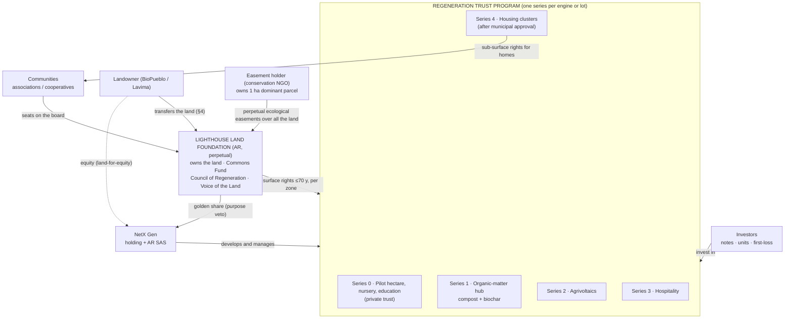
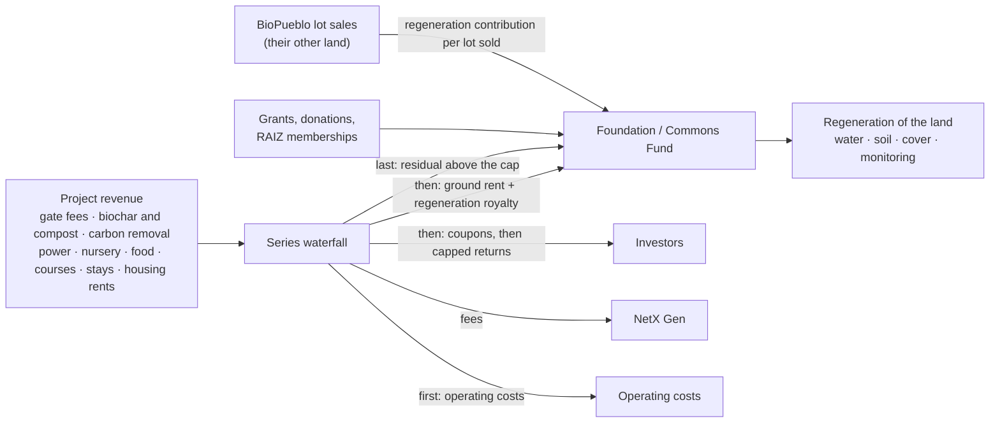

# 25 · Proposed design v0.1: Commons Foundation + Regeneration Trust Program

Back to [[00 - README]] · Why this option: [[24 - Legal structure options compared]] · Engines: [[23 - Yield engines (where the money comes from)]] · Token impact: [[26 - Impact on tokenomics (tasks)]]

## 🌱 In one breath

**The land belongs to a foundation, forever. The money builds projects on top of it.**

- **The Foundation** (Argentine, perpetual) owns lot 7A, and later any other lot. Its statute forbids selling or mortgaging the land. It never sells land: it grants long **surface rights** over zones of it, for projects and homes, and collects a **ground rent** and a **regeneration royalty** on everything produced. That money, plus grants and memberships, pays for regeneration. That is the commons.
- **Investors** put money into a **program of trusts**, one **series** per engine or lot: the organic-matter hub, solar, hospitality, housing. Each series holds a surface right and its project, and pays investors from the project's cash flows. Debt investors get a fixed coupon. Equity investors get a variable return, **capped**; above the cap, the money goes to the commons.
- **An independent conservation entity** holds perpetual ecological easements over all the land, so the protection survives even if the Foundation fails.
- **NetX Gen** designs, manages and runs the platform, earning fees and licences. The Foundation holds a golden share in it.
- **Residents** hold their homes on surface rights through community associations or cooperatives, and decide their own matters one person, one vote.

Foreign capital can finance every series and the holding without owning or possessing land [verify].

## 1. The pieces, each with one job

| # | Entity | Legal form | Its one job | Owns | Earns / receives | Pays |
|---|---|---|---|---|---|---|
| 1 | **Lighthouse Land Foundation** ("the Foundation") | *Fundación*, CCyC arts. 193–224, authorised by Río Negro's IGPJ; Argentine-controlled board [verify] | **Keep the land forever and fund its regeneration** | The land (7A, later lots 2–5); the Commons Fund | Ground rents; regeneration royalty; residual above the investors' cap; grants and donations; RAIZ memberships | Regeneration works, monitoring, nursery and community grants; the Council of Regeneration |
| 2 | **Easement holder** | An established conservation NGO, or a residents' association, owning a small dominant parcel [verify] | **Guard the guardian**: hold perpetual ecological easements over all the land | A ~1 ha dominant parcel | Nothing (maybe a monitoring fee) | — |
| 3 | **Regeneration Trust Program** ("the Program"), one **series** per engine or lot | Private ordinary trusts first (CCyC 1666+); later a **financial trust program** with public offering, CNV (CCyC 1690–1692), tokenisable | **Turn investment into regenerating, productive projects and pay investors** | Each series: a surface right over its zone (≤70 y) and its project assets | Project revenue (23: E1–E8) | Ground rent + royalty to the Foundation; coupons and distributions to investors; fees to NetX |
| 4 | **NetX Gen** (holding abroad + Argentine SAS) | Holding (jurisdiction open) owning an AR SAS | **Design, develop, manage and replicate** | The platform, brand and kit | Development and management fees; a performance fee below the cap; platform fees; kit licences to other nodes | — |
| 5 | **Communities** (clusters of ~16 families, producers) | Associations, housing or agricultural cooperatives, or steward-owned SAS | **Live and work on the land** | Sub-surface rights for homes or projects | Their own activities | Ground rent and royalty (through their series or directly) |
| 6 | **Feeder for foreign investors** (optional, phase 2) | Offshore fund or SPV that buys notes and units of the series | **Let foreign capital in under its own securities law** | Program notes and units | Their coupons | — |

**Why a foundation and not the trust as the land owner:** see [[22 - Legal redesign - brief, hard law and first principles]] §3. The trust ends at 30 years and has no voice; the foundation is perpetual, purpose-bound and supervised by the State. **Why a separate easement holder:** if the Foundation is ever captured or fails, a second, independent entity can still enforce the ecological rules in court.

## 2. The scheme

### 2.1 Ownership, rights and control



### 2.2 Money



### 2.3 Plain-text version

```
                    Easement holder (NGO) ── perpetual easements ──┐
                                                                   ▼
Landowner ── land ──► LIGHTHOUSE LAND FOUNDATION (perpetual, can't sell or mortgage land)
   │                    │   ▲            ▲                │
   │ equity             │   │ rent +     │ grants,        │ golden share
   ▼                    │   │ royalty +  │ memberships    ▼
NetX Gen ◄── fees ──┐   │   │ residual   │             NetX Gen
                    │   ▼   │
               REGENERATION TRUST PROGRAM: series 0, 1, 2, 3, 4…  ◄── investors (notes, units)
               (each holds a surface right and a project)          ──► coupons, capped returns
                    │
                    └── sub-surface rights ──► Communities (homes, 1 person 1 vote)
```

## 3. The waterfall of each series

The same order in every series [criterio; percentages are model parameters for Vagner, not proposals yet]:

1. **Operating costs** of the project.
2. **Ground rent** to the Foundation: fixed, per hectare of the surface right.
3. **Regeneration royalty** to the Foundation: *r*% of gross revenue (model parameter), paid before investors, so the commons gets paid even when the project is weak.
4. **Senior green notes** (debt): coupon and principal. Secured by the series' surface right, its plant and its contracts, **never by the land** (CCyC 2120 lets the surface holder mortgage the surface right [C]).
5. **First-loss units** (catalytic investors): absorb losses first, receive returns after the notes.
6. **Participation units**: return up to a **cap** (e.g., a target IRR, a parameter).
7. **Residual above the cap**: to the Foundation, and partly to the units as an incentive if needed (parameter).

At the end of each surface right, the improvements revert to the Foundation. The law provides compensation for the surface holder unless agreed otherwise [verify, CCyC 2126]: the series' model must price this in.

## 4. The landowner's deal: four ways to pay for the land

The landowner's main question will be "what do I get?". Options to combine:

| | Deal | What the landowner gets | Pros | Cons |
|---|---|---|---|---|
| **L1** | **Land-for-equity** (today's direction) | Equity in the NetX holding, released by milestones (deed, easements registered, permits) | Already negotiated in principle; aligns with the platform's upside | The holding doesn't own the land, so the equity's value rests on NetX's business; legal form of "land to the Foundation, shares from NetX" (a donation with a charge, CCyC 1562?) [verify] |
| **L2** | **Land-for-income** | A share of the Foundation's ground rents for N years, as a deferred price | Simple cash logic; tied to the land's real use | Reduces commons income during those years; it must be unsecured on the land |
| **L3** | **Staged transfer** | Keeps the title at first, grants surface rights to the series for units plus rent, and transfers to the Foundation later at a pre-agreed formula | Lowest trust required on day 1 (option C first, B later) | "Forever" only arrives at transfer; a pre-emption right is capped at 5 years by law [S] |
| **L4** | **Value capture** | The lift on its other ~9,000 ha; it pays a regeneration contribution on each of its own lot sales to the Foundation | Turns the "300 reasons" thesis into a contract 🧪 | Not a payment for the land by itself |

Proposed starting offer [criterio]: **L1 + L4**, with **L2 as a sweetener** if equity alone doesn't close; **L3** if the owner won't transfer the title yet.

## 5. Foreign capital and the rural land law

| Where foreign money sits | Owns or possesses rural land? | Status |
|---|---|---|
| NetX holding equity | No | ✅ |
| Senior notes of any series (debt) | No; a lender is not an owner | ✅ [verify] |
| Participation units of a series | No land; the series holds a surface right | ⚠️ Could a surface right held by a series with foreign beneficiaries count as foreign "possession"? Main question for counsel |
| Grants and donations to the Foundation | No | ✅ (exchange-control and anti-money-laundering rules apply) |
| RAIZ memberships | No | ✅ |
| Residents' surface rights for homes | Possibly "possession" | ⚠️ Quotas apply; never on the riverbank |

If the answer to the ⚠️ rows is "yes, it counts", the fallback is clean: foreign capital enters only as **notes** and **holding equity**, and units are reserved for Argentines, or the foreign share is capped within the quota [verify]. **First of all: is 7A rural land at all?** If it is urban, none of this binds.

## 6. Governance

| Body | Who | Decides | Can't |
|---|---|---|---|
| **Foundation board** | Seats for: the Council of Regeneration (ecology, water), residents (elected one person one vote), the landowner (founder seat), independents, NetX (minority). Argentine majority [verify] | Surface rights, the Commons Fund budget, royalty rates for new series | Sell or mortgage the land; amend the purpose clause (entrenched in the statute; IGPJ oversight) |
| **Voice of the Land** | A seat with a suspensive veto, backed by monitoring data | Pauses any decision that harms water, soil or native life until reviewed | Decide alone; it pauses, people decide |
| **Series holders' assemblies** | Investors of each series, by capital | Their series: budgets, refinancing, replacing the manager for cause | Touch the land or other series |
| **Residents' assemblies** (per cluster and general) | Residents, one person one vote | Daily life, shared spaces, cluster rules (stricter, never laxer, than the easements) | Override the easements |
| **Easement holder** | Independent NGO | Enforces the easements in court | Manage the land |

## 7. Phasing

| Phase | When | What happens | Money |
|---|---|---|---|
| **0 · Foundations** | Q4 2026 – Q2 2027 | Framework agreement with the landowner (L1 + L4); Foundation incorporated (IGPJ can take months: meanwhile an existing foundation can act as fiscal host [verify]); easement holder chosen; **Series 0** as a private trust: pilot hectare, nursery, education; feedstock survey for the hub; grid enquiry for solar | NetX SAFE; Series 0 private placement (≤35 per issue); first grants; RAIZ memberships at the Feb 2027 Gathering |
| **1 · Engines** | 2027 – 2028 | Land transferred to the Foundation; easements registered after the survey; **Series 1** (organic hub) and **Series 2** (agrivoltaics) with offtake contracts and PPAs; first-loss from catalytic investors | Private series → first **CNV financial trust** with public offering, green-labelled; carbon-removal pre-purchases |
| **2 · Scale** | 2028+ | **Series 3–4** (hospitality, housing after approval); lots 2–5 join as new series; tokenised units on CNV-regulated rails; foreign feeder; replication to other nodes | Public program; tokenisation; foreign funds; development-bank lines |

## 8. What could go wrong, and the prepared answer

| Risk | Prepared answer |
|---|---|
| The landowner won't transfer the title | Start with **L3** (option C): surface rights from the owner, easements now, transfer later |
| Foundation authorisation is slow | Fiscal host or an existing foundation for phase 0; the land waits in the owner's hands under easements |
| Units held by foreigners count as land possession | Foreign capital through notes and the holding only; units for Argentines or within quota |
| The engines produce less cash than modelled | The series stay small and private; the regeneration royalty is paid before investors, so the commons still gets its share; growth follows Fibonacci pacing |
| Municipal approval for housing is slow | Engines E1–E7 don't need subdivision |
| A lender forecloses on a series | The lender takes the surface right and the plant for the rest of its term, **never the land**; the easements still bind |
| The Foundation is captured | Independent easement holder; entrenched statute; IGPJ oversight; the residents' seats |
| Public-offering costs are too high early | Stay with private series until the cash flows justify a CNV program |
| Our numbers are wrong | Every figure is a "what must be true" parameter until Vagner models it |

---

## Sources & logic used

- Law: CCyC arts. 193–224 (foundations), 1562 (donation with a charge), 1666–1707 (trusts; 1668 the 30-year limit; 1690–1692 financial trusts), 2114–2128 (surface right; 2117 terms, 2120 guarantees, 2126 compensation), 2162–2165 (perpetual real easements); Ley 26.737; Ley 26.831; Ley 27.739. [C] where read in the 2026-09-29 research (`NS_platform/…/Investigacion — DRS, fideicomisos y tokenizacion… 2026-09-29.md`), [S] otherwise; all [verify] by counsel.
- Precedents behind the shape [S]: community land trusts (land held forever, homes on long leases); the Edith Maryon Foundation (Switzerland: takes land off the market forever and grants surface rights); Terre de Liens (citizen capital buying farmland, low capped returns); steward-ownership (golden share, capped returns, residual to purpose); blended finance (first-loss capital crowding in commercial investors).
- Design choices, waterfall, deal options and phasing: our judgement [criterio], built on [[22 - Legal redesign - brief, hard law and first principles]], [[23 - Yield engines (where the money comes from)]] and [[24 - Legal structure options compared]].
