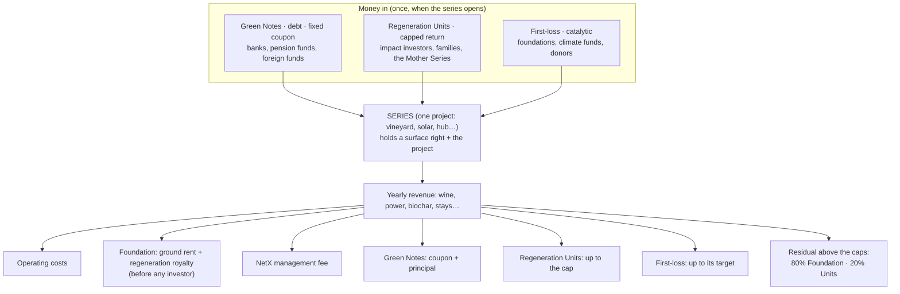
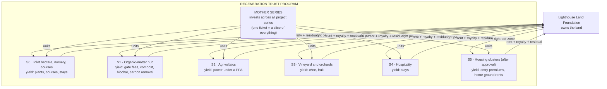
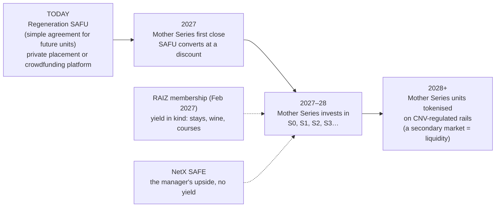
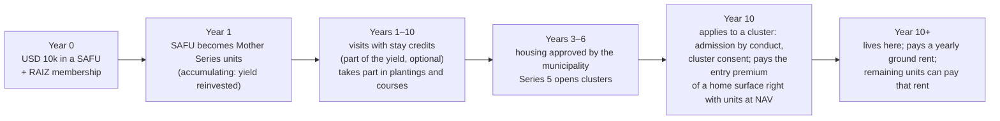

# 28 · Tokenomics for design B: series, early money and investor journeys

Back to [[00 - README]] · Legal design: [[25 - Legal design v0.1 (Land Foundation + Regeneration Trust Program)]] · Engines: [[23 - Yield engines (where the money comes from)]] · Model: `sim/series_waterfall_sim.py` → `sim/RESULTS_series_waterfall.md`

## 🌱 In one breath

**Legal by design** means each legal structure gets its own tokenomics. This is the one for design B (land in a foundation, investors in a trust program).

- **A series is a project with its own pot, not a time window.** The vineyard, the solar park and the biochar hub are each a separate compartment with their own assets, revenue and investors. A series opens when its project is ready.
- **In each series, three kinds of investors share the money in a fixed order:**
  1. **Green Notes** (debt) are paid first, at a fixed coupon.
  2. **Regeneration Units** come next, up to a **cap**.
  3. **First-loss** (catalytic money) comes after the Units.
  4. Whatever is left above the caps goes mostly to the **commons**.
- **Money can come in today, before the series exist**, through a **Regeneration SAFU** (a simple agreement for future units). It turns into Units of a **Mother Series**, which invests across all the projects, and later into tokens on regulated rails.
- **USD 1,000 in the vineyard today** returns about USD 2,660 over 15 years in the illustrative model (~9% a year). Or ~300 bottles plus USD 850 if you take the yield as wine.
- **USD 10,000 invested today** can pay for the entry to a home here in 10 years, once housing is approved, without any priority before approval.

## 1. Three investor types in one series: yes, they work together

Every series has a **capital stack** (who puts money in) and a **waterfall** (who gets paid, in what order):

Why this order [criterio]:
- **The commons is paid before any investor**: the land always gets its share, even in bad years.
- **Notes are safest**, so they get the lowest return. They are secured by the series' surface right and plant, **never by the land**.
- **First-loss sits below the Units**: if the project disappoints, the catalytic money loses first. That protection is what lets a family or a pension fund come in.
- **Units are capped**: above the cap, the upside belongs to the land.

Not every series needs all three. A young vineyard can't carry debt, so it has Units and First-loss only. A solar park with a power contract can be 60% debt.

## 2. What a "series" is, and where its yield comes from

A series is **a separate pot inside the Program**, like a bed in a garden: its own water, its own harvest, its own gardeners. By law, each trust is a separate patrimony, so a problem in the solar series can't reach the vineyard series (CCyC 1685–1687 [C]). Series open **when a project is ready**, not on a calendar, and each can take money in more than one close.

- **Project series**: for investors who want one specific project (the wine lover, the solar fund).
- **Mother Series**: for investors who want a slice of everything (less risk, simpler). It is also where small tickets and, later, tokens live.

## 3. Early money: how to invest now and receive yield later

**What the law lets us sell today:**
- **"Token sale" is just a wrapper.** What the law looks at is what the token promises. A token that promises yield is a security, whatever its technology (Ley 26.831 art. 2 [C]).
- **Selling it today**, before a regulated rail exists, is legal only as a private placement (few buyers) or through a CNV-registered crowdfunding platform [verify].
- **RAIZ membership** can be sold to anyone, because it promises use, not profit.

The ladder:

| Instrument | Who issues it | For whom | What you get | Legal wrapper [verify] |
|---|---|---|---|---|
| **Regeneration SAFU** | Series 0 (a private trust can be set up by contract quickly) | Early believers, USD 1k–50k | Converts into Mother Series units at the first close, at a **discount** (parameter: 20%). If the Mother Series doesn't open by a set date, it converts into Series 0 units | Private placement (~35 per issue, ≤15 non-qualified) or a CNV-registered crowdfunding platform (Ley 27.349 allows trust participations); abroad, the investor's own exemptions |
| **NetX SAFE** | NetX holding | Venture investors | Equity in the manager (fees, kit licences) | Private placement |
| **RAIZ membership** | Foundation | Anyone | Stays, community products, voice; **in-kind yield** | Membership + service contract |
| **Project series units** | Each series | Impact investors | A capped return from one project | Private, then CNV public offering |
| **Mother Series units → tokens** | Mother Series | Everyone, KYC | A slice of all projects; later tradable | CNV public offering + tokenisation; PSAV rails (Ley 27.739) |

## 4. Journey A: "I invest today and in 10 years I want to live here"

What the numbers look like (`sim/RESULTS_series_waterfall.md`; the Mother Series' net return is a **parameter**, the blend of all series):

| Invested today | Net return (parameter) | Value in year 10 |
|---:|---:|---:|
| USD 10,000 | 3% | ~USD 13,400 |
| USD 10,000 | 6% | ~USD 17,900 |
| USD 10,000 | 9% | ~USD 23,700 |

Whether that covers a home depends on the **entry premium** of a home surface right, which is a parameter we don't have yet (§7).

Two legal guard-rails built into the journey [verify]:
- **No priority and no reservation before municipal approval** (Ord. 173). Units are only a **means of payment**, accepted at NAV on the same terms as anyone else, once housing is approved.
- **Admission by conduct**, never by beliefs (Ley 23.592), with the cluster's consent.

## 5. Journey B: "USD 1,000 today in the wine we will sell in 15 years"

From the model (vineyard series, 10 ha; all inputs in §7):

| Year | What happens | Cash to the USD 1,000 |
|---:|---|---:|
| 0 | You invest (SAFU → vineyard units, or directly) | −1,000 |
| 1–3 | Planting, irrigation, first growth; costs paid from the reserve | 0 |
| 4 | First vintage sold | 0 (sales still below costs; the reserve covers the gap) |
| 5–6 | Production ramps up | 34, then 154 |
| 7–14 | Full production | ~203 a year |
| 15 | Last year + **exit** (the remaining years of the vineyard are sold to new investors or to the Mother Series) | ~850 |
| **Total** | | **~USD 2,660 (2.7x), ~9.2% a year** |

- **Wine path:** take years 1–14 as bottles at the series' price instead of cash: **~300 bottles** (worth ~USD 4,200 at retail), plus ~USD 850 in year 15.
- **Mother path:** less exposure to one vineyard, a blended return.
- **RAIZ path:** no cash; member prices on wine and stays.

In the same model, the vineyard series pays the **Foundation ~USD 307k** over 15 years (rent, royalty and the residual above the cap). The solar series pays it ~USD 1.36M over 20 years. **That is the "money into the commons".**

Agrivoltaic series, for comparison: USD 1,000 in Units returns ~USD 2,800 over 20 years (~10% a year), with Notes ahead of it at 7%.

## 6. What changes from the previous tokenomics

| Before (main) | Design B |
|---|---|
| RAIZ: utility, no yield | RAIZ: membership with **in-kind yield** (unchanged in law, now explicit) |
| Fideicomiso units over the land | **Units over projects**; the land is never in an investor's pot |
| One "land pot" | **Many series + a Mother Series** |
| SAFE only for early money | **SAFE (manager) + SAFU (projects)** |
| No cap on returns | **Capped returns, residual to the commons** |

## 7. Parameters to re-tune (all in `sim/series_waterfall_sim.py`)

| Parameter | Value used | Who tunes it |
|---|---|---|
| Regeneration royalty | 5% of gross revenue | Gus + Vagner |
| Ground rent | USD 100 per ha per year | Gus + Vagner |
| NetX management fee | 1.5% (vineyard), 1% (solar) of capital per year | Vagner |
| Units cap | 9% (vineyard), 10% (solar) a year | Gus + Vagner |
| First-loss target | 4–5% a year | Vagner + catalytic investors |
| Upside share to Units above the cap | 20% | Gus |
| Exit multiple at the horizon | 6× (vineyard), 3× (solar) of the last year's operating cash | Vagner |
| Vineyard: planting and irrigation | USD 30k/ha; working capital USD 220k | Agronomist quote |
| Vineyard: yield, bottles, prices | 7 t/ha at maturity; 750 bottles/t; USD 6 net, USD 2.5 variable cost, USD 14 retail | Local winemaker |
| Solar: capex, output, price | USD 0.8M/MW; 1,900 MWh/MW/yr; USD 60/MWh PPA | Developer quote, grid enquiry |
| Solar stack | 60% Notes at 7%, 12 y; 10% First-loss; 30% Units | Banks |
| SAFU discount | 20% | Gus + Vagner |
| Mother Series net return | 3 / 6 / 9% (scenarios) | Vagner |
| Home entry premium and yearly rent | **missing** | Martín + Franz (after approval) |

## 8. Legal questions this adds (for [[27 - Brief para el abogado (preguntas)]])

1. Can a private trust (Series 0) issue a **SAFU** convertible into units of a later financial-trust series? Through a crowdfunding platform (Ley 27.349)?
2. Can a trust pay distributions **in kind** (wine, stays), and how is that taxed?
3. Can units be accepted **as payment** for a home surface right after approval without becoming a forbidden reservation before it?
4. Can a Mother Series hold units of other series in the same program?

---

## Sources & logic used

- Model: `sim/series_waterfall_sim.py` (stdlib), results in `sim/RESULTS_series_waterfall.md`. All inputs are assumptions [criterio], marked for re-tuning in §7; no market data was used for prices or costs [verify each with quotes].
- Law: Ley 26.831 art. 2 (security) [C]; Ley 27.349 (crowdfunding platforms; instruments include trust participations) [S] [verify]; Ley 27.739 (PSAV) [C]; CCyC 1685–1687 (separate patrimony) [C], 2117 (surface right: ≤70 y for buildings, ≤50 y for plantations) [C]; Ord. 173/2026 (no reservations before approval) [C]; Ley 23.592 [C].
- Instrument shapes [S]: SAFE (Y Combinator) and SAFT (simple agreement for future tokens) as templates for the SAFU; blended-finance first-loss structures; sustainability-linked instruments.
- Design: [[25 - Legal design v0.1 (Land Foundation + Regeneration Trust Program)]] and [[26 - Impact on tokenomics (tasks)]].
