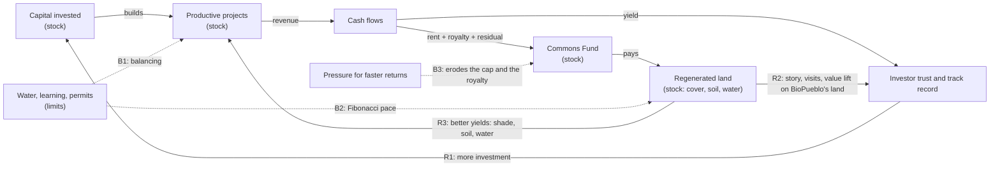

# 29 · Systems design pass for B

Back to [[00 - README]] · Design: [[25 - Legal design v0.1 (Land Foundation + Regeneration Trust Program)]] · Tokenomics: [[28 - Tokenomics for design B (series, early money, investor journeys)]] · Method: [[02 - Design Lens (the council)]]

## 🌱 In one breath

Docs 25 and 28 built the **skeleton**: the legal pieces, the instruments, who gets paid and in what order. This page adds the **nervous system**, following the method in doc 02 (Zargham, McConaghy, Meadows, Leveson, Ostrom): what the system must achieve, what must never break, which loops make it grow or stall, what can go wrong, and who adjusts what, how fast.

A first Monte Carlo run over 2,000 possible futures per series already changes the design:
1. **First-loss money placed behind capped Units is not fully repaid in ~60% of futures.** It needs a different position in the waterfall (§5).
2. **The cap makes the commons the big winner in good futures.** That is the goal, but the investors' upside share has to stay attractive.
3. **Delays and frost dominate the risk.** Diversification across series (the Mother Series), reserves, insurance and slow, Fibonacci-paced growth are the answers.

## 1. Requirements (what the system must achieve) [criterio; targets to set with the team]

| # | Requirement | Measured by | Target |
|---|---|---|---|
| R1 | Hectares regenerating, directly and through the valley | Ledger C: cover, soil organic matter, infiltration; tonnes of organic matter delivered to valley farms | ❓ set per year (Fibonacci on site; tonnes off site) |
| R2 | The commons is funded every year, good or bad | Foundation income ≥ commons operating budget | ≥ 1× from year 3 ❓ |
| R3 | Investors get a fair, capped yield with a known risk | Units IRR distribution (P10/P50/P90) | P50 near the cap; P(loss) below a threshold ❓ |
| R4 | The land never leaves the commons | Title, easements, statute | Always (invariant J1) |
| R5 | People without capital can belong and live here | Share of residents on work-based or affordable rents | ❓ |
| R6 | No single actor captures decisions or money | Voice and holdings concentration | J6 limits |
| R7 | Replicable to lots 2–5 and other nodes without redesign | Time and cost to open a new series or node | ❓ |
| R8 | Legal at every step | Counsel sign-off per instrument | Always |

## 2. Invariants for design B (must hold in every state)

They replace I1–I8 of doc 03 for this design.

| # | Invariant | Enforced by |
|---|---|---|
| J1 | **The land is never sold, mortgaged or pledged**; only surface rights and project assets may be | Foundation statute; easements; trust deeds |
| J2 | **The commons is paid before investors**: ground rent + royalty come out of revenue before any coupon or distribution | Waterfall in every series' trust deed |
| J3 | **Units are capped**; the residual above the cap goes mostly to the commons | Trust deed |
| J4 | **Separate pots**: a series' problems can't reach another series, the Foundation or the land | Separate patrimony per trust (CCyC 1685–1687) |
| J5 | **Reserve per series** ≥ the costs until first revenue, plus a buffer ❓ | Trust deed; quarterly check |
| J6 | **Anti-capture**: no investor > X% of the Mother Series ❓; residents' matters one person, one vote; NetX a minority on the Foundation board | Program rules; statute |
| J7 | **Mother Series concentration**: ≤ Y% ❓ in any single series | Investment policy |
| J8 | **Arm's length**: transfers between series, NetX and related parties at audited market prices; NAV and exit values set by an independent valuer | Trust deeds; audit |
| J9 | **Ecological floor**: if a zone's Ledger C indicators degrade for 2 periods, new capital for that zone pauses | Voice of the Land flag + Council |
| J10 | **Legal mirror**: if the ledger and the legal record differ, the legal record wins | Reconciliation |

## 3. Stocks, flows and feedback loops (Meadows)

- **R1, money loop** (reinforcing): investment → projects → yield → trust → more investment. Fast, and dangerous if it runs ahead of the land.
- **R2, story loop** (reinforcing): visible regeneration → visits and story → investors and buyers. It only starts once the pilot hectare is visible (doc 23).
- **R3, land loop** (reinforcing, slow): regenerated land improves the projects' own yields (shade, soil, water).
- **B1/B2, limits** (balancing): water, learning and permits cap the pace. Fibonacci pacing respects them instead of fighting them.
- **B3, extraction pressure** (balancing, harmful): investors push to raise the cap or cut the royalty. J2 and J3 sit in the trust deeds and need the Foundation's consent to change.
- **Leverage point** (Meadows): the strongest lever is the **goal** written in the statute and the trust deeds (regeneration first), not any single parameter.

## 4. Hazards (STPA-lite, Leveson) for design B

| # | Hazard | Unsafe control action | Mitigation |
|---|---|---|---|
| K1 | Lender forecloses on a series | Over-leveraged series misses debt service | Leverage limits per engine; reserve (J5); the lender takes only the surface right, never the land (J1) |
| K2 | Run on the Mother Series | Tokenised, tradable units fund 15-year assets; many holders sell at once | No redemption on demand; secondary market only (sellers find buyers); gates and notice periods; liquidity reserve |
| K3 | Royalty avoidance | Costs or revenue moved between series and NetX to shrink "gross revenue" | J8 arm's length; royalty on gross, not profit; audit |
| K4 | Inflated exit values | Manager sets a high NAV to earn performance fees or to look good | Independent valuer; fees not tied to NAV marks |
| K5 | Capture of the Foundation | A bloc takes the board and changes direction | Entrenched purpose; independent easement holder; IGPJ oversight; residents' seats; Voice of the Land |
| K6 | Speculation on tokenised units | Price swings detach from the projects | Regulated rails, KYC; disclosures; slow layers can't be changed by token holders |
| K7 | Goodhart on ecological KPIs | Linked yield rewards gaming the metric | Few KPIs, external verifier, communities choose their own metrics (Scott) |
| K8 | Growth faster than water | R1 outruns B1 | Capital released by Ledger C gates (J9); Fibonacci pacing |
| K9 | Conflicts of interest | NetX or BioPueblo on both sides of a deal | Disclosure, recusal, independent members |
| K10 | Concentration in one engine | A single series fails and drags the Mother Series | J7 limit; diversify across engines with uncorrelated risks (wine vs power vs biochar) |

## 5. Simulation: first Monte Carlo pass

`sim/series_montecarlo_sim.py`, 2,000 futures per series, seed 7. Results in `sim/RESULTS_series_montecarlo.md`.

**Uncertainty assumed** [criterio, to re-tune]:

| Series | Uncertainty |
|---|---|
| Vineyard | Frost in 15% of years (60% of the crop lost); wine price ±20%; costs ±15%; yield at maturity ±15%; permit delay of 0–2 years |
| Agrivoltaics | Power price ±25%; output ±5%; capex overrun of 5% ± 10%; grid-connection delay of 0–2 years |

**What came out:**

| | Vineyard | Agrivoltaics |
|---|---|---|
| Units IRR P10 / P50 / P90 | −2.6% / 8.4% / 10.8% | 1.2% / 8.5% / 14.0% |
| Probability Units lose money | 22% | 10% |
| Probability Units reach their cap | 44% | 42% |
| First-loss not fully repaid | 60% | 61% |
| Foundation receives P10 / P50 / P90 | USD 116k / 160k / 1.33M | USD 401k / 540k / 5.95M |

**Three findings that change the design:**

1. **The First-loss position is wrong.** Placed behind capped Units, catalytic money is repaid only in good futures. Fix to model next: pay Units a **preferred return** (e.g., 5–6%), then First-loss up to its target, then Units up to the cap, then the residual. Catalytic investors still protect the others, but they are no longer a near-certain donation.
2. **The commons is the big winner in good futures** (its P90 is 8–11× its P50). That is the purpose, but investors give up most of the upside. Tune the upside share (20% now) and the cap together, and test them with real investors.
3. **Delays and frost drive the losses.** Answers to model next:
   - the Mother Series spread across engines whose risks don't move together;
   - a frost insurance or a reserve;
   - opening series only once the permits are granted (the delay then falls on the SAFU stage, not on Units).

**Next simulations:**
- (a) the waterfall with a preferred return;
- (b) a **Mother Series portfolio** across series, with correlations;
- (c) a **liquidity run** (K2);
- (d) later, governance agents: who votes for which parameter, in the cadCAD style.

## 6. The control layer: who adjusts what, and how fast (pace layering)

| Pace | Parameters / rules | Who decides | Mechanism (to design in the Fogón, [lighthouse-platform #94](https://github.com/netxgen-2050/lighthouse-platform/issues/94)) |
|---|---|---|---|
| **Never** | J1 (land), the Foundation's purpose, the easements | Nobody | Entrenched in the statute and the registry |
| **Slow** (years) | Royalty formula, residual split, cap policy, J5–J9 thresholds | Foundation board + Voice of the Land + resident and RAIZ consultation | Long deliberation; **conviction voting** as a signal (preference accumulates over time, which resists flash capture) |
| **Medium** (per series) | Each series' cap, stack, fees, reserve, at opening | Foundation (as land owner) + series investors | Term sheet negotiation; investors accept or don't enter |
| **Fast** (yearly) | Commons Fund budget, community grants, Mother Series allocation within J7 | Council of Regeneration gate, then members and holders | Quadratic or conviction voting over Council-approved proposals |
| **Daily** | Community vouchers, stays, markets | Communities | Their own rules (Ostrom) |

**How the Mother Series decides where to invest** is still open [criterio]: a Council of Regeneration gate (principles, permits, water), then the unit holders signal by conviction voting within the J7 limits, then an independent investment committee executes. To decide with the team.

## 7. Still open

- Validate with people (Paruch): test the SAFU and the membership with real participants at the Feb 2027 Gathering, as a measured experiment.
- Federation (Ostrom, Beer): one Mother Series per node or one for all? How does a program with several foundations govern itself?
- RAIZ internals under B: credit backing (I2 of doc 03), community commitment pooling, and whether an augmented bonding curve still has a role now that cash yield lives in the Units.

---

## Sources & logic used

- Method: [[02 - Design Lens (the council)]]: Zargham (requirements → invariants → simulation → monitoring; conviction voting), McConaghy (simulation-led token engineering), Meadows (stocks, flows, leverage points), Leveson (STPA), Ostrom (polycentric commons), Brand (pace layering), Scott (over-legibility), Goodhart's law [S].
- Models: `sim/series_waterfall_sim.py` and `sim/series_montecarlo_sim.py` (stdlib); results in `sim/RESULTS_series_waterfall.md` and `sim/RESULTS_series_montecarlo.md`. All inputs are illustrative assumptions [criterio].
- Earlier invariants and hazards: [[03 - Long-Term Vision]] §7 (I1–I8, H1–H9), adapted here for design B.
