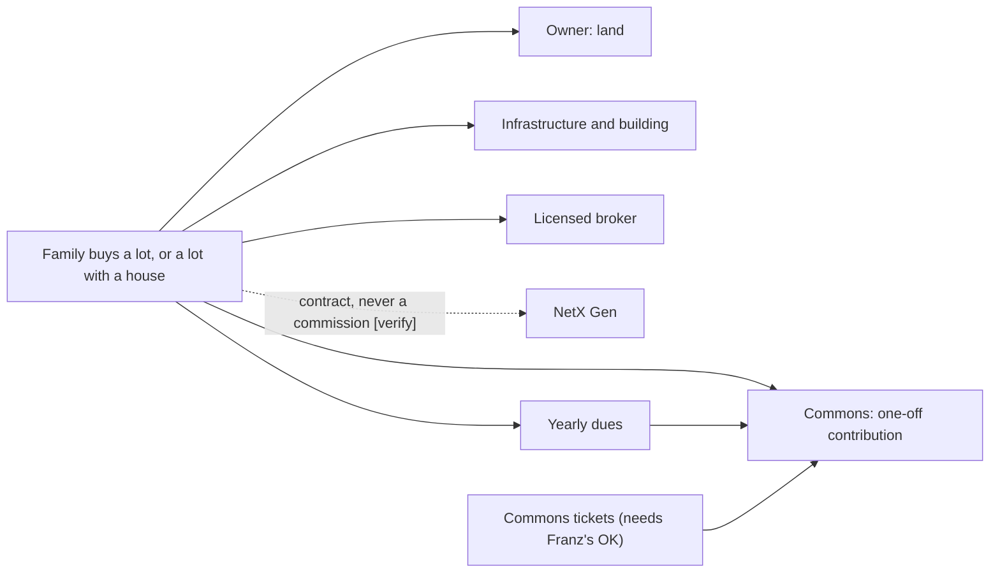

# 31 · Lot sales for phase 1 (CEO decision 2026-11-02)

Back to [[00 - README]] · Options: [[18 - Hybrid model (selling some lots) - options and trade-offs]] · Earlier position: [[30 - How NetX Gen gets capitalised (money in, by stage)]] · Design: [[25 - Legal design v0.1 (Land Foundation + Regeneration Trust Program)]] · Model: `sim/lot_sale_sim.py`, `sim/RESULTS_lot_sale.md`

## 🌱 In one breath

Franz (CEO) decided that **phase 1 of Lighthouse VRN sells private lots**, alone or with a house, in a northern sector of the 7A, assuming the municipality will approve them [^call]. The commons, its governance and its tickets come as the second step, and Franz agrees that private sale alone isn't enough: the model has to be a **hybrid** [^gus]. This breaks written rules of this repo, listed below, and nobody with a licence has reviewed it. This doc records the decision, keeps the money flows apart and gives the platform a versioned model to read. **Every number is a placeholder:** lots of about USD 15–40k come from a call nobody recorded [^gus], and the rest is an estimate waiting for quotes.

## 1. The rules this breaks

`AGENTS.md` asks for this to be said out loud:

| Rule | What it says | What the decision does |
|---|---|---|
| Rule 1, the diode | No instrument may sell the land | 🧨 Sells land inside 7A: this is option **H2** of doc 18, the only irreversible one. Doc 18 asks for the team to amend the rule in writing |
| Rule 4 (law) | No lots, priority or reservations before municipal approval (Ord. 173/2026) | 🧨 The platform prototype simulates them, assuming approval. Rule 4 is law, not a choice of ours: going outside the team is a separate step |
| Doc 25, design B | The Foundation owns the land forever and never sells | ❓ Doesn't fit the sold sector. The rest of the 7A can stay under design B: to be reconciled |
| Doc 30 §3 and §4 | "No lot sales in any channel until approval" | Superseded by this decision as a direction; the legal facts it cites stand |

Also open [verify]: Ley 26.737 for foreign buyers (and whether 7A is rural), Ley 20.266 art. 33 (NetX can't collect a commission without a broker licence, 06 L32), CCyC 2118/2120 (the trust can't sell land: only the owner can, doc 18 §2).

## 2. Who decides and what stays true

- **The decision and its risk are Franz's** [^gus]. Written confirmation requested on 2026-11-02; not received when this was written ❓.
- **The land isn't NetX's.** The registered owner is Lavima S.A. / BioPueblo. Who appears as seller, and on what deal, is open ❓ Franz.
- **The prototype stays a prototype:** simulated payments and the "internal prototype, sample data" notice. Going outside the team or taking real money needs Franz's written instruction, saying whether a lawyer reviewed it.
- **Three pots, never mixed** (rule 2) still holds. A lot sale adds a fourth flow, and it isn't NetX revenue:

In plain text: the family pays for the owner's land, infrastructure and building, a one-off contribution and a licensed broker. NetX is paid only through a design and development contract. After the sale, yearly dues keep feeding the commons, and so would commons tickets if Franz approves them.

## 3. What the model says (placeholders)

From `sim/RESULTS_lot_sale.md` v0.2:

| Package | Price (USD) |
|---|---:|
| Lot only, middle of the range | 27,500 |
| Lot + modular house, 90 m² | 117,500 |
| Lot + family house, 170 m² | 265,500 |
| Lot + large house, 250 m² | 527,500 |

- **Two numbers don't match yet:** at USD 15–40k a lot, only the largest package reaches Franz's USD 500k per family. 50 families are USD 1.4M in lots, USD 7.6M with the placeholder buyer mix, or USD 25M at USD 500k each. ❓ Franz.
- **The cheapest lots may not pay for themselves:** after the owner's share, broker, NetX contract, contribution and USD 12k of infrastructure, a lot needs about USD 17.6k to break even. A USD 15k lot falls USD 1.8k short.
- **Private sale alone isn't enough:** 25 families with the buyer mix leave a one-off USD 190k for the commons, spread over three years of sales. It doesn't get through year 1 on a USD 72k yearly budget, and the balance stays negative. The money comes once; the commons costs every year.
- **Dues decide it:** covering USD 72k a year with dues alone takes USD 2,880 per lot with 25 families, or USD 1,440 with 50. On USD 240k it takes USD 9,600 or USD 4,800.
- **Commons tickets help at the start, not forever:** at USD 72k a year and USD 1,200 dues, the Hatch's net USD 161k moves the first shortfall from year 4 to year 8, and the balance still ends negative. At USD 3,000 dues the commons holds for ten years, with or without tickets.

## 4. What was left out, on purpose

- **The "300 reasons" (`NS_permacultura` 17):** its arithmetic assumes a budgeted permaculture plan that isn't being done, so it isn't used [^gus].
- **Real quotes:** house costs per m², infrastructure, the owner's share and the buyer mix are Claude's estimates, with no quote behind them. Replace them in `sim/`, not in the results.
- **Lot size:** the source of USD 15–40k gave no size. The model assumes each lot fits a family house and runs the price linearly over the placeholder plan's 1,344–2,200 m², until Martín's lot plan arrives.
- **Commons tickets:** tiers from doc 04 (USD 300 / 1,500 / 5,000), but selling them needs Franz's approval because they bring governance into scope [^gus].
- **Yield or appreciation language:** rule 3 is unchanged.

## Sources & logic used

- Decision and USD 500k per family: private call Gus–Franz, 2026-11-02 [NC]; written confirmation pending.
- Lot prices: reported by Gus from a call with no record [NC].
- Options, guardrails and legal notes: docs 18, 06 (L27, L31, L32), 25, 30.
- Numbers: `sim/lot_sale_sim.py` v0.2. House costs, infrastructure, owner's share, buyer mix, contribution, dues and fees are [criterio] placeholders; USD 72k a year is the commons opex of `sim/RESULTS.md`; tickets are its net commons capital, which still assumes the cancelled Gathering (I-15). The 170 m² house is Martín's scale reference (`NS_permacultura` 20 §3).
- Logic: separate the money flows, then ask what must be true for the commons to survive after the sales end [criterio].

[^call]: Private call Gus–Franz, 2026-11-02.
[^gus]: Gus, working session of 2026-11-02, reporting Franz's position and an earlier unrecorded call.
