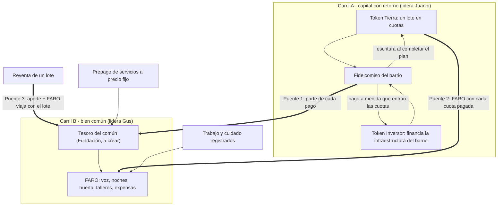

# 34 · Propuesta para Juanpi y Franz: FARO, Token Tierra y Token Inversor

Volver a [[00 - README]] · Notas de la call: [[32 - Call 2026-11-16 (FARO, Token Tierra, Token Inversor - inputs and actions)]] · Bibliografía: [[33 - Bauwens bibliography (P2P and the commons) - reading notes]] · Modelo: `sim/barrio_stack_sim.py`, `sim/RESULTS_barrio_stack.md`

## 🌱 En una frase

Cada trabajo va al instrumento que mejor lo hace. **La plata que espera un retorno** entra por los instrumentos de Juanpi (Token Tierra y Token Inversor), dentro de un fideicomiso por barrio. **El bien común** se organiza con FARO, que no se usa para levantar capital, no cotiza en ningún mercado y por eso no tiene un precio que defender. Los dos carriles se tocan en tres puntos: una parte de cada pago va al común, FARO se acredita con cada cuota pagada, y la reventa de un lote también aporta.

Esto toma la objeción de Juanpi en la call (un token flotante para financiarse obliga a defender el precio) y el pedido de Gus (lo común necesita su propio token, con uso real) [^call]. Cambia dos cosas que Gus presentó: los tramos de precio creciente como forma de levantar capital, y la idea de que la tierra sea la reserva de FARO.

## 1. Dónde ya coincidimos

| Punto | Quién lo dijo |
|---|---|
| Un fideicomiso por barrio, para aislar el riesgo | Acordado por los tres [^call] |
| El token necesita la mayor utilidad real posible | Juanpi y Gus |
| Quemar tokens cuando se usan tiene sentido | Juanpi (su diseño de 2025) y Gus |
| No liberar todo de una vez | Juanpi (el riesgo) y Gus (la respuesta) |
| Los modelos no son excluyentes | Gus, aceptado por Juanpi |
| Nada se firma con Tether sin revisarlo a fondo | Los tres |

## 2. El desacuerdo, y cómo lo resolvemos

Juanpi: si el proyecto se financia vendiendo un token que después circula, hace falta liquidez y reserva desde el primer día, los primeros compradores quieren salir, y el equipo termina dedicado al precio. Gus: FARO vendido por tramos, cada tramo más caro, para premiar a quien llega antes.

Los dos tienen razón en una parte. Juanpi, en que **FARO no debe ser la herramienta de financiamiento**. Gus, en que **lo común necesita un token propio** que no dependa de quién puso más plata. La salida es que FARO no financie el proyecto: el capital entra por instrumentos con plazo, contrato y fideicomiso detrás, que es lo que Juanpi propuso.

## 3. La propuesta: dos carriles y tres puentes

En texto: el fideicomiso del barrio recibe la plata de quien compra un lote en cuotas y de quien financia la infraestructura. Le devuelve al inversor a medida que cobra las cuotas, y le escritura al comprador cuando termina de pagar. De cada pago, una parte va al tesoro del común. El comprador recibe FARO a medida que paga. Fuera del barrio, FARO también se gana aportando trabajo o se obtiene prepagando servicios.

### Carril A: capital con retorno

| Instrumento | Qué es | Qué proponemos ajustar |
|---|---|---|
| **Fideicomiso del barrio** | Un patrimonio separado por barrio (acordado). Equivale a una "serie" del doc 28 | Las parcelas comunes no entran al patrimonio que respalda deuda: si el barrio sale mal, lo común no responde |
| **Token Tierra** | El plan de cuotas de Juanpi: el token representa el derecho contractual sobre un lote determinado; la escritura sigue su vía legal | Token con lista de titulares autorizados (ERC-3643 o equivalente del riel), no un ERC-20 libre. El NFT del lote queda como la ficha del lote: superficie, estado, deberes. Antes de la aprobación municipal no se cobra nada **[verify]** |
| **Token Inversor** | El financiamiento de Juanpi para un proyecto definido: aquí, la infraestructura del barrio | **Cobrar a medida que entran las cuotas**, con una prima objetivo y un plazo máximo, en vez de una recompra a fecha fija. La razón está en la sección 4. Primero entre pocos inversores conocidos; el ticket de USD 100 al público necesita una vía de oferta pública **[verify]** |
| **Token Equity** | Acciones de NetX tokenizadas | Queda fuera de este acuerdo. La inversión en la empresa va por la conversación con Tether y por el SAFE. La tierra no entra a la empresa: con un socio extranjero choca con la Ley 26.737 **[verify]** |

### Carril B: FARO, el token del común

**Qué da:** voz sobre lo común, noches, huerta y cocina, talleres y espacios, y una parte de las expensas. Cada servicio a un precio fijo en FARO.

**Cómo se obtiene** (ninguna puerta es una inversión):

1. **Con el lote.** Se acredita a medida que se pagan las cuotas (hoy, de ejemplo, 10 FARO por m² [^slides]). Quien paga la mitad tiene la mitad.
2. **Aportando.** Trabajo y cuidado registrados y validados por pares (las Semillas, 07 J-2) se convierten en FARO. Es la puerta de quien no tiene capital.
3. **Prepagando servicios.** Se compra al tesoro del común, a precio fijo, en cupos anuales atados a la capacidad real (camas, cubiertos, horas de taller). Quien prepaga antes recibe un descuento, como en cualquier preventa.

**Qué no tiene:** listado en exchanges, pool de liquidez, market maker, recompra por dinero, respaldo en la tierra, ni un premio en FARO por bloquear.

**Política monetaria**, en una tabla para discutir con Juanpi:

| Palanca | Regla propuesta | De dónde viene |
|---|---|---|
| Emisión | Solo por las tres puertas, y la tercera con tope anual según capacidad | Doc 11 (oferta atada a capacidad) |
| Quema | El FARO usado en un servicio se quema | Juanpi 2025 (quema por tarifas) y Gus en la call |
| Bloqueo | Bloquear da más voz, con tope; no da más FARO | Juanpi 2025 (veNETX), suavizado; slides, opción A |
| Transferencia | En la versión 1, solo junto con el lote. Se revisa a los 12 meses con datos de uso | Objeción de Juanpi: sin circulación no hay precio que defender |
| Reserva | Ninguna en tierra. El respaldo es la capacidad de dar el servicio | Slides, lámina 8 |
| Voz | Asuntos de residentes: una persona, un voto. Tesoro y recursos del común: FARO con tope por persona | Regla 6; slides, lámina 6 |

### Los tres puentes

1. **Una parte de cada pago va al común.** Hoy el modelo usa 5 % de cada pago de lote, más expensas [^sim]. Falta decidir si el Token Inversor también aporta al emitirse ❓.
2. **FARO con cada cuota.** El plan de cuotas es también una membresía que crece: la voz acompaña al compromiso. Si alguien abandona el plan, el FARO de las cuotas no pagadas nunca se emite.
3. **La reventa aporta.** El FARO del lote viaja con el lote, quien compra adhiere al reglamento y una parte del precio va al común **[verify]**. Reemplaza la idea de exigir FARO bloqueado al comprador: es más simple y cumple lo mismo.

## 4. Lo que dicen los números

Un barrio de 21 lotes a USD 27.500, con USD 12.000 de infraestructura por lote. Todos son valores de ejemplo; faltan los costos de Vagner [^sim].

- **La infraestructura del barrio pide unos USD 317.000** (obra, 10 % de imprevistos y USD 40.000 de armado legal). Es lo que tendría que traer el Token Inversor.
- **El margen es muy fino.** De cada dólar que paga un comprador, al fideicomiso le queda 68 %: el resto va al dueño de la tierra, al corredor, al contrato de NetX y al común. Con todos los lotes vendidos y cobrados entran USD 392.700. Devolver USD 317.200 con 10 % anual a 24 meses cuesta USD 380.640: sobran USD 12.060. A 36 meses no alcanza.
- **Una recompra a 12 meses no cierra con lotes en cuotas.** Vendiendo 2 lotes por trimestre en 24 cuotas, a los 12 meses el fideicomiso tiene 21 % de lo que debe; a los 24 meses, 53 %. Solo cierra a 12 meses con 5 lotes por trimestre pagados al contado.
- **Pagando a medida que entran las cuotas, sí cierra**, pero tarda: en el caso base el inversor pone USD 317.200 y recibe USD 384.382 en 48 meses. Con lotes a USD 40.000, en 29 meses.
- **Lo común no vive de los lotes.** El 5 % suma USD 28.875 una sola vez y las expensas, USD 25.200 por año: cerca de 35 % de un presupuesto de USD 72.000. El resto tiene que salir de lo que el común produce (estadías, cocina, talleres) y de los barrios que sigan.

Lo que esto le pide al acuerdo: subir el precio del lote, bajar la parte del dueño o el costo de obra; y que el Token Inversor no prometa una fecha fija.

## 5. Qué tomamos de Bauwens

Franz pidió sumar a Bauwens [^call]. Lo que sus textos le aportan a esta propuesta, en corto; el detalle está en [[33 - Bauwens bibliography (P2P and the commons) - reading notes]] §3. La lectura es nuestra [criterio].

| Idea de Bauwens | Qué hace con la propuesta |
|---|---|
| **Transvestment**: el capital entra y se le paga, pero lo que crece es lo común; una "membrana" separa los dos flujos [^bauwens] | Respalda los dos carriles. Los tres puentes son la membrana |
| En su ejemplo, quien invierte no decide cómo gasta el común | Respalda que Token Inversor y Tether no tengan voz sobre lo común |
| Su crítica a Bitcoin: hecho para escasear, gana el que llegó antes vendiéndole al que llega después | Cuestiona los tramos de precio creciente para FARO. Respalda la objeción de Juanpi |
| Contabilidad de contribuciones: cada uno registra su trabajo y los pares lo revisan | Respalda la segunda puerta de FARO, la de quien aporta sin capital |
| Moneda atada a un límite real; crédito mutuo entre miembros | Respalda emitir FARO según capacidad. Abre una opción a estudiar: FARO como crédito mutuo ❓ |
| Quien toma sin contribuir paga más | Sugiere expensas que bajan con el aporte: quien vive y trabaja ahí paga menos que un dueño ausente ❓ |
| Las comunidades locales que solo miran hacia adentro no se sostienen | Cuestiona un barrio cerrado. Pide compartir diseños y reglas con otros nodos |

Sus textos no traen un diseño de token, números ni nada sobre ley argentina.

## 6. Calendario hacia la ventana de julio a diciembre de 2027

Franz propuso tener lo legal listo en julio de 2027 y usar el segundo semestre, antes de que venza el sandbox el 31-12-2027 [^call].

| Cuándo | Qué | Quién |
|---|---|---|
| Nov–dic 2026 | Acordar este esquema; cargar los costos de Vagner en el modelo; elegir el primer barrio | Gus, Juanpi, Franz, Vagner |
| Ene–mar 2027 | Abogado: fideicomiso del barrio, Token Tierra, Token Inversor, FARO. Las tres calls de rieles con el mismo cuestionario (Hadron, Coinag + Pala, Landtoken) | Franz, Juanpi |
| Abr–jun 2027 | Piloto cerrado en la plataforma, sin dinero real: plan de cuotas, FARO por cuota, servicios en FARO. Reglamento del común | Gus, Juanpi |
| Jul–dic 2027 | Token Tierra y Token Inversor del primer barrio, si hay aprobación municipal y visto bueno del abogado. FARO en uso como membresía | Los tres |

Tres cosas mandan sobre el calendario: la aprobación municipal (Ordenanza 173/2026), el acuerdo con el dueño registrado de la tierra y el abogado.

## 7. Lo que hay que decidir

| # | Decisión | Recomendación de Gus |
|---|---|---|
| 1 | ¿FARO levanta capital? | No. El capital entra por Token Tierra y Token Inversor |
| 2 | ¿Token Inversor con recompra a fecha fija o cobrando con las cuotas? | Cobrando con las cuotas, con prima objetivo y plazo máximo |
| 3 | ¿FARO se puede transferir en la versión 1? | Solo con el lote; revisar a los 12 meses |
| 4 | ¿Cómo se premia llegar temprano? | En Token Tierra, con el precio del lote; en FARO, con descuento por prepago y más voz por bloqueo, sin precio creciente |
| 5 | ¿Voz por FARO o por persona? | Las dos, según el asunto (tabla de la sección 3) |
| 6 | ¿El nombre es FARO? ¿Qué pasa con RAIZ? | FARO para Lighthouse; RAIZ queda en reserva hasta decidirlo (07 I-8) |
| 7 | ¿Qué riel? | Después de elegir el primer instrumento, como dice el comparativo del documento compartido. Sin exclusividad |
| 8 | ¿Tether como inversor y como riel a la vez? | Separar las dos conversaciones; el equity queda fuera de este acuerdo |

## 8. Reglas del repo que esto toca

Por indicación de Gus (2026-11-19), lo hablado en la call manda sobre decisiones anteriores del repo. La ley manda sobre las dos.

| Regla | Qué hace esta propuesta | Tipo |
|---|---|---|
| 1, el diodo | 🧨 Token Tierra vende lotes (ya abierto por el doc 31). Se mantiene que lo común no respalda deuda | Elección nuestra |
| 2, tres ollas | ✅ Se mantiene: empresa (SAFE), común (FARO), tierra y proyectos (fideicomiso del barrio). El equity con tierra adentro queda fuera | Elección nuestra y Ley 26.737 [verify] |
| 3, la membresía no promete precio ni retorno | ✅ Se mantiene y se aplica a FARO. El retorno vive en Token Inversor y en el valor del lote | Elección nuestra y Ley 26.831 art. 2 [verify] |
| 4, sin lotes ni reservas antes de la aprobación | 🧨 Token Tierra no arranca antes de la aprobación municipal | **Ley** (Ord. 173/2026) |
| 6, una persona un voto | ✅ Se mantiene para asuntos de residentes; el tesoro usa FARO con tope | Elección nuestra |
| A2, el token madre es RAIZ | Cambia el nombre a FARO para Lighthouse | Elección nuestra |
| Doc 11, sin quemas | Vuelve la quema, atada al uso y sin mercado | Elección nuestra |

## 9. Preguntas nuevas para el abogado

1. ¿Un plan de cuotas tokenizado sobre un lote determinado es un boleto de compraventa? ¿Desde qué momento puede firmarse y cobrarse?
2. ¿El Token Inversor es un valor negociable aunque el fideicomiso sea privado y la reventa ocurra dentro de la plataforma? ¿Quién tiene que estar registrado?
3. ¿Qué vía permite tickets de USD 100 al público: fideicomiso financiero con oferta pública, plataforma de financiamiento colectivo, otra?
4. ¿FARO prepagado a precio fijo y canjeable por servicios es una preventa de servicios? ¿Qué pide defensa del consumidor y qué impuestos trae?
5. ¿Se puede obligar por reglamento a que cada reventa de un lote aporte al común?
6. ¿Acreditar FARO con cada cuota convierte a FARO en parte del contrato de inversión?

## Fuentes y lógica usada

- Call privada "Plataforma | Tokenomics y MicroFunding", 2026-11-16; notas en el doc 32.
- Slides "El bien común de Lighthouse VRN", reunión del 2026-11-09.
- Documento compartido "Tokenomics & Plataforma | Trimestre de Fuego": comparativo de plataformas, propuesta para Tether, tokenomics $NETX 2025 de Juanpi; leído el 2026-11-19.
- Bibliografía de Bauwens enviada por Franz el 2026-11-16: notas en el doc 33, hechas a partir de resúmenes de cada texto y todavía no cotejadas línea por línea.
- Repo: docs 11 (revisión de $NETX), 28 (series), 31 (venta de lotes), 07 (I-8, J-2); `sim/lot_sale_sim.py`.
- Números: `sim/barrio_stack_sim.py` v0.1. Todos los insumos son de ejemplo [criterio] o no confirmados [NC]; el 10 % anual es el ejemplo de Juanpi en la call.
- Lógica: separar los derechos que un token suele mezclar (financiar, usar, decidir) y darle a cada uno el instrumento que la ley deja cargar [criterio]. Nada de esto es asesoramiento legal, impositivo ni de inversión.

[^call]: Call privada "Plataforma | Tokenomics y MicroFunding", 2026-11-16.
[^slides]: Slides "El bien común de Lighthouse VRN", 2026-11-09, láminas 8 a 14.
[^sim]: `sim/RESULTS_barrio_stack.md`, generado por `sim/barrio_stack_sim.py` v0.1.
[^bauwens]: Manski y Bauwens (2020), *Frontiers in Blockchain* 2:29, Parte 1; Bauwens, Kostakis y Pazaitis (2019), *Peer to Peer: The Commons Manifesto*, §1.3. Referencias completas en el doc 33.
