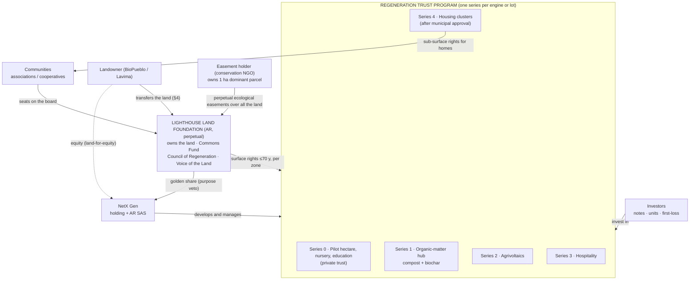
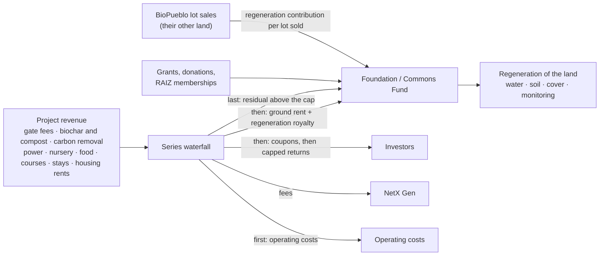
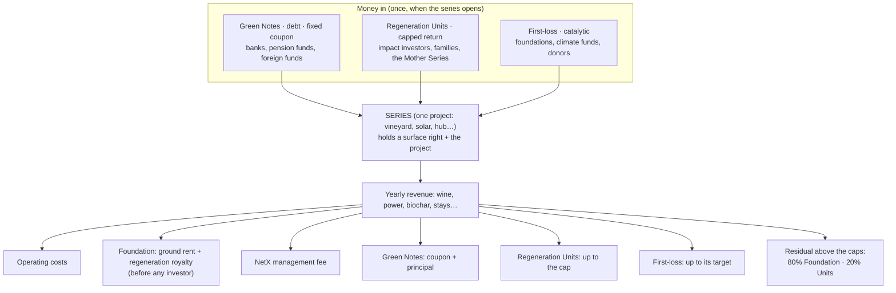
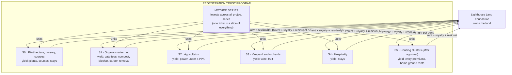
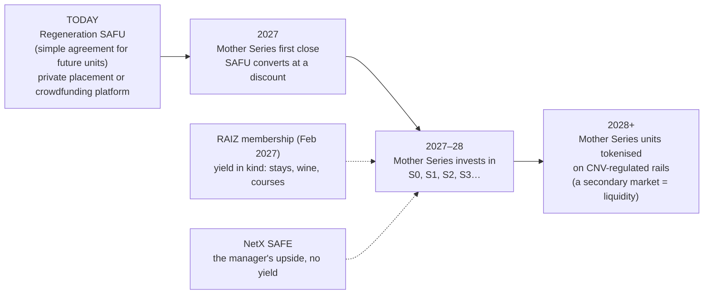
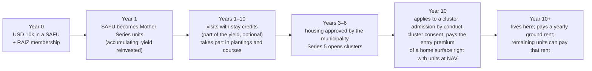
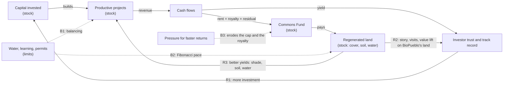

# NS_Tokenomics — full context pack

Generated from `main` (built on top of commit `dd2c85e`) by `scripts/build_context_pack.py`. Each file below starts with a `=== FILE:` line.

**How to read this pack:** follow `AGENTS.md` (first file). The **current legal design is design B** (docs 22–29). Docs 01–21 are earlier work: read them as inputs and background, not as the current proposal. Nothing here is legal, tax or investment advice.


=== FILE: AGENTS.md ===

# Instructions for AI assistants working in this repository

(Read by Claude Code via `CLAUDE.md`, and by other assistants via `AGENTS.md`. Humans: see `00 - README.md`.)

## What this repo is

Token and capital design for the **Lighthouse** (~1,000 ha, Macrolote 7, Mainqué, Río Negro, Argentina) of NetX Gen: the **RAIZ** utility token, the Commons Fund, the community token templates, and the investor capital stack (company SAFE / commons RAIZ / land fideicomiso). Start with `00 - README.md`, then read the file your task touches. Every doc opens with a 🌱 "In one breath" summary.

Team: Gus (design), Vagner (CFO, financial model), Franz (BioPueblo relationship, investor pipeline), Martín (masterplan), Juanpi (tokenisation platforms). Working language: **English** (Spanish quotes from Argentine sources are fine). Gabriel (COO, legal) left the team on 2026-10-17: there is no in-house legal lead, so every legal point that changes the design is [verify] until an external law firm reviews it.

## Legal redesign (since 2026-10-17)

This repo **reopens the whole legal structure** from the goal: regenerate the land at scale with enough capital, the land and part of every flow ending in a commons, and a real yield for investors. Docs 22–27 hold the redesign; its centre is [[25 - Legal design v0.1 (Land Foundation + Regeneration Trust Program)]].

- **Hard law binds; our earlier choices don't.** Doc 22 §2 separates them. Rules 1–3 and 6 below are previous choices under review; rules 4 and 5 are law (Ord. 173/2026, Ley 23.592).
- When a proposal breaks one of the rules below, **say so explicitly** and add the follow-up to `07` section I. Don't silently rewrite older docs.
- **Yield is allowed** as a design goal ("obtain a yield" is a permaculture principle), on instruments that can legally carry it, naming the law that allows it. Rule 3 still applies to RAIZ as a membership until the team decides otherwise (doc 26).
- **Tokenomics is legal by design**: every legal solution we analyse gets **its own tokenomics** (doc 28 is the one for design B, with its model in `sim/series_waterfall_sim.py`). The older tokenomics docs (03, 04, 09, 12, 15, 20 and `sim/value_model_sim.py`) are not edited here: they are inputs, and adapting or retiring them is listed in doc 26 and `07` section I.
- Read earlier docs as **inputs to re-check**, not as conclusions: they mix law, preferences and unverified readings.
- When a proposal has several interacting entities, **draw it** (Mermaid + plain text).

## Design rules until now (don't propose things that break them without saying so; under review in the legal redesign)

1. **The diode**: no token, fund, community or investor instrument may encumber, collateralise or sell the land. Rights flow up the layers; recourse and debt never flow down. (A bounded sale zone inside Lighthouse is under discussion since 2026-10-12, see doc 18; until the team amends this rule in writing, it stands.)
2. **Three pots, never mixed**: company (SAFE), commons (RAIZ / Guardian), land (fideicomiso units). Commons money is never NetX revenue.
3. **RAIZ is a utility.** Never write price forecasts, "appreciation", "yield", "return" or "investment" language about RAIZ. Returns live only in the SAFE and fideicomiso units.
4. **No lots, no priority, no reservations** of Mainqué parcels before municipal approval (Ordenanza 173/2026).
5. **No gating by beliefs or values** (Ley 23.592): gate by conduct and contribution only.
6. Residents' matters are **one person, one vote**; money never buys that voice.

## Writing conventions (mandatory)

- **Cite sources.** Every factual claim gets a footnote `[^x]`, and every document ends with a **"Sources & logic used"** section (documents, data and reasoning used). Mark claims **[C]** confirmed, **[S]** secondary, **[NC]** not confirmed, **[criterio]** our judgement, **[verify]** check with counsel.
- **Emoji legend**: ✅ doable · 🧨 legal challenge · 🏴‍☠️ legal hack (only if substance matches form) · ❓ open question · 🔒 private.
- Keep the 🌱 plain-language summary at the top of each doc. Readers include people new to crypto-economics.
- Numbers are **"what must be true"** models, not forecasts. If you change a number, change the model in `sim/` and regenerate the RESULTS file; don't hand-edit results.
- Use Obsidian `[[wikilinks]]` between docs; keep file names stable (other docs link to them).
- When you add a decision or open question, update `07 - Open Questions and Research Backlog.md`.

## Privacy

- `private/` is git-ignored (call transcripts, the financial model original, third-party decks). **Never add, quote at length or summarise personal content from it**, and never commit it. Cite it as e.g. *"Private call Gus–Gabriel, 2026-10-02"*.
- Paths starting with `../NS_platform/` point to a sibling folder on Gus's machine that is not in this repo. Cite them; don't assume you can read them.
- Don't paste personal data (IDs, bank details, contact lists) into docs.

## Git workflow

- Team repo: `https://github.com/netxgen-2050/NS_Tokenomics`; its `main` holds agreed content. Everyone works on branches of this repo (since 2026-10-17 Gus no longer uses the `sepu85` copy).
- Never commit to `main` directly. Work on your person's branch, named after them (`gustavo`, `gabriel`, `vagner` exist; otherwise create e.g. `cambios_franz`), and open a pull request to `main` with a short summary and the sources you used. Merges follow team agreements.
- Commit messages: what changed and why, in one or two lines.

## Running the models

```
python3 sim/hatch_sim.py           # Founding Pass raise vs credits promised
python3 sim/value_model_sim.py     # RAIZ use-value and fideicomiso IRR scenarios
```
Standard library only.

## Legal caveat

Nothing here is legal, tax or investment advice. Legal statements come from the 2026-09-29 research (in NS_platform) or are marked [verify]; counsel decides.


=== FILE: 00 - README.md ===

---
title: NS_Tokenomics — README and reading instructions
created: 2026-10-02
updated: 2026-10-02 (v0.2, after the Gus–Gabriel call)
status: working repository (private) — design sandbox, not an offer, not legal/tax/investment advice
owners: Gus (design), Gabriel (COO, legal), Vagner (CFO, financial model)
language: English (shared workstream with non-Argentine collaborators)
---

# NS_Tokenomics — how to read this

This repository holds the **token and capital design for the Lighthouse** (~1,000 ha, Macrolote 7, Mainqué, Río Negro, inside BioPueblo's ~10,000 ha). It answers one question:

> **How do we fund the commons and the first communities on land that will never be sold, give each stakeholder (investors, workers, residents without capital, community founders, NetX, the land) a fair kind of return, and stay compliant?**

> ⚖️ **Legal redesign (2026-10-17):** the legal structure is being redesigned from scratch in docs 22–27 (centre: [[25 - Legal design v0.1 (Land Foundation + Regeneration Trust Program)]]): the land in a perpetual foundation, investors funding projects on surface rights through a trust program, with a capped yield. The 60-second answer below still describes the previous design; adapting it and the tokenomics is listed as tasks in 07 §I.

## 1. The answer in 60 seconds

- **The land is never sold.** It sits in a fideicomiso holding a surface right (DRS) and is protected by perpetual ecological easements held by a Guardian. Communities receive **use licences**, never ownership.
- **Three pots of money, three wrappers, never mixed** (the "diode": rights flow up, no money or debt flows down to the land):

| Pot | Instrument | For whom | Return type | When |
|---|---|---|---|---|
| **Company** (NetX holding, moving out of Próspera) | **SAFE**, USD 5k tickets, ~375–500k | Early believers in NetX | Venture equity | Oct 2026 – Mar 2027 |
| **Commons** (Guardian / Commons Fund) | **RAIZ**: the mother token, a utility. In Feb 2027 a non-transferable Founding Pass | Users, families, "plan-B" investors, supporters worldwide | **In-kind**: stays, community products (airdrops), a voice on the commons fund | Feb 2027 Gathering |
| **Land** (Lighthouse fideicomiso) | **Fideicomiso units**, private, ≤35 per issue | Family offices, regenerative investors | Income from licences/tariffs + NAV growth | After the trust exists |

- RAIZ is a **utility** token. We show what it delivers; **we never promise price or profit**. Profit lives in the SAFE and the fideicomiso, where it's allowed.

## 2. Reading paths by role

| If you are… | Read, in this order | Time |
|---|---|---|
| **Whole team, before the 12 Oct meeting** | 15 (micro-investor offer) → 14 (meeting notes) → 09 §1 and §6 | 20 min |
| **Franz** | 20 (land structure and reply to his research) → 18 (hybrid options) → 17 (Constitution) → 15 (micro-investor offer) | 25 min |
| **Gabriel (COO / legal)** | 13 (call) → 06 (legal friction map, L1–L41) → 16, 18, 17, 20 → `prompt_legal.md` → 01 (context) → 12 §3–4 (who can be offered what) → 05 (community licences) | 40 min |
| **Vagner (CFO)** | 13 → 12 (costs, use of funds) → 09 (investor value model) → `sim/RESULTS_value_model.md` → `sim/RESULTS.md` → 11 ($NETX v2 review) | 45 min |
| **Gus** | 07 (open questions, answered and new) → 09 → 10 → 04 | — |
| **New collaborator, non-crypto** | 08 (glossary) → this README → 03 (vision) "In one breath" sections only | 20 min |
| **Crypto-native collaborator** | 02 (design lens) → 03 → 10 → 09 §4 → 11 | 45 min |

Every document starts with a **🌱 "In one breath"** plain-language summary. Read only those for a quick tour.

## 3. Map of the repository

| # | File | What it gives you |
|---|---|---|
| 00 | README (this) | How to read; conventions; how we collaborate |
| 01 | Context and Constraints | Land, legal walls, product decisions, call updates |
| 02 | Design Lens (the council) | Method: Zargham, McConaghy, Voshmgir, Paruch, Ruddick + *This Is Not a Test* |
| 03 | Long-Term Vision | The full ecosystem 2027–2035: layers, token families, flows, governance, phases, invariants |
| 04 | MVP February 2027 (The Hatch) | What we can launch at the Gathering |
| 05 | Community Token Templates | Kits for associations, steward-owned SAS, TDF-style lodging; licences |
| 06 | Legal Friction Map | Every legal challenge 🧨 and hack 🏴‍☠️, with sources |
| 07 | Open Questions and Research Backlog | Decisions taken, open decisions, research list |
| 08 | Glossary (plain language) | Crypto-economics and Argentine legal terms, without jargon |
| 09 | **Investor Value Model (win-win-win)** | Benchmarks, tensions, RAIZ value accrual, fideicomiso returns, capital stack |
| 10 | **Governance Primitives (options)** | Membership, tokens, presence, sweat, trust graph, roles: recipes and 3 configurations |
| 11 | **Review of $NETX v2 tokenomics (2025)** | Keep / adapt / drop from last year's paper |
| 12 | **Round Inputs (costs and use of funds)** | Costs, use of funds, trust micro-round, who can be offered what |
| 13 | **Call 2026-10-02 (decisions and actions)** | Sanitised decisions, divergences, action items |
| 14 | **Team meeting 2026-10-05 (inputs and actions)** | Team inputs on tokenomics, micro-investors, masterplan; action items |
| 15 | **Micro-investor offer (USD 2–5k tickets)** | What a small ticket can legally get: now / later / never-as-phrased; Founding Circle bundle; answers to the investor's six questions |
| 16 | **Call 2026-10-12 (hybrid model, inputs and actions)** | Positions on selling some lots, facts, action items |
| 17 | **Lighthouse Constitution and Rights of Nature (draft)** | What we take from OASA and the Rights of Nature; where each right is anchored; draft articles |
| 18 | **Hybrid model (selling some lots): options and trade-offs** | Five meanings of "hybrid", trade-offs, guardrails, what to decide |
| 20 | **Land structure after Próspera and reply to Franz** | The regenerative purpose first; land for equity: optimistic structure, prepared fallbacks (P1–P10), point-by-point reply to Franz's research |
| 21 | **Gemini deep research review (2026-10-17)** | What the Gemini reports confirm (mostly our own design echoed), add (land law back in force, timeshare, milestone vesting) and get wrong; the rural-or-urban question |
| 22 | **Legal redesign — brief, hard law and first principles** | What the **law** forces vs what we **chose**; trust vs foundation; design principles for the redesign |
| 23 | **Yield engines (where the money comes from)** | Ten engines that regenerate **and** produce cash (organic-matter hub with biochar, agrivoltaics, nursery, hospitality, housing…); which investor fits which |
| 24 | **Legal structure options compared** | Six structures scored; why the foundation + trust program; what we keep from doc 20 |
| 25 | **Legal design v0.1 (Land Foundation + Regeneration Trust Program)** | **The proposal**, with diagrams: entities, money waterfall, landowner deal, foreign capital, governance, phasing, risks |
| 26 | **Impact on tokenomics (tasks)** | RAIZ vs Regeneration Units; how they link; which rules and docs would change (tasks in 07 §I) |
| 27 | **Brief para el abogado (preguntas)** (Spanish) | 22 questions for an Argentine law firm |
| 28 | **Tokenomics for design B (series, early money, investor journeys)** | Legal-by-design tokenomics for design B: what a series is, the capital stack and waterfall, the SAFU for early money, the Mother Series, two investor journeys (live here in 10 years; USD 1,000 in the wine), parameters to tune. Model: `sim/series_waterfall_sim.py` |
| 29 | **Systems design pass for B** | Requirements, invariants J1–J10, feedback loops, hazards K1–K10, first Monte Carlo (`sim/series_montecarlo_sim.py`), who adjusts which parameter and how fast |
| 30 | **How NetX Gen gets capitalised (money in, by stage)** | NetX's money by stage (SAFE, design contract with BioPueblo, development and management fees, licences); the runway arithmetic; why selling lots is not the shortcut and what to do instead |
| — | `Guía - usar este repo con tu IA.md` (Spanish) | **How the team uses this repo with Claude, ChatGPT or Gemini**: access, the one-file context pack, project instructions, starter prompts by role |
| — | `context-pack/` | One-file snapshot of the repo for AI projects (`python3 scripts/build_context_pack.py` regenerates it) |
| — | `assets/esquema-legal-B.png`, `assets/capitalizacion-netx.png` | One-image diagrams for sharing: design B, and how NetX gets capitalised (sources: the `.html` files next to them) |
| — | `prompt_gemini.md` (Spanish) | **Gemini Deep Research prompt**: capital ladder from the next company to a tokenised model, land kept off the market, stewardship of the 1,000 ha, fallbacks, answer to Franz (then an audio summary) |
| — | `prompt_legal.md` (Spanish) | **Legal deep-research prompt** for Gabriel's AI assistant: compliance audit, lawful room to manoeuvre, hybrid model, constitution, Franz's proposal |
| sim | `hatch_sim.py`, `value_model_sim.py` + RESULTS files | Reproducible models (Python, stdlib only) |
| sources | Lighthouse RTMM brief, BioPueblo KMZ | Inputs we can share |
| private | Transcript, financial model, large/third-party files | **Git-ignored**: never pushed |

## 4. Conventions

**Sources (Gabriel's rule, adopted 2026-10-02):** every factual claim carries a footnote `[^x]`, and every document ends with **"Sources & logic used"**: the documents, data and reasoning it relied on. Markers used in claims:
- **[C]** confirmed in a primary source · **[S]** secondary source · **[NC]** not confirmed · **[criterio]** our own judgement, not a fact · **[verify]** to check with counsel.
- Private sources are cited by name and date (e.g. *"Private call Gus–Gabriel, 2026-10-02"*) and stay out of the repo.

**Emoji legend**

| Emoji | Meaning |
|---|---|
| ✅ | Doable now within Argentine law as we understand it (still to be confirmed by counsel) |
| 🧨 | **Legal challenge**: collides with a rule; don't ship without counsel |
| 🏴‍☠️ | **Legal hack**: structural workaround; legitimate only if substance matches form |
| 🌱 / 🔬 | Plain-language / technical section |
| ❓ | Open question (tracked in 07) |
| 🔒 | Private: content kept outside the shared repo |

**Ground rules we design by**
1. **The diode**: financial instruments never govern or encumber land; rights flow upward, recourse never flows down (TDF mortgage lesson).
2. **Commitment precedes organization.**
3. **Separate the rights** tokens usually bundle (funding, voice, access, reputation, return).
4. **Substance over form**: euphemisms help users understand; they don't change the legal nature.
5. **Simulate before launch**; numbers are "what must be true", not forecasts.

**Names:** the mother token is **RAIZ** (decided 2026-10-02). In Argentine-facing UI we follow `../NS_platform/Documentation/Desarrollo/02 - Glosario UX-Legal.md` (no "token", "inversión con retorno", "reservá").

## 5. How we collaborate (Git + Obsidian)

- This folder is both an **Obsidian vault** (open the folder as a vault; `[[links]]` work) and a **private Git repository**.
- **Team repo:** `https://github.com/netxgen-2050/NS_Tokenomics`. Its `main` holds what we have agreed.
- **To change anything:** work on your own branch, named after you (`gustavo`, `gabriel`, `vagner` exist; otherwise create e.g. `cambios_franz`), and open a pull request to `main`. We merge according to the agreements we reach, in the PR or in meetings.
- Everyone works on branches of the team repo (`netxgen-2050/NS_Tokenomics`); `main` holds the legal redesign since 2026-10-17; the earlier `main` is kept in the branch `archive`.
- `AGENTS.md` / `CLAUDE.md` tell your AI assistant (Claude, ChatGPT, Cursor…) how to work here: rules, source citations, privacy, branches. Point your assistant at them first.
- `private/` is git-ignored: the call transcript, the financial model (Vagner's original stays with Vagner) and large third-party files (e.g. the Avedam Kezum deck) live only on Gus's machine.
- `../NS_platform` (product and legal research) is a sibling, read-only source; it isn't part of this repo. Paths starting with `../NS_platform/` refer to it ❓ (decide whether to share it as a second repo).
- Rerun the models: `python3 sim/hatch_sim.py` and `python3 sim/value_model_sim.py`.

## 6. Status (v0.2, 2026-10-02)

- ✅ Vision, MVP, legal map, community kits, glossary (v0.1, morning)
- ✅ After the call: investor value model, governance options, review of $NETX v2, round inputs, call notes, RAIZ rename, sources everywhere (v0.2)
- ✅ After the 2026-10-05 team meeting: micro-investor offer (15), team-meeting notes (14), legal items L26–L30, backlog section F (v0.3)
- ✅ After the 2026-10-12 call: call notes (16), Constitution and Rights of Nature draft (17), hybrid options and trade-offs (18), legal items L31–L38, backlog section G, legal deep-research prompt (v0.4)
- ✅ After Gabriel's vault inventory and Franz's Gemini research: legal corrections in 06 (L31–L32, L37–L41), 16, 17, 18; backlog section H; land structure after Próspera and reply to Franz (20), Gemini deep-research prompt (v0.5, 2026-10-16)
- ⏭ Next: hire NetX's own law firm (07 H-1); legal deep research (Gabriel, doc 19); decision on the hybrid before the surveyor brief; counsel pack (06 §3 + structure diagram), Vagner's bounded Lighthouse model, Council of Regeneration charter, one-page explainer for collaborators.

## Sources & logic used

- This README summarises files 01–13 of this repository; their own source sections apply.
- Collaboration conventions: Gabriel's request for sources and Gus's proposal of a private repo with personal branches, private call 2026-10-02.


=== FILE: 22 - Legal redesign - brief, hard law and first principles.md ===

---
title: Brief, hard law and first principles
created: 2026-10-17
status: v0.1 — Claude for Gus; every legal point [verify] with counsel
---

# 22 · Brief, hard law and first principles

Back to [[00 - README]] · Legal redesign: [[25 - Legal design v0.1 (Land Foundation + Regeneration Trust Program)]]

## 🌱 In one breath

We need a lot of money to regenerate a lot of land. A landowner will contribute ~1,000 ha (lot 7A), and maybe four more lots, **once there is a structure investors can enter**, both Argentine and foreign. Investors want two things: to be part of the dream, and a **yield**. The commons needs two things: the **land**, kept off the market forever, and a steady share of the **money**. This page separates what the **law** forces on us from what we **chose** earlier and can now change. Then it sets the design principles for the new proposal.

## 1. The brief

| Who | What they need | What they bring |
|---|---|---|
| **The land** (7A, ~1,000 ha of riverbank, barda and arid plateau, ~200 mm of rain a year) | Water, soil, cover and time; never to be sold again | Space, sun, river, a story |
| **Landowner** (BioPueblo / Lavima) | A fair, legible return for the land; value lift on the ~9,000 ha it keeps; a structure it can sign | Land: 7A now, maybe four more lots later |
| **Investors** (national and foreign; small to institutional) | A legal instrument; a real yield from real cash flows; protection; liquidity some day; a purpose they can feel | Capital: from USD 2k tickets to multi-million tranches |
| **Communities and residents** | Secure tenure for their homes and projects, without having to buy land | Work, care, presence, buyers for services |
| **NetX Gen** | A business: fees, a replicable kit, equity value | Design, platform, management, network |
| **The commons** | The land, perpetual protection, and a share of every flow, to fund regeneration | — |

Scale goal [criterio]: hundreds of hectares regenerated directly in a decade, thousands with the four extra lots and BioPueblo's land, and far more **indirectly** by turning the valley's waste (fruit pruning, pomace, manure, food scraps) into compost and biochar for its farms[^regen].

## 2. Hard law vs our previous choices

**Hard law** binds us. **Our choices** were made earlier in this repo and can be reopened here.

| # | Constraint | Kind | Source | What it means for design |
|---|---|---|---|---|
| 1 | Foreigners and foreign-controlled companies can't own or possess rural land beyond quotas, and never land that contains or borders large permanent water bodies | **Law** (in force again on an interim basis since 2026-10-09) | Ley 26.737 arts. 3, 8–10; Supreme Court interim ruling [S][^csjn] | Land in an **Argentine-controlled** owner; foreign money enters as finance, not as landowner. First check: is 7A rural at all? [verify] |
| 2 | Any instrument sold to the public with an expectation of profit from others' efforts is a security | **Law** | Ley 26.831 art. 2; CNV rules [C] | Yield needs a **securities wrapper**: private placement (small) or CNV public offering (large) |
| 3 | Private-offer limits in Argentina (~35 buyers per issue, ≤15 non-qualified, no mass media) | **Law** (CNV rules) | RG CNV 1016/2024 as amended by 1088/2025 [S] | Fine for a first, small round; **not** for "un montón" of money |
| 4 | Ordinary trusts last at most 30 years | **Law** | CCyC art. 1668 [C] | A trust can't hold land forever: something perpetual must receive it at the end |
| 5 | Financial trusts (public offering) need a CNV-registered or bank fiduciary | **Law** | CCyC arts. 1690–1692 [C] | Large capital means a professional fiduciary, a prospectus and costs |
| 6 | A surface right (DRS) lasts at most 70 years for buildings (50 for plantations), and the holder may mortgage it | **Law** | CCyC arts. 2114–2128, esp. 2117 and 2120 [C] | Lenders can secure the **improvements** without touching the **land** |
| 7 | Real easements can be perpetual and bind every successor | **Law** | CCyC arts. 2162–2165 [C] | The ecological anchor survives any change of owner; it needs a dominant estate owned by someone else |
| 8 | Virtual-asset service providers must register with the CNV | **Law** | Ley 27.739 [C] | Any token rail selling to Argentines needs a registered PSAV |
| 9 | No lots, reservations or priority before municipal approval of a subdivision | **Law** | Ord. 173/2026 of Mainqué [C] | Revenue that needs subdivision comes **late**; build first the revenue that doesn't |
| 10 | No discrimination by beliefs | **Law** | Ley 23.592 [C] | Admission by conduct and contribution |
| 11 | Environmental impact declaration before works; water permits; riverbank line and 15 m towpath | **Law** | Ley M 3266; Ley Q 2952 (DPA); CCyC 1974 [S] | Permits are on the critical path of every yield engine |
| 12 | The land is never encumbered, collateralised or sold ("the diode") | **Our choice** | `AGENTS.md` rule 1 | Keep for the **land**; relax for **improvements** (row 6) |
| 13 | Three pots never mixed | **Our choice** | rule 2 | Keep the spirit (commons money never becomes company money); allow more vehicles |
| 14 | RAIZ is a utility; no yield language | **Our choice** | rule 3 | Reopen: yield can live in regulated units that sit next to RAIZ or are linked to it (see 26) |
| 15 | Residents' matters one person, one vote | **Our choice** | rule 6 | Keep for residents; investors vote in their own vehicles |
| 16 | Land goes to a trust; a "Guardian" association owns the dominant parcel, the Commons Fund and a golden share | **Our choice** | doc 20 | Reopen (§3) |

## 3. "Can't the trust hold and finance too?" Yes, with two limits

A trust (*fideicomiso*) can hold land, receive money, contract, pay investors and fund works. It is a separate patrimony, protected from the creditors of whoever set it up and of the trustee (CCyC arts. 1685–1687 [C]). So it **can** be the custodian and the financing engine. Its two limits:

1. **Time**: an ordinary trust ends at 30 years. At the end the land goes to a *fideicomisario*, which must be someone perpetual if the land is to stay off the market.
2. **No voice of its own**: a trust is a contract executed by a professional trustee. It has no members, no assembly, no council. Its governance is whatever the contract says, frozen at signature.

So the functional split [criterio]:
- **Trusts are good engines** (time-bound, investor-facing, professional, ring-fenced).
- **A perpetual entity is needed as the owner of last resort**: a **foundation** (*fundación*, CCyC arts. 193–224: no members, a patrimony bound to a purpose, State oversight by Río Negro's IGPJ) or an association (*asociación civil*: members and assembly).

The earlier "Guardian" did four jobs at once: easement anchor, Commons Fund, final owner and golden share. The new design (25) gives each job to the entity that does it best.

## 4. Design principles for the new proposal [criterio]

1. **Land in the commons, money in the engines.** The land sits with a perpetual, Argentine-controlled owner that can't sell or mortgage it. Capital is invested in the **improvements and cash flows**, never in the land.
2. **Yield from living systems, not from land price.** Investors are paid from what the regenerating land and the valley produce: energy, carbon removal, compost, nursery stock, food, hospitality, housing rents and education. Land appreciation is never the business case.
3. **Revenue that doesn't need subdivision comes first** (Ord. 173). Housing comes when it is approved.
4. **A share of every flow goes to the commons**, written into every contract (a ground rent plus a regeneration royalty).
5. **Capped returns, residual to the commons** (steward-ownership applied to finance). Investors get a fair, capped yield; the upside above the cap feeds regeneration.
6. **Fractal and replicable**: one program, many series (one per lot or engine). Lots two to five plug in without redesign, and so do other nodes.
7. **Start small and legal, scale to regulated and tokenised.** Private placement first, CNV public offering and tokenisation when the cash flows exist.
8. **Blended finance**: grants and first-loss capital make the commercial tranches safe enough for big investors.
9. **Few entities, each with one clear job.** Every added entity must earn its place.

---

## Sources & logic used

[^regen]: Lighthouse regenerative design principles (Gus, 2026-10-15 and 2026-10-16), including the regional strategy of an external permaculture adviser: design from the region down, implement from one hectare up, import the valley's organic matter, treat regeneration as a yield.
[^csjn]: Supreme Court interim suspension of art. 154 of DNU 70/2023, 2026-10-09, reported by several outlets; see `21 - Gemini deep research review (2026-10-17).md` §3. Ruling text not yet read [verify].

- Law references: Código Civil y Comercial (CCyC) articles as cited; Ley 26.737; Ley 26.831; Ley 27.739; Ley 23.592; Ord. 173/2026 of Mainqué; Río Negro Leyes M 3266 and Q 2952. Marked [C] when the text was read in earlier research (`NS_platform/…/Investigacion — DRS, fideicomisos y tokenizacion… 2026-09-29.md`), [S] otherwise.
- Hard-law vs choices table: our classification [criterio], built from `AGENTS.md`, `06 - Legal Friction Map.md` and `20 - Land structure after Próspera and reply to Franz.md`.


=== FILE: 23 - Yield engines (where the money comes from).md ===

---
title: Yield engines — where the money for investors and for the commons comes from
created: 2026-10-17
status: v0.1 — qualitative map; numbers must come from Vagner's model and real quotes
---

# 23 · Yield engines (where the money comes from)

Back to [[00 - README]] · Legal redesign: [[25 - Legal design v0.1 (Land Foundation + Regeneration Trust Program)]] · Principles: [[22 - Legal redesign - brief, hard law and first principles]] §4

## 🌱 In one breath

A structure can only pay a yield that the land and its people actually **produce**. "Obtain a yield" is a permaculture principle[^holmgren], and the same logic applies to the money: every engine below must regenerate **and** produce cash. The most important finding: **the biggest engines don't need the land to be subdivided**. A regional compost and biochar hub, agrivoltaic solar, a native nursery, food and education can start years before any housing is approved, and they can absorb millions of dollars. Housing and hospitality come later and pay ground rent to the commons. Land value is never the business case.

## 1. The engines

Legend: **Capital** = how much investment the engine can usefully absorb · **Subdivision?** = needs Ord. 173 approval first.

| # | Engine | Who pays | Regenerative effect | Capital | Subdivision? | Main permits / risks |
|---|---|---|---|---|---|---|
| E1 | **Regional organic-matter hub**: compost and **biochar** from the valley's fruit pruning (much of it burned today), packing-house fruit waste, winery pomace, manure, food scraps | Gate fees from producers and municipalities; compost and biochar sales to valley farms; **carbon-removal credits** for biochar | Fertility for the site **and** for the valley's farms: the main path to "millions of hectares indirectly"[^regen] | **High** (plant, logistics, pyrolysis) | No (industrial / rural permit) | DIA; emissions; feedstock contracts; credit methodology and verification[^cdr] |
| E2 | **Agrivoltaics** on part of the plateau: solar panels with vegetation under and between them | Power buyers: corporate PPAs on the term market, or distributed generation[^mater] | Shade and wind shelter, less evaporation, panel-washing water feeding plants; known to help vegetation in drylands [S][^agrivoltaics] | **Very high** | No | Grid connection capacity in the Comahue region [verify]; DIA; it is a lender-financeable asset (the surface right can be mortgaged, CCyC 2120) |
| E3 | **Native nursery and seed bank** | Restoration projects, BioPueblo's other land, municipalities, mining and oil companies' remediation obligations in Patagonia [verify] | Plants for the site and the region | Low–medium | No | Phytosanitary registration |
| E4 | **Restoration outcomes**: verified hectares restored, soil carbon, biodiversity | Outcome buyers: climate funds, companies, pay-for-success contracts; carbon and biodiversity credits | Directly pays for regeneration | Medium | No | **Measure before claiming**: dryland soil carbon is slow and hard to verify; treat as upside, not base case [criterio] |
| E5 | **Food and fibre** on the irrigated river terraces (orchards, agroforestry, regenerative grazing as a measured trial) | Markets, restaurants, members (in kind) | Cover, soil, local food | Medium | No | Water rights (DPA); markets |
| E6 | **Education and gatherings** (permaculture courses, retreats, volunteer programs, the yearly planting) | Participants, universities, companies | Builds the community and the story | Low | No (temporary structures) | Event permits |
| E7 | **Hospitality** (eco-lodge, glamping, a hostel for volunteers) | Guests; members' stay credits | Funds the commons; brings buyers and residents | Medium | Usually a building permit, not subdivision [verify] | Tourism registration; **not** timeshare (no fixed nights) |
| E8 | **Housing on surface rights**: families or clusters get a long surface right (≤70 y) for their home; they pay an entry premium and a yearly ground rent | Residents | People living in and caring for the land | High (infrastructure, homes) | **Yes**, or an equivalent municipal approval [verify] | Ord. 173; services; the land is not sold, the right reverts at the end |
| E9 | **Platform and kit licences** (NetX's business) | Other nodes, BioPueblo, other regenerative projects | Replication = more hectares elsewhere | Low | No | — (company revenue, not commons) |
| E10 | **Value capture from BioPueblo's surrounding land**: a contractual regeneration contribution on every lot BioPueblo sells in its other ~9,000 ha | BioPueblo's buyers, via BioPueblo | Funds the shared watershed, corridors and river | — | Their subdivisions | Contract with BioPueblo; the "300 reasons" thesis 🧪[^300] says it raises their prices |

## 2. Which engines fit which investor

| Investor appetite | Best engines | Instrument (see 25) |
|---|---|---|
| Steady, contracted cash flows (pension funds, banks, development finance) | E2 solar with a PPA; E1 with long feedstock and offtake contracts | **Senior green notes** (debt) in a series, secured by the project's surface right and its contracts, **never by the land** |
| Impact equity, patient (family offices, impact funds) | E1, E5, E7, E8 | **Participation units** in a series, return **capped**, residual to the commons |
| Catalytic (foundations, climate funds, philanthropists, development banks' grants) | E4 and the commons itself | **Grants** to the commons; **first-loss** units that absorb early losses so others can come in |
| Venture (believes in the replicable model) | E9 | **NetX holding equity** (SAFE) |
| Community, members, "plan B" people | E6, E7, E5 in kind | **RAIZ membership**: yield in kind (stays, food, courses), see 05 |
| Carbon-removal buyers | E1 biochar, later E4 | **Offtake / pre-purchase contracts**: buyers pay years ahead for future tonnes, which finances the plant[^cdr] |

## 3. What must be true [criterio]

- **E1** works if feedstock is contracted (who gives the pruning, at what gate fee), biochar finds buyers in the valley, and a credit methodology accepts our process. First step: a feedstock survey of the Alto Valle (the regional mapping already planned[^regen]).
- **E2** works if the grid can take the power and a buyer signs a PPA. First step: ask the distributor about connection capacity near Mainqué [verify].
- **E8** works only after municipal approval, and if families accept a 70-year surface right instead of a deed. Look at references: community land trusts, Swiss *Baurecht*/*Erbbaurecht*, UK leasehold.
- Every engine has to pay the **commons share** (25) and still return enough to its investors. If an engine can't carry the royalty, it stays a pilot.
- **Sequence**: E6, E3 and E5 first (cheap, they build the story); E1 and E2 next (big capital, no subdivision needed); E7 and E8 last.

## 4. What this page doesn't do

It doesn't size anything. Prices, costs and returns come from Vagner's model and real quotes (feedstock survey, PPA indications, nursery prices). Until then, the engines are **hypotheses ranked by fit**, not a business plan.

---

## Sources & logic used

[^holmgren]: David Holmgren, *Permaculture: Principles and Pathways Beyond Sustainability* (2002), principle 3 "Obtain a yield". [C]
[^regen]: Lighthouse regenerative design principles (Gus, 2026-10-15 and 2026-10-16): regional strategy, import of the valley's organic matter (fruit pruning, pomace, manure, food scraps), one-hectare pilot, Fibonacci growth.
[^cdr]: Biochar is one of the most traded durable carbon-removal types in the voluntary market (registries such as Puro.earth; forward offtake buyers such as the Frontier coalition). Prices and methodologies change; check current terms before modelling [S] [verify].
[^mater]: Argentina's renewable term market (MATER, Res. SE 281/2017) lets generators sell to large users by private PPA; Ley 27.424 covers distributed generation [S] [verify current rules].
[^agrivoltaics]: Studies of agrivoltaic systems in drylands report lower soil-water loss and better plant growth under panels (e.g., Barron-Gafford et al., *Nature Sustainability*, 2019) [S]. Site-specific effect unknown.
[^300]: The "300 reasons" thesis: regeneration raises lot value more than it costs; a share of each lot sale funds the common ecosystem (external permaculture adviser, 2026-10-16) 🧪 untested.


=== FILE: 24 - Legal structure options compared.md ===

---
title: Structure options compared
created: 2026-10-17
status: v0.1 — Claude for Gus; scores are our judgement [criterio]; counsel to challenge
---

# 24 · Structure options compared

Back to [[00 - README]] · Legal redesign: [[25 - Legal design v0.1 (Land Foundation + Regeneration Trust Program)]] · Brief: [[22 - Legal redesign - brief, hard law and first principles]] · Engines: [[23 - Yield engines (where the money comes from)]]

## 🌱 In one breath

Six ways to organise land, money and community, scored against what we need. The winner, **B**, is not a break with what we had: it keeps the perpetual easements, the golden share and the capital ladder of the current design (**A**). What it changes: **who owns the land** (a perpetual foundation instead of a 30-year trust) and **where investors put their money** (a program of trusts that owns the projects, not the land). **C** (the owner keeps the land and grants a 70-year surface right) is the fallback if the landowner won't transfer ownership. **E** (offshore company owning the land) is blocked by the rural land law if 7A is rural.

## 1. The options

| | Option | How it works in one line |
|---|---|---|
| **A** | **Current design** (`20 - Land structure after Próspera…`) | The land goes to a purpose land trust (≤30 y) that issues units; a Guardian association holds the easements, the Commons Fund and a golden share in the NetX holding, and receives the land at year 30 |
| **B** | **Commons Foundation + Regeneration Trust Program** (proposed, see [[25 - Legal design v0.1 (Land Foundation + Regeneration Trust Program)]]) | A foundation owns the land forever; a program of trusts, one series per engine or lot, holds surface rights and projects and pays investors; every flow pays the foundation |
| **C** | **Owner keeps the land; surface right + easements** | Lavima keeps the title, grants a 70-year surface right to an investment trust and perpetual easements to a conservation entity |
| **D** | **Cooperative** (Ley 20.337) | Land and projects in a cooperative of residents and producers; members contribute capital; one member, one vote |
| **E** | **Offshore steward-owned holding owns the land** (through an Argentine company) | Foreign capital owns the land company; a purpose trust or foundation holds the control shares |
| **F** | **Closed-end fund** (FCI cerrado, Ley 24.083) | A CNV-regulated fund, run by a registered manager, owns the land and the projects and issues quota-shares |

## 2. Scores

●●● strong · ●● works · ● weak · ✗ fails

| Criterion | A | **B** | C | D | E | F |
|---|---|---|---|---|---|---|
| Land off the market **forever** | ●● (trust ends at 30 y; Guardian inherits) | **●●●** (foundation, perpetual by statute) | ● (owner keeps it; only easements are perpetual) | ●● (members could vote to sell unless the bylaws forbid it) | ● (shares can be sold) | ✗ (land is a fund asset) |
| **Scale of capital** | ●● (trust units, private at first) | **●●●** (series per engine, public offering and tokenisation possible) | ●● | ● (cooperatives raise little outside capital) | ●●● | ●●● |
| **Foreign capital** under Ley 26.737 | ●● (units may count as indirect holding [verify]) | **●●●** (foreigners finance projects, not land) [verify] | ●● | ●● | ✗ if 7A is rural | ● (fund owns land) |
| **Legal yield** | ●● (units) | **●●●** (notes and units, capped) | ●● | ● (interest on capital limited by law) | ●●● | ●●● |
| **Money to the commons** | ●● | **●●●** (ground rent + royalty in every contract) | ● (depends on owner's goodwill) | ●● | ● | ● |
| **Time to first money** | ●● | ●● (first series is a private trust) | ●●● (no transfer needed) | ●● | ● | ● (CNV approval) |
| **Cost and complexity** | ●● | ● (more entities, more agreements) | ●●● | ●● | ● | ● |
| **Fits the landowner** | ●● (equity in a holding that doesn't own the land: a valuation question) | ●● (several ways to pay them, see 25 §4) | ●●● (keeps the title, earns rent) | ● | ●● | ●● |
| **Replicable** (lots 2–5, other nodes) | ●● | **●●●** (new series, same program) | ●● | ● | ●● | ●● |
| **Community voice** | ●● | ●● (foundation board + resident assemblies) | ● | ●●● | ● | ✗ |

## 3. Reading the scores

- **B** wins on the three things the brief asks for: land kept forever, large capital, foreign money. Its cost is complexity, which phasing absorbs: start with one private series and the foundation, add the rest when the money arrives.
- **A is not discarded, it evolves into B**. Kept from A: the perpetual easements, the golden share on the NetX holding, the capital ladder and the separation of commons money. Changed: the land owner (foundation instead of trust) and the investors' object (projects instead of land).
- **C** is the honest fallback if Lavima wants to keep the title. B can run on top of C: the program holds a surface right granted by Lavima instead of by the foundation, and the foundation holds the easements. What we lose is "forever": after 70 years, the owner decides.
- **D** fits **inside** B as a tool for residents' clusters and producers, not as the frame.
- **E** dies on Ley 26.737 if 7A is rural; it is the right shape only for NetX's own business (the holding), which owns no land.
- **F** is an alternative **engine** to the trust program at scale, if a regulated fund manager wants to run it. It must hold projects and surface rights, never the land.

---

## Sources & logic used

- Options A and C: `20 - Land structure after Próspera and reply to Franz.md` (§2 and P1) and the 2026-09-29 legal research in `NS_platform/` (surface right + easements architecture).
- Option D: Ley 20.337 (cooperatives: one member one vote; limited interest on capital) [S] [verify].
- Option E: Ley 26.737 arts. 3 and 10 [S]; see [[22 - Legal redesign - brief, hard law and first principles]] row 1.
- Option F: Ley 24.083 (FCI), closed-end funds may hold real estate and projects under CNV rules [S] [verify].
- Scores: our judgement [criterio].


=== FILE: 25 - Legal design v0.1 (Land Foundation + Regeneration Trust Program).md ===

---
title: Proposed design v0.1 — Commons Foundation + Regeneration Trust Program
created: 2026-10-17
status: v0.1 — proposal by Claude for Gus, to be reviewed and approved by a licensed Argentine lawyer. Not legal, tax or investment advice
---

# 25 · Proposed design v0.1: Commons Foundation + Regeneration Trust Program

Back to [[00 - README]] · Why this option: [[24 - Legal structure options compared]] · Engines: [[23 - Yield engines (where the money comes from)]] · Token impact: [[26 - Impact on tokenomics (tasks)]]

## 🌱 In one breath

**The land belongs to a foundation, forever. The money builds projects on top of it.**

- **The Foundation** (Argentine, perpetual) owns lot 7A, and later any other lot. Its statute forbids selling or mortgaging the land. It never sells land: it grants long **surface rights** over zones of it, for projects and homes, and collects a **ground rent** and a **regeneration royalty** on everything produced. That money, plus grants and memberships, pays for regeneration. That is the commons.
- **Investors** put money into a **program of trusts**, one **series** per engine or lot: the organic-matter hub, solar, hospitality, housing. Each series holds a surface right and its project, and pays investors from the project's cash flows. Debt investors get a fixed coupon. Equity investors get a variable return, **capped**; above the cap, the money goes to the commons.
- **An independent conservation entity** holds perpetual ecological easements over all the land, so the protection survives even if the Foundation fails.
- **NetX Gen** designs, manages and runs the platform, earning fees and licences. The Foundation holds a golden share in it.
- **Residents** hold their homes on surface rights through community associations or cooperatives, and decide their own matters one person, one vote.

Foreign capital can finance every series and the holding without owning or possessing land [verify].

## 1. The pieces, each with one job

| # | Entity | Legal form | Its one job | Owns | Earns / receives | Pays |
|---|---|---|---|---|---|---|
| 1 | **Lighthouse Land Foundation** ("the Foundation") | *Fundación*, CCyC arts. 193–224, authorised by Río Negro's IGPJ; Argentine-controlled board [verify] | **Keep the land forever and fund its regeneration** | The land (7A, later lots 2–5); the Commons Fund | Ground rents; regeneration royalty; residual above the investors' cap; grants and donations; RAIZ memberships | Regeneration works, monitoring, nursery and community grants; the Council of Regeneration |
| 2 | **Easement holder** | An established conservation NGO, or a residents' association, owning a small dominant parcel [verify] | **Guard the guardian**: hold perpetual ecological easements over all the land | A ~1 ha dominant parcel | Nothing (maybe a monitoring fee) | — |
| 3 | **Regeneration Trust Program** ("the Program"), one **series** per engine or lot | Private ordinary trusts first (CCyC 1666+); later a **financial trust program** with public offering, CNV (CCyC 1690–1692), tokenisable | **Turn investment into regenerating, productive projects and pay investors** | Each series: a surface right over its zone (≤70 y) and its project assets | Project revenue (23: E1–E8) | Ground rent + royalty to the Foundation; coupons and distributions to investors; fees to NetX |
| 4 | **NetX Gen** (holding abroad + Argentine SAS) | Holding (jurisdiction open) owning an AR SAS | **Design, develop, manage and replicate** | The platform, brand and kit | Development and management fees; a performance fee below the cap; platform fees; kit licences to other nodes | — |
| 5 | **Communities** (clusters of ~16 families, producers) | Associations, housing or agricultural cooperatives, or steward-owned SAS | **Live and work on the land** | Sub-surface rights for homes or projects | Their own activities | Ground rent and royalty (through their series or directly) |
| 6 | **Feeder for foreign investors** (optional, phase 2) | Offshore fund or SPV that buys notes and units of the series | **Let foreign capital in under its own securities law** | Program notes and units | Their coupons | — |

**Why a foundation and not the trust as the land owner:** see [[22 - Legal redesign - brief, hard law and first principles]] §3. The trust ends at 30 years and has no voice; the foundation is perpetual, purpose-bound and supervised by the State. **Why a separate easement holder:** if the Foundation is ever captured or fails, a second, independent entity can still enforce the ecological rules in court.

## 2. The scheme

### 2.1 Ownership, rights and control



### 2.2 Money



### 2.3 Plain-text version

```
                    Easement holder (NGO) ── perpetual easements ──┐
                                                                   ▼
Landowner ── land ──► LIGHTHOUSE LAND FOUNDATION (perpetual, can't sell or mortgage land)
   │                    │   ▲            ▲                │
   │ equity             │   │ rent +     │ grants,        │ golden share
   ▼                    │   │ royalty +  │ memberships    ▼
NetX Gen ◄── fees ──┐   │   │ residual   │             NetX Gen
                    │   ▼   │
               REGENERATION TRUST PROGRAM: series 0, 1, 2, 3, 4…  ◄── investors (notes, units)
               (each holds a surface right and a project)          ──► coupons, capped returns
                    │
                    └── sub-surface rights ──► Communities (homes, 1 person 1 vote)
```

## 3. The waterfall of each series

The same order in every series [criterio; percentages are model parameters for Vagner, not proposals yet]:

1. **Operating costs** of the project.
2. **Ground rent** to the Foundation: fixed, per hectare of the surface right.
3. **Regeneration royalty** to the Foundation: *r*% of gross revenue (model parameter), paid before investors, so the commons gets paid even when the project is weak.
4. **Senior green notes** (debt): coupon and principal. Secured by the series' surface right, its plant and its contracts, **never by the land** (CCyC 2120 lets the surface holder mortgage the surface right [C]).
5. **First-loss units** (catalytic investors): absorb losses first, receive returns after the notes.
6. **Participation units**: return up to a **cap** (e.g., a target IRR, a parameter).
7. **Residual above the cap**: to the Foundation, and partly to the units as an incentive if needed (parameter).

At the end of each surface right, the improvements revert to the Foundation. The law provides compensation for the surface holder unless agreed otherwise [verify, CCyC 2126]: the series' model must price this in.

## 4. The landowner's deal: four ways to pay for the land

The landowner's main question will be "what do I get?". Options to combine:

| | Deal | What the landowner gets | Pros | Cons |
|---|---|---|---|---|
| **L1** | **Land-for-equity** (today's direction) | Equity in the NetX holding, released by milestones (deed, easements registered, permits) | Already negotiated in principle; aligns with the platform's upside | The holding doesn't own the land, so the equity's value rests on NetX's business; legal form of "land to the Foundation, shares from NetX" (a donation with a charge, CCyC 1562?) [verify] |
| **L2** | **Land-for-income** | A share of the Foundation's ground rents for N years, as a deferred price | Simple cash logic; tied to the land's real use | Reduces commons income during those years; it must be unsecured on the land |
| **L3** | **Staged transfer** | Keeps the title at first, grants surface rights to the series for units plus rent, and transfers to the Foundation later at a pre-agreed formula | Lowest trust required on day 1 (option C first, B later) | "Forever" only arrives at transfer; a pre-emption right is capped at 5 years by law [S] |
| **L4** | **Value capture** | The lift on its other ~9,000 ha; it pays a regeneration contribution on each of its own lot sales to the Foundation | Turns the "300 reasons" thesis into a contract 🧪 | Not a payment for the land by itself |

Proposed starting offer [criterio]: **L1 + L4**, with **L2 as a sweetener** if equity alone doesn't close; **L3** if the owner won't transfer the title yet.

## 5. Foreign capital and the rural land law

| Where foreign money sits | Owns or possesses rural land? | Status |
|---|---|---|
| NetX holding equity | No | ✅ |
| Senior notes of any series (debt) | No; a lender is not an owner | ✅ [verify] |
| Participation units of a series | No land; the series holds a surface right | ⚠️ Could a surface right held by a series with foreign beneficiaries count as foreign "possession"? Main question for counsel |
| Grants and donations to the Foundation | No | ✅ (exchange-control and anti-money-laundering rules apply) |
| RAIZ memberships | No | ✅ |
| Residents' surface rights for homes | Possibly "possession" | ⚠️ Quotas apply; never on the riverbank |

If the answer to the ⚠️ rows is "yes, it counts", the fallback is clean: foreign capital enters only as **notes** and **holding equity**, and units are reserved for Argentines, or the foreign share is capped within the quota [verify]. **First of all: is 7A rural land at all?** If it is urban, none of this binds.

## 6. Governance

| Body | Who | Decides | Can't |
|---|---|---|---|
| **Foundation board** | Seats for: the Council of Regeneration (ecology, water), residents (elected one person one vote), the landowner (founder seat), independents, NetX (minority). Argentine majority [verify] | Surface rights, the Commons Fund budget, royalty rates for new series | Sell or mortgage the land; amend the purpose clause (entrenched in the statute; IGPJ oversight) |
| **Voice of the Land** | A seat with a suspensive veto, backed by monitoring data | Pauses any decision that harms water, soil or native life until reviewed | Decide alone; it pauses, people decide |
| **Series holders' assemblies** | Investors of each series, by capital | Their series: budgets, refinancing, replacing the manager for cause | Touch the land or other series |
| **Residents' assemblies** (per cluster and general) | Residents, one person one vote | Daily life, shared spaces, cluster rules (stricter, never laxer, than the easements) | Override the easements |
| **Easement holder** | Independent NGO | Enforces the easements in court | Manage the land |

## 7. Phasing

| Phase | When | What happens | Money |
|---|---|---|---|
| **0 · Foundations** | Q4 2026 – Q2 2027 | Framework agreement with the landowner (L1 + L4); Foundation incorporated (IGPJ can take months: meanwhile an existing foundation can act as fiscal host [verify]); easement holder chosen; **Series 0** as a private trust: pilot hectare, nursery, education; feedstock survey for the hub; grid enquiry for solar | NetX SAFE; Series 0 private placement (≤35 per issue); first grants; RAIZ memberships at the Feb 2027 Gathering |
| **1 · Engines** | 2027 – 2028 | Land transferred to the Foundation; easements registered after the survey; **Series 1** (organic hub) and **Series 2** (agrivoltaics) with offtake contracts and PPAs; first-loss from catalytic investors | Private series → first **CNV financial trust** with public offering, green-labelled; carbon-removal pre-purchases |
| **2 · Scale** | 2028+ | **Series 3–4** (hospitality, housing after approval); lots 2–5 join as new series; tokenised units on CNV-regulated rails; foreign feeder; replication to other nodes | Public program; tokenisation; foreign funds; development-bank lines |

## 8. What could go wrong, and the prepared answer

| Risk | Prepared answer |
|---|---|
| The landowner won't transfer the title | Start with **L3** (option C): surface rights from the owner, easements now, transfer later |
| Foundation authorisation is slow | Fiscal host or an existing foundation for phase 0; the land waits in the owner's hands under easements |
| Units held by foreigners count as land possession | Foreign capital through notes and the holding only; units for Argentines or within quota |
| The engines produce less cash than modelled | The series stay small and private; the regeneration royalty is paid before investors, so the commons still gets its share; growth follows Fibonacci pacing |
| Municipal approval for housing is slow | Engines E1–E7 don't need subdivision |
| A lender forecloses on a series | The lender takes the surface right and the plant for the rest of its term, **never the land**; the easements still bind |
| The Foundation is captured | Independent easement holder; entrenched statute; IGPJ oversight; the residents' seats |
| Public-offering costs are too high early | Stay with private series until the cash flows justify a CNV program |
| Our numbers are wrong | Every figure is a "what must be true" parameter until Vagner models it |

---

## Sources & logic used

- Law: CCyC arts. 193–224 (foundations), 1562 (donation with a charge), 1666–1707 (trusts; 1668 the 30-year limit; 1690–1692 financial trusts), 2114–2128 (surface right; 2117 terms, 2120 guarantees, 2126 compensation), 2162–2165 (perpetual real easements); Ley 26.737; Ley 26.831; Ley 27.739. [C] where read in the 2026-09-29 research (`NS_platform/…/Investigacion — DRS, fideicomisos y tokenizacion… 2026-09-29.md`), [S] otherwise; all [verify] by counsel.
- Precedents behind the shape [S]: community land trusts (land held forever, homes on long leases); the Edith Maryon Foundation (Switzerland: takes land off the market forever and grants surface rights); Terre de Liens (citizen capital buying farmland, low capped returns); steward-ownership (golden share, capped returns, residual to purpose); blended finance (first-loss capital crowding in commercial investors).
- Design choices, waterfall, deal options and phasing: our judgement [criterio], built on [[22 - Legal redesign - brief, hard law and first principles]], [[23 - Yield engines (where the money comes from)]] and [[24 - Legal structure options compared]].


=== FILE: 26 - Impact on tokenomics (tasks).md ===

---
title: Impact on tokenomics
created: 2026-10-17
status: v0.1 — what the proposed design changes in RAIZ, the pots and the repo's rules; decisions for Gus and the team
---

# 26 · Impact on tokenomics

Back to [[00 - README]] · Legal redesign: [[25 - Legal design v0.1 (Land Foundation + Regeneration Trust Program)]] · Design: [[25 - Legal design v0.1 (Land Foundation + Regeneration Trust Program)]]

> **Update 2026-10-17:** tokenomics is now **legal by design**: each legal solution gets its own tokenomics. The one for design B is [[28 - Tokenomics for design B (series, early money, investor journeys)]]. This page stays as the list of what changes in the **older** tokenomics docs.

## 🌱 In one breath

Yield and the commons can work together if they live in **two different instruments that talk to each other**:
- **RAIZ** stays the membership and voice of the commons. Its yield is **in kind**: stays, food, courses, a say in where the Commons Fund goes.
- **Regeneration Units** (tokenised trust units of each series) carry the **cash yield**, on regulated rails. Their yield is capped, and part of it is tied to verified regeneration.

Merging both into one token is possible, but then RAIZ becomes a security: KYC for everyone, a regulated issuer, fewer people able to join. Keeping them separate lets anyone join the commons and lets investors earn. Most of the repo's design survives; four rules need amending.

## 1. The instruments after the redesign

| Instrument | Holder | What it gives | Yield | Legal nature | Where it lives |
|---|---|---|---|---|---|
| **RAIZ membership** (today's Founding Pass, v0) | Anyone, any nationality | Membership of the commons; stay credits; community products; voice on the Commons Fund | **In kind** (stays, food, courses) | Membership + service contract with the Foundation (or a members' association) | Foundation |
| **Regeneration Units** (participation units of a series, tokenised later) | Investors, KYC | A share of the series' cash flows, capped | **Cash**, variable, capped; a **regeneration-linked** part | Security: private placement first, then CNV public offering and tokenisation | Each series of the Program |
| **Green Notes** (senior debt of a series) | Investors, KYC, including foreign funds | A fixed coupon | **Cash**, fixed | Security (debt securities of a financial trust) | Each series |
| **First-loss units** | Catalytic investors (foundations, climate funds) | Lower in the waterfall, impact reporting | Cash after the notes, possibly lower | Security (private) | Each series |
| **NetX equity** (SAFE today) | Venture investors; the landowner | The upside of the manager and platform | Venture | Shares of the holding | NetX holding |
| **Community instruments** | Residents, clusters | Homes on sub-surface rights; cooperative shares | Housing; limited interest on cooperative shares | Surface right; cooperative law | Communities |

## 2. How RAIZ and the Units talk to each other (the link, without merging)

Options, from safest to boldest [criterio; each needs counsel]:

1. **Regeneration-linked yield** ✅: part of each Unit's return depends on verified regeneration KPIs (cover, soil organic matter, water infiltration) measured in the yearly ecological ledger. This is how sustainability-linked bonds work [S]. Investors are paid more when the land is doing better.
2. **Yield in kind for unit holders** ✅: unit holders can take part of their distribution as RAIZ stay credits. The cash goes to the Foundation, which delivers the service.
3. **Commons share of every flow, visible on-chain** ✅: the royalty and the residual above the cap are shown live on the platform. That is RAIZ's "treasury" made transparent.
4. **RAIZ members get first access to Unit issuances** ⚠️: a priority right to invest. It could make RAIZ look like a gateway to a security [verify].
5. **RAIZ itself pays cash from the royalty** ❌ for now: that turns RAIZ into a security, with KYC and a regulated issuer, and the commons into an investment pool. Possible later (RAIZ v2, regulated), but it changes what the commons is.

## 3. The pots, redrawn

| Before (main) | After (legal redesign) | Change |
|---|---|---|
| **Company** pot: SAFE in the holding | NetX holding: SAFE and equity; earns fees and licences | Same; now with a clear business: manager + platform (answers `07` H-14) |
| **Commons** pot: Guardian association, RAIZ | **Foundation**: land + Commons Fund; RAIZ memberships, ground rents, royalty, residual, grants, value capture | Bigger: the commons gets the land **and** a share of every flow |
| **Land** pot: fideicomiso units over the land | **Program series**: notes and units over **projects on surface rights**, not over the land | The investors' object changes: projects, not land |
| — | Easement holder | New, independent |

## 4. Rules of the main repo this would amend

| Rule in `AGENTS.md` | Proposed amendment | Why |
|---|---|---|
| 1 · Diode: nothing may encumber the land | **Keep for the land; allow surface rights and project assets to be pledged or mortgaged** | Project finance (solar, hub) needs collateral; the land stays untouched (CCyC 2120) |
| 2 · Three pots | **Commons money is never company or investor money; investors hold series, NetX holds fees** | Same spirit, more vehicles |
| 3 · RAIZ is a utility; no yield language | **RAIZ stays a utility with in-kind yield; cash yield lives in Regeneration Units and Green Notes, and can be described plainly there** | The rule already allowed returns in trust units; this makes yield explicit and links it to regeneration |
| 6 · One person, one vote | Unchanged for residents; investors vote only in their series | — |
| — (new) | **Capped investor returns; residual to the commons** | Steward-ownership applied to finance |
| — (new) | **The regeneration royalty is paid before investors** | The commons gets paid in bad years too |

Docs that would change if this is adopted: `00 - README.md` (60-second answer), `03`, `04` (who receives the Pass money: the Foundation), `09` (stakeholders table), `12` (round inputs: series 0), `20` (land structure) and `sim/value_model_sim.py` (add the waterfall with royalty and cap).

## 5. Questions for the team

1. Separate instruments (RAIZ + Units) or one token? Recommendation: separate now, revisit for RAIZ v2.
2. Royalty rate *r* and return cap: Vagner to model ranges per engine.
3. Which regeneration KPIs drive the linked yield, and who certifies them (the Council of Regeneration plus an external verifier)?
4. Does the Feb 2027 Founding Pass go to the Foundation (if it exists) or to a fiscal host?

---

## Sources & logic used

- Sustainability-linked instruments: ICMA Sustainability-Linked Bond Principles (coupon tied to KPIs) [S]; CNV guidelines for social, green and sustainable securities [S] [verify current resolution].
- Securities line: Ley 26.831 art. 2; Ley 27.739 (PSAV) [C]; CNV tokenisation regime and sandbox [S] [verify].
- Current tokenomics: `03 - Long-Term Vision.md`, `04 - MVP February 2027 (The Hatch).md`, `09 - Investor Value Model (win-win-win).md`, `AGENTS.md` (read as inputs, not as rules here).
- Amendments and recommendations: our judgement [criterio].


=== FILE: 27 - Brief para el abogado (preguntas).md ===

---
title: Brief para el abogado — diseño legal v0.1 de Lighthouse
created: 2026-10-17
status: v0.1 — para enviar a un estudio jurídico argentino (derecho civil, fiduciario, mercado de capitales, rural y tributario). Nada de esto es un dictamen
---

# 27 · Brief para el abogado

Volver a [[00 - README]] · Diseño: [[25 - Legal design v0.1 (Land Foundation + Regeneration Trust Program)]]

## 🌱 En un respiro

Queremos regenerar ~1.000 ha áridas en Mainqué, Río Negro (Macrolote 7, lote 7A, dentro del proyecto BioPueblo), y quizás cuatro lotes más. Necesitamos capital argentino y extranjero que reciba un rendimiento, mientras la tierra queda fuera del mercado para siempre. La propuesta tiene cinco partes:
- **Una fundación argentina** es dueña de la tierra y no puede venderla ni hipotecarla.
- **Un programa de fideicomisos por series** tiene derechos de superficie sobre zonas del campo y desarrolla proyectos productivos y regenerativos:
  - compost y biochar con residuos del valle;
  - energía agrovoltaica;
  - vivero;
  - hospitalidad;
  - más adelante, viviendas.
- **Los inversores** reciben cupones o rendimientos con tope de esos proyectos.
- **La fundación** cobra un canon y una regalía de regeneración.
- **Una ONG de conservación independiente** tiene servidumbres ecológicas perpetuas sobre todo el campo.

Le pedimos que nos diga qué funciona, qué no y qué cambiaría.

## 1. El esquema

```
ONG de conservación ── servidumbres perpetuas ──┐
                                                ▼
Dueño actual ── tierra ──► FUNDACIÓN (perpetua; no vende ni hipoteca la tierra)
   │                          │                 ▲
   │ acciones                 │ derechos de     │ canon + regalía + excedente sobre el tope
   ▼                          ▼ superficie      │
NetX Gen (gestor) ──► PROGRAMA DE FIDEICOMISOS (series: piloto, compost/biochar, solar, hospitalidad, viviendas)
                              ▲                 │
                  inversores (títulos de deuda, certificados de participación)
                                                └──► comunidades (viviendas sobre derechos de superficie)
```

## 2. Preguntas

### A. Lo primero
1. **¿El Macrolote 7 / lote 7A es "tierra rural"** en el sentido de la Ley 26.737 (fuera del ejido urbano)? ¿Cambia eso con la aprobación de la Ordenanza 173/2026 de Mainqué?
2. ¿Cuál es hoy el estado de la Ley 26.737 tras la suspensión cautelar del art. 154 del DNU 70/2023 por la Corte Suprema (09-10-2026)? ¿Qué cupo queda en el departamento?
3. ¿El dueño actual del suelo (una sociedad anónima) está controlado por capital extranjero? Si lo está, ¿qué limita eso?

### B. La fundación como dueña perpetua
4. ¿Puede una fundación inscripta ante la IGPJ de Río Negro recibir ~1.000 ha como patrimonio (y luego más lotes), con un estatuto que prohíba vender y gravar la tierra? ¿Qué tan firme es esa prohibición frente a una reforma futura del estatuto?
5. ¿Cuánto tarda la autorización? ¿Conviene usar una fundación existente como anfitriona fiscal mientras tanto?
6. ¿Qué composición del consejo de administración evita que la fundación cuente como "extranjera" para la Ley 26.737?
7. ¿Bajo qué figura transfiere el dueño la tierra si recibe a cambio acciones de NetX (sociedad distinta de la fundación)? ¿Donación con cargo (art. 1562)? ¿Qué impuestos genera (Sellos en Río Negro, Ganancias, deducción de donaciones)?

### C. Derechos de superficie y series
8. ¿Puede la fundación constituir derechos de superficie (≤70 años) sobre zonas del lote **sin subdividir** el inmueble? ¿Hace falta mensura o aprobación municipal para cada zona?
9. ¿Puede la serie (un fideicomiso) hipotecar su derecho de superficie para financiar una planta solar o de biochar (art. 2120) sin afectar la tierra? ¿Qué pasa con las mejoras y la indemnización al vencer el plazo (art. 2126)? ¿Se puede pactar otra cosa?
10. **Si los beneficiarios de una serie son extranjeros, ¿el derecho de superficie que tiene la serie cuenta como "posesión" o "tenencia" extranjera de tierra rural?** ¿Y un préstamo o un título de deuda de un extranjero?
11. ¿Conviene un programa global de fideicomisos financieros con oferta pública ante la CNV, con una serie por proyecto? ¿Desde qué tamaño se justifican los costos? ¿Cómo se pasa de fideicomisos privados (oferta privada, ≤35 inversores por emisión) a un programa público?
12. Tratamiento tributario: ¿transparencia fiscal de los fideicomisos financieros con oferta pública frente a fideicomisos ordinarios con beneficiarios extranjeros? ¿IVA e Ingresos Brutos sobre el canon y la regalía?

### D. Rendimiento y comunidad
13. ¿Podemos atar parte del rendimiento de los certificados a indicadores ecológicos verificados, como en los bonos vinculados a sostenibilidad? ¿Encaja en los lineamientos de la CNV para valores verdes, sociales y sustentables?
14. ¿Podemos poner un tope al rendimiento de los inversores y destinar el excedente a la fundación?
15. La membresía de la fundación (pase con créditos de estadía, sin reventa ni promesa de ganancia): ¿queda fuera de la Ley 26.831 y del régimen de tiempo compartido si no garantiza noches fijas?
16. Para tokenizar los certificados más adelante: ¿qué exige hoy el régimen de tokenización de la CNV y el registro de PSAV (Ley 27.739)? ¿Cómo pueden participar inversores extranjeros (un fondo o vehículo en el exterior que compre los títulos)?
17. Viviendas: ¿un derecho de superficie de largo plazo para cada familia (o subconstituido por la serie) es una forma válida y "bancable" de tenencia? ¿Se puede ofrecer recién con la aprobación de la Ordenanza 173?

### E. La protección ecológica
18. ¿Puede una ONG de conservación ser dueña de una parcela dominante de ~1 ha dentro del lote y tener servidumbres reales perpetuas (arts. 2162–2165) sobre todo el resto? ¿Qué exige el Registro de la Propiedad de Río Negro? ¿Se puede sumar una reserva natural privada (Ley M 2669) sobre la ribera?

### F. El dinero temprano y los rendimientos en especie
19. ¿Puede un fideicomiso privado (la serie 0) emitir un **acuerdo de unidades futuras** (tipo SAFE) convertible en certificados de una serie posterior con oferta pública? ¿Se puede colocar a través de una plataforma de financiamiento colectivo (Ley 27.349)?
20. ¿Puede un fideicomiso pagar distribuciones **en especie** (vino, estadías)? ¿Cómo tributa?
21. Una vez aprobado el loteo, ¿se pueden aceptar certificados como **medio de pago** del derecho de superficie de una vivienda, en igualdad de condiciones con cualquiera, sin que eso cuente como reserva o prioridad prohibida antes de la aprobación?
22. ¿Puede una "serie madre" del programa tener certificados de las demás series?

## 3. Qué le pedimos

- Una opinión breve por pregunta: funciona / funciona con cambios / no funciona, y por qué.
- Las alternativas que usted usaría en lugar de lo que no funciona.
- Un presupuesto por etapas para:
  - fase 0: fundación, primera serie privada y acuerdo con el dueño de la tierra;
  - fase 1: servidumbres y programa ante la CNV.

---

## Fuentes y lógica usada

- Diseño: [[25 - Legal design v0.1 (Land Foundation + Regeneration Trust Program)]] y [[24 - Legal structure options compared]] de este repo.
- Normas citadas: CCyC (arts. 193–224, 1562, 1666–1707, 2114–2128, 2162–2165); Leyes 26.737, 26.831, 27.739; Ordenanza 173/2026 de Mainqué; Ley M 2669 de Río Negro. Las preguntas no presuponen las respuestas: todas son [verificar].


=== FILE: 28 - Tokenomics for design B (series, early money, investor journeys).md ===

---
title: Tokenomics for design B — series, early money and investor journeys (legal by design)
created: 2026-10-17
status: v0.1 — Claude for Gus; every number is a tunable parameter (§7), modelled in sim/series_waterfall_sim.py; not an offer, not a forecast; legal points [verify]
---

# 28 · Tokenomics for design B: series, early money and investor journeys

Back to [[00 - README]] · Legal design: [[25 - Legal design v0.1 (Land Foundation + Regeneration Trust Program)]] · Engines: [[23 - Yield engines (where the money comes from)]] · Model: `sim/series_waterfall_sim.py` → `sim/RESULTS_series_waterfall.md`

## 🌱 In one breath

**Legal by design** means each legal structure gets its own tokenomics. This is the one for design B (land in a foundation, investors in a trust program).

- **A series is a project with its own pot, not a time window.** The vineyard, the solar park and the biochar hub are each a separate compartment with their own assets, revenue and investors. A series opens when its project is ready.
- **In each series, three kinds of investors share the money in a fixed order:**
  1. **Green Notes** (debt) are paid first, at a fixed coupon.
  2. **Regeneration Units** come next, up to a **cap**.
  3. **First-loss** (catalytic money) comes after the Units.
  4. Whatever is left above the caps goes mostly to the **commons**.
- **Money can come in today, before the series exist**, through a **Regeneration SAFU** (a simple agreement for future units). It turns into Units of a **Mother Series**, which invests across all the projects, and later into tokens on regulated rails.
- **USD 1,000 in the vineyard today** returns about USD 2,660 over 15 years in the illustrative model (~9% a year). Or ~300 bottles plus USD 850 if you take the yield as wine.
- **USD 10,000 invested today** can pay for the entry to a home here in 10 years, once housing is approved, without any priority before approval.

## 1. Three investor types in one series: yes, they work together

Every series has a **capital stack** (who puts money in) and a **waterfall** (who gets paid, in what order):



Why this order [criterio]:
- **The commons is paid before any investor**: the land always gets its share, even in bad years.
- **Notes are safest**, so they get the lowest return. They are secured by the series' surface right and plant, **never by the land**.
- **First-loss sits below the Units**: if the project disappoints, the catalytic money loses first. That protection is what lets a family or a pension fund come in.
- **Units are capped**: above the cap, the upside belongs to the land.

Not every series needs all three. A young vineyard can't carry debt, so it has Units and First-loss only. A solar park with a power contract can be 60% debt.

## 2. What a "series" is, and where its yield comes from

A series is **a separate pot inside the Program**, like a bed in a garden: its own water, its own harvest, its own gardeners. By law, each trust is a separate patrimony, so a problem in the solar series can't reach the vineyard series (CCyC 1685–1687 [C]). Series open **when a project is ready**, not on a calendar, and each can take money in more than one close.



- **Project series**: for investors who want one specific project (the wine lover, the solar fund).
- **Mother Series**: for investors who want a slice of everything (less risk, simpler). It is also where small tickets and, later, tokens live.

## 3. Early money: how to invest now and receive yield later

**What the law lets us sell today:**
- **"Token sale" is just a wrapper.** What the law looks at is what the token promises. A token that promises yield is a security, whatever its technology (Ley 26.831 art. 2 [C]).
- **Selling it today**, before a regulated rail exists, is legal only as a private placement (few buyers) or through a CNV-registered crowdfunding platform [verify].
- **RAIZ membership** can be sold to anyone, because it promises use, not profit.

The ladder:



| Instrument | Who issues it | For whom | What you get | Legal wrapper [verify] |
|---|---|---|---|---|
| **Regeneration SAFU** | Series 0 (a private trust can be set up by contract quickly) | Early believers, USD 1k–50k | Converts into Mother Series units at the first close, at a **discount** (parameter: 20%). If the Mother Series doesn't open by a set date, it converts into Series 0 units | Private placement (~35 per issue, ≤15 non-qualified) or a CNV-registered crowdfunding platform (Ley 27.349 allows trust participations); abroad, the investor's own exemptions |
| **NetX SAFE** | NetX holding | Venture investors | Equity in the manager (fees, kit licences) | Private placement |
| **RAIZ membership** | Foundation | Anyone | Stays, community products, voice; **in-kind yield** | Membership + service contract |
| **Project series units** | Each series | Impact investors | A capped return from one project | Private, then CNV public offering |
| **Mother Series units → tokens** | Mother Series | Everyone, KYC | A slice of all projects; later tradable | CNV public offering + tokenisation; PSAV rails (Ley 27.739) |

## 4. Journey A: "I invest today and in 10 years I want to live here"



What the numbers look like (`sim/RESULTS_series_waterfall.md`; the Mother Series' net return is a **parameter**, the blend of all series):

| Invested today | Net return (parameter) | Value in year 10 |
|---:|---:|---:|
| USD 10,000 | 3% | ~USD 13,400 |
| USD 10,000 | 6% | ~USD 17,900 |
| USD 10,000 | 9% | ~USD 23,700 |

Whether that covers a home depends on the **entry premium** of a home surface right, which is a parameter we don't have yet (§7).

Two legal guard-rails built into the journey [verify]:
- **No priority and no reservation before municipal approval** (Ord. 173). Units are only a **means of payment**, accepted at NAV on the same terms as anyone else, once housing is approved.
- **Admission by conduct**, never by beliefs (Ley 23.592), with the cluster's consent.

## 5. Journey B: "USD 1,000 today in the wine we will sell in 15 years"

From the model (vineyard series, 10 ha; all inputs in §7):

| Year | What happens | Cash to the USD 1,000 |
|---:|---|---:|
| 0 | You invest (SAFU → vineyard units, or directly) | −1,000 |
| 1–3 | Planting, irrigation, first growth; costs paid from the reserve | 0 |
| 4 | First vintage sold | 0 (sales still below costs; the reserve covers the gap) |
| 5–6 | Production ramps up | 34, then 154 |
| 7–14 | Full production | ~203 a year |
| 15 | Last year + **exit** (the remaining years of the vineyard are sold to new investors or to the Mother Series) | ~850 |
| **Total** | | **~USD 2,660 (2.7x), ~9.2% a year** |

- **Wine path:** take years 1–14 as bottles at the series' price instead of cash: **~300 bottles** (worth ~USD 4,200 at retail), plus ~USD 850 in year 15.
- **Mother path:** less exposure to one vineyard, a blended return.
- **RAIZ path:** no cash; member prices on wine and stays.

In the same model, the vineyard series pays the **Foundation ~USD 307k** over 15 years (rent, royalty and the residual above the cap). The solar series pays it ~USD 1.36M over 20 years. **That is the "money into the commons".**

Agrivoltaic series, for comparison: USD 1,000 in Units returns ~USD 2,800 over 20 years (~10% a year), with Notes ahead of it at 7%.

## 6. What changes from the previous tokenomics

| Before (main) | Design B |
|---|---|
| RAIZ: utility, no yield | RAIZ: membership with **in-kind yield** (unchanged in law, now explicit) |
| Fideicomiso units over the land | **Units over projects**; the land is never in an investor's pot |
| One "land pot" | **Many series + a Mother Series** |
| SAFE only for early money | **SAFE (manager) + SAFU (projects)** |
| No cap on returns | **Capped returns, residual to the commons** |

## 7. Parameters to re-tune (all in `sim/series_waterfall_sim.py`)

| Parameter | Value used | Who tunes it |
|---|---|---|
| Regeneration royalty | 5% of gross revenue | Gus + Vagner |
| Ground rent | USD 100 per ha per year | Gus + Vagner |
| NetX management fee | 1.5% (vineyard), 1% (solar) of capital per year | Vagner |
| Units cap | 9% (vineyard), 10% (solar) a year | Gus + Vagner |
| First-loss target | 4–5% a year | Vagner + catalytic investors |
| Upside share to Units above the cap | 20% | Gus |
| Exit multiple at the horizon | 6× (vineyard), 3× (solar) of the last year's operating cash | Vagner |
| Vineyard: planting and irrigation | USD 30k/ha; working capital USD 220k | Agronomist quote |
| Vineyard: yield, bottles, prices | 7 t/ha at maturity; 750 bottles/t; USD 6 net, USD 2.5 variable cost, USD 14 retail | Local winemaker |
| Solar: capex, output, price | USD 0.8M/MW; 1,900 MWh/MW/yr; USD 60/MWh PPA | Developer quote, grid enquiry |
| Solar stack | 60% Notes at 7%, 12 y; 10% First-loss; 30% Units | Banks |
| SAFU discount | 20% | Gus + Vagner |
| Mother Series net return | 3 / 6 / 9% (scenarios) | Vagner |
| Home entry premium and yearly rent | **missing** | Martín + Franz (after approval) |

How these get decided: the **values** (royalty, rent, caps, residual split, fees, SAFU discount, housing prices) go to the Fogón's governance once it is designed ([lighthouse-platform #94](https://github.com/netxgen-2050/lighthouse-platform/issues/94)); the **measured data** (yields, prices, costs) come from quotes and experts, not votes.

## 8. Legal questions this adds (for [[27 - Brief para el abogado (preguntas)]])

1. Can a private trust (Series 0) issue a **SAFU** convertible into units of a later financial-trust series? Through a crowdfunding platform (Ley 27.349)?
2. Can a trust pay distributions **in kind** (wine, stays), and how is that taxed?
3. Can units be accepted **as payment** for a home surface right after approval without becoming a forbidden reservation before it?
4. Can a Mother Series hold units of other series in the same program?

---

## Sources & logic used

- Model: `sim/series_waterfall_sim.py` (stdlib), results in `sim/RESULTS_series_waterfall.md`. All inputs are assumptions [criterio], marked for re-tuning in §7; no market data was used for prices or costs [verify each with quotes].
- Law: Ley 26.831 art. 2 (security) [C]; Ley 27.349 (crowdfunding platforms; instruments include trust participations) [S] [verify]; Ley 27.739 (PSAV) [C]; CCyC 1685–1687 (separate patrimony) [C], 2117 (surface right: ≤70 y for buildings, ≤50 y for plantations) [C]; Ord. 173/2026 (no reservations before approval) [C]; Ley 23.592 [C].
- Instrument shapes [S]: SAFE (Y Combinator) and SAFT (simple agreement for future tokens) as templates for the SAFU; blended-finance first-loss structures; sustainability-linked instruments.
- Design: [[25 - Legal design v0.1 (Land Foundation + Regeneration Trust Program)]] and [[26 - Impact on tokenomics (tasks)]].


=== FILE: 29 - Systems design pass for B (requirements, invariants, hazards, simulation).md ===

---
title: Systems design pass for design B — requirements, invariants, feedback loops, hazards, simulation, control layer
created: 2026-10-17
status: v0.1 — Claude for Gus; first pass of the complex-systems method (doc 02) over design B; numbers illustrative
---

# 29 · Systems design pass for B

Back to [[00 - README]] · Design: [[25 - Legal design v0.1 (Land Foundation + Regeneration Trust Program)]] · Tokenomics: [[28 - Tokenomics for design B (series, early money, investor journeys)]] · Method: [[02 - Design Lens (the council)]]

## 🌱 In one breath

Docs 25 and 28 built the **skeleton**: the legal pieces, the instruments, who gets paid and in what order. This page adds the **nervous system**, following the method in doc 02 (Zargham, McConaghy, Meadows, Leveson, Ostrom): what the system must achieve, what must never break, which loops make it grow or stall, what can go wrong, and who adjusts what, how fast.

A first Monte Carlo run over 2,000 possible futures per series already changes the design:
1. **First-loss money placed behind capped Units is not fully repaid in ~60% of futures.** It needs a different position in the waterfall (§5).
2. **The cap makes the commons the big winner in good futures.** That is the goal, but the investors' upside share has to stay attractive.
3. **Delays and frost dominate the risk.** Diversification across series (the Mother Series), reserves, insurance and slow, Fibonacci-paced growth are the answers.

## 1. Requirements (what the system must achieve) [criterio; targets to set with the team]

| # | Requirement | Measured by | Target |
|---|---|---|---|
| R1 | Hectares regenerating, directly and through the valley | Ledger C: cover, soil organic matter, infiltration; tonnes of organic matter delivered to valley farms | ❓ set per year (Fibonacci on site; tonnes off site) |
| R2 | The commons is funded every year, good or bad | Foundation income ≥ commons operating budget | ≥ 1× from year 3 ❓ |
| R3 | Investors get a fair, capped yield with a known risk | Units IRR distribution (P10/P50/P90) | P50 near the cap; P(loss) below a threshold ❓ |
| R4 | The land never leaves the commons | Title, easements, statute | Always (invariant J1) |
| R5 | People without capital can belong and live here | Share of residents on work-based or affordable rents | ❓ |
| R6 | No single actor captures decisions or money | Voice and holdings concentration | J6 limits |
| R7 | Replicable to lots 2–5 and other nodes without redesign | Time and cost to open a new series or node | ❓ |
| R8 | Legal at every step | Counsel sign-off per instrument | Always |

## 2. Invariants for design B (must hold in every state)

They replace I1–I8 of doc 03 for this design.

| # | Invariant | Enforced by |
|---|---|---|
| J1 | **The land is never sold, mortgaged or pledged**; only surface rights and project assets may be | Foundation statute; easements; trust deeds |
| J2 | **The commons is paid before investors**: ground rent + royalty come out of revenue before any coupon or distribution | Waterfall in every series' trust deed |
| J3 | **Units are capped**; the residual above the cap goes mostly to the commons | Trust deed |
| J4 | **Separate pots**: a series' problems can't reach another series, the Foundation or the land | Separate patrimony per trust (CCyC 1685–1687) |
| J5 | **Reserve per series** ≥ the costs until first revenue, plus a buffer ❓ | Trust deed; quarterly check |
| J6 | **Anti-capture**: no investor > X% of the Mother Series ❓; residents' matters one person, one vote; NetX a minority on the Foundation board | Program rules; statute |
| J7 | **Mother Series concentration**: ≤ Y% ❓ in any single series | Investment policy |
| J8 | **Arm's length**: transfers between series, NetX and related parties at audited market prices; NAV and exit values set by an independent valuer | Trust deeds; audit |
| J9 | **Ecological floor**: if a zone's Ledger C indicators degrade for 2 periods, new capital for that zone pauses | Voice of the Land flag + Council |
| J10 | **Legal mirror**: if the ledger and the legal record differ, the legal record wins | Reconciliation |

## 3. Stocks, flows and feedback loops (Meadows)



- **R1, money loop** (reinforcing): investment → projects → yield → trust → more investment. Fast, and dangerous if it runs ahead of the land.
- **R2, story loop** (reinforcing): visible regeneration → visits and story → investors and buyers. It only starts once the pilot hectare is visible (doc 23).
- **R3, land loop** (reinforcing, slow): regenerated land improves the projects' own yields (shade, soil, water).
- **B1/B2, limits** (balancing): water, learning and permits cap the pace. Fibonacci pacing respects them instead of fighting them.
- **B3, extraction pressure** (balancing, harmful): investors push to raise the cap or cut the royalty. J2 and J3 sit in the trust deeds and need the Foundation's consent to change.
- **Leverage point** (Meadows): the strongest lever is the **goal** written in the statute and the trust deeds (regeneration first), not any single parameter.

## 4. Hazards (STPA-lite, Leveson) for design B

| # | Hazard | Unsafe control action | Mitigation |
|---|---|---|---|
| K1 | Lender forecloses on a series | Over-leveraged series misses debt service | Leverage limits per engine; reserve (J5); the lender takes only the surface right, never the land (J1) |
| K2 | Run on the Mother Series | Tokenised, tradable units fund 15-year assets; many holders sell at once | No redemption on demand; secondary market only (sellers find buyers); gates and notice periods; liquidity reserve |
| K3 | Royalty avoidance | Costs or revenue moved between series and NetX to shrink "gross revenue" | J8 arm's length; royalty on gross, not profit; audit |
| K4 | Inflated exit values | Manager sets a high NAV to earn performance fees or to look good | Independent valuer; fees not tied to NAV marks |
| K5 | Capture of the Foundation | A bloc takes the board and changes direction | Entrenched purpose; independent easement holder; IGPJ oversight; residents' seats; Voice of the Land |
| K6 | Speculation on tokenised units | Price swings detach from the projects | Regulated rails, KYC; disclosures; slow layers can't be changed by token holders |
| K7 | Goodhart on ecological KPIs | Linked yield rewards gaming the metric | Few KPIs, external verifier, communities choose their own metrics (Scott) |
| K8 | Growth faster than water | R1 outruns B1 | Capital released by Ledger C gates (J9); Fibonacci pacing |
| K9 | Conflicts of interest | NetX or BioPueblo on both sides of a deal | Disclosure, recusal, independent members |
| K10 | Concentration in one engine | A single series fails and drags the Mother Series | J7 limit; diversify across engines with uncorrelated risks (wine vs power vs biochar) |

## 5. Simulation: first Monte Carlo pass

`sim/series_montecarlo_sim.py`, 2,000 futures per series, seed 7. Results in `sim/RESULTS_series_montecarlo.md`.

**Uncertainty assumed** [criterio, to re-tune]:

| Series | Uncertainty |
|---|---|
| Vineyard | Frost in 15% of years (60% of the crop lost); wine price ±20%; costs ±15%; yield at maturity ±15%; permit delay of 0–2 years |
| Agrivoltaics | Power price ±25%; output ±5%; capex overrun of 5% ± 10%; grid-connection delay of 0–2 years |

**What came out:**

| | Vineyard | Agrivoltaics |
|---|---|---|
| Units IRR P10 / P50 / P90 | −2.6% / 8.4% / 10.8% | 1.2% / 8.5% / 14.0% |
| Probability Units lose money | 22% | 10% |
| Probability Units reach their cap | 44% | 42% |
| First-loss not fully repaid | 60% | 61% |
| Foundation receives P10 / P50 / P90 | USD 116k / 160k / 1.33M | USD 401k / 540k / 5.95M |

**Three findings that change the design:**

1. **The First-loss position is wrong.** Placed behind capped Units, catalytic money is repaid only in good futures. Fix to model next: pay Units a **preferred return** (e.g., 5–6%), then First-loss up to its target, then Units up to the cap, then the residual. Catalytic investors still protect the others, but they are no longer a near-certain donation.
2. **The commons is the big winner in good futures** (its P90 is 8–11× its P50). That is the purpose, but investors give up most of the upside. Tune the upside share (20% now) and the cap together, and test them with real investors.
3. **Delays and frost drive the losses.** Answers to model next:
   - the Mother Series spread across engines whose risks don't move together;
   - a frost insurance or a reserve;
   - opening series only once the permits are granted (the delay then falls on the SAFU stage, not on Units).

**Next simulations:**
- (a) the waterfall with a preferred return;
- (b) a **Mother Series portfolio** across series, with correlations;
- (c) a **liquidity run** (K2);
- (d) later, governance agents: who votes for which parameter, in the cadCAD style.

## 6. The control layer: who adjusts what, and how fast (pace layering)

| Pace | Parameters / rules | Who decides | Mechanism (to design in the Fogón, [lighthouse-platform #94](https://github.com/netxgen-2050/lighthouse-platform/issues/94)) |
|---|---|---|---|
| **Never** | J1 (land), the Foundation's purpose, the easements | Nobody | Entrenched in the statute and the registry |
| **Slow** (years) | Royalty formula, residual split, cap policy, J5–J9 thresholds | Foundation board + Voice of the Land + resident and RAIZ consultation | Long deliberation; **conviction voting** as a signal (preference accumulates over time, which resists flash capture) |
| **Medium** (per series) | Each series' cap, stack, fees, reserve, at opening | Foundation (as land owner) + series investors | Term sheet negotiation; investors accept or don't enter |
| **Fast** (yearly) | Commons Fund budget, community grants, Mother Series allocation within J7 | Council of Regeneration gate, then members and holders | Quadratic or conviction voting over Council-approved proposals |
| **Daily** | Community vouchers, stays, markets | Communities | Their own rules (Ostrom) |

**How the Mother Series decides where to invest** is still open [criterio]: a Council of Regeneration gate (principles, permits, water), then the unit holders signal by conviction voting within the J7 limits, then an independent investment committee executes. To decide with the team.

## 7. Still open

- Validate with people (Paruch): test the SAFU and the membership with real participants at the Feb 2027 Gathering, as a measured experiment.
- Federation (Ostrom, Beer): one Mother Series per node or one for all? How does a program with several foundations govern itself?
- RAIZ internals under B: credit backing (I2 of doc 03), community commitment pooling, and whether an augmented bonding curve still has a role now that cash yield lives in the Units.

---

## Sources & logic used

- Method: [[02 - Design Lens (the council)]]: Zargham (requirements → invariants → simulation → monitoring; conviction voting), McConaghy (simulation-led token engineering), Meadows (stocks, flows, leverage points), Leveson (STPA), Ostrom (polycentric commons), Brand (pace layering), Scott (over-legibility), Goodhart's law [S].
- Models: `sim/series_waterfall_sim.py` and `sim/series_montecarlo_sim.py` (stdlib); results in `sim/RESULTS_series_waterfall.md` and `sim/RESULTS_series_montecarlo.md`. All inputs are illustrative assumptions [criterio].
- Earlier invariants and hazards: [[03 - Long-Term Vision]] §7 (I1–I8, H1–H9), adapted here for design B.


=== FILE: sim/RESULTS_series_waterfall.md ===

# RESULTS — series waterfall (illustrative, not a forecast)

Generated by `sim/series_waterfall_sim.py`. Inputs are assumptions listed in doc 28 §7; re-tune them and re-run. Not an offer of securities.

## A · Vineyard, 10 ha (wine from year 4)

Raise: USD 570,000 = Green Notes 0 + First-loss 85,500 + Regeneration Units 484,500

| Year | Revenue | Op. costs | To Foundation (rent+royalty) | NetX fee | Notes | Units | First-loss | Residual to commons |
|---:|---:|---:|---:|---:|---:|---:|---:|---:|
| 1 | 0 | 60,000 | 1,000 | 8,550 | 0 | 0 | 0 | 0 |
| 2 | 0 | 60,000 | 1,000 | 8,550 | 0 | 0 | 0 | 0 |
| 3 | 0 | 60,000 | 1,000 | 8,550 | 0 | 0 | 0 | 0 |
| 4 | 90,000 | 97,500 | 5,500 | 8,550 | 0 | 0 | 0 | 0 |
| 5 | 180,000 | 135,000 | 10,000 | 8,550 | 0 | 16,250 | 0 | 0 |
| 6 | 270,000 | 172,500 | 14,500 | 8,550 | 0 | 74,450 | 0 | 0 |
| 7 | 315,000 | 191,250 | 16,750 | 8,550 | 0 | 98,450 | 0 | 0 |
| 8 | 315,000 | 191,250 | 16,750 | 8,550 | 0 | 98,450 | 0 | 0 |
| 9 | 315,000 | 191,250 | 16,750 | 8,550 | 0 | 98,450 | 0 | 0 |
| 10 | 315,000 | 191,250 | 16,750 | 8,550 | 0 | 98,450 | 0 | 0 |
| 11 | 315,000 | 191,250 | 16,750 | 8,550 | 0 | 98,450 | 0 | 0 |
| 12 | 315,000 | 191,250 | 16,750 | 8,550 | 0 | 98,450 | 0 | 0 |
| 13 | 315,000 | 191,250 | 16,750 | 8,550 | 0 | 98,450 | 0 | 0 |
| 14 | 315,000 | 191,250 | 16,750 | 8,550 | 0 | 98,450 | 0 | 0 |
| 15 | 315,000 | 191,250 | 16,750 | 8,550 | 0 | 411,950 | 153,981 | 123,220 |

| Class | Paid in | Received | Multiple | IRR |
|---|---:|---:|---:|---:|
| First-loss | 85,500 | 153,981 | 1.80x | 4.0% |
| Regeneration Units | 484,500 | 1,290,250 | 2.66x | 9.2% |
| **Foundation (commons)** | 0 | 306,970 | — | — |
| NetX (fees) | 0 | 128,250 | — | — |

### USD 1,000 in Regeneration Units of the vineyard series

| Year | Cash to you (USD) |
|---:|---:|
| 0 | -1,000 (you invest) |
| 5 | 34 |
| 6 | 154 |
| 7 | 203 |
| 8 | 203 |
| 9 | 203 |
| 10 | 203 |
| 11 | 203 |
| 12 | 203 |
| 13 | 203 |
| 14 | 203 |
| 15 | 850 |

Total received: **USD 2,663** (2.66x), IRR **9.2%**.

**Wine path** (you take years 1–14 of distributions as bottles at the series' price, USD 6, and year 15, including the exit, in cash): about **302 bottles**, worth ~USD 4,230 at a retail value of USD 14, plus USD 850 in year 15. Yield in kind is worth more to whoever drinks it than the same cash would be.

## B · Agrivoltaics, 5 MW (power sold under a PPA)

Raise: USD 4,000,000 = Green Notes 2,400,000 + First-loss 400,000 + Regeneration Units 1,200,000

| Year | Revenue | Op. costs | To Foundation (rent+royalty) | NetX fee | Notes | Units | First-loss | Residual to commons |
|---:|---:|---:|---:|---:|---:|---:|---:|---:|
| 1 | 570,000 | 85,000 | 29,700 | 40,000 | 168,000 | 247,300 | 0 | 0 |
| 2 | 567,150 | 85,000 | 29,558 | 40,000 | 320,057 | 92,536 | 0 | 0 |
| 3 | 564,314 | 85,000 | 29,416 | 40,000 | 320,057 | 89,842 | 0 | 0 |
| 4 | 561,493 | 85,000 | 29,275 | 40,000 | 320,057 | 87,161 | 0 | 0 |
| 5 | 558,685 | 85,000 | 29,134 | 40,000 | 320,057 | 84,494 | 0 | 0 |
| 6 | 555,892 | 85,000 | 28,995 | 40,000 | 320,057 | 81,841 | 0 | 0 |
| 7 | 553,112 | 85,000 | 28,856 | 40,000 | 320,057 | 79,200 | 0 | 0 |
| 8 | 550,347 | 85,000 | 28,717 | 40,000 | 320,057 | 76,573 | 0 | 0 |
| 9 | 547,595 | 85,000 | 28,580 | 40,000 | 320,057 | 73,959 | 0 | 0 |
| 10 | 544,857 | 85,000 | 28,443 | 40,000 | 320,057 | 71,358 | 0 | 0 |
| 11 | 542,133 | 85,000 | 28,307 | 40,000 | 320,057 | 68,770 | 0 | 0 |
| 12 | 539,422 | 85,000 | 28,171 | 40,000 | 320,057 | 66,194 | 0 | 0 |
| 13 | 536,725 | 85,000 | 28,036 | 40,000 | 0 | 383,689 | 0 | 0 |
| 14 | 534,041 | 85,000 | 27,902 | 40,000 | 0 | 381,139 | 0 | 0 |
| 15 | 531,371 | 85,000 | 27,769 | 40,000 | 0 | 378,603 | 0 | 0 |
| 16 | 528,714 | 85,000 | 27,636 | 40,000 | 0 | 376,079 | 0 | 0 |
| 17 | 526,071 | 85,000 | 27,504 | 40,000 | 0 | 373,567 | 0 | 0 |
| 18 | 523,440 | 85,000 | 27,372 | 40,000 | 0 | 192,825 | 178,244 | 0 |
| 19 | 520,823 | 85,000 | 27,241 | 40,000 | 0 | 0 | 368,582 | 0 |
| 20 | 518,219 | 85,000 | 27,111 | 40,000 | 0 | 197,328 | 477,794 | 789,311 |

| Class | Paid in | Received | Multiple | IRR |
|---|---:|---:|---:|---:|
| Green Notes | 2,400,000 | 3,688,622 | 1.54x | 7.0% |
| First-loss | 400,000 | 1,024,620 | 2.56x | 5.0% |
| Regeneration Units | 1,200,000 | 3,402,456 | 2.84x | 10.3% |
| **Foundation (commons)** | 0 | 1,357,031 | — | — |
| NetX (fees) | 0 | 800,000 | — | — |

### USD 1,000 in Regeneration Units of the agrivoltaic series

| Year | Cash to you (USD) |
|---:|---:|
| 0 | -1,000 (you invest) |
| 1 | 206 |
| 2 | 77 |
| 3 | 75 |
| 4 | 73 |
| 5 | 70 |
| 6 | 68 |
| 7 | 66 |
| 8 | 64 |
| 9 | 62 |
| 10 | 59 |
| 11 | 57 |
| 12 | 55 |
| 13 | 320 |
| 14 | 318 |
| 15 | 316 |
| 16 | 313 |
| 17 | 311 |
| 18 | 161 |
| 20 | 164 |

Total received: **USD 2,835** (2.84x), IRR **10.3%**.

## Journey: invest today, live here in 10 years

Accumulating units of the Mother Series (distributions reinvested). The net return is a parameter (blend of all series), not a forecast. The NAV in year 10 can pay the entry premium of a home surface right, on the same terms as anyone else, once housing is approved (no priority before approval: Ord. 173).

| Invested today | Net return | NAV in year 10 | Stay credits used meanwhile |
|---:|---:|---:|---|
| 10,000 | 3% | 13,439 | optional: part of the yield taken as stays |
| 10,000 | 6% | 17,908 | optional: part of the yield taken as stays |
| 10,000 | 9% | 23,674 | optional: part of the yield taken as stays |
| 30,000 | 3% | 40,317 | optional: part of the yield taken as stays |
| 30,000 | 6% | 53,725 | optional: part of the yield taken as stays |
| 30,000 | 9% | 71,021 | optional: part of the yield taken as stays |


=== FILE: sim/RESULTS_series_montecarlo.md ===

# RESULTS — Monte Carlo over the series waterfall (illustrative, not a forecast)

Generated by `sim/series_montecarlo_sim.py` (seed 7). Uncertainty ranges are assumptions listed in doc 29 §5; re-tune and re-run. Not an offer of securities.

## A · Vineyard, 10 ha  (N = 2000)

| Output | P10 | P50 | P90 |
|---|---:|---:|---:|
| Regeneration Units IRR | -2.6% | 8.4% | 10.8% |
| Foundation receives (USD) | 115,739 | 160,220 | 1,332,549 |
| First-loss multiple | 0.00x | 0.00x | 1.80x |

- Probability the Units **lose money**: **22%**
- Probability the Units **reach their cap** (9%): **44%**
- Probability First-loss is **not fully repaid**: **60%**

## B · Agrivoltaics, 5 MW  (N = 2000)

| Output | P10 | P50 | P90 |
|---|---:|---:|---:|
| Regeneration Units IRR | 1.2% | 8.5% | 14.0% |
| Foundation receives (USD) | 401,326 | 540,348 | 5,948,468 |
| First-loss multiple | 0.00x | 0.00x | 2.33x |

- Probability the Units **lose money**: **10%**
- Probability the Units **reach their cap** (10%): **42%**
- Probability First-loss is **not fully repaid**: **61%**


=== FILE: 01 - Context and Constraints.md ===

---
title: Context and Constraints
created: 2026-10-02
status: v0.1
sources: ../NS_platform/Documentation (00, 03, 10, 11, 13, 16, Desarrollo/02-03, requisitos-legales, Investigacion DRS), sources/NetX_Lighthouse_Regenerative_Territorial_Model_AI.md
---

# 01 · Context and Constraints

Back to [[00 - README]]

## 🌱 In one breath

We have a big, beautiful piece of land that we cannot yet legally sell in pieces, a legal research that says "money goes to a trustee, never through the platform, and no tradable tokens", and a hard date (February 2027 Gathering at BioPueblo). The tokenomics has to create value **inside** those walls now and be **ready to grow** when the walls move.

## 1. The territory

| Item | What we know | Source |
|---|---|---|
| Land | **Macrolote 7, ~969 ha** in **Mainqué, Río Negro**, part of BioPueblo's ~10,000 ha. Lot **7A** is NetX's. Soluna (Parcel 5, 110 ha, 50 chacras) is the first BioPueblo barrio, a sibling not our land | Investigación DRS §2; Producto v2 §2 |
| Owner | Mother parcel 05-7-880580 (matrícula 05-22352) owned by **Lavima S.A.**; sale to BioPueblo in progress | Legal brief §0.a |
| Proposed structure (**under negotiation since 2026-10-16**: land for equity; ownership to a purpose trust is the optimistic case, see [[20 - Land structure after Próspera and reply to Franz]]) | Lavima grants a **derecho real de superficie (DRS)** per macrolote (≤70 y) to a **fideicomiso de desarrollo** (≤30 y) with adhering fiduciantes; **perpetual negative easements** in favour of a **guardian entity** as the ecological anchor | Investigación DRS §2, §5 |
| Planning model | RTMM: ~1,000 residents, 10–12 intentional communities, >50% ecological/productive landscape, 180–250 ha food, shared metabolic infrastructure, three ledgers (cash / commons / ecological) | Lighthouse brief |
| Hard question the brief leaves us | **"What finances the commons after land-sale/appreciation capture matures?"** (Challenge 5) | Lighthouse brief §10 |

The tokenomics is, in large part, our answer to that last question.

## 2. Legal walls (as of 2026-09-29 research — context, not a legal opinion)

| Wall | Consequence for token design | Emoji |
|---|---|---|
| **Ordenanza 173/2026 Mainqué** arts. 41–46: no offering, advertising, reserving lots of unapproved subdivisions; 7A only "vision + non-binding interest, no money, no lot, no priority" until preliminary approval (target Feb 2027) | The mother token **cannot** carry lot priority, lot reservation, or be marketed with lots | 🧨 |
| **Transferable token = "activo virtual"** (Ley 25.246 art. 4 bis); offering it through a platform = **PSAV** registration (CNV, SA/SRL) | v0 must be **non-transferable** in Argentina | 🧨 |
| **If it carries profit expectation and is in series** → valor negociable → public offering without authorization (Ley 26.831 art. 2; CP art. 310) | No yield, no "appreciation" narrative, no buy-back promise | 🧨 |
| **Private-offer safe harbour** (RG CNV 1016/2024 mod. 1088/2025): ≤35 buyers per issue, ≤15 non-qualified, no mass media | Financial participation (fideicomiso) stays a **separate, invitation-only circle** | ✅/🧨 |
| **Money never passes through the platform or NetX Gen**; goes to the fiduciary / receiving entity | Pass revenue must land in a **legal recipient** (Commons association or fideicomiso), not NetX | ✅ |
| **Timeshare** ("7 tokens = 7 nights") needs property affectation + Tourism registry before promotion (CCyC 2087–2102; Ley 26.356) | TDF-style perpetual night rights are **out for Feb**; consumable stay credits are OK | 🧨 |
| **One foreign beneficiary** in the fideicomiso makes the whole fideicomiso taxable (25–35%); foreigners cannot take ownership of **riverside rural land** (Ley 26.737) | Foreign supporters are a natural audience for the **Commons/mother layer**, not for the fideicomiso | 🧨 → 🏴‍☠️ opportunity |
| **Anti-discrimination** (Ley 23.592): no admission by ideas/values | Token gating must be by **conduct and contribution**, never by belief | 🧨 |
| **Asociación civil** cannot distribute profits | Value from associations must circulate as **use-value / services / in-kind**, not dividends | design driver |
| **CNV tokenization sandbox** (RG 1069/2025 → RG 1150/2026) open **until 31-12-2027**; real-estate precedents (Illa Belgrano, Espacio Añelo, Landtoken) | A regulated, tradable real-estate token is possible **later** via fideicomiso financiero + PSAV | ✅ (2028) |
| **Personal data** (Ley 25.326) not yet researched | Presence/sweat/values data needs a privacy design | ❓ |

## 3. What the product team has already decided (we build on it, not around it)

- **No wallets or smart contracts in this phase**; "the platform may break, the investment contracts never" (Producto v2 §1).
- Non-transferable **Semillas** (ex Project Points) as internal value accounting, Collabberry-style agreement → peer review → allocation (doc 16).
- **Pase de estadías**: non-transferable lodging credits as a service contract.
- **Sumarte** = adhesion to the macrolote fideicomiso, invitation-only, KYC by the fiduciary.
- Community templates: **asociación civil** (non-profit) or **SAS** (with returns).
- UI vocabulary avoids "token", "inversión con retorno", "reservá" (Glosario UX-Legal).

**Implication:** the tokenomics should add **one new piece** for February (the mother/Founding Pass and the Commons Fund it feeds) and **re-use** Semillas, Pase de estadías and Sumarte as the other "organs".

## 4. Timeline anchors

| Date | Event |
|---|---|
| Oct 2026 – Jan 2027 | 4 monthly product iterations (doc 14) |
| **Feb 2027** | **Gathering/Congress at BioPueblo**: genesis event, first sales of the Pass, 7A preliminary approval hoped for |
| 2nd third of 2027 | Definitive approval (escrituración) per BioPueblo |
| **31-12-2027** | CNV tokenization sandbox ends (may be extended or replaced) |

## 5. What the RTMM brief adds to token design

- **Barrett's seven levels** become the *coverage test* for which needs the token ecosystem serves (survival goods → service/meaning).
- **Three ledgers** map one-to-one to token families:
  - Ledger A (cash) → fideicomiso units, sales, tariffs, Pass revenue.
  - Ledger B (internal provisioning / commons) → stay credits, commons credits, community vouchers, Semillas.
  - Ledger C (ecological capital) → **non-tradable** attestations that *gate* fund releases (never sold as credits in v0).
- The 12-community ecology gives us the **producers** whose commitments back the mother token's access utility.

## 6. Updates from the 2026-10-02 call (Gus–Gabriel) [^call]

| Topic | Update | Consequence |
|---|---|---|
| Land | **Lighthouse hectares will not be sold**; one fideicomiso for Lote 7 holds the DRS | Value must come from licences, tariffs, services, RAIZ: see [[09 - Investor Value Model (win-win-win)]] |
| Rights to communities | A DRS can't be granted on a DRS (CCyC art. 2118 [^drs]); communities get **use rights / licences** | Template in [[05 - Community Token Templates]] §0 |
| Structure (Gabriel's sketch) | Uruguay holding → Argentine SA/SAS → **fiduciary**; BioPueblo fiduciante (land) + beneficiary; investors beneficiaries | 🧨 fiduciary = developer conflicts with research recommendation (L21 in 06) |
| Scale | Lote 7 fits **~20 barrios**; land value mentioned **~USD 4M** [NC] | Input to the value model |
| Money | Cash runs out around **March 2027**; SAFE round USD 375–500k, 5k tickets | [[12 - Round Inputs (costs and use of funds)]] |
| Jurisdiction | Leave Próspera for the round (Uruguay or Wyoming) | Issuer choice in 06 §2 |
| Name | Mother token = **RAIZ** | All docs |
| Land law politics | Gabriel mentioned a bill to relax limits on foreign land ownership (Ley de Tierras) in Congress; the 29-09 research records the Senate approving the property bill **without** the land chapter on 6/7-08-2026 [^drs] | Re-verify before any foreign-buyer flow ❓ |

## 7. Updates from the 2026-10-05 team meeting [^team]

| Topic | Update |
|---|---|
| Scope | NetX's focus is **Lighthouse, "our barrio"**, inside a BioPueblo town of ~10 barrios; platform could later serve other barrios |
| Masterplan | Preliminary masterplan **15 Oct**; anteproyecto end of October → surveyor → municipality (Martín). GIS base includes topography, hydrology and historical flood levels |
| Flood strip | Part of the land next to the river may be unbuildable → keep as conservation commons (06 L30) |
| Land signature | LOI with BioPueblo expected **mid-October** |
| Micro-investors | Demand for USD 2–5k tickets; see [[15 - Micro-investor offer (USD 2-5k tickets)]] |

## Sources & logic used

- `../NS_platform/Documentation/` files 00, 03, 10, 11, 13, 16, `Desarrollo/02–03`, `requisitos-legales-plataforma-2026-09-29.md`, `Investigacion — DRS, fideicomisos y tokenizacion (Lighthouse VRN) 2026-09-29.md` (read 2026-10-02).
- `sources/NetX_Lighthouse_Regenerative_Territorial_Model_AI.md` (RTMM brief v0.1).
- Logic: constraints first, then design ("requirements before mechanisms", see 02).

[^call]: Private call Gus–Gabriel, 2026-10-02 (private transcript); sanitised in [[13 - Call 2026-10-02 (decisions and actions)]].
[^drs]: `../NS_platform/Documentation/Investigacion — DRS, fideicomisos y tokenizacion (Lighthouse VRN) 2026-09-29.md` §3 A.1, §3 A.5.
[^team]: Core team monthly, 2026-10-05 (Fathom transcript in `../NS_platform/Documentation/transcripts/Octubre/`); see [[14 - Team meeting 2026-10-05 (inputs and actions)]].


=== FILE: 02 - Design Lens (the council).md ===

---
title: Design Lens — the council of cryptoeconomic thinkers
created: 2026-10-02
status: v0.1 — method, not dogma
---

# 02 · Design Lens (the council)

Back to [[00 - README]]

## 🌱 In one breath

Most token projects start with "what token do we launch?". The people we learn from start somewhere else: **what system are we steering, what must never break, and what behaviour do we want?** The token is only the last, smallest piece: a way of writing rights down. We borrow five voices and one reading list, and we keep an honest record of where they would disagree with us.

> A note on attribution: below we paraphrase public positions and well-known contributions. These are *lenses we apply*, not quotes or endorsements. Where we're less sure of a thinker's specific view we say so.

## 1. The council

### Michael Zargham (BlockScience) — *economic systems engineering*
**What we take:**
- Treat the ecosystem as a **sociotechnical control system**: state, actions, policies, and **invariants** (things that must stay true whatever happens). Governance is the *control layer* that keeps the system inside its safe region; it doesn't "optimise" it.
- **Requirements before mechanisms**, then **simulation** (cadCAD lineage) before launch, then **monitoring** after.
- From his Commons Stack work: the **Hatch → Augmented Bonding Curve** pattern (a gated initial raise, then a curve with a reserve and a funding pool, with entry/exit "tributes" that fund the commons) and **conviction voting** (preference accumulates over time, which resists flash-capture).
- Institutions as **layered, polycentric** systems: the code doesn't replace law; it should mirror it.

**How it shows up here:** invariants I1–I8 in [[03 - Long-Term Vision]]; the Feb raise is literally called **The Hatch** ([[04 - MVP February 2027 (The Hatch)]]); `sim/hatch_sim.py`.

### Trent McConaghy (Ocean Protocol) — *token engineering & AI*
**What we take:**
- Token design as an **engineering loop**: formulate goals → design → **verify by simulation** (his TokenSPICE work) → deploy → monitor. Tokens are "incentive machines" pointed at an objective function.
- **Nature 2.0 / AI DAOs**: his old thought experiment of land or a forest that "owns itself" via an autonomous agent, accumulating resources for its own regeneration. For us: a **"Voice of the Land" agent** that represents Ledger C (ecological KPIs) inside governance.
- His more recent warnings that autonomous AI agents with resources can become **uncontrollable**, and his "humans must keep up" stance. For us: the land-agent gets **a delay/flag power, never a decision or treasury power**. Humans and the Council of Regeneration decide.
- **Data as an asset with sovereignty**: ecological and community data (MRV, presence) is valuable; communities should hold it, not the platform.

**How it shows up here:** AI layer in the Vision §6; hazard H7 (agent capture).

### Dr. Shermin Voshmgir (Token Kitchen / *Token Economy*) — *tokens as programmable rights*
**What we take:**
- A token is **a bundle of rights plus a purpose**: access, usage, voice, ownership, transfer. Write the bundle down explicitly, token by token.
- **Purpose-driven tokens**: tokens can reward contribution to a public good (regeneration) rather than speculation, but the purpose must be *measurable* and the incentive must not be gameable.
- The token **is** an institution: once issued, it shapes behaviour and expectations; design the social contract, not just the ledger.

**How it shows up here:** the **Rights × Purpose matrix** (§3 below), used for every token in the folder.

### Krzysztof Paruch (WU Vienna, Research Institute for Cryptoeconomics) — *token engineering as a discipline*
**What we take** (we're less certain about his specific positions; we apply the token-engineering education lineage he's associated with):
- Systematic **stakeholder → incentive → mechanism** mapping before any parameter.
- Tokens as **policy instruments** in an institutional and legal context, not as code alone. Regulation is a design input, not an afterthought.
- Explicit **validation** of assumptions with real participants (pilots, workshops), not only simulations.

**How it shows up here:** stakeholder map (§4), legal-as-design-input in [[06 - Legal Friction Map]], and the Feb Gathering as a **live validation** rather than a launch party.

### Will Ruddick (Grassroots Economics) — *commitment pooling* (added; Gus's own lineage since 2019)
Not in the brief, but impossible to ignore: communities issue **vouchers that are redeemable commitments** for their own goods and services; **pools** hold baskets of vouchers with swap limits and fees; value is backed by **productive capacity**, not by speculation. This is the cleanest answer to "access to the commodities our communities produce" and to "keep yield inside the ecosystem".

## 2. *This Is Not a Test* as our design curriculum

Zargham's seminar repo ([github.com/mzargham/thisisnotatest](https://github.com/mzargham/thisisnotatest)) is a reading map in three modules: **Models and their limits**, **Collective action and institutions**, **Design, analysis and governance**. It isn't a toolkit; it's a *posture*: design for adaptation, not prediction. We turn each reading into a **design check** used throughout this folder:

| Reading (module) | Design check for Lighthouse tokenomics |
|---|---|
| Meadows, *Thinking in Systems* / *Leverage Points* (1) | Model stocks and flows (land, commons fund, credits, trust). Intervene at **goals** (needs coverage, regeneration), not just parameters (price) |
| Brand, *Pace Layering* (1) | **Slow layers remember, fast layers learn.** Land & easements (centuries) → charter (decades) → fideicomiso (30 y) → mother token (years) → community vouchers (months) → daily exchange. Never let a fast layer rewrite a slow one: that's the diode in time |
| Alexander, *A Pattern Language* (1) | Community token **templates as patterns**: composable, local, named ([[05 - Community Token Templates]]) |
| Ashby, *Requisite Variety* (1) | The governance system must be as diverse as what it governs → 10–12 communities with **different** token models, one shared protocol |
| Holling, *Panarchy* (1) | Plan for the release/reorganisation phase: what happens when a community fails? (exit, re-pooling) |
| Schumacher, *Small is Beautiful* (1) | 70–110 people per community; token circles at human scale |
| Lessig, *Code 2.0* (2) | Code is a regulator, but here **law is the source of truth**; the ledger is a mirror ("si hay diferencia, manda el fiduciario") |
| North, *Institutions* (2) | Formal rules (statutes, fideicomiso, easements) vs informal norms (convivencia); tokens must fit both |
| Axelrod, *Evolution of Cooperation* (2) | Repeated games + reputation → **non-transferable** presence/sweat; identity continuity matters more than liquidity |
| Ostrom, *Governing the Commons* (2) | The 8 design principles = acceptance checklist for every community token (§5) |
| Scott, *Seeing Like a State* (2) | ⚠️ **Tension**: HIQI and KPIs make communities legible to investors, and legibility can destroy local knowledge. Measure what communities choose to measure; keep some things unmeasured |
| Jacobs, *Death and Life of Great American Cities* (2) | Mixed uses and short loops: communities trading with each other daily beats one big treasury |
| Berkes, *Sacred Ecology*; LaDuke, *All Our Relations* (2, 3) | Relational, place-based governance; ❓ Mapuche/indigenous presence and history in the Río Negro valley must be part of the design, not an afterthought |
| Simon, *Sciences of the Artificial* (3) | Satisficing over optimising: we set **constraints** (invariants), not targets to maximise |
| Carse, *Finite and Infinite Games* (3) | OASA's framing: the commons is an **infinite game**; tokens that reward "winning and exiting" are finite-game tokens |
| Leveson, *Engineering a Safer World* (3) | **STPA-lite hazard analysis** ([[03 - Long-Term Vision]] §7) |
| Beer, *Designing Freedom* (VSM) (3) | Map federation to System 1 (communities) … System 5 (identity: Land Trust principles) |
| Graeber, *Utopia of Rules* (3) | Don't let compliance bureaucracy eat the community: keep rules few and legible |
| Latour, *We Have Never Been Modern* (3) | The land, water and the agent are actors too → the "Voice of the Land" seat |

## 3. Rights × Purpose matrix (Voshmgir lens) — template

Every token in this folder gets this table. Example for the Feb **Founding Pass**:

| Right | Yes/No | Detail |
|---|---|---|
| Access | ✅ | Gathering, commons spaces, community markets, stay credits |
| Usage (redeem) | ✅ | Commons Credits for community goods/services |
| Voice | ✅ | One person one voice in Commons Allocation Rounds (funders' chamber) |
| Ownership of land | ❌ | Never (diode) |
| Financial return | ❌ | None, no buy-back, no dividend |
| Transfer | ❌ | Non-transferable in v0 (🧨 activo virtual) |
| **Purpose** | | Fund the commons and the first communities; create a constituency of stewards |
| **Behaviour rewarded** | | Early commitment, showing up, allocating well |

## 4. Stakeholder map (who wants what)

| Stakeholder | Wants | Gives | Risk they bring |
|---|---|---|---|
| Early supporters / "regen tourists" (often foreign) | Belonging, access, a say, good story | Money (small–mid tickets) | Expect appreciation if we're sloppy with words |
| Future residents | Home, community, affordability | Money + time | Cohesion risk |
| Builders / stewards | Livelihood, recognition, path to stake | Labour, skills | Labour-law recharacterisation 🧨 |
| Real-estate co-investors (AR residents) | Return, security | Capital via fideicomiso | Want liquidity/priority we can't give yet |
| Communities (associations / SAS) | Land access, customers, capital | Goods, services, commitments | Free-riding on commons, or extraction |
| BioPueblo / Lavima | Sales, approvals, reputation | Land (DRS) | Conflict of interest in governance |
| NetX Gen (SAS AR + holding) | Fees, network, replicability | Platform, structuring | Conflict if it receives Pass revenue |
| The land (via guardian + agent) | Regeneration | Everything | Voiceless unless designed in |

## 5. Ostrom checklist (acceptance test for any community token)

1. Clear boundaries (who's in, what's the resource)  2. Rules fit local conditions  3. Those affected can change the rules  4. Monitoring by accountable monitors  5. Graduated sanctions  6. Cheap, local conflict resolution  7. External authorities recognise the right to organise (→ legal wrapper)  8. Nested enterprises (→ federation protocol).

## 6. Sources & logic used

- Zargham, *This Is Not a Test* seminar: https://github.com/mzargham/thisisnotatest
- OASA Whitepaper v1.2: https://oasa.earth/papers/OASA-Whitepaper-V1.2.pdf · bonding-curve note: https://oasa.earth/glossary/bonding-curve/
- $TDF token page: https://www.traditionaldreamfactory.com/token
- Grassroots Economics, commitment pooling: https://grassrootseconomics.org/pages/how-it-works · docs: https://docs.grassecon.org/
- Voshmgir, *Token Economy* (book); Commons Stack / Augmented Bonding Curve & conviction voting (BlockScience research); McConaghy, "Nature 2.0" and token-engineering essays (Medium) — to collect into `sources/` ❓


=== FILE: 03 - Long-Term Vision.md ===

---
title: Long-Term Vision — the Lighthouse token ecosystem
created: 2026-10-02
status: v0.1 — hypothesis to iterate with Gus, counsel, communities
mother_token: RAIZ (name decided 2026-10-02)
---

# 03 · Long-Term Vision (2027 → 2035)

Back to [[00 - README]] · MVP: [[04 - MVP February 2027 (The Hatch)]] · Legal: [[06 - Legal Friction Map]]

## 🌱 In one breath

Picture a **tree**. The **roots** are the land, protected forever by easements and a guardian, and no token can touch them. The **trunk** is a Commons Fund that pays for water, soil, seed banks and shared infrastructure. The **mother token (RAIZ)** is how people around the world join that trunk: they fund it, they help decide where it grows, and they can "eat its fruit": goods and services from the communities. The **branches** are 10–12 communities, each with its own little economy (vouchers, stay credits, contribution points). Whatever a community produces flows back into a **shared pool** that RAIZ holders can draw from. So the more the communities flourish, the more a RAIZ is *worth using*, without anyone paying dividends and without anyone ever mortgaging the roots.

## 1. Architecture: five layers and a diode

```
 LAYER                         SPEED       WHO GOVERNS                     TOKEN / RIGHT
 ─────────────────────────────────────────────────────────────────────────────────────────────
 L0  LAND & ECOLOGY            centuries   Lavima (soil) + perpetual       none, ever
     servidumbres ecológicas               negative easements → Guardian   (Ledger C attestations
     DRS ≤70y per macrolote                entity (NetX Land Trust)         only *read* this layer)
 ───────────────── DIODE: no lien, no collateral, no sale by any upper layer ──────────────────
 L1  CHARTER                   decades     Council of Regeneration         Principles, invariants
     Land Trust principles                 (independent, veto on           (not tokens)
                                           principle breaches only)
 L2  REAL-ESTATE CAPITAL       30 years    Fideicomiso de desarrollo +     Fideicomiso units
     development fideicomiso               beneficiaries' assembly         (private ≤35 now;
                                                                           CNV-tokenised later)
 L3  COMMONS                   years       Commons Assembly (bicameral):   RAIZ (mother):
     Commons Fund + Commons Pool           Funders × Dwellers + Land seat  funding · voice · access
 L4  COMMUNITIES               months      each community's statute        Community vouchers,
     10–12 associations/SAS                (association / steward SAS)     stay credits, Semillas
 L5  DAILY EXCHANGE            days        markets, pools                  swaps, clearing
 ─────────────────────────────────────────────────────────────────────────────────────────────
 rights flow UP (land enables commons enables communities)      recourse never flows DOWN
```

Two kinds of capital, two doors: **L2** is for those who want a real-estate stake (and can legally hold it). **L3** is for those who want to fund and steward the commons and enjoy its fruits. Many people will walk through both doors; **neither door opens the other.** This is also how we handle foreigners (who break fideicomiso tax transparency and can't own riverside rural land): they are naturally L3 citizens. 🏴‍☠️ (see 06)

## 2. The token families

| Family | Layer | Transferable? | Earned / bought | Backed by | Purpose |
|---|---|---|---|---|---|
| **RAIZ** (mother) | L3 | v0–v1: ❌ · v2 (2028+): ✅ only on regulated or offshore rails 🧨/🏴‍☠️ | Bought (Hatch, then curve) + small share earned via sweat | Commons Pool capacity + Commons Fund reserve | Fund commons, steward allocation, access community goods |
| **Steward Voice** | L3 | ❌ never | Derived: 1 per person holding RAIZ, boosted by Presence/Sweat, decays | — | Governance weight that money can't buy beyond a cap |
| **Commons Credits** | L3→L4 | ❌ | Issued to RAIZ holders (allowance) | Community vouchers in the pool | Access to commodities & services |
| **Presence / Sweat** (Semillas family) | L3/L4 | ❌ | Earned, host/peer-confirmed, decaying | — | Reputation, voice boost, path to stake |
| **Community Vouchers** (CAV-style) | L4 | Within pool rules only 🧨 | Issued by each community | That community's goods/services (a commitment to redeem) | Local trade, pre-financing production |
| **Stay Credits** | L4 | ❌ | Bought / earned | Hosting community's capacity | Lodging without timeshare 🧨 |
| **Fideicomiso units** | L2 | Cession by deed (now) → CNV token (later) | Bought, invitation-only | Real estate | Financial participation |
| **Ecological attestations** | L0 read-out | ❌ not a credit | Measured (MRV) | Reality | Gate fund releases (Ledger C) |

### The Rights × Purpose of RAIZ (target state)

| Right | Target state (2028+) | Constraint |
|---|---|---|
| Funding | Purchase mints RAIZ; part of every purchase goes to the Commons Fund (entry tribute) | Never NetX revenue |
| Voice | Through Steward Voice (capped, presence-boosted) in the Funders' chamber | No plutocracy: cap + quadratic or one-person-one-voice |
| Access | Yearly Commons Credits allowance redeemable in the Commons Pool | Credits ≤ pool capacity (I2) |
| Ownership | ❌ No claim on land, no claim on fideicomiso | Diode |
| Return | ❌ No dividends, no buy-back promise. Value = **use-value** of the pool | Keeps it a utility; 🧨 if traded, secondary price still counts |
| Transfer | Only after legal rails exist; exit tribute to Commons Fund | 🧨 PSAV / securities |

## 3. Value flows: how communities "feed the mother" without paying dividends

```
           buy RAIZ (entry tribute ~X%)                    exit tribute (v2)
 supporters ───────────────────────────────▶  COMMONS FUND  ◀──────────────────── secondary market
                                                 │   ▲
           allocation rounds (bicameral)         │   │ canon / tariffs / in-kind commitments
                                                 ▼   │ (legit costs, donations, not profits)
                         grants, infra, incubation   │
                                ┌────────────────────┴────────────────────┐
                                ▼                                         │
   COMMUNITIES (assoc./steward-SAS)  ── issue vouchers ──▶  COMMONS POOL  ── redeem ──▶ RAIZ holders
          ▲                                                    ▲   │                 (Commons Credits)
          └──────── buy inputs / infra services with credits ──┘   └── swap fee → Commons Fund
```

**Six retention loops** (each legal for an asociación civil, to be confirmed 🧨):
1. **Infrastructure tariffs**: water, energy, logistics, cold chain and processing are run by the commons (fideicomiso de administración or coop). Communities pay tariffs = recurring commons income. Brief Challenge 5 answered.
2. **Land-use canon**: communities using commons land pay a canon (sub-arrangement under the DRS / comodato with charges) 🧨 structure TBD.
3. **In-kind commitments ("regenerative tithe")**: each community commits a % of its output as vouchers into the Commons Pool. Between non-profits this is a **donation in kind**; for a SAS it's a **pre-sale** (the Commons Fund buys vouchers at a discount, financing production up front).
4. **Pool swap fees** (small, e.g. 0.5–2%) to the Commons Fund.
5. **Credit circularity**: communities accept Commons Credits for their goods, then spend them on commons services (tariffs, processing, machinery) instead of cashing out. Value circulates; it doesn't leak.
6. **Steward-ownership for SAS**: profit-seeking communities use a **steward-owned SAS** (asset lock + dividend cap + **golden share held by the Guardian** with veto on sale/extraction). Surplus above the cap is reinvested or donated to the Commons Fund (see [[05 - Community Token Templates]]).

**Why RAIZ "gains value" without being a security (in its non-transferable phases):** a RAIZ is worth what its yearly Commons Credits can buy. That grows as more communities commit productive capacity to the pool. It's the **use-value of a membership in a growing economy**, like a CSA share in a farm that keeps adding crops, not a share of profits. 🧨 The moment it's tradable, a market price appears and that argument weakens (Howey-style "efforts of others"). Hence the phased rails.

### 3b. Additions after the 2026-10-02 call [^call]

- **"The land belongs to itself."** Narrative: the trust's purpose is to give the land to itself. Legal translation: the land is never sold; the fideicomiso holds the DRS, perpetual negative easements bind it, and **only licences** are granted to those who follow declared regeneration principles [^drs].
- **Licences, not ownership:** communities, operators and households receive **use rights / licences** from the fideicomiso (a DRS can't be granted on a DRS [^drs]). Licence canons are a recurring commons income (loop 2 above becomes the main one).
- **Community airdrops to RAIZ holders:** each community, when it launches, airdrops **redeemable vouchers** (oil, produce, courses, stays) to RAIZ holders. It's the use-value version of $NETX v2's "launchpool" [^netx]. RAIZ holders get "the first fruits" of all 12 communities.
- **Lighthouse as service provider to BioPueblo:** BioPueblo sells its own lots freely; Lighthouse's communities serve the neighbouring barrios (food, care, learning, repair, energy, events). Neighbours become **customers of the communities and of the pool**, so external cash flows into the ecosystem.
- **Trust graph** for curation (who vouches for whom) joins presence and sweat as a governance primitive: [[10 - Governance Primitives (options)]].
- **Licensing the kit (Phase 4):** the operational, legal, tech and brand manual becomes a **licence** sold to other nodes (Gabriel's expansion model [^call]), with the "desembarco territorial" service for communities landing on a territory.
- **Family-office tension:** RAIZ alone doesn't satisfy financial investors; the full capital stack is in [[09 - Investor Value Model (win-win-win)]].

## 4. Governance: polycentric, bicameral, principle-gated

| Body | Composition | Decides | Can't |
|---|---|---|---|
| **Council of Regeneration** (OASA borrowing) | 5–7 independent people, ecology + law + community, rotating | Whether a proposal violates the Land Trust principles (binary gate); invariant breaches | Allocate money; choose winners |
| **Funders' chamber** | RAIZ holders, **Steward Voice** = 1 per person × presence boost (max ×2), decaying | Commons Fund allocation priorities, rounds | Touch land; override Dwellers on residents' life matters |
| **Dwellers' chamber** | Residents, **one person one vote** (Reglamento / PH especial) | Co-approval of allocations above a threshold; community life | Be bought: no token weighting ever |
| **Voice of the Land seat** | AI agent reading Ledger C + a human ecologist steward | Can **flag** and **delay** (e.g. 30 days) any allocation predicted to degrade KPIs | Vote, spend, veto permanently |
| **Community assemblies** | Per statute | Their own vouchers, admission rituals (by conduct), internal points | Issue claims on the Commons Fund |

Allocation mechanics evolve: **quadratic funding rounds** (2027) → **conviction voting** on a continuous funding pool (2028+, after we have stable identity and enough participants to avoid capture).

## 5. Phased roadmap

| Phase | When | RAIZ form | Key unlock | Legal state |
|---|---|---|---|---|
| **0 · Commitment** | Oct 2026–Jan 2027 | none: commitment registry (no money) | Communities and supporters pledge needs/offers/capital ranges | ✅ |
| **1 · Hatch** | **Feb 2027** | **Founding Pass**: non-transferable membership/service | Commons Fund opens in the guardian association; Allocation Round 0 live at the Gathering | ✅ (to confirm) |
| **2 · Pool** | Mar–Dec 2027 | Pass + Commons Credits; 2–3 community vouchers in the pool; Presence/Sweat live | 7A preliminary approval → lots via fideicomiso (separate) | ✅/🧨 voucher rules |
| **3 · Rails** | 2028 | **RAIZ v2**: transferable on (a) CNV-sandbox-style regulated rails for AR, or (b) offshore utility token for non-AR holders; Augmented Bonding Curve with entry/exit tributes | Hatch passes **carry over** voice, credits and status (not financial value) | 🧨/🏴‍☠️ |
| **4 · Federation** | 2029+ | RAIZ as network keystone: reciprocal access with other nodes (Quinta Esencia, TDF/OASA, Rubania), license of the kit | Post-land-sales steady state: commons funded by tariffs + tributes + pool fees | depends |

## 6. AI layer (McConaghy lens)

- **Facilitator agents**: summarise proposals, check them against principles, run quick simulations of allocation impact before a vote, translate ES/EN/PT. They advise; humans decide.
- **Voice of the Land agent**: reads soil/water/biodiversity MRV (Ledger C), files flags, keeps the long memory of the territory. **Bounded**: no treasury keys, no votes, kill switch held by the Council, open prompts and logs.
- **Data sovereignty**: MRV and presence data are commons assets held by the guardian/communities, licensed (not sold) to researchers and investors. A future "data pool" may become a revenue line 🧨 (Ley 25.326).
- **Horizon (Nature 2.0)**: a land that, through its guardian and agent, accumulates resources for its own restoration. We keep this as a north star, not a v1 feature, because ungoverned autonomous agents with money are exactly the risk Trent himself warns about.

## 7. Invariants and hazards (Zargham + Leveson lens) 🔬

**Invariants** (must hold in every state; enforced by law where possible, by code/process where not):

| # | Invariant | Enforced by |
|---|---|---|
| I1 | **Diode**: no token, fund or community can encumber, collateralise or sell L0 land | Easements, fideicomiso contract, Guardian statute |
| I2 | **Backing**: outstanding Commons Credits ≤ k × pool redeemable capacity (k ≤ 0.8) | Issuance policy, monthly check |
| I3 | **Reserve**: Commons Fund liquid reserve ≥ 3 months commons opex (mirrors Reglamento art. 35) | Treasury policy |
| I4 | **Anti-capture**: no person > 2% of Funders' voice; no single entity > 10% of RAIZ supply | Voice cap, issuance caps |
| I5 | **Principle gate**: no allocation without Council pass | Process |
| I6 | **Ecological floor**: releases for a zone pause if its Ledger C KPIs degrade 2 periods in a row | Voice of the Land flag + Council |
| I7 | **No NetX capture**: Pass/RAIZ proceeds never become NetX revenue; NetX is paid fixed service fees, disclosed | Contracts, audit |
| I8 | **Legal mirror**: if ledger ≠ legal record, legal record wins | Reconciliation |

**Hazards (STPA-lite)**

| # | Hazard | Unsafe control action | Mitigation |
|---|---|---|---|
| H1 | Land encumbered (TDF mortgage case) | Treasury/fideicomiso takes debt secured on land | I1 in deeds; Guardian veto; temperature-check process for last-resort cases |
| H2 | Plutocratic capture of commons | Big buyer accumulates voice | I4, bicameral, presence boost |
| H3 | Credit run / broken promise | Credits issued beyond what communities can deliver | I2, credits expire, sim before issuance |
| H4 | Legal recharacterisation as security / timeshare / lot pre-sale | Marketing promises appreciation, lots or perpetual nights | Copy review, 06 checklist, invariants in T&C |
| H5 | Extractive community | A SAS strips value or degrades land | Steward-owned SAS + golden share; easements; I6 |
| H6 | Commons tragedy inside pool | Communities issue vouchers they don't honour | Swap limits per voucher, reputation, graduated sanctions (Ostrom 5) |
| H7 | Agent capture / opacity | AI agent manipulates or is manipulated | Bounded powers, open logs, Council kill switch |
| H8 | Over-legibility (Scott) | KPIs crowd out local knowledge | Communities choose their own metrics; minimal federation KPIs |
| H9 | Conflict of interest | BioPueblo/NetX sit on both sides | Disclosures, recusal, independent Council |

## 8. How we'd know it's working (federation KPIs, kept few)

- % of commons opex covered by **recurring** flows (tariffs + fees + tributes) vs one-off sales → target >60% by 2030.
- Pool depth: value of goods/services committed per RAIZ outstanding.
- Barrett coverage: Survival goods share of pool (food, water, energy services) vs higher levels.
- Participation: unique allocators per round; Dwellers' turnout.
- Ledger C trends per zone (soil organic matter, water balance, corridor continuity).
- Zero breaches of I1.

## Sources & logic used

- Logic: pace layering, diode, Ostrom polycentricity, STPA-lite hazards ([[02 - Design Lens (the council)]]); commitment pooling (Grassroots Economics); OASA/TDF land-in-a-non-selling-entity pattern.
- Augmented bonding curve / conviction voting: Commons Stack & BlockScience research lineage (Zargham) [S, to collect in `sources/`].
- RTMM brief: `sources/NetX_Lighthouse_Regenerative_Territorial_Model_AI.md` (three ledgers, 12-community ecology, Challenge 5).

[^call]: Private call Gus–Gabriel, 2026-10-02 (private transcript); sanitised in [[13 - Call 2026-10-02 (decisions and actions)]].
[^drs]: `../NS_platform/Documentation/Investigacion — DRS, fideicomisos y tokenizacion (Lighthouse VRN) 2026-09-29.md` §2, §3 A.1 (art. 2118), §5.
[^netx]: *Tokenomics $NETX v2 | NetX State* (2025), §5; see [[11 - Review of $NETX v2 tokenomics (2025)]].


=== FILE: 04 - MVP February 2027 (The Hatch).md ===

---
title: MVP February 2027 — The Hatch (Minimum Viable Token Ecosystem)
created: 2026-10-02
status: v0.1 — proposal; every ✅ still needs counsel sign-off (Gabriel / Néstor / own counsel)
---

# 04 · MVP February 2027 — The Hatch

Back to [[00 - README]] · Vision: [[03 - Long-Term Vision]] · Numbers: [[sim/RESULTS]] · Legal: [[06 - Legal Friction Map]]

## 🌱 In one breath

At the February Gathering we don't launch a tradable coin. We **hatch a constituency**: a limited group of founders buy a **Founding Pass** that funds a **Commons Fund** held by the Land Trust's guardian association. With it they get three things you can feel on day one: a **voice** (they vote, live, on the first allocation of that fund among the proto-communities), **access** (credits to spend on what communities produce, stays included), and **standing** (their place in the story, carried into the future RAIZ). Separately, and only by invitation, a small circle can join the real-estate fideicomiso. Two doors, never mixed.

*"Hatch" comes from the Commons Stack pattern: a gated first raise by trusted early contributors before any open market exists.*

## 0. Update after the 2026-10-02 call: two tracks to February [^call]

| Track | What | Recipient | Who | Rules |
|---|---|---|---|---|
| **A · Company** | SAFE in the NetX holding (new jurisdiction), USD 5k tickets, USD 375–500k; a small trust micro-round first for legal fees | NetX holding | ~127 investor-tagged contacts, one by one | Private placement; AR-resident count vs safe harbour 🧨 ([[12 - Round Inputs (costs and use of funds)]] §4) |
| **B · Commons** | **RAIZ Founding Pass** (this document) | Guardian / Commons Fund | Anyone, including foreigners and "plan-B" investors | Utility: no return language |
| (C · Land) | Fideicomiso units | Lighthouse fideicomiso | Invited, ≤35/issue | Only once the trust exists; probably after Feb |

A and B can be offered **in the same conversation** but are **two contracts with two recipients**. Pass revenue never funds the company's runway (I7).

## 1. The five pieces of the MVTE (Minimum Viable Token Ecosystem)

| # | Piece | What it is | Legal wrapper (hypothesis) | Status |
|---|---|---|---|---|
| 1 | **Commitment Registry** (Oct–Jan) | Supporters, residents-to-be and communities log **needs, offers and pledge ranges** (money / time / goods), no money moves | Platform data (consent, Ley 25.326) | ✅ |
| 2 | **Founding Pass** (RAIZ v0) | Non-transferable membership sold in 3 tiers, capped cohort | Membership + service contract with the **Guardian association** (asociación civil / fundación); revenue = social dues / donation with counterpart services | ✅ to confirm 🧨 tax framing |
| 3 | **Commons Fund** | Treasury of the Guardian, ring-fenced by statute; public monthly accounts | Guardian's bank account; multisig-style human signatories (3 of 5) | ✅ |
| 4 | **Allocation Round 0** | Live at the Gathering: pass holders + present stewards allocate the incubation-grant bucket among proto-community proposals; Council of Regeneration gates principles | Guardian's statute: grants program with member consultation | ✅ |
| 5 | **Commons Credits + Stay Credits** | Each pass carries a credit balance redeemable for community goods/services and stays; non-transferable, expiring | Service contract (Ley 24.240); closed-loop credits issued by the Guardian 🧨 (see §5) | ✅/🧨 |

Re-used from NS_platform (not rebuilt): **Semillas** (contribution points), **Pase de estadías**, **Pasaporte** (KYC where needed), **Sumarte** (fideicomiso, invitation-only, ≤35/issue).

## 2. The Founding Pass (RAIZ v0) — spec

| Parameter | Proposal v0.1 | Lever / note |
|---|---|---|
| Name in UI | **"Pase Fundador / Founding Pass"** of the Lighthouse Commons | No "token" in AR-facing copy (Glosario) |
| Tiers | **Semilla** USD 300 · **Guardián/Steward** USD 1,500 · **Raíz/Guardian** USD 5,000 | Founding membership USD 2–5k was already discussed for ~15 people |
| Cohort cap | Total passes capped by pool capacity (sim: credits/yr ≤ 80% of what communities can deliver) | Avoid the "success breaks I2" failure |
| Minimum threshold | e.g. USD 75k net by end of Gathering; if missed → pure memberships, Fund doesn't open | Avoids an under-reserved commons (I3) |
| Price steps | Optional: +10–15% per cohort (Gathering cohort cheapest) | Rewards early commitment without a speculative curve |
| Commons Credits | **30% of price**, released yearly over 3 years, expire 12 months after release | Sim: safe up to ~40% if pool ≥ USD 40k/yr |
| Stay Credits | Part of the credit balance usable for stays at hosting communities | Consumable balance, **not** "N nights per year forever" (timeshare 🧨) |
| Voice | **1 person = 1 Steward Voice**, whatever the tier; boosted by confirmed Presence up to ×2 | Money buys access and credits, **not** more voice |
| Genesis attestation | Attending the Gathering mints a **Genesis Presence** record | Earned, not bought |
| Transfer | ❌ None. Death/hardship: Guardian may reassign per statute | Avoid "activo virtual" |
| Refund | Right of withdrawal per consumer law (arrepentimiento, 10 days); then non-refundable (it's dues + services) | 🧨 confirm |
| Carry-over | If and when RAIZ v2 exists, founders carry over **voice status, unused credits, Genesis record and a founder recognition**. **No promised conversion ratio or price.** | 🧨 a promised token conversion could look like a SAFT/security |
| Who can buy | Anyone 18+, any nationality; KYC light (identity + payment origin) by the Guardian | Foreigners welcome: this door doesn't touch the fideicomiso |
| What it never says | lots, chacras, priority, reservation, return, appreciation, "invest" | Ord. 173, CNV |

### Rights × Purpose (Voshmgir table)

| Right | Founding Pass v0 |
|---|---|
| Access | ✅ Gathering, commons spaces, community markets |
| Usage | ✅ Commons + stay credits |
| Voice | ✅ Funders' chamber, 1 person 1 voice (+ presence) |
| Land / lots | ❌ |
| Return | ❌ |
| Transfer | ❌ |
| Purpose | Fund the commons and first communities; form a steward constituency before capital is deployed |

## 3. Where the money goes (base scenario from the sim, illustrative)

Gross ~USD 210k from ~225 founders → minus expected cost of honouring credits (~24k) and setup (~25k) → **~USD 160k net**:

| Bucket | % | ~USD | Examples |
|---|---:|---:|---|
| Commons bootstrap | 50% | 81k | Seed bank, nursery, first water works / cistern design, shared kitchen kit, MRV baseline |
| Community incubation grants (Round 0 + 1) | 20% | 32k | 3–5 micro-grants to proto-communities that commit vouchers to the pool |
| Reserve (I3) | 20% | 32k | ≥3 months commons opex; also backstops credits |
| Stewardship ops | 10% | 16k | Guardian admin, accounting, Council stipends |

**NetX Gen gets nothing from the Fund** (I7). If NetX provides the platform to the Guardian, it's a **disclosed fixed service fee**, decided by the Guardian, not a % of the raise.

**Why this rule (answer to A7, in plain words):** the Commons Fund is money people gave *to the commons*. If NetX took a percentage, three things go wrong: (1) legally, a % of money raised from many people looks like the activity of a crowdfunding platform, which needs CNV authorisation (the research already dropped the 0.5% fee for this reason [^drs]); (2) it's a conflict of interest, since NetX would earn more the more it sells, not the better the commons does; (3) it destroys trust with exactly the people we need. NetX still earns in clean ways: a **fixed, published platform fee** the Guardian agrees to (like any software supplier), a **development fee** from the fideicomiso, equity value in the holding, and later **licences** of the kit to other nodes. Gus confirmed: "go as proposed".

## 4. The Gathering ritual (Allocation Round 0)

1. **Proposals in advance (Dec–Jan):** each proto-community (Soil & Seed, Water, Makers… plus guest tribes like the Avedam-Kezum-style group or a Rubania compound) submits a one-page proposal: what they'll build, what they'll **commit to the pool** (e.g. 200 kg of vegetables, 40 h of carpentry, 30 bed-nights), budget ask.
2. **Principle gate:** the Council of Regeneration marks each proposal pass / revise. Reasons published.
3. **Live round:** pass holders (remote + present) and present stewards each get the same number of **allocation votes**; we run **quadratic funding** over the grant bucket (breadth of support beats size of a few voices). The Dwellers' chamber doesn't exist yet: the **proto-community members present** play that role, co-signing the result.
4. **Voice of the Land (demo):** the facilitator agent reads the baseline MRV and flags any proposal with ecological risk. Theatre with substance: it shows the future architecture.
5. **Commit:** winning communities sign a **commitment agreement** (vouchers into the pool + reporting), and get funded by the Guardian.
6. **Publish:** results and accounts on the platform's "Fogón de decisiones", with the statutory basis shown (C10 in compliance-by-design).

This is the strongest pitch we can make to the room: **not "buy our token", but "watch this community fund itself, decide together and start producing in one weekend".**

## 5. Credits without becoming a bank 🧨 → design choices

Credits redeemable at several communities can look like a **payment instrument**. v0 avoids that:
- **Single issuer, closed loop:** credits are a balance with the **Guardian only**. When a holder redeems, the Guardian **buys** the good/service from the community (partly in cash, partly netting the community's in-kind commitment) and delivers it. The community never "accepts credits"; it sells to the Guardian.
- **No cash-out, no transfer, expiry**: a prepaid service balance, not money.
- **Pool accounting off-chain in v0**, designed to map later onto commitment-pool vouchers (Grassroots Economics' protocol on Celo) once counsel clears voucher transferability.

## 6. On-chain or not? (A4, explained)

**In plain words:** "on-chain" means the record lives on a public blockchain where anyone can verify it, and usually where people hold it in a crypto wallet. "Off-chain" means the record lives in our platform's database, like a bank account or a membership list. The question is: **in February, does a Founding Pass exist as a blockchain object or as a platform record?**

- If it's a **transferable** blockchain token, Argentine law treats it as a virtual asset and the platform needs CNV (PSAV) registration. That's off the table for Feb.
- If it's a **non-transferable** blockchain record (an "attestation", like a digital certificate nobody can sell), it's verifiable and portable but needs wallets, which adds friction for non-crypto people.
- If it's a **platform record**, it's simple and legally cleanest, and we can "anchor" it on a chain later without changing anyone's rights.

**Decision (Gus delegated it; 2026-10-02):** money, credits and votes **off-chain** in February; only the **Genesis Presence** badge as an on-chain, non-transferable attestation for those with a wallet (optional). Re-evaluate for RAIZ v2.


| Option | What it means | Pros | Cons |
|---|---|---|---|
| **A · Off-chain ledger, chain-ready** (recommended for Feb) | Platform DB, append-only, exportable; signatures by humans | Matches "no wallets/smart contracts in this phase"; zero 🧨 from activo virtual | Less crypto-native signalling |
| **B · Non-transferable attestations** (EAS on Celo/Base) | Pass, Genesis Presence and votes as on-chain attestations; no transfer function | Verifiable, portable reputation; ties to TDF/Celo ecosystem; nothing tradable | Wallet UX; "token" perception risk; data-protection review |
| C · Transferable token now | — | — | 🧨 PSAV + possible security; contradicts legal research. **Not recommended** |

A pragmatic path: **A for the money and credits, B for Genesis Presence only** (a souvenir of being there that is also reputation), if wallet onboarding is solved with embedded wallets (Privy already in the stack).

## 7. What must be true by February (critical path)

| # | Must be true | Owner (proposal) | By |
|---|---|---|---|
| 1 | **Guardian entity exists** (or a fiscal host is chosen) with a bank account and a statute allowing member categories, grants, dues, closed-loop credits | Gabriel + counsel | Dec 2026 ❓ (AC registration in Río Negro can take months → fiscal host plan B) |
| 2 | Council of Regeneration: 5 people named, principles document v1 | Gus | Dec 2026 |
| 3 | Commitment Registry live; ≥3 proto-communities with pool commitments | Gus + product | Jan 2027 |
| 4 | Pass T&C, privacy notice, consumer-law flows reviewed | Counsel | Jan 2027 |
| 5 | Pricing, caps, credit ratio frozen after sim iteration 2 | Gus + Vagner | Jan 2027 |
| 6 | Payment rails: AR (MercadoPago → Guardian) and foreign (Stripe → ? 🧨 FX/donations from abroad) | Franz + counsel | Jan 2027 |
| 7 | Copy audit: no lots, no return, no priority | Gabriel | Feb 2027 |

## 8. Explicitly OUT of the February MVP

Tradable tokens · bonding curve with sell-back · lot priority or reservation · perpetual nights (timeshare) · yield or appreciation narrative · NetX revenue share of the Fund · AI with any decision power · token-weighted votes in residents' matters.

## Sources & logic used

- Logic: Commons Stack "Hatch" pattern (gated initial raise); closed-loop credits to avoid payment-instrument regimes; quadratic funding for breadth of support.
- Numbers: `sim/hatch_sim.py` → [[sim/RESULTS]].
- Legal: `../NS_platform/Documentation/requisitos-legales-plataforma-2026-09-29.md`; `Desarrollo/03 - Compliance by design.md` (C1–C16).

[^call]: Private call Gus–Gabriel, 2026-10-02 (private transcript); sanitised in [[13 - Call 2026-10-02 (decisions and actions)]].
[^drs]: `../NS_platform/Documentation/Investigacion — DRS, fideicomisos y tokenizacion (Lighthouse VRN) 2026-09-29.md` §1 and §6 D.4 (PFC activity).


=== FILE: 05 - Community Token Templates.md ===

---
title: Community Token Templates
created: 2026-10-02
status: v0.1 — patterns (Alexander) to compose, not prescriptions
---

# 05 · Community Token Templates

Back to [[00 - README]] · Vision: [[03 - Long-Term Vision]]

## 🌱 In one breath

Each community picks a **legal body** (association or steward-owned company) and composes its economy from a few **patterns**, like LEGO. Whatever they pick, they plug into the same **Commons Pool** so their goods reach RAIZ holders and part of their value circulates back to the commons. Freedom inside, one shared protocol between.

## 0. What a community actually receives: a licence, not land [^call]

The fideicomiso holds a **DRS** on Lote 7. A DRS can't be granted on top of a DRS (CCyC art. 2118 [^drs]), so communities receive a **use right / licence** from the fideicomiso. Candidate legal forms, to confirm with counsel 🧨:
- **Contractual licence / locación** of a defined area (personal right; terms and renewals by contract; check maximum terms [verify]).
- **Derecho real de uso or usufructo** granted on the superficiary property: is it possible for the superficiario? [NC] ❓ Gabriel.
- Comodato with charges (cargo) for non-profit communities.

Every licence carries: the **principles** and easement obligations, a **canon** (sliding scale; part payable in sweat or in-kind vouchers), a **term with renewal** tied to conduct, and the community's **pool commitment**. Investors gain the income; residents gain security of tenure; the land stays whole.

**"Desembarco territorial" (Gabriel's product idea [^call]):** NetX accompanies a cohesive community (with or without capital) through landing on territory: legal body (this page), licence, finance (RAIZ airdrop plan, fideicomiso units, grants), master plan and diffusion. Manual at first, then a repeatable kit (and later a licence to other nodes).

## 1. Legal body: choose one

| Body | When | Can pay profits? | How value stays in the ecosystem | Emoji |
|---|---|---|---|---|
| **Asociación civil** (default, Gus's preference) | Purpose-first: Soil & Seed, Water, Care, Learning, Culture, Ecology | ❌ | Tariffs and canon paid to commons; in-kind commitments (donations between non-profits); accepting/spending credits; surplus reinvested by law | ✅ |
| **Steward-owned SAS** | Needs equity or external capital: Exchange/hospitality, Makers, Energy, processing | ✅ capped | **Asset lock** (no sale of core assets without golden-share consent), **dividend cap** (e.g. ≤ X% of capital/year), surplus above cap → reinvest or donate to Commons Fund; **golden share** held by the Guardian (veto on sale, change of purpose, extraction); transfer restrictions up to 10 years (Ley 27.349 art. 48) | ✅/🧨 to draft |
| Cooperativa | Producer or service coops (energy, water) | Surplus returns by use, not capital | Coop principles align well; INAES oversight; ≥10 members | ✅ |
| Fundación | Guardian-like roles | ❌ | Like association, heavier setup | ✅ |

🏴‍☠️ *"All associations, yet value accrues to the mother token"*: the trick isn't to move profits upward (associations can't), it's to make the **use-value** of the network grow. Associations pay for real services (water, processing, machinery, logistics) run by the commons, and commit part of their output to the pool. RAIZ holders access a richer basket each year. No dividends anywhere, but the ecosystem's value concentrates in the commons. Precedents in spirit: Purpose Foundation steward-ownership, Stiftung Edith Maryon (land never sold), OASA (land in an association, use-rights only).

## 2. Economic patterns (pick 1–4)

### P1 · Commitment Voucher (Grassroots Economics pattern)
- The community issues vouchers = "redeemable for 1 kg of vegetables / 1 h of carpentry / 1 bed-night".
- Deposits a share into the **Commons Pool**; the Guardian may pre-buy vouchers (financing production up front).
- **Pool rules:** swap limits per voucher (based on proven delivery), small fee to Commons Fund, value index per voucher reviewed quarterly.
- Fits: food, materials, repair, care hours.
- 🧨 Transferable vouchers between people may be read as a payment instrument or activo virtual → v0: vouchers held **only by the Guardian/pool**; people use Commons Credits.

### P2 · Stay Credits (TDF / OASA pattern, adapted)
**The inspiration ($TDF, Traditional Dream Factory, Portugal):** 1 $TDF = 1 night per year in standard lodging (+ utility fee for operating costs); target supply = beds × 365 (18,600); price on a bonding curve from ~€222 toward ~€420; ~20% reserved for sweat; 1 token = 1 vote, complemented by **Proof of Presence** and **Proof of Sweat** (suggested weight: tokens×1 + PoP×5 + Sweat×5); 30 tokens for citizenship; issued on Celo; secondary trading gated until "go-live"; land held by OASA (Swiss association) and never sold; members can't vote on dividends.

**What we keep:** supply tied to **physical capacity** (beds × nights) — a beautiful honesty constraint; utility fee covering real operating cost; presence and sweat diluting pure capital in voting; land held by a non-selling entity.

**What we change for Argentina and for Gus's lessons:**
| TDF feature | Lighthouse adaptation | Why |
|---|---|---|
| Perpetual "1 night/year" right | **Consumable stay credits** (balance, expiry) until the hosting units are built and affected | 🧨 timeshare (CCyC 2087–2102, Ley 26.356): affectation + Tourism registry **before** promotion |
| Transferable token, DEX later | Non-transferable in AR | 🧨 PSAV / securities |
| 1 token = 1 vote in DAO | Votes on hospitality operations only; **never** on land or commons allocation | Diode; plutocracy |
| Land financing decisions near token holders | Land can't be encumbered by the community (I1); last-resort cases need temperature-check + Guardian consent | **TDF mortgage lesson** |
| Bonding curve price | Later (Phase 3), with an exit tribute to the Commons Fund | Needs legal rails |

**Who should run it:** Community #11 Exchange (hospitality, events) — natural home for a TDF-like model, and natural bridge for **reciprocal stays with TDF/OASA and other nodes** (a stay on Lighthouse redeemable with a TDF stay, cleared between communities: reciprocal staking, not token swaps).

### P3 · Contribution Points (Semillas / Collabberry pattern)
Already in NS_platform (doc 16): agreement → peer review → non-transferable points, frozen value at issue, `PP = hours × reference rate × p × f_eval`. Use for internal value accounting before there's a price. 🧨 labour law (LCT art. 23): modality + insurance before confirming hours.

### P4 · Equity in a steward-owned SAS
For communities raising outside capital: non-voting or limited-voting share classes for investors, golden share for the Guardian, dividend cap. 🧨 Selling SAS shares to many people = public offering; keep private (≤35/15) or use a registered crowdfunding platform (PFC, ≤1.5M UVA per project/year).

## 3. The plug-in protocol (what every community signs)

1. **Principles**: adhere to Land Trust principles and easements (conduct-based, measurable).
2. **Pool commitment**: commit ≥ N% of output (or N hours/bed-nights) as vouchers to the Commons Pool; report delivery.
3. **Commons payments**: pay tariffs/canon for commons services used.
4. **Open books to the federation** (summary level): enough for monitoring, not surveillance (Scott).
5. **Conflict ladder**: dialogue → mediation → restorative circle → Assembly (Soluna art. 28 pattern).
6. **Exit**: a community can leave the pool; it settles outstanding vouchers and keeps its sovereignty. Land rules (easements) stay.
7. **Ostrom check** passed ([[02 - Design Lens (the council)]] §5).

## 4. Suggested mapping to the 12-community ecology (first guess)

| Community | Body | Patterns |
|---|---|---|
| 1 Soil & Seed | Association | P1 (veg, seedlings), P3 |
| 2 Orchard & Fermentation | Association → steward SAS for value-added | P1, P4 later |
| 3 Grain & Protein | Coop or association | P1 |
| 4 Forest & Materials | Steward SAS | P1, P4 |
| 5 Water | Commons utility (fideicomiso de administración / coop) | tariffs, P3 |
| 6 Energy & Circularity | Coop / steward SAS | tariffs, P4 |
| 7 Makers & Repair | Association or steward SAS | P1 (hours), P3 |
| 8 Care | Association | P1 (care hours), P3 |
| 9 Learning | Association | P1 (courses), P2 (learner stays) |
| 10 Culture & Inner Life | Association | P1, P2 |
| 11 Exchange | **Steward SAS** | **P2 (TDF-style)**, P4 |
| 12 Ecology & Bioregion | Association (close to Guardian) | Ledger C data, P3 |

## Sources & logic used

- Logic: Alexander's pattern language (composable patterns); Ostrom checklist; steward-ownership (Purpose Foundation model) [S]; commitment pooling (Grassroots Economics docs: https://docs.grassecon.org/).
- TDF/OASA facts: OASA Whitepaper v1.2 (https://oasa.earth/papers/OASA-Whitepaper-V1.2.pdf), $TDF page (https://www.traditionaldreamfactory.com/token).
- Legal: SAS transfer restrictions (Ley 27.349 art. 48), association/coop/condominium comparison, per `../NS_platform/Documentation/Investigacion — DRS, fideicomisos y tokenizacion (Lighthouse VRN) 2026-09-29.md` §7 E.

[^call]: Private call Gus–Gabriel, 2026-10-02 (private transcript).
[^drs]: Same research, §3 A.1.


=== FILE: 06 - Legal Friction Map.md ===

---
title: Legal Friction Map — challenges and "legal hacks"
created: 2026-10-02
status: v0.1 — NOT legal advice. Written by a non-lawyer from NS_platform research (verified to 2026-09-29) and general knowledge; updated 2026-10-16 with Gabriel's vault inventory. Every item → counsel.
audience: Gus, Gabriel, NetX's own counsel (to be hired, 07 H-1)
---

# 06 · Legal Friction Map

Back to [[00 - README]] · Base research: `../NS_platform/Documentation/Investigacion — DRS, fideicomisos y tokenizacion (Lighthouse VRN) 2026-09-29.md`

## 🌱 In one breath

We always aim for compliance. Where the vision hits a wall, we name the wall (🧨) and propose ways around or through it (🏴‍☠️). A "hack" is only legitimate if the **substance** really changes: renaming a security "membership" doesn't make it a membership. Argentine law looks through labels (CCyC art. 12 fraude a la ley; CNV looks at economic reality; Ley 26.831 art. 2 catches "any investment contract").

## A note on euphemisms (honest version)

The NS_platform glossary already uses UX words (Semillas, Pactos, Pase, Sumarte). That's good **clarity** for users. It is **not** protection. Use euphemisms to describe accurately; never to disguise. Test each label: *if a judge read the T&C and the marketing together, would they agree with the label?*

## 1. Friction map

| # | Vision element | 🧨 Challenge | Rule (verify) | 🏴‍☠️ Hack / path | Residual risk |
|---|---|---|---|---|---|
| L1 | Mother token sold widely | Transferable digital value = **activo virtual**; platform offering it = **PSAV** | Ley 25.246 art. 4 bis; RG CNV 1058/2025 cat. 5 | **Non-transferable pass** (v0) → no activo virtual. Note: *self-issuance* isn't PSAV per the research; but the moment it's tradable and promoted, securities analysis kicks in | Low (v0) |
| L2 | Token "gains value" as ecosystem grows | Expectation of profit from others' efforts + series + tradable = **valor negociable**, unauthorized public offering (CP art. 310) | Ley 26.831 art. 2 | Value = **use-value** (credits redeem a growing basket); no buy-back, no price talk, no secondary market in AR | Medium if marketing slips |
| L3 | Funding the 1,000 ha land trust with token sales | Collecting money for lots before approval; any **priority** | Ord. 173 Mainqué arts. 41–46; Ley 14.005; Dto. 95/24 (35% fine, also on buyers) | Pass funds **commons**, not land; real-estate capital only via **fideicomiso** (private, ≤35/15, after approvals as required) | Low if strictly separated |
| L4 | Governance utility over the funds | Who legally holds the funds? Votes need a legal basis | CCyC asociaciones (art. 168+); statute | Holders become **members of a category** of the Guardian association with a statutory consultation/allocation right; Council gate in the statute | 🧨 Can a member category have a different vote? IGPJ Río Negro (Ley K 3827) criteria ❓ [^gv] |
| L5 | Access to community commodities | Multi-merchant prepaid credits ≈ **payment instrument / PSP** (BCRA) or gift-card rules | BCRA PSP communications; Ley 24.240 | **Closed loop, single issuer**: the Guardian buys and delivers; credits non-transferable, expiring, no cash-out | Low–medium ❓ |
| L6 | Community vouchers (Grassroots-style) traded among people | Could be activo virtual / quasi-money ("cuasimonedas" history makes AR sensitive) | Ley 25.246; BCRA | Vouchers held only by the pool/Guardian in v0; person-to-person later, after counsel; or run as **barter/club de trueque** framework | Medium |
| L7 | TDF-style nights | **Timeshare** regime | CCyC 2087–2102; Ley 26.356 | Consumable stay credits now; real timeshare after units built + affected + Tourism registry | Low (consumable) |
| L8 | Foreign buyers | In fideicomiso: whole trust taxed 25–35%; riverside rural land ownership prohibited | LIG art. 73; Ley 26.737 + Dto. 274/2012 (**in force again, interim, since 2026-10-09**, see L38) | Foreigners join via the **Commons door** (pass), not the fideicomiso → 🏴‍☠️ the restriction becomes a funnel design | Low |
| L9 | Foreign payments into an AR association | FX rules, donations from abroad, UIF origin-of-funds | BCRA FX; UIF | 🏴‍☠️ Offshore sister entity (see §2) collects foreign passes and **grants** to the AR Guardian with a published agreement; or Guardian receives foreign donations directly with KYC | Medium ❓ |
| L10 | NetX earning from the ecosystem | % of raise = PFC activity; conflict of interest | Ley 27.349 Tít. II; research §8 | Fixed, disclosed service fee from Guardian; development fee from fideicomiso via **NetX SAS AR** (never the LLC) | Low |
| L11 | NetX State LLC (Próspera) as issuer | Reputational + governing-law exposure; LLC breaks fideicomiso transparency | Gus's own notes; research §8 | Never issue from the Próspera LLC; use Guardian (AR) and, for offshore, a purpose-built non-profit (Swiss/Uruguay) | — |
| L12 | Sweat earning RAIZ or stake | Labour recharacterisation; income in kind | LCT art. 23; Ley 25.855 | Volunteering with symbolic recognition; conversion to stake only inside a resident's own contract; insurance first | Medium |
| L13 | Admission/gating by token or values | Discrimination | Ley 23.592 | Gate by **conduct + contribution**, never belief; affinity = suggestion | Low |
| L14 | Pass revenue tax treatment | IVA / IIBB on services vs donation; association's income-tax exemption | LIG art. 26; Río Negro IIBB | Split invoice: dues/donation (exempt if AC registered) + services (taxed) ❓ accountant | Medium |
| L15 | Promise to convert pass → future RAIZ | Promise of future tokens resembles a **SAFT** (investment contract) | Ley 26.831 art. 2 | Carry over **non-financial status only** (voice, credits, recognition); no ratio, no price | Low if worded right |
| L16 | Tradable RAIZ v2 for AR residents | Needs regulated rails | CNV Tít. XXII (sandbox → 31-12-2027) | Tokenised **fideicomiso financiero** via registered PSAV (Illa Belgrano / Añelo / Landtoken precedents) — but that's an L2 real-estate security, **not** a commons token | Structural: commons tokens don't fit that box |
| L17 | Indigenous / customary rights in Río Negro valley | Prior consultation (ILO 169, constitutional art. 75 inc. 17) if any claim exists | ❓ | Early due diligence; relational design (LaDuke lens) | Unknown ❓ |
| L18 | Personal data in presence/sweat/values | Sensitive data | Ley 25.326 | Minimisation, explicit consent, separated stores (C16 pending) | Medium |


### New after the 2026-10-02 call [^call]

| # | Vision element | 🧨 Challenge | Rule (verify) | 🏴‍☠️ Hack / path | Residual risk |
|---|---|---|---|---|---|
| L19 | "Sell profit without offering profit" | Any marketing of expected profit on RAIZ = investment contract | Ley 26.831 art. 2; US *Howey* | Put profit in instruments built for it (SAFE, fideicomiso units, private); RAIZ publishes **facts** (capacity, in-kind value, curve formula), never forecasts ([[09 - Investor Value Model (win-win-win)]] §1) | Medium: depends on discipline in every pitch |
| L20 | Fixed "×2 in a year" to early investors | Fixed-multiple debt; may be judged abusive interest; liability if next round underperforms | CCyC art. 771 [verify] | SAFE/convertible note with discount/cap; or a 2× **conversion** cap, not cash | Low if restructured |
| L21 | NetX's Argentine company as **fiduciary** of the Lighthouse fideicomiso (Gabriel's sketch) | Conflict of interest (developer = trustee); fiduciary is a UIF-obligated subject; consumer-law exposure as "developer-beneficiary" | Research §4 B.3; Ley 25.246 art. 20 inc. 18 | Professional or separate fiduciary; NetX SAS as **developer/manager** by contract | Medium ❓ Gabriel |
| L22 | SAFE to ~75–100 people incl. AR residents | AR private-offer safe harbour ≈35 buyers/issue (≤15 non-qualified), no mass media; ≤50 prospects per meeting and ≤30 invitations to non-qualified investors; resale locked 3 months (qualified) / 6 months (non-qualified); splitting a round into "several issues" can be read as fragmentation and aggregated [S] [^gv] | RG CNV 1016/2024 mod. 1088/2025 | Qualified investors first; separate issues only where genuinely distinct (aggregation risk); foreign investors under the holding's jurisdiction rules; counsel opinion | Medium |
| L23 | RAIZ holders "with priority to come and live if things go wrong" (plan-B pitch) | Priority to **lots** = forbidden before approval (Ord. 173) | Ord. 173 arts. 41–46 | Priority to **stays and guest access** (a service), never to lots or licences of land before approval | Low if wording right |
| L24 | Community airdrops to RAIZ holders | If airdropped vouchers are transferable/financial, they inherit L1/L6 issues | Ley 25.246 art. 4 bis | Airdrops = redeemable goods/services credits, non-transferable in AR | Low |
| L25 | Wyoming LLC or Uruguay for the holding | US securities law for US persons; Uruguay's virtual-asset framework [verify]; holding must not be a fideicomiso beneficiary (taxes the trust) | Research §4 B.3, B.5 | Holding owns the AR SAS; the SAS (not the LLC) contracts with the trust | Low–medium |

### New after the 2026-10-05 team meeting [^team]

| # | Vision element | 🧨 Challenge | Rule (verify) | 🏴‍☠️ Hack / path | Residual risk |
|---|---|---|---|---|---|
| L26 | **Transferable RAIZ without running a market** (issue only; holders trade elsewhere) | Not running the market doesn't remove securities risk: if buyers expect profit, the *issuance* is the unauthorised offering; providing liquidity, market-making, buybacks, burns or listing help make the market "ours" | Ley 26.831 art. 2; PSAV rules (self-issuance not covered per research [^drs]; exact article of RG CNV 1058/2025 [verify]: two vault notes cite art. 37 for different points [^gv]) | **Members-only transfers (allowlist)**: RAIZ moves only to KYC'd, admitted members, with exit tribute to the Commons Fund; avoids "tráfico generalizado" | Medium ❓ counsel |
| L27 | Micro-investors' 5k **"discounted from your lot later"** | Money linked to lots before approval; and Lighthouse lots are never sold | Ord. 173 arts. 41–46; Ley 14.005 | Credit toward **licence entry, stays, RAIZ** (15 §1) | Low if rephrased |
| L28 | **Public talks** (Space Week, BitConf, Climate Week) mentioning buying lots or returns | Advertising lots of an unapproved subdivision; public offering by "mass media" | Ord. 173 art. 42 [C] [^o173]; RG CNV 1016/2024 mod. 1088/2025 (no mass media; social networks only with restricted access) [^gv] | Copy checklist before each talk: no lots, no returns, no token price; show admin status of the subdivision; invite to the Gathering and the community, not to an investment | Medium |
| L29 | **Third-party tokenisation platform** (Hadron, LandToken, others) for part of the round | A platform abroad doesn't make the token legal for AR residents; securities and PSAV rules still apply to the offer | Research §6 D.2–D.3 | Use only for pot 3 (land) via a CNV-route fideicomiso financiero, or for non-AR buyers; evaluation criteria in 15 §3 | Medium |
| L30 | **River-adjacent strip** of Lote 7 (flood risk) | Possibly unbuildable; and **riverside rural land** can't be acquired by foreigners when converting to ownership | Ley 26.737 + Dto. 274/2012 art. 10 [^drs] (**in force again, interim, since 2026-10-09**, see L38) | Keep that strip in conservation/commons (Z5) under easements; never offered as licences to foreigners for dwelling; Martín's GIS flood layers decide the line | Low |

### New after the 2026-10-12 call [^call12]

| # | Vision element | 🧨 Challenge | Rule (verify) | 🏴‍☠️ Hack / path | Residual risk |
|---|---|---|---|---|---|
| L31 | **Selling some lots inside Lighthouse (7A)** to finance the start (hybrid H2 in [[18 - Hybrid model (selling some lots) - options and trade-offs]]) | No offer before approval. **The trust cannot sell land**: it holds a surface right, so it can only sell units built on it, under horizontal property with approved plans; selling land needs the owner, or a prior conversion of the right into ownership. In rural horizontal property each unit must meet the economic-unit minimum, unless the municipality approves the project as real-estate or tourist. Breaks design rule 1 as written | Ord. 173 arts. 23, 41–46 [C] [^o173]; CCyC 2118, 2120 (superficie), 2073–2086 (conjuntos inmobiliarios) [C]; RN Dto. 1220/02 art. 112, Dto. 95/24 art. 8 c [C] [^gv] | Start with H0/H1 (lots sold by their owner, only once the barrio has definitive approval: ❓ none confirmed yet [^gv]); test H3/H4 for residents; decide H2 only with legal answers and numbers | High until decided |
| L32 | **Commission to NetX for selling BioPueblo lots** through the platform | Real-estate brokerage needs a licensed broker: an unlicensed broker has no legal action to collect a commission; a % on sales also looks like platform intermediation | Ley 20.266 art. 33, as amended by Ley 25.028 [S] [^gv]; Río Negro licensing rules [verify]; Ley 27.349 Tít. II | Referral or marketing-service agreement with BioPueblo or a licensed broker; fixed fee | Medium ❓ |
| L33 | **Ticket money used as NetX runway** while the buyer gets stays and a later discount | Mixes pots (I7); if the buyer expects value later from NetX's work, it drifts toward an investment contract | Ley 26.831 art. 2; Ley 24.240 | Company money → SAFE; stays → prepaid service by whoever operates hospitality; commons → Pass. Sell as the Founding Circle bundle (15 §1) | Medium |
| L34 | **NFT as the key to a house**, passed on by the holder; fungible tokens for days per year | Transferable = activo virtual; days per year = timeshare; resale at a gain = profit expectation | Ley 25.246 art. 4 bis; CCyC 2087–2102; Ley 26.831 art. 2 | Assignable **licence** with Guardian and community consent, recorded off-chain first; members only; resale at cost or with the surplus to the Commons Fund ❓ | Medium ❓ counsel |
| L35 | **Rights of Nature in our constitution** ([[17 - Lighthouse Constitution and Rights of Nature (draft)]]) | Nature is not a legal subject we can rely on; a statute alone can be amended by whoever controls the entity | CCyC arts. 14, 240; Ley 25.675; CN art. 41 [verify] | Rewrite rights as **duties** in easements, DRS deed, trust contract, Guardian statute and licences; double key for amendments | Low–medium |
| L36 | **"Lighthouse as its own jurisdiction"**: rules, sanctions, ending a licence for ecological breach | Private rules live inside public order; ending a licence where people live meets consumer, housing and due-process limits | Ley 24.240; CCyC [verify] | Graduated sanctions, mediation and arbitration clauses, step-in before termination | Medium |
| L37 | **Protection "to infinity"** and the succession clause (land goes to a similar project if NetX fails) | The surface right lasts ≤70 y and the trust ≤30 y; the land belongs to a third party, who decides what happens at the end | CCyC arts. 1668 (trust ≤30 y), 2117 (surface right ≤70 y to build, ≤50 y to forest), 2165, 2182 (easements), 1965, 1972 [C] [^gv] | Owner-granted **real** easements (presumed perpetual, but they need a dominant parcel, so the Guardian must own one; a personal easement for an entity lasts ≤50 y). A bare "no sale" clause is void in onerous acts (1972) and resolutory conditions are capped at 10 y (1965), so the promise must live in the owner's grant and in real rights; successor named in the DRS deed and the trust (fideicomisario); put it in the BioPueblo term sheet now | High if not agreed with the owner |
| L38 | **Offshore vehicle owning the land** (TDF pattern: single-purpose company under a Swiss association) | Limits on foreign ownership of rural land; riverside land | Ley 26.737 + Dto. 274/2012: **in force again on an interim basis**: on 2026-10-09 the Supreme Court suspended art. 154 of DNU 70/2023 while a Bariloche case is decided [S] ([[21 - Gemini deep research review (2026-10-17)]] §3). First question: is 7A rural land at all (07 H-11); also whether the parcel is rural and the river is on the official map [NC] | Keep land rights in the Argentine fideicomiso; use the offshore entity only for the commons rail (§2) | High for land; see §2 for tokens |

### New after Gabriel's vault inventory (2026-10-13) [^gv]

| # | Vision element | 🧨 Challenge | Rule (verify) | 🏴‍☠️ Hack / path | Residual risk |
|---|---|---|---|---|---|
| L39 | **A binding term sheet with BioPueblo / the land owner** signed before the base legal architecture is set | It can fix the land structure (surface right, trust, easements) without the clauses our design depends on | CCyC 2114–2128, 2162–2182 [C] | Before signature it carries: no sale and no mortgage of the land in the surface-right title; the owner's commitment to grant real easements to a Guardian-owned dominant parcel; succession (who receives the land and improvements at the end); the Constitution (17) as annex. Reviewed by NetX's own counsel, not the counterparty's adviser | High if signed without them |
| L40 | **Units built on the surface right can be mortgaged** (H3 and any building) | The surface holder may mortgage by law; the diode breaks unless restricted. International investors often ask for exactly that right | CCyC 2120 [C] | Contractual restriction in the surface-right title; check that it binds third parties [verify] | Medium |
| L41 | **Boletos after preliminary approval** (7A timeline in [[16 - Call 2026-10-12 (hybrid model, inputs and actions)]]) | Preliminary approval doesn't enable transfer and only enables acts the authority expressly authorises | Ord. 173 arts. 23, 43, 44 [C] [^o173] | Ask the municipality for that authorisation in writing; otherwise wait for definitive approval and Catastro | Medium |
| L42 | **Passes promising fixed nights** (Franz's 10–22 nights a year for 4 years) | May fall under the timeshare regime, which needs a deed of affectation and tourism registration before any offer | CCyC 2087–2102; Ley 26.356 [S] [verify] | Passes give consumable stay credits subject to availability, never fixed nights or specific units | Medium |

## 2. 🏴‍☠️ Offshore options for RAIZ v2 (transferable)

| Option | How it'd work | Pros | Cons / 🧨 |
|---|---|---|---|
| **Swiss association (OASA-style)** | A Verein issues a **utility token** (FINMA utility-token practice), sells to non-AR residents, funds the AR Guardian by grant. Possibly **joining the OASA network** itself as a project | Proven template (TDF/OASA); non-profit; Gus has lived it | FINMA analysis per case; AR residents still can't be targeted (CNV: foreign PSAVs targeting AR need local branch); grant flows into AR = FX/UIF |
| **Uruguay** (NetX holding under consideration per the 27-09 jurisdiction memo) | Uruguay has a 2024 virtual-asset framework under BCU ❓ verify; holding issues/sponsors | Regional, Spanish-speaking, close | Recent framework, BCU licensing; still can't target AR public |
| **Liechtenstein TVTG** | Token Container Model, clear registration | Legal certainty for tokenised rights | Cost, distance, Euro-centric |
| Próspera (existing LLC) | — | Already exists | ❌ Reputational risk (Gus's own lesson), and the LLC must stay out of the AR fideicomiso |
| El Salvador / Panama | DASP regimes | Crypto-friendly | Reputational fit with regenerative/indigenous partners (Anti-Krisis lesson) |

**Dual-rail principle:** *same rights, two wrappers.* AR residents hold the **non-transferable pass** (AR Guardian); non-AR holders may hold a **transferable utility RAIZ** (offshore non-profit). Both feed the same Commons Fund under the same Council and principles; voice remains **1 person = 1 voice** on both rails so trading doesn't buy governance. 🧨 Arbitrage and fairness between rails must be designed (e.g. offshore secondary trades pay an exit tribute to the Commons Fund; geofencing + KYC).

## 3. Questions for counsel (priority order)

1. Can the Guardian (AC or fundación) have a **member category** whose dues fund a ring-fenced Commons Fund and who hold a **statutory allocation/consultation right**? Timeline to register in Río Negro (IGPJ, Ley K 3827) vs a **fiscal host** for Feb?
2. Is a **closed-loop, non-transferable, expiring credit balance** redeemable for goods the Guardian procures from communities outside BCRA PSP / gift-card regimes?
3. Pass **tax split** (dues/donation vs services); exemption status timing.
4. Exact wording so the **pass → RAIZ carry-over** isn't a security promise.
5. **Foreign payments**: direct donations to the AC vs offshore sister entity granting funds.
6. Is a **steward-owned SAS** with golden share held by an association + dividend cap enforceable under Ley 27.349 and IGPJ practice?
7. Community **vouchers** held by a pool (not people): any regime triggered?
8. Indigenous/customary claims over Macrolote 7: any known?

## Sources & logic used

- Primary legal map: `../NS_platform/Documentation/Investigacion — DRS, fideicomisos y tokenizacion (Lighthouse VRN) 2026-09-29.md` (verified to 2026-09-29; markers [C]/[S]/[NC] there) and `requisitos-legales-plataforma-2026-09-29.md`.
- Items marked [verify] come from general knowledge, not from that research, and must be checked by counsel.
- Logic: substance over form (CCyC art. 12); diode.
- L31, L32, L37–L41 and the IGPJ / RG 1088 details: Gabriel's vault inventory of 2026-10-13 [^gv], shareable parts only (law texts, general criteria).

[^call]: Private call Gus–Gabriel, 2026-10-02 (private transcript); sanitised in [[13 - Call 2026-10-02 (decisions and actions)]].
[^team]: Core team monthly, 2026-10-05 (Fathom transcript, `../NS_platform/Documentation/transcripts/Octubre/Team meeting 05-10.md`); see [[14 - Team meeting 2026-10-05 (inputs and actions)]].
[^drs]: `../NS_platform/Documentation/Investigacion — DRS, fideicomisos y tokenizacion (Lighthouse VRN) 2026-09-29.md` §3 A.5, §6.
[^call12]: Call "Plataforma | Tokenomics y MicroFunding", 2026-10-12 (private Fathom transcript); see [[16 - Call 2026-10-12 (hybrid model, inputs and actions)]].
[^gv]: Gabriel, inventory of his vault for the legal deep research, 2026-10-13 (internal working file, kept out of the repo; only its shareable parts are used here: law texts and general criteria). Not reviewed by a licensed lawyer.
[^o173]: Ordenanza 173/2026, Municipalidad de Mainqué, sanctioned 2026-06-23; arts. 21–23, 41–47 and 70 transcribed from the official PDF in Gabriel's vault [^gv].


=== FILE: 07 - Open Questions and Research Backlog.md ===

---
title: Open Questions and Research Backlog
created: 2026-10-02
updated: 2026-10-02 (v0.2 — Gus's answers + call action items)
status: living — answer inline; each answer unlocks an iteration
---

# 07 · Open Questions and Research Backlog

Back to [[00 - README]]

## A. Decisions taken (2026-10-02)

| # | Question | Decision | Where it's applied |
|---|---|---|---|
| A1 | One brand with separable rights (pass now, tradable later)? | ✅ **Yes** | Everywhere |
| A2 | Name of the mother token | ✅ **RAIZ** | Everywhere |
| A3 | Who is the land-trust body? | ✅ **A fideicomiso** holds the land rights for Lote 7; a Guardian entity holds easements and the Commons Fund (to confirm with counsel whether the Guardian can be the fideicomiso's fideicomisario) | 01, 03, 06 |
| A4 | Off-chain vs attestations | ✅ Gus delegated → off-chain for money/credits/votes; optional non-transferable Genesis attestation. Plain explanation in [[04 - MVP February 2027 (The Hatch)]] §6 | 04 |
| A5 | Voice rule | ✅ Combine primitives (membership per holon, RAIZ holding, presence, sweat, trust graph, roles). Options in [[10 - Governance Primitives (options)]]; config A for Feb, B by end 2027 | 10 |
| A6 | Credit generosity | 30%, falling per cohort (no change requested) | 04, sim |
| A7 | NetX fee on the Commons side | ✅ "Go as proposed": fixed, disclosed platform fee only. Explanation in [[04 - MVP February 2027 (The Hatch)]] §3 | 04 |
| A8 | Join OASA network for the offshore rail? | ❌ **No** | 06 §2 (option kept as reference only) |

## B. New open decisions (for Gus, Gabriel, Vagner)

| # | Question | Recommendation | Owner |
|---|---|---|---|
| B-1 | Fiduciary: NetX's AR company or an independent fiduciary? (06 L21) | Independent/professional fiduciary; NetX as developer-manager | Gabriel |
| B-2 | Holding jurisdiction: Uruguay or Wyoming? | Decide by investor mix: mostly LatAm/EU plan-B → Uruguay; US investors → Wyoming. Never Próspera for this round | Gabriel |
| B-3 | Early-investor promise: ×2 vs SAFE discount/cap | SAFE/convertible with discount + cap (12 §3) | Gabriel + Vagner |
| B-4 | One pre-seed valuation (four in circulation) | Vagner's 6–12M range; pick one | Vagner |
| B-5 | Offer fideicomiso units before or after Feb? | After the trust is constituted and the Mainqué status is clear | Gabriel |
| B-6 | Share `../NS_platform` as a second private repo? | Yes, read-only for Vagner | Gus |
| B-7 | Settlement licence canon policy (affordability vs investor return, 09 §5) | Sliding scale; premium licences carry more of the canon | Gus + Vagner |

## C. Research backlog

| # | Item | Why | Where / who |
|---|---|---|---|
| C1 | **Pool capacity 2027**: what the first 2–3 communities can commit (kg, hours, bed-nights) | Caps passes and credits (I2) | Communities; Miguel Ángel's group |
| C2 | **Uptake** at 300/1,500/5,000 for the pass; SAFE interest among the ~127 investor contacts | Replaces guesses | Gabriel's list; 10 calls |
| C3 | **Lawyer quotes**: fideicomiso, Guardian, holding flip, RAIZ T&C | Round input | Gabriel |
| C4 | **Lighthouse bounded model** (RTMM Challenge 1) with licences/tariffs (09 §5) | Real IRR for units | Vagner |
| C5 | TDF real data: night value, utility fee, occupancy, token sales; OASA curve formula (whitepaper appendix) | Calibrate 09 §4 | Gus |
| C6 | **TDF mortgage case** timeline and decision path | Precise invariants I1/H1 | Gus |
| C7 | Licence figure for communities (contract vs derecho real de uso on superficiary property) | 05 §0 | Gabriel |
| C8 | Trust-graph partner (Unity Hub): scope, data ownership, timing | 10 config C | Gus |
| C9 | Grassroots Economics pool contracts and LatAm deployments | Phase 2 pool | Gus / Will Ruddick |
| C10 | Indigenous / customary claims around Mainqué / Lote 7 | L17 | Gabriel |
| C11 | Ley de Tierras reform status (foreign ownership) | Foreign route | Gabriel |
| C12 | AR country-risk hurdle for USD real assets | 09 §2 | Vagner |
| C13 | Is Juan Zaninetti (author of $NETX v2) available for the RAIZ activation plan? | 11 §4 | Gabriel |

## D. Diagnostic for collaborators (20-minute warm-up)

1. What's the difference between a token's **price** and its **use-value**? Which do we grow?
2. Why make a governance right **non-transferable**?
3. What does a **bonding curve** do, and what does the reserve do?
4. What does "**rights flow up, recourse never flows down**" protect against?
5. Why can't RAIZ promise a return, and where *can* returns live?

## E. Next iterations

1. Counsel pack: 06 (L1–L25) + structure diagram (company / commons / land).
2. Vagner integration: three separate entities in the model; bounded Lighthouse case.
3. One-page explainer (EN/ES) for collaborators and the CEO review.
4. Council of Regeneration charter + principles v1.
5. Community plug-in agreement + licence template (05).

## F. After the 2026-10-05 team meeting

| # | Question / item | Recommendation | Owner | By |
|---|---|---|---|---|
| F-1 | Adopt the **now / later / never-as-phrased** sorting of micro-investor ideas (15 §1) | Yes | Team | 12 Oct |
| F-2 | **Founding Circle bundle** (SAFE + RAIZ Pass) as the 2–5k product | Yes, split to be set by Vagner | Vagner + Gus | 12 Oct |
| F-3 | Tokenisation platform choice (Hadron, LandToken…) | Not before the design is fixed; evaluate with 15 §3 criteria, for pot 3 only | Juanpi | Nov |
| F-4 | Copy checklist for public talks (BitConf 30/31 Oct, Space Week, Climate Week) | Mandatory review by Gabriel (06 L28) | Franz + Gabriel | before each talk |
| F-5 | BioPueblo LOI (expected mid-October) | Confirm it covers one fideicomiso for Lote 7 and the licence model | Franz + Gabriel | mid-Oct |
| F-6 | River strip / flood line in the masterplan | Keep it as conservation commons (06 L30) | Martín | 15 Oct |
| F-7 | Second legal quote; jurisdiction (Delaware / Wyoming / Uruguay / AR holding) | Compare on: investor base, tax, cost, reputation | Gabriel | Oct |

## G. After the 2026-10-12 call: hybrid model, constitution, legal deep research

The call left the **hybrid model** open [^call12]. Franz then produced a legal architecture with Gemini [^franz], without this repo as context; it departs from decisions in section A. Until the legal deep research is back ([[prompt_legal]]), these are open:

| # | Question | Current repo position | Owner | By |
|---|---|---|---|---|
| G-1 | Run the legal deep research ([[prompt_legal]], in Spanish) against Gabriel's vault; deliver doc 19 | — | Gabriel | Oct |
| G-2 | Confirm **H0 + H1** now (BioPueblo sells its own lots; base camp on Soluna lots) ([[18 - Hybrid model (selling some lots) - options and trade-offs]]) | Recommended | Team | 19 Oct |
| G-3 | **H2**: a sale zone inside 7A? Needs legal answers, Vagner's numbers with and without it, BioPueblo's plans | Never sell (2026-10-02) stands until the team amends rule 1 in writing | Team | before the surveyor brief (first half of Nov) |
| G-4 | Ticket credit against a future lot (Franz) | Not for Lighthouse lots (06 L27, L31); ❓ test a credit against lots of an already approved barrio | Gabriel | G-1 |
| G-5 | Where ticket money goes: NetX runway or commons? | Company money via SAFE; commons via Pass (06 L33) | Franz + Vagner + Gus | 19 Oct |
| G-6 | Commons Fund inside the real-estate fideicomiso and tickets issued by an operating company (Franz) vs Guardian | Guardian; three pots never mixed | Gabriel + Gus | G-1 |
| G-7 | Transferable allowlisted token with platform-run resale from day one (Franz); NFT as a house key (Gus, long term) | Non-transferable in AR in v0 (06 L1, L26, L34) | Gabriel | G-1 |
| G-8 | Votes weighted by ticket size (Franz: 1 vs 3) | One person, one voice | Gus | — |
| G-9 | Which municipality has jurisdiction over Macrolote 7 (south bank)? Status of Soluna's approval? | The BioPueblo parcel lies in the Mainqué municipal area (Ley 4318/2008, upheld by the Supreme Court in 2023), on the south bank [S]; **whether Macrolote 7 itself falls inside is unconfirmed** (no polygon yet). Soluna's definitive approval: not confirmed [^gv] | Gabriel + Martín | G-1 |
| G-10 | Adopt [[17 - Lighthouse Constitution and Rights of Nature (draft)]] as the working draft; put the succession and no-sale clauses into the BioPueblo term sheet | Proposed | Gus + Franz + Gabriel | term sheet |
| G-11 | Thresholds for the Constitution (ecological share, built share, water) from the masterplan | ❓ | Martín + Gus | after 15 Oct |
| G-12 | Swiss vehicle / OASA as a side option (reopens A8 conditionally) | A8 "No" stands; exploratory conversation only | Gus + Franz | — |
| G-13 | Commission for referring BioPueblo lot buyers: lawful form | ❓ (06 L32) | Gabriel | G-1 |

## H. After Gabriel's vault inventory (2026-10-13) and the reply to Franz's research

Gabriel answered the prompt with an inventory of what his vault already holds [^gv]. Its main recommendation: **design the base legal architecture with a law firm, in parallel with the tokenomics**, bottom-up (land and vehicles → instruments → product), because everything above changes when the base changes. The reply to Franz's Gemini research is [[20 - Land structure after Próspera and reply to Franz]].

| # | Question | Current repo position | Owner | By |
|---|---|---|---|---|
| H-1 | Hire NetX's own law firm: a short technical-legal brief, two or three quotes, fixed fee per phase (1 base architecture, 2 instruments, 3 contracts and platform terms), Río Negro real estate + notary, capital markets/fintech, tax, international corporate | Recommended | Gabriel + Gus | first phase before the Feb 2027 Gathering |
| H-2 | Status of Ley 26.737 (foreign ownership of rural land): verify before relying on 06 L8, L30, L38 | ✅ in force again (interim) since 2026-10-09, see [[21 - Gemini deep research review (2026-10-17)]] §3; ruling text still to read | Counsel | first |
| H-3 | Any binding term sheet with BioPueblo / the land owner carries no sale and no mortgage of the land, real easements to a Guardian-owned parcel, succession and the Constitution annex (06 L39) | Proposed | Franz + Gabriel | before signature |
| H-4 | Polygon of Macrolote 7 crossed with the Mainqué municipal area; ask the land owner whether a survey of the whole parcel already exists before briefing a new surveyor | ❓ | Martín | before the surveyor brief |
| H-5 | Boletos after preliminary approval only with express municipal authorisation (06 L41) | Proposed | Gabriel | — |
| H-6 | Mortgage restriction for units on the surface right (06 L40) | Proposed | Gabriel | term sheet |
| H-7 | Send Franz's research to Gabriel (his vault's Drive connector couldn't open it) | — | Gus | now |
| H-8 | Adopt from Franz's research into the masterplan and Constitution: camino de sirga, EIA (Ley M 3266) and water permits (DPA) in the roadmap, closed water cycle and phyto-treatment, native cover minimum per plot, platform decoupled from land ownership (SaaS) | Proposed (20 §2) | Martín + Gus | masterplan |
| H-9 | Run the Gemini deep research (`prompt_gemini.md`) and share its audio summary with the team | ✅ run 2026-10-17, reviewed in doc 21 | Gus | 19 Oct call |
| H-10 | **Land structure for the BioPueblo term sheet** (land for equity, after Próspera): ownership to a purpose land trust with the Guardian as fideicomisario and golden share (optimistic), with fallbacks P1–P10 ([[20 - Land structure after Próspera and reply to Franz]]) | Proposed; the surface right becomes fallback P1 | Gus + Franz + Gabriel | before signature |
| H-11 | **Is Macrolote 7 rural land in law** (outside Mainqué's urban ejido)? Does Ord. 173 approval change that? Is BioPueblo's owner foreign-controlled? Decides whether Ley 26.737 binds the structure | ❓ open; first question to counsel | Counsel + Franz | first |
| H-12 | Gemini deep research results (2026-10-17): adopt milestone vesting in the term sheet, the sale zone outside the 1,000 ha (P6), the single rural unit fallback (P4), timeshare-safe passes (06 L42); reject the misalignments M1–M10 ([[21 - Gemini deep research review (2026-10-17)]]) | Proposed | Gus + team | 19 Oct call |
| H-13 | **Foreign capital under Ley 26.737**: (1) no clause gives the holding control over the trust or the Guardian; (2) do foreign holders of income-only trust units count as indirect owners? (3) does a surface right or long licence to a foreign resident count as tenure? (4) remaining departmental quota (Registry certificate) ([[21 - Gemini deep research review (2026-10-17)]] §5b) | ❓ for counsel, with H-11 | Counsel | first |
| H-14 | **What the holding does and how it earns**, in one page: revenue lines are scattered (09 §stakeholders, 15 FAQ, 03 I7) and doc 09's BioPueblo row and the README summary still describe the old deal (BioPueblo as trust beneficiary, trust holding only a DRS). Write it after land for equity (doc 20) and check it against Vagner's model | ❓ open | Gus + Vagner | before the SAFE deck |

## I. Legal redesign (2026-10-17): tasks it leaves for other structures

Gabriel left the team on 2026-10-17: open items owned by him (B-2, C3, F-7, H-1, H-2) move to Gus until a law firm is hired (I-2).

| # | Task | Status | Owner | When |
|---|---|---|---|---|
| I-1 | Review [[25 - Legal design v0.1 (Land Foundation + Regeneration Trust Program)]]: keep, change or drop each piece | Proposed | Gus | this week |
| I-2 | Hire an Argentine law firm (civil, trusts, capital markets, rural, tax) and send [[27 - Brief para el abogado (preguntas)]]; ask for a phased quote | ❓ open | Gus | first |
| I-3 | Model the series waterfall in `sim/` (ground rent, royalty *r*, notes, first-loss, capped units, residual to the commons) for engines E1 (organic hub) and E2 (agrivoltaics) | ❓ open | Vagner | before the investor deck |
| I-4 | Collect the first facts: is 7A rural land (H-11); feedstock survey of the valley's pruning and waste (E1); grid capacity near Mainqué (E2) | ❓ open | Franz + Martín | next 4 weeks |
| I-5 | Landowner deal: take L1 + L4 (L2 as sweetener, L3 as fallback) from doc 25 §4 into the term sheet conversation; supersedes the direction of H-10 if adopted | Proposed | Franz + Gus | before signature |
| I-6 | **Legal-by-design tokenomics**: each legal solution gets its own tokenomics (design B: [[28 - Tokenomics for design B (series, early money, investor journeys)]], v0.1 done). Then adapt or retire the older docs following [[26 - Impact on tokenomics (tasks)]]: 03 (RAIZ + Regeneration Units), 04 (who receives Pass money: Foundation or fiscal host), 09 (stakeholders; BioPueblo row), 12 (Series 0 in the round), 15 (micro-investor offer), 20 (superseded by 25?), README 60-second answer, `sim/value_model_sim.py` | ❓ open, after I-1 | Gus + Vagner + Juanpi | after counsel's first answer |
| I-7 | Decide whether to amend design rules 1, 2, 3 in `AGENTS.md` as proposed in doc 26 §4 (land never encumbered but improvements may be; capped yield in Units; RAIZ yield in kind) | ❓ team decision | Team | after I-1 |
| I-8 | One token or two: RAIZ membership + Regeneration Units (recommended) vs a single regulated token | ❓ open | Gus + Juanpi | after I-2 |
| I-9 | Choose the independent easement holder (an established Argentine conservation NGO) and ask whether it would hold perpetual easements and a 1 ha dominant parcel | ❓ open | Gus | Q1 2027 |
| I-10 | H-14 (what the holding does): partly answered by doc 25 §1 (NetX = developer, manager and platform; fees and kit licences); write the one-page version for investors | In progress | Gus + Vagner | before the SAFE deck |
| I-11 | Re-tune the parameters of doc 28 §7 (royalty, rent, caps, fees, exit multiples, vineyard and solar inputs, SAFU discount) and get the **missing home entry premium and ground rent**. Values to decide go to the Fogón's governance: [lighthouse-platform #94](https://github.com/netxgen-2050/lighthouse-platform/issues/94); measured data come from quotes | ❓ open | Gus + Vagner (+ Martín, Franz for housing) | next model pass |
| I-12 | Systems pass, next round (doc 29 §5): waterfall with a preferred return so First-loss isn't a near-certain donation; Mother Series portfolio with correlations; liquidity-run test; then governance agents | ❓ open | Gus + Vagner | before the investor deck |
| I-13 | **Company structure to start raising** (Monday 2026-10-19): (a) stop issuing from the Próspera LLC and open a new holding (Delaware C-corp is the standard home for SAFEs with international investors; Wyoming LLC or Uruguay are cheaper or regional; decide with counsel); (b) an Argentine SAS as the operating company that signs with the trusts (registered in Río Negro, near the project, or wherever counsel registers fastest); (c) start the Foundation in Río Negro now (IGPJ is slow) or pick a fiscal host; (d) Series 0 private trust to issue the SAFU | ❓ team decision + counsel | Gus + Vagner + Franz | Monday, then counsel |
| I-14 | **NetX's first revenue without approvals**: take a paid regional-design proposal (water, soil, masterplan; pilot hectare and first neighbourhood first) to BioPueblo's owners, with the permaculture partner; channel lot-sales pressure into 'design first, BioPueblo sells later, each sale funds the commons' ([[30 - How NetX Gen gets capitalised (money in, by stage)]]) | Proposed | Franz + Gus | Monday, then BioPueblo |

## Sources & logic used

- Section G: call of 2026-10-12 and comparison of this repo with Franz's document, read 2026-10-13 [criterio].
- Section H: Gabriel's vault inventory of 2026-10-13 (shareable parts only) and [[20 - Land structure after Próspera and reply to Franz]].
- Team meeting 2026-10-05 (Fathom transcript in NS_platform) for section F.
- Decisions: Gus's message of 2026-10-02 (answers A1–A8) and the private call Gus–Gabriel of the same day (B-items, action items).

[^franz]: Franz, *"Arquitectura Legal, Financiera, Tokenómica y de Gobernanza para el Desarrollo Territorial Regenerativo: Barrio Lighthouse VRN (Biopueblo)"*, Gemini deep research after the 2026-10-12 call (Google Doc, read 2026-10-13).
[^call12]: Call "Plataforma | Tokenomics y MicroFunding", 2026-10-12 (private Fathom transcript); see [[16 - Call 2026-10-12 (hybrid model, inputs and actions)]].
[^gv]: Gabriel, inventory of his vault for the legal deep research, 2026-10-13 (internal working file, kept out of the repo; only its shareable parts are used here: law texts and general criteria). Not reviewed by a licensed lawyer.


=== FILE: 08 - Glossary (plain language).md ===

---
title: Glossary (plain language)
created: 2026-10-02
---

# 08 · Glossary (plain language)

Back to [[00 - README]] · UI ↔ legal terms: `../NS_platform/Documentation/Desarrollo/02 - Glosario UX-Legal.md`

| Term | Plain meaning | In this project |
|---|---|---|
| **Token** | A digital record of a right (to access, vote, own, transfer). Not necessarily money | We avoid the word in Argentine UI |
| **RAIZ** (mother token) | The ecosystem-wide membership that funds the commons, gives voice and access | v0 = Founding Pass, non-transferable |
| **Hatch** | The first, gated raise among trusted early supporters, before any open market | Feb 2027 Gathering |
| **Bonding curve** | A rule where price rises automatically as more units are sold; a reserve lets people sell back | Phase 3 only (needs legal rails) |
| **Augmented bonding curve** | A bonding curve where part of every buy (and sell) goes to a commons fund | Phase 3 option |
| **Entry / exit tribute** | The % of a buy or sell that goes to the commons | Phase 3 |
| **Commons Fund** | Shared money for shared infrastructure and new communities, held by the Guardian | Opens with the Hatch |
| **Commons Pool** | A basket of goods/services that communities commit; members draw on it with credits | v0 off-chain |
| **Commitment pooling** | Communities issue vouchers = promises to deliver their goods/services; pools let these promises be swapped | Grassroots Economics method |
| **Voucher** | A redeemable promise ("1 kg of tomatoes") | Held by the pool in v0 |
| **Commons Credits** | Your balance to redeem from the pool | Non-transferable, expiring |
| **Stay Credits** | Balance for nights at hosting communities | Not timeshare |
| **Steward Voice** | Your say in allocation; 1 per person, boosted by presence | Money doesn't buy more |
| **Presence / Sweat** | Records of showing up and of work done, confirmed by others | Non-transferable, decaying |
| **Semillas** | NS_platform's contribution points (value before price) | Re-used |
| **Quadratic funding** | Allocation that rewards *how many* people support something more than *how much* any one gives | Round 0 |
| **Conviction voting** | Support grows the longer you keep it; resists last-minute capture | Phase 3 |
| **Invariant** | A rule that must stay true in every situation ("land is never collateral") | I1–I8 |
| **Diode** | Rights flow up the layers; recourse and debt never flow down to land | Gus's layer separation |
| **Use-value vs price** | What it lets you *do* vs what someone pays for it | We grow use-value |
| **Steward-ownership** | A company where profits are capped and control stays with stewards, not sellable | For SAS communities |
| **Golden share** | A special share that can veto selling the company or changing its purpose | Held by the Guardian |
| **Guardian / NetX Land Trust** | The non-profit that holds the ecological easements and the Commons Fund | Legal form TBD |
| **Fideicomiso** | Argentine trust: a trustee holds assets for beneficiaries under a contract | Real-estate door (L2) |
| **DRS** | Derecho real de superficie: right to build/plant on someone else's land for up to 70 years | Lavima → fideicomiso |
| **PSAV** | Registered virtual-asset service provider (CNV) | Needed for tradable tokens |
| **Oferta privada** | Sale to a few invited people (≤35, ≤15 non-qualified) without mass media | Fideicomiso circle |
| **MRV** | Measurement, reporting, verification (of ecological outcomes) | Ledger C |
| **Ledger A / B / C** | Cash economy / internal commons economy / ecological capital | From the RTMM brief |
| **SAFE** | Simple Agreement for Future Equity: money now, shares later at the next priced round (with discount and/or cap) | Company pot |
| **Fideicomiso units** | Participation as beneficiary in the Lighthouse trust | Land pot |
| **Licence / derecho de uso** | Permission to use and develop an area under conditions; not ownership | What communities receive |
| **Airdrop** | Free distribution of tokens or vouchers to holders | Community vouchers to RAIZ holders |
| **ve-lock** | Lock tokens for longer → more voice | From $NETX v2, softened |
| **Trust graph** | Map of who vouches for whom; trust spreads through it | Curation & sybil resistance |
| **Holon / holonic** | A whole that is part of a bigger whole (circle ⊂ community ⊂ Lighthouse ⊂ network) | Membership per holon |
| **Consumption yield** | Yearly value of what a utility token lets you use ÷ what you paid | RAIZ value (09 §4) |
| **IRR** | Yearly return that makes all cash in and out net to zero | Investor model |
| **NAV / cap rate** | Value of an income asset = yearly net income ÷ cap rate | Exit value of units |
| **Hurdle** | Minimum return an investor requires | ~8–10% USD; more for Argentina |

## Sources & logic used

- Definitions are standard usage [criterio]; legal terms per `../NS_platform/Documentation/Desarrollo/02 - Glosario UX-Legal.md` and the 2026-09-29 legal research.


=== FILE: 09 - Investor Value Model (win-win-win).md ===

---
title: Investor Value Model — tensions and a win-win-win capital stack
created: 2026-10-02
status: v0.1 — answers Gus's challenge after the 2026-10-02 call; numbers are illustrative ("what must be true"), never a promise
audience: Gus, Gabriel (COO), Vagner (CFO)
---

# 09 · Investor Value Model (win-win-win)

Back to [[00 - README]] · Numbers: [[sim/RESULTS_value_model]] · Legal: [[06 - Legal Friction Map]] · Governance: [[10 - Governance Primitives (options)]]

## 🌱 In one breath

A family office won't put serious money in for "access and a good story" alone. People who want to live on the land often have no capital at all. **One token can't serve both, and it shouldn't try.** We propose a **capital stack**: each stakeholder gets the *kind* of return they actually value, through the wrapper that can legally carry it:

- **Real-estate investors** get income and value growth through **fideicomiso units**.
- **Early believers in NetX** get venture upside through a **SAFE in the holding**.
- **Users and families** get a big in-kind yield (stays, products) through **RAIZ**.
- **Workers and residents without capital** get **use rights and RAIZ earned by work**.
- **The land** gets a veto nobody can buy.

RAIZ stays a **utility** token. We can show, honestly and with data, how its *use-value* grows. What we can't do is promise a price.

## 1. The question behind the question

> "How do we sell profit to the investor without legally offering profit?" (Gus, call 2026-10-02 [^call])

**Short answer: we can't, and we don't need to.** Any instrument marketed with an expectation of profit from others' work is a security in Argentina (Ley 26.831 art. 2) and almost everywhere else (US *Howey*), whatever we call it [^ley26831]. The honest way out:
1. **Profit lives where profit is allowed.** Fideicomiso units (private, ≤35 per issue in AR) and holding equity (SAFE, private placement) are *meant* to carry returns. They're compliant if offered privately.
2. **Utility lives in RAIZ.** Its value to the holder is in-kind and measurable (nights, products, services, voice). We publish facts (capacity built, pool depth, the curve formula, in-kind value delivered) and **never** price forecasts.
3. **The bundle is a portfolio, not a token.** A family office can hold units + RAIZ (+ SAFE). Each piece is clean, and the combination is attractive.

## 2. Benchmarks: what is "competitive" for patient ecological capital?

| Benchmark | Figure | Period / note | Source |
|---|---|---|---|
| US farmland (NCREIF Farmland Index), total return | **10.29%/yr**, s.d. 6.74%, worst year +2% | 33 years | [^ncreif-farm] |
| US timberland (NCREIF Timberland Index), total return | **10.74%/yr** | 1987–2021 | [^ncreif-timber] |
| NetX thesis: regenerative vs extractive (illustrative) | **13–14%** vs 9–10% risk-adjusted | Modelling, not track record (the thesis says so) | [^thesis] |
| Land appreciation, NetX financial model "Insights" | conservative 2–3%, **base 4–6%**, upside 7–10%/yr | Patagonian land, model assumption | [^model] |
| Family offices: allocation to private equity / real estate | PE ~21%; real estate 6–18% by region | 317 single family offices, 2024 | [^ubs] |
| Argentina country-risk premium | Not quantified here | ❓ Vagner: USD hurdle for AR real assets is plausibly **12–15%** [criterio] | — |

**Reading:** a family office comparing us to farmland or timberland expects **~8–10% USD net** in a stable jurisdiction, and **more for Argentina** (FX, legal, macro). "Plan-B" investors (Gabriel's profile: people from conflict zones looking for a soft landing [^call]) accept lower financial return in exchange for **optionality to live there**. That's exactly what the utility layer can sell.

## 3. The tensions of regenerative investing (and what we do with each)

| # | Tension | Why it bites here | Our move |
|---|---|---|---|
| T1 | **Horizon**: fund cycles 7–10 y vs regeneration 20–50 y | Soil, forest and community mature slowly | Evergreen fideicomiso (≤30 y by law [^drs]) with **cession windows**; RAIZ for the long tail |
| T2 | **Yield vs affordability** | Higher licence canons raise investor IRR but squeeze residents with no capital (see §5) | **Sliding-scale canon** (sweat can pay part); cross-subsidy from hospitality and premium licences; cap canon at a % of local median income |
| T3 | **Never-sell vs appreciation** | Land is never sold (Gus [^call]), so appreciation is unrealised | Capture value through **income + NAV-based cessions**, not land sales; early entry below post-approval value |
| T4 | **Liquidity vs stewardship** | Liquid tokens attract speculators; illiquid units scare investors | Units: cession windows + community preference; RAIZ: non-transferable now, **time-locked** later (ve-lock, borrowed from $NETX v2 [^netx]) with exit tribute |
| T5 | **Capital vs control** | Money wants votes | Diode + bicameral governance: money buys capped voice on the commons, never on land or residents' lives ([[10 - Governance Primitives (options)]]) |
| T6 | **MRV theatre vs real regeneration** | Investors like carbon/biodiversity credits; measuring takes years | Minimal baseline now; MRV in the pitch as *roadmap*, not revenue (Gus [^call]); Ledger C gates fund releases, it's not sold |
| T7 | **Promise vs utility** | Legal line (§1) | Facts, not forecasts; utility value is verifiable |
| T8 | **Whales** | One large early ticket can dominate (concern raised in call [^call]) | Per-person caps on RAIZ voice; SAFE pro-rata caps; investor chamber separate from dwellers |
| T9 | **Argentina macro & FX** | USD investors, ARS costs | USD-denominated units; costs partly in-kind (sweat, vouchers); FX section in data room ❓ Vagner |

## 4. RAIZ: how a TDF-like utility token accrues value (honestly)

**The mechanism (phase 3, after units exist and the timeshare question is solved 🧨 [^timeshare]):**
- 1 RAIZ = **1 stay-night per year** in standard lodging (pay a utility fee) **+ a share of community airdrops**: product/service vouchers each community commits to the Commons Pool (oil, vegetables, courses, workshop hours) [^call].
- **Supply capped by real capacity** (beds × 365), as at TDF (18,600 = beds × 365) [^oasa].
- **Price on a public bonding curve** that rises as capacity sells out (TDF: ~€222 → asymptote ~€420) [^oasa][^bc].
- In AR: non-transferable until legal rails exist. Later: transferable on a regulated or offshore rail with an **exit tribute** to the Commons Fund.

**Simulated value per RAIZ bought at USD 250** (full table in [[sim/RESULTS_value_model]]):

| Scenario | In-kind value in year 5 (stay − fee + airdrops) | = "consumption yield" on price | Curve price in year 10 | IRR if you use 35–65% of it | IRR use + exit at curve (if legal) |
|---|---:|---:|---:|---:|---:|
| conservative | USD 56 | 22% | 374 | −2% | 11% |
| **base** | **USD 95** | **38%** | **432** | **15%** | **21%** |
| upside | USD 150 | 60% | 542 | 31% | 34% |

**What this tells us:**
1. **Utility tokens are a superb deal for users** (families, regulars, plan-B households): prepaying a perpetual night gives an in-kind yield far above any bond. That's why TDF sells.
2. **For a pure financial investor who never comes, use-value is ~zero** (the conservative case even goes negative). Their return would depend on a secondary market we can't promise. **So RAIZ alone is the wrong product for family offices**: it's the *kicker*, not the core.
3. The curve gives early holders a visible, rules-based entry advantage. Communicate it as **pricing policy** ("the earlier you commit, the lower the price, as at TDF"), never as "appreciation" 🧨.

## 5. Fideicomiso units: what must be true for family-office returns

Set-up (illustrative): investors put **USD 6M** cash for infrastructure; BioPueblo contributes the DRS in kind (~USD 4M, the land value mentioned in the call [^call]). Land is never sold. Income comes from **community use licences** (derecho de uso / canon, since a DRS can't be granted on a DRS [^drs][^call]), productive leases, infrastructure tariffs and a hospitality share. Exit by **cession of units in year 15** at NAV (net income / cap rate).

| Scenario | Net income at maturity | Investor IRR (15 y) |
|---|---:|---:|
| conservative | USD 0.46M/yr | ~0% |
| base | USD 0.83M/yr | **5.9%** |
| upside | USD 1.39M/yr | **12.0%** |

**What must be true** (base, varying the settlement licence canon on the ~70 ha of Z0 settlements):

| Canon USD/ha/yr | ≈ per resident/month | IRR @ cap 8% |
|---:|---:|---:|
| 12,000 | ~USD 70 | 5.9% |
| 18,000 | ~USD 105 | 8.6% |
| 25,000 | ~USD 145 | 11.2% |

Plus the **early-entry lever**: buying in at 30–45% below post-approval value (entering before Mainqué's approval de-risks the project) lifts the base IRR to **9–12%**.

**Reading (the honest one):** a never-sell land trust living only on licences and tariffs is a **5–9% USD income asset**, the right profile for *patient, impact-first* capital. Reaching the **10–12%** family-office hurdle needs (a) an early-entry discount, (b) premium licences (hospitality, wellness) carrying more of the canon than affordable housing, and (c) development margin captured by **steward-owned community SAS** that build and operate. Pushing the housing canon up for investor IRR breaks T2. We should say this openly in the room: credibility comes from naming the gaps [^narrative].

## 6. The win-win-win capital stack

| Stakeholder | Puts in | Gets | Instrument / wrapper | Return type | Protection |
|---|---|---|---|---|---|
| **Family office / regenerative investor** | USD 100k–1M+ | Income + NAV growth; reporting; optional family access | **Fideicomiso units** (private ≤35/issue) + RAIZ kicker | Cash (target 6–9% base, 10–12% with early entry) + in-kind | Land never encumbered (I1); trustee duties; cession window |
| **Plan-B investor** (Gabriel's profile) | USD 5k–50k | Network membership, priority **stay** access (service, not lots), community | RAIZ Founding Pass (+ SAFE if they want company upside) | In-kind (22–60% consumption yield when used) | Non-transferable now; carry-over to RAIZ v2 |
| **Early company investors** | USD 5k SAFE tickets | Equity upside in NetX (platform, licences, development fees) | **SAFE in the holding** (new jurisdiction, not Próspera) [^call] | Venture | Standard SAFE terms; no fixed "x2" (see 06 L20) |
| **Workers / builders** | Labour, skills | Wages + **Sweat → RAIZ** (a reserved pool, TDF reserves 20% for sweat [^oasa]) + path to use licence | Labour/volunteer agreement + Semillas | Cash + in-kind + use rights | Insurance; LCT-compliant modality 🧨 |
| **Residents without capital** | Time, care, presence | **Use licence** paid partly by work; affordable canon tier; voice as dweller | Licence (derecho de uso) from the fideicomiso; community membership | Housing security + belonging | Dwellers' chamber (1p1v); canon cap; no eviction by token |
| **Community founders / project directors** | Vision, organisation | Founder stake in a **steward-owned SAS**, salaries, community-token founder allocation | Steward SAS (golden share to Guardian) or association | Capped dividends + salary | Asset lock; principles |
| **NetX Gen** | Platform, structuring, network | Development fee from the fideicomiso, platform fees (fixed, disclosed), **licence of the kit** to other nodes (Gabriel's licensing model [^call]) | NetX SA/SAS AR + holding | Business revenue | Never a % of investors' money; never Commons Fund revenue (I7) |
| **BioPueblo / Lavima** | Land (DRS) | Fiduciante-beneficiary share; neighbours served by Lighthouse services | Fideicomiso | Income share | Contract |
| **The land** | Everything | Perpetual easements, Voice-of-the-Land seat, Ledger C gates | Guardian + easements | Regeneration | Diode; Council veto |

**Why it's win-win-win:** nobody gets paid with someone else's kind of return. Investors aren't paid with residents' affordability (canon cap), residents don't carry investors' risk (land never mortgaged), workers' sweat turns into the same use-rights capital buys, and the commons is funded by the RAIZ layer, which every other layer feeds (tariffs, airdrops, exit tributes).

## 7. What to tell a family office (draft framing, needs counsel review)

> "Lighthouse is a 1,000-ha regenerative land trust that will never be sold. You can participate in its infrastructure through private fideicomiso units that earn from community licences and services, with exits through periodic unit cessions. Separately, your family can hold RAIZ: prepaid access to stays and to what our communities produce, and a voice in how the commons fund is spent. We don't promise returns on RAIZ; we publish what it delivers."

## 8. Next steps

- Vagner: replace the illustrative canon, capex and cap-rate inputs with the Lighthouse bounded model (the RTMM brief's Challenge 1) and an AR country-risk hurdle ❓.
- Gabriel: confirm (a) whether units can be USD-denominated, (b) cession windows with community preference, (c) foreign investors' route, since a foreign beneficiary taxes the whole fideicomiso [^drs].
- Gus: validate the in-kind numbers (night value, utility fee, airdrop basket) with TDF's real data ❓ (B5/B6 in 07).

## Sources & logic used

- Logic: separate return *types* by wrapper (layer separation / diode); "what must be true" modelling instead of forecasts (Zargham/McConaghy lens, [[02 - Design Lens (the council)]]).
- Simulation: `sim/value_model_sim.py` → [[sim/RESULTS_value_model]] (all inputs listed in the script).

[^call]: Private call Gus–Gabriel, 2026-10-02 (transcript held privately, not in the shared repo; see [[13 - Call 2026-10-02 (decisions and actions)]]).
[^ley26831]: Ley 26.831 art. 2 (oferta pública; "contrato de inversión"), as summarised in `../NS_platform/Documentation/Investigacion — DRS, fideicomisos y tokenizacion (Lighthouse VRN) 2026-09-29.md` §6 D.1.
[^ncreif-farm]: Peoples Company, "NCREIF Farmland Returns: 30+ Years of Evidence": https://peoplescompany.com/blog/national-council-of-real-estate-investment-fiduciaries-farmland-returns-30-years-of-evidence-about-farmland-as-an-investment-class
[^ncreif-timber]: AcreTrader, "What's the Return on Timber Investments?" (NCREIF Timberland 10.74% 1987–2021): https://acretrader.com/learn/farmland-investing/whats-the-return-on-timber-investments
[^thesis]: NetX Gen, *Regenerative Assets Investment Thesis* v3 (Google Doc 13e8WJ68…), as synthesised in `../NS_platform/Documentation/01 - Source Synthesis.md` §1.
[^model]: *NetX Financial Model 20012026.xlsx*, sheet "Insights" (land appreciation ranges; legal/technical cost ranges); file kept in `private/`.
[^ubs]: UBS Global Family Office Report 2025 press release: https://www.ubs.com/global/en/media/display-page-ndp/en-20250521-global-family-office-report-2025.html
[^drs]: DRS/fideicomiso research 2026-09-29 (§1, §4, §4 B.5), `../NS_platform/Documentation/`.
[^timeshare]: CCyC arts. 2087–2102; Ley 26.356, per the same research §7 E.
[^oasa]: OASA Whitepaper v1.2: https://oasa.earth/papers/OASA-Whitepaper-V1.2.pdf ; $TDF page: https://www.traditionaldreamfactory.com/token
[^bc]: OASA glossary, bonding curve: https://oasa.earth/glossary/bonding-curve/
[^netx]: *Tokenomics $NETX v2 | NetX State* (Juan Zaninetti, 2025), reviewed in [[11 - Review of $NETX v2 tokenomics (2025)]].
[^narrative]: `../NS_platform/Documentation/07 - Investor Narrative (Argentina).md`, "Honesty rules".


=== FILE: 10 - Governance Primitives (options).md ===

---
title: Governance Primitives — options to combine
created: 2026-10-02
status: v0.1 — answers A5 ("show me options… membership, token holding, presence, sweat, trust graphs, holacratic")
---

# 10 · Governance Primitives (options)

Back to [[00 - README]] · Vision: [[03 - Long-Term Vision]] · Investor stack: [[09 - Investor Value Model (win-win-win)]]

## 🌱 In one breath

Different decisions deserve different voices. Who may live here is decided by residents; how the commons fund is spent mixes funders, stewards and residents; how a community runs its kitchen belongs to that community. We have six **building blocks** (primitives). Each decision type gets a **recipe** that combines them. Money is one ingredient, never the whole meal.

## 1. The six primitives

| Primitive | What it measures | Earned / bought | Transferable | Decays | Strength | Weakness | Source / precedent |
|---|---|---|---|---|---|---|---|
| **M · Membership** (0/1, per network) | Belonging to a holon: Lighthouse, a community, a circle, the wider NetX network | Admitted by that holon's ritual (conduct-based) | ❌ | Lapses if dues/agreements lapse | Clear boundaries (Ostrom 1) | Binary; gatekeeping risk 🧨 Ley 23.592 | Soluna Reglamento art. 36 [^soluna]; TDF citizenship [^tdf] |
| **T · Token holding** (RAIZ) | Financial commitment to the commons | Bought (+ sweat pool) | Later, on rails | No (but voice can be time-locked) | Funds the commons; aligns funders | Plutocracy | TDF 1 token = 1 vote [^tdf]; $NETX ve-lock [^netx] |
| **P · Presence** | Showing up (nights, events, assemblies) | Host-confirmed | ❌ | Yes (recent counts more) | Rewards skin-in-the-place | Penalises remote supporters | OASA Proof of Presence [^oasa]; Closer $Presence [^closer] |
| **S · Sweat** | Work contributed | Peer-assessed agreements | ❌ | Slowly | Lets people without money in | Labour-law risk 🧨; gaming | OASA Proof of Sweat [^oasa]; Collabberry / Semillas [^doc16] |
| **G · Trust graph** | Who vouches for whom, and how far trust propagates | Vouches from trusted members | ❌ | Yes, and revocable | Sybil resistance; curation without central gatekeeper; "if the elephant trusts you…" (Gus [^call]) | Cliques; privacy; needs infrastructure (partner: Unity Hub, in conversation [^call]) | Web-of-trust / EigenTrust family [criterio] |
| **R · Role** | Holding a mandate in a circle | Elected / consented | ❌ | Term-limited | Distributed authority (holacracy/sociocracy) | Coordination overhead | Soluna circles art. 32–34 [^soluna]; Avedam Kezum 12 organs [^doc16] |
| (**D · Dweller**) | Resident status | Adhesion to the PH-especial regulation | ❌ | — | Legal basis for 1 person 1 vote | — | Required by law for residents' matters [^drs] |

## 2. Combining them: a voice formula (template)

For a person *i* in a given holon:

```
Voice_i = M_i × min( cap , w_T·√(RAIZ_i, time-locked) + w_P·Presence_i + w_S·Sweat_i ) × Trust_i
          where M_i ∈ {0,1}, Trust_i ∈ [0.5, 1.5] from the trust graph, cap = max share per person
```

- **√ of tokens** (quadratic-style) dampens whales; **time-lock multiplier** (from $NETX v2's ve-model: 1y ×1 … 5y ×6 [^netx], here softened to ×1…×2) rewards long commitment.
- Compare TDF's suggested formula: *tokens×1 + PoP×5 + Sweat×5* [^oasa]. Ours adds membership gating, a cap and trust.

## 3. Decision types × recipe

| Decision | Who decides | Recipe | Why |
|---|---|---|---|
| Land use, easements, sale/encumbrance of land | Nobody by vote → **Council of Regeneration gate** + legal documents | — (invariant I1) | The diode |
| Residents' life matters (rules of coexistence, sanctions) | Dwellers | **D only, 1 person 1 vote** | Required by the PH-especial regulation [^drs]; can't be bought |
| Commons Fund allocation | Bicameral | Funders' chamber: **M·(T,P,S)·G**, capped + Dwellers' chamber: **D**; above a threshold both must approve | Money + commitment + residents |
| Who joins a community / network | That community | **M** by its own ritual + **G** (vouches) + conduct record | Tribes are sovereign in their entry ritual [^compliance]; trust curates out bad actors (Gus's concern [^call]) |
| Community operations (kitchen, hospitality, production) | Community circles | **R** (holacratic roles) + **S** | Those who do decide |
| Network-level (NetX federation, licences) | Network assembly | Delegates from holons (**R**) | Holonic nesting (Ostrom 8) |
| Emergency / safety | Role holders | **R** with time-limited mandate | Speed |

## 4. Three configurations to choose from

| | **A · Simple bicameral** (Feb 2027) | **B · Holonic weighted** (2027–28) | **C · Trust-graph liquid** (2029+) |
|---|---|---|---|
| Primitives live | M, T (1 pass = 1 voice), P (Genesis), D | + S, R, √T with time-lock, P decay | + G full, delegation along trust paths |
| Tooling | Platform polls + human signatories | Platform + attestations (EAS) | Trust-graph partner (Unity Hub?) + conviction voting |
| Pros | Easy to explain; legally clean | Rewards sweat and presence; whales capped | Self-curating community; scales to 12 tribes |
| Cons | Ignores sweat; coarse | More parameters to calibrate | Complex; privacy and capture risks |
| **Recommendation** | ✅ for the Gathering | ✅ target by end 2027 | Explore with partner; don't promise for Feb |

## 5. Holonic membership ("1 or 0, per network")

A person can be a member of several holons at once: **NetX network ⊃ Lighthouse ⊃ community ⊃ circle**, plus other nodes (Quinta Esencia, TDF…). Membership is **0/1 per holon**, so it's a vector, not a number. Rights cascade **upward by delegation, never downward by command**, which is the diode applied to governance. Reciprocal memberships between nodes (e.g. a TDF citizen gets guest status here) are agreements between holons, not token swaps.

## 6. Open questions

- ❓ Trust-graph partner (Unity Hub) scope for 2027: what data, who owns it, and privacy (Ley 25.326)?
- ❓ Weights w_T, w_P, w_S: calibrate with a simulation of 200 synthetic members (as doc 10 of NS_platform suggested).
- ❓ How does a trust revocation work without becoming a social-exclusion weapon? (Graduated sanctions, appeal to mediation.)

## Sources & logic used

- Logic: Ostrom's design principles and polycentric governance; pace layering; the diode (see [[02 - Design Lens (the council)]]).

[^soluna]: Reglamento de Copropiedad Chacras de Soluna, as synthesised in `../NS_platform/Documentation/01 - Source Synthesis.md` §2.
[^tdf]: $TDF token page: https://www.traditionaldreamfactory.com/token (1 token = 1 vote; 30 tokens for citizenship).
[^oasa]: OASA Whitepaper v1.2 (PoP, Sweat, voting-weight formula): https://oasa.earth/papers/OASA-Whitepaper-V1.2.pdf
[^closer]: Closer docs, as synthesised in `../NS_platform/Documentation/01 - Source Synthesis.md` §4.
[^netx]: *Tokenomics $NETX v2 | NetX State* (2025), ve-lock multipliers; see [[11 - Review of $NETX v2 tokenomics (2025)]].
[^doc16]: `../NS_platform/Documentation/16 - Personas, Acuerdos y Puntos.md`.
[^call]: Private call Gus–Gabriel, 2026-10-02 (private transcript).
[^drs]: DRS/fideicomiso research 2026-09-29 §5 (PH especial; admission by assembly invalid; 1 person 1 vote by regulation).
[^compliance]: `../NS_platform/Documentation/Desarrollo/03 - Compliance by design.md` C8–C10.


=== FILE: 11 - Review of $NETX v2 tokenomics (2025).md ===

---
title: Review — "Tokenomics $NETX v2 | NetX State" (2025)
created: 2026-10-02
reviewed_doc: https://docs.google.com/document/d/1zFkzxH-YqFpWDtFPAblSf_SOsfKx50fkjo8TfvDxOQc (author Juan Zaninetti, created 2025-07-19, last edit 2025-08-10)
status: v0.1 critical reading — what to keep, adapt, drop
---

# 11 · Review of $NETX v2 tokenomics (2025)

Back to [[00 - README]]

## 🌱 In one breath

Last year's paper is a **classic DeFi network-token design**: 1 billion fixed supply, public sale on exchanges, staking, burns, collateral. It was written for a different strategy (NetX State as a "Regenerative Layer 2" of Próspera). Several ideas are worth keeping (time-locked voting, launchpool airdrops of community tokens, a regenerative impact fund, XP for contribution). The core financial architecture conflicts with **Argentine law as researched on 2026-09-29** and with **Gus's diode principle**, so it shouldn't be the base for RAIZ.

## 1. What the paper proposes (summary)

| Element | $NETX v2 |
|---|---|
| Supply | Fixed 1,000,000,000 |
| Allocation | Community & regenerative rewards 40% (10-y unlock) · Treasury 15% · Team & advisors 20% (1-y cliff, 3-y vest) · Private sale 7.5% @ USD 0.03 · Public sale 7.5% @ USD 0.06 · Initial liquidity 10% |
| Raise | ~USD 6.75M (private + public) |
| Use of funds | Tech 30% · Ops & growth 30% · Reserve 20% · Market making 4.44% · Liquidity 5.56% · Admin 10% |
| Utility | ve-locked governance (×1 at 1 y → ×6 at 5 y); currency for protocol fees; staking for node access/reputation with slashing; **collateral for lending**, performance bonds |
| Monetary policy | Aggressive **burns** (70% of fees, 80% of slashes, 50% of RWA/NFT fees…) → deflationary |
| Rewards | Lock-day airdrop; **launchpool**: stakers receive tokens of new ecosystem projects |
| Community plan | XP missions (Zealy/Galxe), referral airdrops, 10-y "regenerative impact" rewards via oracles |
| Framework | Members, ReGen nodes, investors, developers; BTC/RBTC/stablecoins; **FIR — Fondo de Impacto Regenerativo** governed by the community |

## 2. Keep / adapt / drop

| Idea | Verdict | Where it goes in our design | Why |
|---|---|---|---|
| **ve-lock** (longer lock → more voice) | ✅ Adapt (softened ×1…×2, capped, √) | [[10 - Governance Primitives (options)]] §2 | Rewards long-term commitment; reduces flash capture |
| **Launchpool airdrops** of new community tokens to stakers | ✅ Adapt as **utility airdrops** of community vouchers to RAIZ holders | [[03 - Long-Term Vision]] §3, [[09 - Investor Value Model (win-win-win)]] §4 | Matches Gus's "RAIZ holders receive airdrops from the 12 communities" [^call]; keep them redeemable goods/services, not financial tokens 🧨 |
| **FIR (regenerative impact fund)** governed by members | ✅ Keep the idea | = our **Commons Fund** | Same purpose; ours adds the principle gate and bicameral control |
| **XP / missions** for early community | ✅ Adapt as **non-transferable** Semillas/Genesis records | [[04 - MVP February 2027 (The Hatch)]] | Good for activation; must not convert into a sellable token 🧨 |
| **Stake-for-access with slashing** for nodes | 🟡 Adapt as **commitment deposits/bonds** in community agreements | [[05 - Community Token Templates]] §3 | Ostrom's graduated sanctions; but a slashable financial stake is a legal instrument to design with counsel |
| Team & advisors 20% / 10-y community unlock | 🟡 Informative | Holding cap table, not RAIZ | RAIZ shouldn't allocate tokens to the company team (I7: NetX doesn't extract from the commons) |
| **1B fixed supply + "scarcity drives value"** | ❌ Drop | RAIZ supply is **capacity-backed** (beds × nights + pool) | Scarcity narrative = expectation of profit → security 🧨 [^ley26831]; and an arbitrary 1B cap disconnects tokens from real capacity |
| **Public sale + CEX/DEX liquidity + market making** | ❌ Drop (for AR) | Possible only on regulated/offshore rails in phase 3 | Transferable token = activo virtual; platform = PSAV; public offering 🧨 [^drs] |
| **Burns / deflation** | ❌ Drop | — | Exists to raise price → investment-contract signal; no use-value logic |
| **Token as collateral for lending** | ❌ Drop | — | Violates the diode (financial leverage close to land); TDF mortgage lesson [^principles] |
| BTC/RBTC as network collateral | ❌ Drop for now | — | Adds currency risk and regulatory surface without serving the commons |
| Fees paid in $NETX | 🟡 Later | Commons Credits / vouchers inside the closed loop | Fine as internal credits; not as a traded currency in AR |

## 3. Numbers worth reusing (as reference, not targets)

- Use-of-funds split (Tech 30 / Ops 30 / Reserve 20 / Admin 10) is a useful **sanity check** for [[12 - Round Inputs (costs and use of funds)]].
- The 20% reserve matches our I3 invariant spirit.

## 4. What this means for the conversation with the team

The 2025 paper answers *"how do we make a token price go up?"*. The 2026 question is *"how do we fund the commons and give every stakeholder their kind of return, legally?"*. Juanpi's work on community activation (XP, airdrops, anti-sybil) is valuable and could be re-used in the platform's onboarding. ❓ Is he available to collaborate on the RAIZ activation plan?

## Sources & logic used

- Reviewed document: *Tokenomics $NETX v2 | NetX State* (Google Doc linked above), read on 2026-10-02.
- Legal lens: DRS/fideicomiso research 2026-09-29; logic: diode / layer separation; utility vs security (see [[06 - Legal Friction Map]]).

[^call]: Private call Gus–Gabriel, 2026-10-02 (private transcript).
[^ley26831]: Ley 26.831 art. 2, per `../NS_platform/Documentation/Investigacion — DRS, fideicomisos y tokenizacion (Lighthouse VRN) 2026-09-29.md` §6 D.1.
[^drs]: Same research, §6 D.2–D.4 (CNV tokenisation regime, PSAV, PFC).
[^principles]: Gus's layer-separation principle and TDF mortgage case, see [[00 - README]] "Ground rules".


=== FILE: 12 - Round Inputs (costs and use of funds).md ===

---
title: Round Inputs — costs, use of funds and instruments for Oct 2026 – Feb 2027
created: 2026-10-02
status: v0.1 — Gus's action item from the 2026-10-02 call ("what will all this cost, as input to the round"); estimates, to be replaced by quotes
audience: Gabriel (COO), Vagner (CFO)
---

# 12 · Round Inputs (costs and use of funds)

Back to [[00 - README]] · Instruments: [[09 - Investor Value Model (win-win-win)]] · Legal: [[06 - Legal Friction Map]]

## 🌱 In one breath

There are **three different pots of money**, and they must never be mixed:
1. **Company** (NetX holding): a SAFE round to pay team, legal structuring and the platform.
2. **Commons** (Lighthouse Guardian): the RAIZ Founding Pass, to pay seed bank, nursery, water studies and community micro-grants.
3. **Land** (fideicomiso): unit subscriptions, to pay infrastructure. Only after the trust exists.

This page sizes pot 1 and the setup costs, and says what each pot can legally offer.

## 1. What the financial model already says

| Item | Value | Source |
|---|---|---|
| Group burn | ~USD 31k/month (core team 12k, legal/regulatory/institutional 7k, operational 2k, other ~10k) | Financial model, sheet "Consolidated" [^model] |
| SAFE inflows modelled | USD 50k (Sep 2026) + **USD 500k (Mar 2027)** | same |
| Round terms (CFO answers) | SAFE, **USD 375k**, minimum ticket **USD 5k**, pre-seed valuation "probably 6–12M"; four different valuations circulating (cap 12M, note cap 5–6M, 1.1M, 25M) must be unified | sheet "Questions" [^model] |
| DCF valuation (5-y projections) | USD 13.8M base; 21.8M by EBITDA multiple | sheet "Charts" [^model] |
| Legal structuring cost ranges | conservative 40–60k · **base 70–120k** · upside 150–250k | sheet "Insights" [^model] |
| Technical (contracts, audits, platform) | conservative 25–40k · **base 50–90k** · upside 120–200k | same |
| Ongoing platform/governance ops | **USD 6–12k/month** (base) | same |
| CAC per buyer | USD 70–150 (base) | same |
| Claude + cloud, Oct–Feb | USD 1.2–2.1k total | `../NS_platform/Documentation/14 - Plan Scrum…` [^scrum] |
| Raise size discussed in call | USD 375k (master-planning reference from San Martín) → 100 × 5k = **USD 500k** | Call 2026-10-02 [^call] |
| Runway concern | Cash runs out around **March 2027** | Call 2026-10-02 [^call] |

## 2. Proposed use of funds — company SAFE (USD 375k → 500k)

| Bucket | Low (375k) | High (500k) | What it buys | Basis |
|---|---:|---:|---|---|
| Legal & structuring | 80k | 120k | Jurisdiction flip (Uruguay or Wyoming), AR SAS/SA, **fideicomiso** for Macrolote 7, Guardian association + easements, RAIZ T&C and utility opinion, SAFE docs | Model base range [^model]; ❓ Gabriel to replace with quotes |
| Masterplan & territorial design | 80k | 110k | ARQVA masterplan/GIS, hydrology and soil studies (RTMM site sequence §15), permaculture zoning | ❓ Martín (ARQVA) quote; RTMM brief §14–15 [^brief] |
| Platform (build + 12 months ops) | 70k | 100k | MVP to Feb + ops 6–12k/month after Feb | Model ranges [^model]; Gus to detail post-Feb costs (call action) [^call] |
| Core team runway (12 months) | 100k | 120k | ~12k/month core team as modelled | [^model] |
| Gathering + community activation | 20k | 30k | Feb Gathering, Allocation Round 0, tribe onboarding (e.g. the Avedam-Kezum-style group) | estimate [criterio] |
| MRV baseline (minimal) | 10k | 15k | One-time ecological baseline (soil, water, biodiversity) for Ledger C, as Gus proposed: "start measuring from day zero" [^call] | estimate [criterio] |
| Contingency (~10%) | 15k | 5k → 0 | | |
| **Total** | **375k** | **500k** | | |

⚠️ The Commons Fund (RAIZ pass revenue) is **not** in this table: it belongs to the Guardian, not to the company (invariant I7).

## 3. The "trust micro-round" for legal fees

In the call, Gus and Gabriel discussed asking a few highly trusted people for ~USD 5–6k each **to pay the lawyers first**, possibly with a **"×2" (or ×3/×5) return** [^call]. Our recommendation:
- ✅ Do it, **small and among highest-trust people**, as a **SAFE or convertible note** with a **discount (20–30%) and/or valuation cap** at the next round. That's standard, explainable, and doesn't create a fixed debt.
- ❌ Avoid a fixed **"×2 in one year"**. It's economically a 100% interest debt: if the next round is smaller than hoped, the company owes money it doesn't have (Gus's own objection in the call [^call]). In Argentina, abusive interest can be reduced by a judge (CCyC art. 771 [verify]) 🧨.
- If a multiple is wanted, use a **"2× cap on conversion"** (the note converts as if the investor had paid half the next-round price), not a cash promise.

## 4. Who can be offered what (and how many) 🧨

| Pot | Instrument | Max people / rules | Watch-out |
|---|---|---|---|
| Company | SAFE (holding in new jurisdiction) | US: Reg D 506(b) / Reg S (if Wyoming) [verify]; **AR residents: CNV private-offer safe harbour ≈ 35 buyers per issue, ≤15 non-qualified, no mass media** [^drs] | With ~127 investor-tagged contacts and 75–100 tickets, **AR-resident buyers may exceed the AR safe harbour** → split issues, prioritise qualified investors, or get counsel's view 🧨 |
| Company | Don't issue from NetX State LLC (Próspera) | — | Reputation (call) [^call]; flip first or in parallel |
| Commons | RAIZ Founding Pass (service + membership) | No investor cap (it's a service) if marketed as utility | No return/price language (L2) |
| Land | Fideicomiso units | ≤35 per issue, ≤15 non-qualified, invitation-only | After trust exists; foreign beneficiary taxes the whole trust [^drs] |

A useful bundle for "plan-B" investors: **SAFE ticket (company) + RAIZ Founding Pass (commons)** bought in the same conversation, as **two contracts** with two recipients.

## 5. Open items for Vagner

1. One valuation for the pre-seed (currently four in circulation [^model]).
2. Add RAIZ (commons) and fideicomiso (land) as **separate entities** in the model so cash never consolidates into the holding by mistake.
3. Replace the Molvento-based land allocation with the RTMM allocation for the Lighthouse case (brief Challenge 2) [^brief].
4. Cap-table clean-up options for the next round (see private call notes) ❓.

## 6. Updates after the 2026-10-05 team meeting [^team]

- **Legal quote:** the first quote received was too high; Gabriel is requesting a second one. Until then, keep the model's base range (USD 70–120k) [^model].
- **Micro-investor demand** (USD 2–5k tickets via connectors) confirmed; product proposal in [[15 - Micro-investor offer (USD 2-5k tickets)]] (Founding Circle = SAFE + RAIZ Pass).
- **Tokenised capital** for part of the 375k was proposed (third-party platforms). Only compliant for the land pot via a CNV-route vehicle, or for non-AR buyers (06 L29). It doesn't change the SAFE plan for this round.
- **Jurisdiction options** widened: Delaware or Wyoming (US), Uruguay, or an Argentine holding (tax doubts) [^team].

## Sources & logic used

- Logic: three pots / three wrappers (diode); costs anchored on the CFO's own model ranges, with gaps marked as estimates [criterio].

[^model]: *NetX Financial Model 20012026.xlsx* (Vagner), sheets "Consolidated", "Questions", "Charts", "Insights"; read 2026-10-02; copy kept in `private/` (not in the shared repo).
[^scrum]: `../NS_platform/Documentation/14 - Plan Scrum y Presupuesto (Oct–Feb).md` §6.
[^call]: Private call Gus–Gabriel, 2026-10-02 (private transcript); sanitised notes in [[13 - Call 2026-10-02 (decisions and actions)]].
[^brief]: `sources/NetX_Lighthouse_Regenerative_Territorial_Model_AI.md` §10, §14–15.
[^drs]: `../NS_platform/Documentation/Investigacion — DRS, fideicomisos y tokenizacion (Lighthouse VRN) 2026-09-29.md` §4 B.5, §6 D.1.
[^team]: Core team monthly, 2026-10-05 (Fathom transcript in `../NS_platform/Documentation/transcripts/Octubre/`); see [[14 - Team meeting 2026-10-05 (inputs and actions)]].


=== FILE: 13 - Call 2026-10-02 (decisions and actions).md ===

---
title: Call Gus–Gabriel 2026-10-02 — decisions, divergences and action items (sanitised)
created: 2026-10-02
source: private transcript (113 min), stored in private/ and excluded from git (contains personal information outside this workstream's scope)
status: sanitised working notes; only workstream-relevant content
---

# 13 · Call 2026-10-02 — decisions and actions

Back to [[00 - README]]

> 🔒 The full transcript is **private** (`private/Meeting Transcription 02-10-2026.txt`, git-ignored). It contains personal conversation outside the scope of this work. Docs cite it as *"Private call Gus–Gabriel, 2026-10-02"*. Ask Gus if you need a specific passage.

## 1. What was agreed or proposed

| # | Point | Who said | Status | Lands in |
|---|---|---|---|---|
| 1 | **Lighthouse hectares will not be sold.** A legal figure (fideicomiso) holds the land rights; NetX doesn't hold land directly | Gus | Proposed, Gabriel aligned | [[01 - Context and Constraints]] |
| 2 | The trust's constitution should protect the **perennial rights of the land** ("give the land to itself" as narrative; legally: never sold, licences only to those who follow regeneration principles) | Gus | Proposed | [[03 - Long-Term Vision]] |
| 3 | Communities get **licences / use rights**, not real rights: a DRS can't be granted on top of a DRS; only use rights | Gabriel | Legal finding | [[05 - Community Token Templates]] |
| 4 | **RAIZ** (mother token): pays for access to the community, a say on the commons fund, prepaid utilities of the 12 communities, **airdrops** from each community, TDF-style free stays, optional future secondary market | Gus | Design direction | [[03 - Long-Term Vision]], [[09 - Investor Value Model (win-win-win)]] |
| 5 | **Trust graph** (vouching, "if the elephant trusts you…") to curate who comes in; partner in conversation (Unity Hub) for 2027+, not Feb | Gus | Exploring | [[10 - Governance Primitives (options)]] |
| 6 | Investor horizon for family offices: 30–50 years? Need a model that triangulates **capital-rich investors** with **committed people without capital** | Gus | Open | [[09 - Investor Value Model (win-win-win)]] |
| 7 | **Short-term raise: SAFE, USD 5k tickets**, ~127 investor-tagged contacts (of ~500 in the list); 375k → 500k target; one-by-one, not public | Gabriel (with Vagner's experience) | Proposed | [[12 - Round Inputs (costs and use of funds)]] |
| 8 | "×2" promise to early investors | Gabriel proposed; **Gus objected** (dangerous if the next round underperforms) | Divergent → recommend SAFE/convertible with discount/cap | [[12 - Round Inputs (costs and use of funds)]] §3 |
| 9 | Small **trust micro-round (~USD 5–6k each)** to pay lawyers first | Gus | Proposed | same |
| 10 | Investor profile **"plan B"**: people from conflict regions seeking a soft landing; offer network membership + priority **use** (stays), **never land rights** | Gabriel | Aligned | [[09 - Investor Value Model (win-win-win)]] |
| 11 | Structure sketch: **Uruguay holding → Argentine SA/SAS (NetX Gen) → fiduciary of the fideicomiso**; BioPueblo as fiduciante contributing the land rights and beneficiary; investors as beneficiaries; **one fideicomiso for Lote 7** | Gabriel | Draft; differs from Gus's starting idea; to align | [[01 - Context and Constraints]], [[06 - Legal Friction Map]] L21 |
| 12 | **Lote 7 fits ~20 barrios**; BioPueblo open to a barrio for the Avedam-Kezum-style community | Gabriel (relaying BioPueblo) | Info | [[01 - Context and Constraints]] |
| 13 | Land value of the lot mentioned at **~USD 4M** | Gabriel | Unverified figure | [[09 - Investor Value Model (win-win-win)]] §5 |
| 14 | **Move away from Próspera** for the round (reputation); target Uruguay or a US LLC (Wyoming); consider buying back Próspera's equity stake at the next round | Both | Direction agreed | [[06 - Legal Friction Map]] L11 |
| 15 | MRV / dMRV / IoT stays **in the pitch narrative**; development focus on the economic and social platform; minimal measurement from day zero | Gus | Agreed | [[12 - Round Inputs (costs and use of funds)]] |
| 16 | Platform as a **service/membership** until March; invitation + vouching creates desirability | Gus | Proposed | [[04 - MVP February 2027 (The Hatch)]] |
| 17 | **Licensing model** for expansion (operational, tech, legal and brand manual licensed to other nodes) — "in the drawer" for later | Gabriel | Future | [[03 - Long-Term Vision]] Phase 4 |
| 18 | "**Desembarco territorial**" product: guided landing of cohesive communities onto territory (legal, financial, master plan, diffusion, deployment) | Gabriel | Product idea | [[05 - Community Token Templates]] |
| 19 | NetX as **service provider to the rest of BioPueblo** (neighbouring barrios): BioPueblo sells its lots freely; Lighthouse serves them | Gus | Strategic direction | [[03 - Long-Term Vision]] |
| 20 | **Cite sources** in every document: footnotes + "sources & logic used" bullets | Gabriel | **Adopted as a rule** | [[00 - README]] conventions |
| 21 | Share the work through a **private Git repo** (main + one branch per person) | Gus | Done in this iteration | [[00 - README]] |

## 2. Action items

| Owner                | Action                                                                                                                                  | By             |
| -------------------- | --------------------------------------------------------------------------------------------------------------------------------------- | -------------- |
| Gabriel              | Keep researching the legal infrastructure (fideicomiso for Lote 7, use-rights/licence figure, Guardian) and **get quotes from lawyers** | next 2 weeks   |
| Gabriel              | Close the agreement with BioPueblo; confirm with Diego that **one fideicomiso covers all of Lote 7**                                    | ❓              |
| Gabriel              | Jurisdiction migration (flip) away from Próspera; options Uruguay / Wyoming                                                             | ❓              |
| Gabriel              | Share the 2025 tokenomics paper (done: reviewed in [[11 - Review of $NETX v2 tokenomics (2025)]]) and the transcript (done, private)    | ✅              |
| Gabriel + Vagner     | Discuss the round next week; Vagner to integrate these concepts into the model                                                          | week of 5 Oct  |
| Gus                  | Estimate costs (platform after Feb, legal, setup) as round input → first version in [[12 - Round Inputs (costs and use of funds)]]      | ✅ v0.1         |
| Gus                  | Define what to do with the money Oct → Feb and what must be ready for the Gathering → [[04 - MVP February 2027 (The Hatch)]]            | ✅ v0.2         |
| Gus, Gabriel, Vagner | Align on one strategy before presenting it to the CEO                                                                                   | before mid-Oct |
| Gus                  | Verify with Miguel Ángel his interest in co-designing the 12 communities                                                                | ❓              |
| Gus                  | Talk to the trust-graph partner about what could be ready for Feb vs later                                                              | ❓              |

## 3. Divergences to resolve (Gus ↔ Gabriel)

1. **Fiduciary role:** Gabriel's sketch makes NetX's Argentine company the fiduciary; the 2026-09-29 legal research recommends the fiduciary **not** be NetX's developer (conflict of interest, UIF obligations) → see [[06 - Legal Friction Map]] L21.
2. **Early-investor promise:** fixed ×2 vs standard SAFE/convertible terms.
3. **What investors enter:** holding equity now and fideicomiso later (Gabriel) vs RAIZ utility for the commons (Gus) → the capital stack in [[09 - Investor Value Model (win-win-win)]] keeps both, in separate wrappers.

## Sources & logic used

- Private transcript (Tactiq), 2026-10-02, 113 min, participants Gabriel Calvo and Gustavo Segovia; only workstream-relevant content extracted.


=== FILE: 14 - Team meeting 2026-10-05 (inputs and actions).md ===

---
title: Core team monthly 2026-10-05 — inputs relevant to tokenomics, and actions
created: 2026-10-06
source: Fathom transcript, ../NS_platform/Documentation/transcripts/Octubre/Team meeting 05-10.md (65 min). Only workstream-relevant content extracted.
participants: Franz Tuñez, Gabriel Calvo, Vagner Perez, Juan Pablo Zaninetti, Martín Vaccarezza, Gustavo Segovia
---

# 14 · Team meeting 2026-10-05 — inputs and actions

Back to [[00 - README]] · Micro-investor answer: [[15 - Micro-investor offer (USD 2-5k tickets)]]

## 🌱 In one breath

The team aligned on **Lighthouse as our barrio** inside BioPueblo, saw the platform mock-up and the RAIZ concept, and opened a **micro-investor workstream** (USD 2–5k tickets) because there is real demand. Two dedicated meetings follow: **12 Oct (tokenomics / micro-funding / platform)** and **15 Oct (preliminary masterplan)**. This page records the inputs; [[15 - Micro-investor offer (USD 2-5k tickets)]] reconciles them with the design.

## 1. Inputs by person (relevant to this repo)

| Who | Input | How it lands here |
|---|---|---|
| Franz | Focus is **Lighthouse**, "our barrio", in a BioPueblo town of ~10 barrios, in direct connection with BioPueblo's direction | 01 §7 |
| Franz | A connector (Marietta) can bring people for **USD 2–5k** but needs a **concrete counterpart**; idea: "discount your 5k from your lot later" | 15 §1 (🧨 rephrased) |
| Franz | Upcoming public talks: FADU Space Week (regenerative civilization), **BitConf (30/31 Oct)** pitching Bitcoiners, Climate Week side event (Nov); considering whether to mention buying a lot | 06 L28 (copy guardrail) |
| Franz | Expects a **LOI from BioPueblo by mid-October** | 07 |
| Juanpi | Comparing **tokenisation platforms** (Hadron by Tether, LandToken, others); idea of integrating one via API; "investor token" with economic right and secondary market for part of the USD 375k | 15 §1, §3; 06 L29 |
| Juanpi | Tether as possible investor (Tether Ventures) and platform (Hadron) | 15 §3 |
| Juanpi | CRM for sponsors, alliances and investors (segmentation, tickets, next steps) | Out of scope here |
| Vagner | Update financial position and runway; revise holding model and **valuation**; start the **Río Negro model**; legal docs (operating agreement, stock options) with Gabriel | 12 §5, 07 |
| Martín | **Preliminary masterplan by 15 Oct**, anteproyecto by end of October (surveyor, municipality); GIS base: topography, hydrology, **flood levels**; regenerative guidelines manual | 01 §7, 06 L30 |
| Gabriel | Note on the **river-adjacent strip** possibly unbuildable (flooding) | 06 L30 |
| Gabriel | Data-room index; crossed Marietta's requests with investment options: *how NetX makes money, how the investor makes money, participation table, Dubai-style payment plan, early exit, examples with numbers*; questions to Vagner: ×2? network? use rights? | 15 §2 |
| Gabriel | First legal quote **too expensive** → asking a second; migration from Próspera to **Delaware / Wyoming** or another investor-friendly jurisdiction for micro-investments; possibly an Argentine holding (tax doubts) | 12 §3, 07 B-2 |
| Gus | Presented the platform mock-up and the RAIZ model: land in a fideicomiso, never sold; RAIZ gives access and governance over the commons; communities as SAS or associations; asked for an AI budget to build to Feb | 03, 04 |

Note: the Fathom summary labels the token "RAISE"; it's a transcription of **RAIZ**.

## 2. Action items (from the meeting)

| Owner                    | Action                                                                                                                             | By     |
| ------------------------ | ---------------------------------------------------------------------------------------------------------------------------------- | ------ |
| Juanpi + Vagner          | Draft the **micro-investor offer** (utilities, ×2?, network, rights) → start from [[15 - Micro-investor offer (USD 2-5k tickets)]] | 12 Oct |
| Franz                    | Send Marietta's meeting transcript to Juanpi                                                                                       | ASAP   |
| Gus                      | Platform input for 12 Oct: narrative/governance + **AI budget**                                                                    | 12 Oct |
| Martín                   | Preliminary masterplan (GIS + marked image)                                                                                        | 15 Oct |
| Gabriel                  | Second legal quote for holding / micro-investments; jurisdiction decision                                                          | Oct    |
| Gabriel + Franz + Juanpi | Consolidate the actors map into one doc; assign owners                                                                             | Oct    |
| Vagner                   | Review the tokenomics-aligned financial model and send feedback to Gus                                                             | Oct    |

## 3. Upcoming meetings

- **Mon 12 Oct**: tokenomics, micro-funding, platform (Gus, Juanpi, Franz, Gabriel; Vagner and Martín optional). Proposed decisions in 15 §4.
- **Thu 15 Oct**: preliminary masterplan (all).

## Sources & logic used

- Fathom transcript of the core team monthly, 2026-10-05 (internal; not in this repo). Small talk, politics and non-workstream topics omitted.


=== FILE: 15 - Micro-investor offer (USD 2-5k tickets).md ===

---
title: Micro-investor offer — what a USD 2–5k ticket can legally get
created: 2026-10-06
status: v0.1 — input for the 2026-10-12 tokenomics meeting; reconciles the team's proposals with the capital stack in 09
audience: whole core team (Franz, Gabriel, Vagner, Juanpi, Martín, Gus)
---

# 15 · Micro-investor offer (USD 2–5k tickets)

Back to [[00 - README]] · Stack: [[09 - Investor Value Model (win-win-win)]] · Costs: [[12 - Round Inputs (costs and use of funds)]] · Legal: [[06 - Legal Friction Map]]

## 🌱 In one breath

There's real demand: a connector (Marietta) says she can bring people who'd put **USD 2–5k**, *if* they get a **concrete counterpart** [^team]. The team put several ideas on the table: a lot discount later, an "investor token" with economic rights and a secondary market, a ×2, membership in the network, use rights. They can all be offered, **each through the right wrapper**. Two of them, as phrased, would break the law or our own land principle. This page sorts the ideas into what we can offer **now**, **later**, and **never as phrased**, and answers Marietta's six questions with numbers we already have.

## 1. The ideas on the table, sorted

| Idea (who) | As phrased | Problem | Compliant version | When |
|---|---|---|---|---|
| "Put 5k now; when the barrio works we **discount it from your lot**" (Franz [^team]) | Credit toward a lot | 🧨 Money linked to lots before approval (Ord. 173 arts. 41–46; Ley 14.005) [^drs]; and **Lighthouse lots are never sold** (decided 2026-10-02 [^call]) | Credit toward a **licence entry fee, stays and RAIZ** in Lighthouse (service/utility) | ✅ Feb 2027 |
| "**Investor token**" with an economic right, **secondary market**, convertible into land (Juanpi [^team]) | Tokenised economic right | 🧨 That's a security (valor negociable) plus a crypto-asset; only legal via a regulated route | (a) Company upside → **SAFE**; (b) real-estate upside → **fideicomiso units**, privately now, and later a **tokenised fideicomiso financiero via a CNV-registered PSAV** (Illa Belgrano / Landtoken precedents [^drs]) | (a) now · (b) 2027–28 |
| **×2** in a year (discussed 2026-10-02; question to Vagner [^team]) | Fixed multiple | 🧨 Fixed-return debt; breaks if the next round underperforms | SAFE/convertible with **discount + cap** | ✅ now |
| **Be part of the network** (Gabriel [^team]) | Membership | — | **RAIZ Founding Pass** (non-transferable membership + voice + credits) | ✅ Feb 2027 |
| **Use rights** of facilities and production (Gabriel [^team]) | Use | Timeshare if perpetual nights 🧨 | **Commons + stay credits** (consumable) inside the Founding Pass | ✅ Feb 2027 |
| **Priority to come and live** (plan-B profile [^call]) | Priority | 🧨 if it's priority to lots | Priority to **stays, guest access and the community entry process**, never lots | ✅ |

**Proposed bundle for a USD 5k micro-investor ("Founding Circle"):** two contracts in one conversation, as in [[12 - Round Inputs (costs and use of funds)]] §4:
1. **SAFE in the holding**, e.g. USD 3,500 (company upside; discount and cap to be set by Vagner).
2. **RAIZ Founding Pass, "Raíz" tier**, e.g. USD 1,500 (membership, voice, ~30% back as commons + stay credits over 3 years, Genesis status).

Splits can flex (all-SAFE, all-Pass). The RAIZ part is open to anyone, including foreigners; the SAFE part is subject to the private-offer limits (06 L22).

## 2. Marietta's six questions — our answers [^team]

| Question | Short answer | Where |
|---|---|---|
| How does NetX make money? | Development and management fee from the fideicomiso; fixed platform fees; equity value of the holding; later, licences of the kit to other nodes. **Never** a % of investors' money or of the Commons Fund | 09 §6, 04 §3 |
| How does the investor make money? | **SAFE**: shares at the next round (venture). **Fideicomiso units**: income from licences/tariffs + exit via unit cession (base ~6%, 9–12% with early entry; illustrative). **RAIZ**: in kind, not money | 09 §4–5 |
| Participation table | Per pot: SAFE (cap table, Vagner); units (pro-rata to contribution, with BioPueblo's in-kind land share); RAIZ (no ownership) | 09 §6, 12 |
| Dubai-style payment plan | For **units**: staged calls tied to milestones (trust constituted → masterplan approved → infrastructure phases). For the **Pass**: instalments allowed (service). **No lot payment plans** before approval | 12, 06 L3 |
| Early exit | SAFE: converts at the next round (no cash exit promised). Units: **cession windows** with community preference. Pass: consumer withdrawal right (10 days), then non-refundable; transfer only member-to-member later (06 L26) | 09 §3 T4 |
| Examples with numbers | `sim/RESULTS_value_model.md` (RAIZ and units), `sim/RESULTS.md` (Hatch) — label as illustrative | sim |

## 3. Evaluating tokenisation platforms (Juanpi's workstream [^team])

Juanpi is comparing platforms (Hadron by Tether, LandToken and others) and proposed integrating one through an API into the NetX platform. Useful, **for pot 3 (land) at scale**, not for RAIZ in February. Suggested criteria, so the choice follows the design and not the other way round:

| Criterion | Why it matters |
|---|---|
| Registered **PSAV in Argentina** (or partnered with one) for offers to AR residents | Required for transferable tokens to AR residents [^drs] |
| Supports **fideicomiso financiero** tokenisation under the CNV regime (RG 1069/2025 → 1150/2026) | The only route for tradable real-estate tokens to the AR public [^drs] |
| **Allowlist / members-only transfers** | Our preferred transferability model (06 L26) |
| Fiduciary partners (e.g. those used in precedents) | Who holds the money (never the platform, never NetX) |
| KYC/AML handled by a regulated party | UIF obligations [^drs] |
| API and white-label UX | Juanpi's integration idea |
| Chain, custody, fees, exit costs | Total cost to the investor and to us |
| Reputation fit | Regenerative and indigenous partners (Gus's "Anti-Krisis" lesson) |

Note on **Tether / Hadron**: Juanpi flagged Tether as both a potential investor (Tether Ventures) and a tokenisation platform (Hadron), citing the Adecoagro narrative [^team]. Worth exploring as an **investor conversation**. As a platform, check point 1 first [verify].

## 4. What to decide on 12 October

1. Adopt the **sorting in §1** (what's now / later / never as phrased).
2. Adopt the **Founding Circle bundle** (SAFE + Pass) as the micro-investor product for the next 3 months, or choose another split.
3. Assign: Vagner (SAFE terms + numbers for Marietta's table), Juanpi (platform evaluation with §3 criteria + activation plan), Gabriel (legal check of §1 and second legal quote), Franz (pipeline and copy review with the 06 checklist), Gus (Pass spec and platform flows).

## Sources & logic used

- Logic: three pots / three wrappers (diode), utility vs security; demand evidence from the team meeting.
- Numbers: illustrative models in `sim/`.

[^team]: Core team monthly, 2026-10-05 (Fathom transcript, `../NS_platform/Documentation/transcripts/Octubre/Team meeting 05-10.md`); sanitised in [[14 - Team meeting 2026-10-05 (inputs and actions)]].
[^call]: Private call Gus–Gabriel, 2026-10-02 (private transcript); sanitised in [[13 - Call 2026-10-02 (decisions and actions)]].
[^drs]: `../NS_platform/Documentation/Investigacion — DRS, fideicomisos y tokenizacion (Lighthouse VRN) 2026-09-29.md` §1, §6 D.1–D.5, §7 E.


=== FILE: 16 - Call 2026-10-12 (hybrid model, inputs and actions).md ===

---
title: Call 2026-10-12 — Platform, tokenomics and micro-funding (inputs and actions)
created: 2026-10-13
status: v0.1 — sanitised notes; no decision was taken in this call
audience: whole core team (Franz, Gabriel, Vagner, Juanpi, Martín, Gus)
---

# 16 · Call 2026-10-12 (hybrid model, inputs and actions)

Back to [[00 - README]] · Follow-ups: [[18 - Hybrid model (selling some lots) - options and trade-offs]] · [[17 - Lighthouse Constitution and Rights of Nature (draft)]] · [[prompt_legal]]

## 🌱 In one breath

Gus presented the assumptions the platform is being built on: the Lighthouse land sits in a land trust (a fideicomiso), is never put on the market, and hosts communities that each run their own economy and governance inside shared rules. Franz agreed with the long-term picture and added a short-term need: **cash**, which for him means **selling some lots** and letting a USD 5–10k ticket count as a discount on a lot later. The call ended with the "hybrid model" **open, not decided**, and with three things to find out first: what the law allows, what BioPueblo's owners want, and what the land itself says (Martín's masterplan) [^t].

## 1. Positions (relevant to this repo)

| Who | Position [^t] | Where it lands |
|---|---|---|
| **Gus** | Land in a trust, never on the market; communities get **access**, not ownership; the trust's rules put the rights of the land first and outlive NetX (if NetX fails, the land goes to a similar project). Tokens are **keys to utility** (stays, a house, products). The hybrid already exists at BioPueblo scale: Lighthouse is roughly a tenth of BioPueblo and is the commons; the rest is sold the traditional way by its owners. Selling lots **inside** 7A: "maybe", only after the trade-offs are calculated (legal, land management, marketing, cost) | 17, 18 |
| **Franz** | Likes the root layer, the commons and self-managed communities. Priority for the platform: **offer and sell lots**, because that is the most concrete cash flow, for BioPueblo's owners and for us. Proposes a **mixed model from the start**: traditional lots for those who want a deed, shares/NFT access for the rest, with a clear narrative of moving toward more commons over time. Governance complexity can wait for a second phase | 18 |
| **Vagner** | A hybrid makes sense because it opens options; the issue is keeping **governance uniform** across sold lots and participatory land | 18 §2 |
| **Martín** | Gated-community statutes in Patagonia already impose renewable energy and natural-material rules on owners; something similar could work. Legal timing matters for the masterplan: if part of 7A is for sale, the surveyor needs to know | 18 §4 |

## 2. Facts and plans mentioned [^t]

| Topic | What was said | Marker |
|---|---|---|
| Micro-tickets | A connector can bring people with USD 3–10k. Idea: the ticket gives days of stay in the co-living, and if the holder later buys a lot, the ticket is deducted from the price | 🧨 see 06 L27, L33 |
| Where ticket money goes | Described as cash flow "for us, to keep going" | 🧨 pot mixing if the ticket is sold as a commons pass (I7); company money belongs in the SAFE (06 L33) |
| Chacras de Soluna | Said in the call to have its municipal subdivision process done, so its lots could move faster than 7A. Idea: a few lots for early buyers who would build the first houses, a base of operations to show larger investors | [NC] **Not confirmed**: definitive approval of the subdivision appears to be still pending [^gv]. Terms of any lot deal are a negotiation and are not recorded here |
| 7A timeline | Masterplan → surveyor in the first half of November → municipality; preliminary approval about 3–4 months later. Only then could *boletos* be signed, not title | [S] Martín. Preliminary approval doesn't enable transfer and only enables acts the authority expressly authorises (Ord. 173 arts. 23, 43) [C]: boletos need that authorisation (06 L41) [^gv] |
| Commission | If the platform helps sell BioPueblo lots, NetX would earn a commission; Gus sees this as an extra, outside the Lighthouse commons model | 🧨 brokerage rules (06 L32) |
| Platform scope | Built for Lighthouse first, usable later by other BioPueblo barrios and elsewhere. Franz proposed a governance table among barrios in the term sheet | — |
| Access as a key | Gus: a house in a community could carry an NFT that works as its key and can be passed on to someone else; fungible tokens could give days per year (TDF pattern) | 🧨 transferability and timeshare (06 L34, L7) |
| Offshore structure | TDF's land is owned by a single-purpose company that belongs to a Swiss association. A Swiss vehicle, or OASA itself with changes, came up as a side option | ❓ reopens A8 in 07 as a conditional side conversation |
| Monitoring | Governance passes through the platform; an AI could flag breaches of Lighthouse rules (e.g. concrete where bio-construction was agreed) | See 17 art. 12: flags, not final decisions |
| Legal research | Gabriel has been preparing the legal limits in his own vault since the previous week; Franz would run a Gemini deep research from the transcript | Done by Franz the same day; see 07 §G |

## 3. Action items from the call [^t]

| Action | Owner | By |
|---|---|---|
| Term sheet with BioPueblo (hectares, macrolote, Soluna lots, governance table among barrios); bring back how the owners want to organise legally | Franz | this week |
| Explore early-buyer lots in Soluna (H1), subject to its approval status | Franz | — |
| Territorial reading and first masterplan proposal to the team | Martín | Thu 15 Oct |
| Share transcript and Gemini legal research with the group | Franz | done |
| Raise the Swiss / OASA option with BioPueblo's owners; if there is interest, a call with Gus | Franz + Gus | — |
| Follow-up call, same group | Franz | Mon 19 Oct |
| Trade-offs of a hybrid inside 7A, before any decision | Gus (design), Vagner (numbers), Gabriel (legal) | before the surveyor brief |

## 4. What this changes in the repo

- New: [[18 - Hybrid model (selling some lots) - options and trade-offs]] and [[17 - Lighthouse Constitution and Rights of Nature (draft)]].
- [[06 - Legal Friction Map]]: items L31–L38.
- [[07 - Open Questions and Research Backlog]]: section G.
- [[prompt_legal]]: the brief for Gabriel now covers the hybrid and the constitution.

## Sources & logic used

- Logic: record positions and open points without deciding; route each idea to the wrapper that can carry it (three pots).
- Personal remarks and third-party matters in the call are left out on purpose (privacy rule in `AGENTS.md`).

[^t]: Call "Plataforma | Tokenomics y MicroFunding", 2026-10-12 (Fathom transcript, held privately; participants: Gus, Franz, Martín, Vagner).
[^gv]: Gabriel, inventory of his vault for the legal deep research, 2026-10-13 (internal working file, kept out of the repo; only its shareable parts are used here: law texts and general criteria). Not reviewed by a licensed lawyer.


=== FILE: 17 - Lighthouse Constitution and Rights of Nature (draft).md ===

---
title: Lighthouse Constitution and Rights of Nature — how we hardcode them (draft)
created: 2026-10-13
status: v0.1 — design draft by a non-lawyer; every anchoring instrument is [verify] with counsel
audience: Gus, Gabriel, Council of Regeneration (when it exists), counsel
---

# 17 · Lighthouse Constitution and Rights of Nature (draft)

Back to [[00 - README]] · Vision: [[03 - Long-Term Vision]] · Governance: [[10 - Governance Primitives (options)]] · Hybrid question: [[18 - Hybrid model (selling some lots) - options and trade-offs]]

## 🌱 In one breath

We want the land to have rights that nobody can vote away or buy. Getting a court to recognise a river or a forest as a legal person is a battle outside our scope. What we can do is write those rights into **every document that gives anyone power over the land**: the deed, the trust contract, the easements, the Guardian's statute, each community's licence. Inside our boundary, that works like a constitution: every lower rule has to respect it, and breaking it has consequences. This page looks at how OASA did it, lists the rights we take from the Rights of Nature movement, and drafts the articles.

## 1. What we learn from OASA

**Principles of Regeneration and Land Stewardship (v1.0, 2022)** [^oasa-p]
- Seven areas, each with operative rules: soil, water, air, waste, rewilding and biodiversity, resources, community. Many rules are measurable: no synthetic fertilisers or pesticides; at least 50% of the land kept or made wild; at most 5% of the surface built; at least 30% of trimmed biomass left on the ground; 20 species per hectare in cultivated fields.
- Access to land is conditional: guardian organisations and their members enjoy the land "as long as they uphold" the principles.
- A **Council of Regeneration** of three, elected yearly, interprets the principles, proposes changes and settles disputes about breaches.
- **Monitoring and graduated responses**: yearly reporting on soil, water and biodiversity; a remediation plan when something degrades; mistakes in good faith are not punished; three consecutive years of degradation can lead to removal of the guardian organisation. Persistent breach can end the right of use.

**OASA Constitution (2025)** [^oasa-c]
- Each project's land sits in a single-purpose vehicle or trust controlled by the association, which "may not sell or encumber the land except as explicitly permitted".
- Membership gives "no ownership of land or profit rights", only use rights and a voice. Surpluses are reinvested.
- **Guardians of Nature** represent soil, water, air, flora and fauna; they can flag or veto decisions that threaten ecological integrity, and their consent is needed to amend the constitution.
- Decisions are weighed against their effect on at least seven future generations.
- Projects may be stricter than the principles, never laxer.
- AI agents assist; they do not decide.

**What we take:** conditional access, measurable rules, a double key for amendments (assembly + guardians of nature), graduated responses, "stricter yes, laxer no". **What we adapt:** OASA weights governance by tokens modulated by presence; our residents' matters stay one person, one vote (design rule 6). OASA's thresholds (50% wild, 5% built) are a point of comparison only, not a target or a guide for us; ours come from the masterplan and the land itself ❓ (the RTMM brief asks for more than 50% ecological and productive landscape [^rtmm]).

## 2. The rights we hardcode

From the Universal Declaration of the Rights of Mother Earth (Cochabamba, 22 April 2010), promoted by the Global Alliance for the Rights of Nature [^garn]. Article 2 lists, in substance [S]:

| # | Right of the land and its living systems | Our operative rule (examples) | Measured by |
|---|---|---|---|
| a | To exist | The land is never sold as a commodity nor used as collateral (diode, I1) | Deed, trust contract |
| b | To be respected | The Constitution binds every instrument below it | Annex to every contract |
| c | To regenerate and continue its vital cycles | Minimum ecological share per zone; no net loss of living cover; the river strip stays in conservation (06 L30) | Ledger C, masterplan zones |
| d | To keep its identity and integrity | Development limited to planned zones; ecological corridors left open | Masterplan, GIS |
| e | To water as a source of life | Water budget per community; rain harvesting first; biological treatment of greywater and blackwater; no discharge to the river | Water KPIs |
| f | To clean air | No burning of toxic materials; controlled burns only where planned | Incidents |
| g | To integral health | Soil organic matter and biodiversity may not decline two periods in a row (I6) | Baseline + yearly MRV |
| h | To be free from contamination and toxic waste | No synthetic biocides or fertilisers; no hazardous materials | Audits |
| i | Not to have its genetic structure disrupted | Native and adapted species first; no invasive species ❓ scope to be defined by the Council | Planting register |
| j | To full and prompt restoration | Whoever harms, repairs: remediation plan, cost on the responsible party, graduated up to loss of the licence | Remediation log |

We do **not** claim that the land is a legal person or that these rights are enforceable as such by anyone in court. We claim that every party who holds a right over this land has **agreed** to these duties, and that the instruments below make that agreement enforceable 🏴‍☠️ (substance: real contractual and property-law duties, not a label).

## 3. Where the rights are anchored (the norm stack)

Gus called this "fractal jurisdictions" [^t]: each layer is free inside the layer above it.

| Layer | Instrument | What it can do for the rights of the land | Strength | Check |
|---|---|---|---|---|
| 0 | Argentine, provincial and municipal law | Sets the outer limits; environmental law already limits property rights | Public law | CCyC arts. 14 and 240; Ley 25.675 [verify] |
| 1 | **Easements** registered on the parcel, held by the Guardian | Negative duties that follow the land whoever holds it | Real right | A **real** easement is presumed perpetual (CCyC 2165) but needs a dominant parcel, so the Guardian must own one; a personal easement for an entity lasts ≤50 y (2182). Granted by the land owner; registration needs a cadastral certificate (RN Ley 3483) [C] [^gv] |
| 2 | **DRS deed** and **fideicomiso contract** | Purpose clause; forbidden acts (sale, mortgage); who receives the assets at the end; Guardian consent for reserved matters | Contract + registered real right | DRS ≤70 y to build, ≤50 y to forest; trust ≤30 y (CCyC 2117, 1668) [C]: what carries the rights after that? 🧨 (06 L37). A bare "no sale" clause is void in onerous acts (1972); resolutory conditions are capped at 10 y (1965) [C] [^gv] |
| 3 | **Lighthouse Constitution** (§4) | The single text all others refer to | By incorporation into 1, 2, 4, 5 | — |
| 4 | **Guardian statute** | Guardians of Nature seat, Council of Regeneration, double key for amendments, asset lock | Association / foundation law | IGPJ Río Negro (Ley K 3827); minimum members per Res. IGPJ 461/03 [C] [^gv] |
| 5 | **Community licence** and plug-in agreement ([[05 - Community Token Templates]]) | Conditional use: the licence lives while the principles are kept; graduated sanctions; step-in and termination | Contract | Enforceability of termination where people live 🧨 [verify] |
| 6 | Community charters, household and space agreements | Local rules, stricter if they want | Contract / internal rules | — |
| 7 | Platform rules and records | Makes compliance visible; flags | Evidence only (I8: the legal record wins) | Ley 25.326 |

**Other anchors, and their limits** [C] [^gv]: the regulation of a *conjunto inmobiliario* (CCyC 2078, 2080, 2085, 2086) can protect ecological values, is transcribed into every deed, gives the consortium a preference on resale and allows sanctions for serious or repeated breaches; it can limit transfers but not prevent them. A **charge** (*cargo*, art. 356) in each title, with a penalty clause (art. 794), travels with the right, though a judge can reduce a disproportionate penalty. There is no private expropriation: on owned land the strongest sanctions are fines, suspension of community rights and the community's preference when someone sells. No Argentine trust with an enforceable ecological sanctions regulation has been found [NC].

**Why licences matter here:** on licensed land we hold three remedies (repair, sanction, end of the licence). On a **sold lot** we keep only layer 1 and whatever regulation binds owners. That is the core of the trade-off in [[18 - Hybrid model (selling some lots) - options and trade-offs]].

## 4. Draft articles (v0.1, for discussion)

**Preamble.** We are stewards of this land for a time. It was here before us and will be here after us. We organise so that its living systems grow richer because we are here.

1. **The land is not a commodity.** Lighthouse land is never sold, mortgaged or pledged, and no token, fund, community or investor instrument may cause that. Rights flow up the layers; debt and recourse never flow down.
2. **Rights of the land.** The land and its living systems hold the rights listed in §2 (a–j). Every person and organisation with a right over the land accepts the duties that follow from them.
3. **Thresholds.** Each zone has measurable minimums (ecological share, built share, water, soil, biodiversity) set in the masterplan and reviewed by the Council. ❓ numbers pending Martín's masterplan.
4. **Stricter, never laxer.** Communities govern themselves and may adopt stricter rules. No community rule, contract or vote can lower a right in this Constitution.
5. **Subsidiarity.** Decisions are taken at the smallest circle able to carry them. A higher circle acts only on what affects more than one community or the land as a whole.
6. **Voice of the Land.** Guardians of Nature sit in the Guardian entity with the power to pause any decision that threatens the rights in article 2 until the Council has ruled.
7. **Council of Regeneration.** An independent council interprets this Constitution, gates the use of the Commons Fund against it (I5) and settles disputes about breaches. Its reasons are published.
8. **Monitoring and graduated responses.** Each community reports on soil, water and biodiversity. Degradation triggers, in order: explanation, remediation plan, support, sanction, and as a last resort the end of the licence. Good-faith mistakes are met with help first.
9. **People.** Residents' matters are decided one person, one vote. Nobody is admitted or excluded for their beliefs; admission and permanence depend on conduct and contribution, including the duties of article 2.
10. **Money.** Company, commons and land money are kept apart. Commons money is never company revenue. Surpluses of the commons are reinvested in the land and its communities.
11. **Succession.** If NetX, the Guardian or any steward ceases to exist or fails, stewardship passes to an organisation with the same purpose, chosen by the Council and the residents. The land never returns to the market through our failure.
12. **Machines.** Automated agents may monitor, inform and flag. They do not decide; a flag pauses and people rule.
13. **Entrenchment.** Articles 1, 2, 4 and 11 cannot be amended. The rest needs a qualified majority of residents and the consent of the Guardians of Nature.

Notes on the draft:
- Article 9 keeps us inside Ley 23.592: we ask people to **do** things (no biocides, repair what you harm), we don't ask them to **believe** things. OASA's devotional language fits a preamble that people may share, not an admission test [criterio].
- Article 1: whoever holds a surface right may mortgage what is built on it by law (CCyC 2120). "Never mortgaged" has to be agreed in the DRS deed, and whether that pact binds third parties is [verify] (06 L40).
- Article 11 is a wish until the land owner agrees: the fideicomiso holds a surface right from Lavima / BioPueblo, not ownership. What happens at the end of the surface right is theirs to grant 🧨 (06 L37).
- Article 13: "cannot be amended" has to be mirrored in instruments that last (easements, the DRS deed). A statute alone can be changed by those who control the entity [verify].

## 5. Open questions

1. Which numbers go into article 3, and per which zones? (Martín, Council)
2. Who are the Guardians of Nature: people named by the Council, partner organisations, a rotating seat? (ties to 10)
3. Can the Constitution be made an annex of the BioPueblo term sheet now, so the DRS deed carries it from day one? (Franz, Gabriel; 06 L39)
4. Legal anchoring of §3, layer by layer: block J of [[prompt_legal]].

## Sources & logic used

- Logic: rights that are not justiciable as "rights of nature" become enforceable when rewritten as duties in property and contract instruments; the stack follows the repo's layers and invariants ([[03 - Long-Term Vision]] §1, §7).
- The rights table in §2 paraphrases Article 2 of the Declaration from memory of the text; the GARN page only links to PDFs, so compare with the PDF before quoting [S].
- Drafting choices in §4 are ours [criterio].

[^oasa-p]: Oasa Association, *Principles of Regeneration and Land Stewardship*, v1.0, created 28 Apr 2022 (Google Doc shared by Gus, read 2026-10-13).
[^oasa-c]: *OASA Constitution 2025*: https://oasa.earth/papers/oasa-constitution-2025/ (read 2026-10-13, through an automated summary; verify wording before quoting) [S].
[^garn]: Global Alliance for the Rights of Nature, Universal Declaration of the Rights of Mother Earth: https://www.garn.org/universal-declaration-for-the-rights-of-mother-earth/ (adoption date and place confirmed on the page, 2026-10-13).
[^rtmm]: `sources/NetX_Lighthouse_Regenerative_Territorial_Model_AI.md`, as summarised in [[01 - Context and Constraints]] §1.
[^t]: Call 2026-10-12 (private Fathom transcript); see [[16 - Call 2026-10-12 (hybrid model, inputs and actions)]].
[^gv]: Gabriel, inventory of his vault for the legal deep research, 2026-10-13 (internal working file, kept out of the repo; only its shareable parts are used here: law texts and general criteria). Not reviewed by a licensed lawyer.


=== FILE: 18 - Hybrid model (selling some lots) - options and trade-offs.md ===

---
title: Hybrid model (selling some lots) — options and trade-offs
created: 2026-10-13
status: v0.1 — decision support; NOT decided. Legal statements are hypotheses for the legal deep research
audience: whole core team; decision needed before the surveyor is briefed (first half of November)
---

# 18 · Hybrid model (selling some lots): options and trade-offs

Back to [[00 - README]] · Call: [[16 - Call 2026-10-12 (hybrid model, inputs and actions)]] · Constitution: [[17 - Lighthouse Constitution and Rights of Nature (draft)]] · Legal: [[06 - Legal Friction Map]]

## 🌱 In one breath

Franz proposes selling a few lots to finance the start. Gus's worry is that a sold lot leaves our governance: once someone owns it, we can no longer guarantee the rights of the land there, and we now have two products to explain. "Hybrid" can mean five different things, and they are far apart in cost and risk. Two of them need no change to our principles and can start now. One of them (selling lots **inside** Lighthouse) would change design rule 1 and should only be decided with the legal answers and the numbers on the table.

## 1. Five things "hybrid" can mean

| # | Option | What is sold | Whose land | Touches rule 1 (never sell Lighthouse land)? |
|---|---|---|---|---|
| H0 | **Hybrid at BioPueblo scale** (already true) | BioPueblo sells its own lots in other barrios; Lighthouse (7A) is the commons | BioPueblo | No |
| H1 | **Base camp next door** | 2–3 Chacras de Soluna lots bought by people close to the team, who build the first houses | BioPueblo → buyers | No |
| H2 | **Sale zone inside 7A** | Lots in a bounded part of Lighthouse, under a gated-community regime with environmental easements (Franz's document) | Lighthouse | **Yes** |
| H3 | **Real right without selling the land** | Units built on the surface right, held as independent property for the term of that right [verify] | Stays with the owner | No in substance; 🧨 units **can** be mortgaged by default (CCyC 2120): needs a restriction in the DRS title (06 L40) |
| H4 | **Long, assignable licences** | A use licence for a house or plot that the holder can pass on to another admitted member (Gus's "key") | Stays with the trust | No |

## 2. Trade-offs

| Criterion | H0 | H1 | H2 | H3 | H4 |
|---|---|---|---|---|---|
| Cash to NetX, speed | Commission only 🧨 brokerage rules (06 L32) | None directly; gives a visible base | Largest, but only after preliminary approval (3–4 months after filing [^t]) | Medium; after buildings exist | Medium; from Feb 2027 as a service |
| Legal prerequisite | A lawful referral agreement | Soluna's subdivision was reported as approved in the call; **not confirmed**, definitive approval appears still pending [NC] [^gv] | Subdivision of 7A approved; and 🧨 **the trust cannot sell land**: it holds a surface right, so only the owner can sell lots, or the right is first converted into ownership (CCyC 2118, 2120) [C]. Rural horizontal-property units must meet the economic-unit minimum unless the municipality approves a real-estate or tourist project (RN Dto. 1220/02 art. 112; Dto. 95/24 art. 8 c) [C] [^gv] | Buildings + approved plans + horizontal-property filing; the surface holder may do it without the owner's consent (CCyC 2120) [C] [^gv] | Trust and Guardian constituted; licence template |
| Rights of the land enforceable? | Not ours to enforce | Only by Soluna's rules | Easements and regulation only; **no licence to end** | Regulation + reversion at term | Full (17 §3) |
| One governance for the territory (Vagner's point [^t]) | n/a | n/a | Two regimes inside one barrio: owners and licensees | Mostly one | One |
| Marketing and funnel (Gus's point [^t]) | Separate product, separate seller | Not marketed | Two products in one funnel; "regenerative commons" story diluted | One product, harder to explain | One product |
| Buyer familiarity | High | High | High | Low | Low |
| Masterplan and surveyor | None | None | Must be drawn before the surveyor brief | Zoning of buildable areas | None |
| Reversible? | Yes | Yes | **No** | At the end of the term | Yes |
| Ord. 173 exposure before approval | None for Lighthouse | None | High: no offer, advertising or reservation until approved | Low | Low if no lot language |

## 3. What a sold lot takes away (the core of Gus's objection)

On licensed land a breach can end with the licence ending. On a sold lot the remedies are those of any neighbour with an easement or a gated community with a regulation: a lawsuit to stop or undo, and fines collected as common charges. Franz's document is right that those tools exist and are stronger than a bare contract [^franz]; they are still slower and narrower than a conditional licence, and they don't cover what the rules didn't foresee. Add resale to anyone (subject to whatever admission rule survives legal review), inheritance, and the owner's creditors. And each sold hectare leaves the base that carries the fideicomiso units' income and the commons.

## 4. If the team still wants H2: minimum guardrails

Listed so the choice is concrete, not as a recommendation:

1. A **hard cap** on the saleable share of 7A and a fixed location, never the river strip (06 L30), drawn in the masterplan before the surveyor brief.
2. **Easements registered before the first sale**, with the Constitution (17) as their content, and the Guardian as holder.
3. Owners join the same **regulation and contribution to the Commons Fund** as licensees.
4. A **preference on resale**. A contractual right of first refusal over real estate lasts ≤5 y and is personal (CCyC 1165–1167); the lasting route is the consortium's preference in the horizontal-property regulation (art. 2085) [C] [^gv].
5. **No ticket, pass or token carries a credit, priority or reservation toward those lots** before approval (06 L27, L31).
6. Design rule 1 in `AGENTS.md` is amended in writing by the team; until then it stands.

## 5. Ways to get early cash without H2

| Source | Pot | Status |
|---|---|---|
| SAFE in the holding, USD 5k tickets | Company | In preparation ([[12 - Round Inputs (costs and use of funds)]]) |
| Founding Pass | Commons (never NetX runway, I7) | Feb 2027 ([[04 - MVP February 2027 (The Hatch)]]) |
| "Founding Circle" bundle (SAFE + Pass) for USD 2–5k | Company + commons, two contracts | [[15 - Micro-investor offer (USD 2-5k tickets)]] |
| Referral or marketing fee for BioPueblo lot sales (H0) | Company | 🧨 needs a lawful form (06 L32) |
| Ticket credit redeemable against a lot in an **already approved** barrio sold by BioPueblo | Company / BioPueblo | ❓ a possible lawful version of Franz's discount idea; legal research block A. No BioPueblo barrio is confirmed to have definitive approval yet [^gv] |
| Fideicomiso units | Land | After the trust exists |

## 6. Reading [criterio] and what to decide

- **H0 and H1** fit our principles today. They give Franz most of what the call asked for in the short term: something to sell with a deed, and people living next to the land.
- **H4**, and **H3** if it survives legal review, are the candidates to give residents something that feels like "mine" without selling land.
- **H2** is the only irreversible option and the only one that changes rule 1. It also needs the land owner, since the trust cannot sell land (06 L31). It needs three inputs first: the legal answers (blocks A and B of [[prompt_legal]]), Vagner's numbers with and without a sale zone, and BioPueblo's own plans from the term sheet.

Decisions for the team (tracked in 07 §G): (1) confirm H0 + H1 now; (2) set a date for the H2 decision before the surveyor brief; (3) until then, no public or investor communication mentions lots in Lighthouse.

## Sources & logic used

- Logic: separate the five meanings of "hybrid", then compare on the criteria raised in the call by Gus (rights of the land, marketing, bureaucracy), Vagner (uniform governance), Martín (legal timing, masterplan) and Franz (cash flow).
- Legal cells are hypotheses from general knowledge and from [[06 - Legal Friction Map]]; none is confirmed [verify].
- No new numbers are introduced; those belong in `sim/` and in Vagner's model.

[^t]: Call 2026-10-12 (private Fathom transcript); see [[16 - Call 2026-10-12 (hybrid model, inputs and actions)]].
[^gv]: Gabriel, inventory of his vault for the legal deep research, 2026-10-13 (internal working file, kept out of the repo; only its shareable parts are used here: law texts and general criteria). Not reviewed by a licensed lawyer.
[^franz]: Franz, *"Arquitectura Legal, Financiera, Tokenómica y de Gobernanza para el Desarrollo Territorial Regenerativo: Barrio Lighthouse VRN (Biopueblo)"*, Gemini deep research, 2026-10-12, §C and §H.


=== FILE: 20 - Land structure after Próspera and reply to Franz.md ===

---
title: Land structure after Próspera (optimistic case, prepared fallbacks) and reply to Franz's research
created: 2026-10-16
status: v0.3 — the land structure is UNDER NEGOTIATION with BioPueblo; this page is design input for that negotiation and for the Gemini deep research (`prompt_gemini.md`), not a decision. Legal statements are [verify] unless marked
audience: Gus, Franz, Gabriel, Vagner; counsel once hired (07 H-1)
---

# 20 · Land structure after Próspera, and reply to Franz's research

Back to [[00 - README]] · Constitution: [[17 - Lighthouse Constitution and Rights of Nature (draft)]] · Hybrid: [[18 - Hybrid model (selling some lots) - options and trade-offs]] · Legal: [[06 - Legal Friction Map]] · Deep research brief: `prompt_gemini.md`

## 🌱 In one breath

The deal with BioPueblo is **land for equity**: they bring the land of Lighthouse, they receive a stake in NetX Gen [^gus16]. NetX Gen is today an LLC in Próspera, and the legal uncertainty there means the equity has to live in a new structure [^gus16]. So the land structure is **open, and ours to propose**. The optimistic version: the land goes, **in ownership**, into an Argentine vehicle whose only purpose is to regenerate it and keep it as a commons; a Guardian holds the rights of the land and the last word on anything that touches it; BioPueblo gets equity in the new NetX holding and, above all, the rise in value that a regenerating Lighthouse brings to the ~9,000 ha it keeps selling. Capital comes in steps, from the next company to a tokenised model, and none of them puts the land on the market (§2b). Each piece has a fallback if a negotiation, a law or a deadline goes against us (§3). Franz's research assumed the trust owns the land, which is also our optimistic case: it's right on that point. What it misses is why we still choose not to sell lots inside Lighthouse (§4).

## 0. The purpose underneath everything

The structure exists to serve one question: **how do we make sure the land ends richer because we are there?** [^regen] Design rules that come from the land, not from finance [^regen]:

1. **Water guides the design.** About 200 mm of rain a year in a few storms; nothing is fixed before its place in the water story is understood.
2. **The river strip and the main runoff channel are commons**: conservation and the green spine, never leftover space.
3. **No net loss** of living cover or soil; native species first; no biocides; nothing discharged into the river.
4. **The ecological share grows and never shrinks**: a proposal to start at 10% wild land and climb by stages to at most 50% ❓ to validate with the team [^regen].
5. **Measure before claiming**: baseline now, a yearly ecological ledger.
6. **Design from the region down, implement from one hectare up**: the valley and BioPueblo's ~10,000 ha frame the ~1,000 ha of Lighthouse; implementation starts on 1 ha and grows each year along a Fibonacci sequence (1, 1, 2, 3, 5…), applying what worked [criterio of an external permaculture adviser] [^regen].
7. **Regeneration is a yield, not a cost**: land with water, soil and forest is worth more than bare land with hidden problems (the "100 reasons → 300 reasons" thesis 🧪, numbers to be studied) [^regen].
8. **Seven generations** at least as the time horizon (OASA), 500 years as the design horizon proposed by the same adviser.

The structure below is good only if it makes these rules **hard to break**, by anyone, for as long as possible: that is what the Constitution and the norm stack in [[17 - Lighthouse Constitution and Rights of Nature (draft)]] are for.

## 1. What we know and what we don't

| Fact | Status |
|---|---|
| Deal: BioPueblo contributes the land of Lighthouse in exchange for equity in NetX Gen | Agreed in principle; terms open [^gus16] [NC] |
| NetX Gen is an LLC in Próspera; the round and the equity move to a new holding (Uruguay, Wyoming, Delaware or Argentina) | Direction agreed 2026-10-02; jurisdiction open (07 B-2, F-7) |
| The land structure was assumed to be a surface right (DRS ≤70 y) to a trust, per the 2026-09-29 research | **A working hypothesis from a verbal account**, not a signed document [^gv] |
| Franz's research assumes the trust owns the land | Possible too; it is what we propose as optimistic case |
| Ley 26.737 (foreign ownership of rural land): in force or not | **In force again on an interim basis since 2026-10-09** (Supreme Court); P2 is now the base case if 7A is rural land (07 H-11, [[21 - Gemini deep research review (2026-10-17)]]) |
| Municipal approval of any subdivision of 7A | Pending; no lots, priority or reservation before (Ord. 173) |
| A trust lasts at most 30 years (CCyC 1668) | [C] [^gv] |

## 2. The optimistic structure: steward-owned land for equity

```
            Rights of the land (Constitution, doc 17)
                          │ binds every layer
 ┌────────────────────────┼─────────────────────────────┐
 │  GUARDIAN (AR association/foundation)                 │
 │  - owns a small parcel → dominant estate of the       │
 │    perpetual real easements over all of 7A            │
 │  - Council of Regeneration, Voice of the Land         │
 │  - Commons Fund (Founding Pass, contributions)        │
 │  - golden share in the NetX holding (purpose veto)    │
 └──────────────┬──────────────────────────┬─────────────┘
       fideicomisario at the end      golden share
                │                          │
 ┌──────────────▼───────────┐   ┌──────────▼─────────────────────┐
 │ LAND TRUST (AR)          │   │ NETX HOLDING (new jurisdiction) │
 │ owns 7A (dominio)        │   │ BioPueblo: equity for the land  │
 │ purpose: regenerate,     │   │ SAFE investors: economic rights │
 │ licence, never sell or   │   │ NetX AR SAS: developer/manager  │
 │ mortgage                 │◄──┤ by contract, never the trustee  │
 │ professional fiduciary   │   └─────────────────────────────────┘
 └──────────────────────────┘
        licences ▼  communities, households, operators
```

| Piece | Optimistic case | Why it serves the purpose |
|---|---|---|
| **Land** | The owner transfers **ownership** of 7A to an Argentine land trust whose sole purpose is regeneration and commons use; sale and mortgage are prohibited acts; the **Guardian is the fideicomisario**, so the land goes to it when the trust ends [verify] | The land leaves the market at the root; no dependence on a third party's goodwill at year 30 or 70 (06 L37) |
| **Rights of the land** | Before any licence, the trust grants **perpetual real easements** in favour of a parcel owned by the Guardian, with the Constitution as content (CCyC 2165) [C] [^gv] | Survives the trust, any successor and any change of control |
| **Company** | The new NetX holding issues equity to BioPueblo **for the land contribution** (exact form for counsel: shares, a SAFE-like instrument, or rights tied to milestones) and SAFEs to investors | BioPueblo becomes a partner in the platform and the network, not a seller |
| **Purpose lock** | The Guardian (or a purpose trust) holds a **golden share** in the holding: veto on anything that touches the land, the Constitution or the three pots. This is one reading of "the trust owns the company": the purpose layer controls the company, never the reverse 🧪 | Investors and future buyers of NetX can't redirect the land; steward-ownership pattern (05 P4) |
| **BioPueblo's return** | Equity in NetX + the **value lift on its remaining ~9,000 ha** from a visible, regenerating Lighthouse next door (300-reasons thesis 🧪) + the platform for its own barrios + a model where its clusters contribute to the commons | Aligns the land owner with regeneration instead of lot sales inside the commons |
| **Cash to start** | SAFE (company), Founding Circle (SAFE + Pass), Pass on the platform in Feb 2027; never land money | Three pots never mixed (rule 2) |
| **Land clock** | Regeneration starts on the first hectare while the subdivision is processed, as rural productive and restoration work [verify what needs a permit] | The land shows results before anyone is asked to buy anything |

## 2b. Raising capital in steps: from the next company to a tokenised model

Each step opens only when the one before has done its job, and none of them puts the land on the market. What can become liquid later are **rights above the diode** (shares, use credits, trust units with income from licences and services), never the title to the land.

| Step | When | Instrument | Pot | Who | What it unlocks for the land |
|---|---|---|---|---|---|
| 0 · Foundations | Now – Dec 2026 | Small micro-round for legal fees; **new holding** (out of Próspera); land-for-equity term sheet; Guardian incorporated | Company | Founders, a few close investors | The structure itself: the land enters its protected vehicle |
| 1 · Company | Q4 2026 – Q1 2027 | **SAFE** in the new holding, USD 5k tickets, private offer (≤35 per issue, ≤15 non-qualified); **Founding Circle** (SAFE + Pass) for USD 2–5k people | Company (+ commons) | ~127 investor contacts, one by one | Team, platform, masterplan, baseline; the first hectare |
| 2 · Commons | Feb 2027 (Gathering) | **Founding Pass** (RAIZ v0): non-transferable membership with use credits and voice | Commons (Guardian) | Anyone, including foreigners | Commons Fund for water, soil, nursery; Allocation Round 0 |
| 3 · Land capital | 2027, once the trust exists | **Fideicomiso units**, private (≤35 per issue); income from licence canons, hospitality and services, never from selling land | Land | Family offices, patient capital | Shared infrastructure; the Fibonacci stages of implementation |
| 4 · Communities | 2027–2028 | Steward-owned community SAS or associations per cluster (~16 families), with golden share to the Guardian; community vouchers | Communities | Residents, operators | Each cluster funds its own regeneration and contributes to the commons |
| 5 · Tokenised | 2028+ | (a) a **tokenised fideicomiso financiero** with public offer under the CNV regime (precedents exist; the CNV tokenisation sandbox ends 31-12-2027 [C] [^gv]), or a regime that follows; (b) **RAIZ v2** transferable on regulated rails or offshore for non-AR holders, with exit tributes to the Commons Fund; (c) federation with other nodes | Land / commons, still separate | A wider public, by then lawfully | Scale: the 1,000 ha and other nodes, with the land still out of the market |

**Stewardship and governance that keep regeneration going for the 1,000 ha** [^regen]:
- **The Guardian holds the long view**: the Council of Regeneration gates spending against the Constitution; the Voice of the Land can pause; the golden share protects the purpose in the company; the easements protect it on the land.
- **Two chambers**: funders decide commons priorities; dwellers decide life on the land, **one person, one vote** (03 §4).
- **Clusters of ~16 families** as the unit of living and regenerating: small circles (sociocracy) prepare and review proposals; formal decisions go through the legal assembly, one person one vote [verify].
- **Regeneration budget built into every flow**: part of each licence canon, cluster contribution and trust income goes to its own cluster and part to the common ecosystem (the river, channels, corridors); the ecological share ratchets up and never down.
- **Pace set by the land**: implementation grows by Fibonacci stages, each stage funded by the step of the ladder that matches it; a yearly ecological ledger decides whether the next stage opens.
- **A regional hub**: the valley's organic matter, people and institutions are part of the design; NetX and its partners convene it and step back once it runs on its own.

## 3. Pessimistic cases, and how we are ready

| # | If… | Then… | What we prepare now |
|---|---|---|---|
| P1 | The owner won't transfer ownership | Fall back to the **surface right** (≤70 y to build) to the trust, with an option to convert to ownership, owner-granted real easements to the Guardian's parcel, and a succession clause. The trust can't sell land in this case (06 L31) | Draft both versions of the land clauses for the term sheet (06 L39) |
| P2 | Ley 26.737 is in force and the holding is foreign | Land can't sit in a vehicle more than 25% controlled by foreigners [verify]; keep the land trust and the Guardian Argentine and outside the holding's control; BioPueblo's equity lives only at holding level | Map who controls each vehicle; verify the law's status first (07 H-2) |
| P3 | The exit from Próspera is slow | Nothing is issued from the Próspera LLC (06 L11); the term sheet promises equity **in the new holding**, conditional on its creation; an interim Argentine SAS handles local contracts | A conditional equity clause; a date for the new holding |
| P4 | Municipal approval is slow or partial | No lots, no priority, no reservation (Ord. 173); the land clock and the platform go on; cash comes from the company pot | Communication rules for every talk (06 L28) |
| P5 | Contributing land costs too much in taxes (Sellos, income tax for the owner; a foreign beneficiary taxes the whole trust) | Keep foreign parties out of the trust's beneficiaries; compare transfer to trust vs to the Guardian vs surface right with a tax adviser | Ask for a binding tax ruling where possible [^gv] |
| P6 | BioPueblo needs lot sales inside 7A | A bounded sale zone under the guardrails of [[18 - Hybrid model (selling some lots) - options and trade-offs]] §4, only after approval, and design rule 1 amended in writing | Vagner's numbers with and without (07 G-3) |
| P7 | The trust's 30-year limit | The Guardian receives the land at the end as fideicomisario; or the land goes to the Guardian (a foundation) directly from the start [verify] | Guardian incorporated early (IGPJ Río Negro) |
| P8 | Disagreement on how much equity the land is worth | Independent appraisal; equity vesting by milestones (title transfer, approvals, easements registered) | A milestone table in the term sheet |
| P9 | The structure is drafted by the counterparty's advisers | NetX hires its own counsel (07 H-1) | Technical-legal brief and two or three quotes |
| P10 | Regeneration costs more or the 300-reasons lift doesn't materialise | BioPueblo's return rests more on equity and platform; the ecological ratchet slows but never reverses | Baseline and yearly ledger from day one |

## 4. Reply to Franz's research

**It is right on the direction** [^franz]: no tokenised "fractions of land", no speculative token, KYC-gated credentials, no return language, registered easements stronger than contracts (with a nature reserve as dominant parcel, exactly our Guardian parcel), a bio-construction and closed-water code, graduated sanctions plus incentives, a ring-fenced Commons Fund, gradual and fractal governance, and software decoupled from land. It also adds to our roadmap the camino de sirga, the environmental impact assessment (Ley M 3266), water permits (Ley Q 2952) and the municipal-area certificate; tracked in 07 H-8.

**It is right that the trust can own the land**, which is our optimistic case (§2). With ownership, selling lots after approval becomes legally possible. We still choose not to sell inside Lighthouse, for reasons of purpose, not law: on licensed land we can repair, sanction and, as a last resort, end a licence; on a sold lot only easements and a regulation remain, the owner can resell, inherit or borrow, and two regimes split one territory and one story (18 §3).

**Where it departs from our design** (each item is legal whatever the land structure):

| Research proposal [^franz] | Issue | Our path |
|---|---|---|
| Pre-sale while approvals are pending; "Conversion Credit" of USD 5,500 for a USD 5,000 ticket with purchase priority | Ord. 173 forbids offering, advertising or reserving parcels of an unauthorised subdivision (art. 41); preliminary approval doesn't enable transfer (arts. 23, 43) [C] [^gv]; a credit worth more than its price is an expectation of gain | Credits toward licence entry and stays (06 L27); lots only after definitive approval, sold by whoever owns them |
| 10 or 22 nights per year for four years | Timeshare regime: units must exist, be assigned by deed and registered before promotion (CCyC 2087–2102; Ley 26.356) [C] [^gv] | Consumable, non-transferable stay credits (06 L7) |
| Transferable ERC-1155 with platform resale and a 3% fee | Virtual asset + a resale venue run by us; loses the 2019 CNV criterion that relied on having no secondary market [S] [^gv] | Non-transferable in Argentina in v0; members-only assignments later (06 L26, L34) |
| Tickets from an operating company as working capital | Mixes the commons and company pots; private offers capped at 35 buyers per issue, 15 non-qualified (RG CNV 1016/2024, 1088/2025) [^gv] | SAFE for the company; Pass for the commons; Founding Circle bundle ([[15 - Micro-investor offer (USD 2-5k tickets)]]) |
| Commons Fund as a sub-account of the real-estate trust, fed by lot sales | Commons depends on selling land and on whoever controls the trust; lasts ≤30 y | Guardian with asset lock and Council (17 art. 7) |
| Votes by ticket size | Money buys voice | One person, one vote (rule 6) |

## 5. Next

1. Run the Gemini deep research with `prompt_gemini.md` (Spanish; the regenerative purpose is its foundation; Franz's research attached for a point-by-point answer). Then an audio summary of the result for the team.
2. Bring §2 and §3 to the next call as the proposal for the BioPueblo term sheet (07 H-3, H-10).
3. Gabriel and counsel validate; nothing here is signed or offered.

## Sources & logic used

- Deal and Próspera context: Gus, message of 2026-10-16 [^gus16]; earlier decisions in [[13 - Call 2026-10-02 (decisions and actions)]] (move away from Próspera) and 06 L11.
- Regenerative purpose and stewardship: the team's regenerative design principles [^regen]; capital ladder from [[03 - Long-Term Vision]] §4–5, [[04 - MVP February 2027 (The Hatch)]] §0 and [[09 - Investor Value Model (win-win-win)]] §6.
- Legal statements: Gabriel's vault inventory, shareable parts only [^gv]; Ord. 173 text via the same; everything else [verify].
- Logic: start from the purpose, choose the structure that makes the purpose hardest to break, then list what can go wrong and the prepared answer; steward-ownership pattern from 05 P4 and OASA (17 §1) [criterio].

[^gus16]: Gus, message of 2026-10-16: the BioPueblo deal is land in exchange for equity; Próspera's legal uncertainty requires a new structure; the land structure is to be negotiated.
[^regen]: Lighthouse regenerative design principles (Gus, 2026-10-15 and 2026-10-16), including theses of an external permaculture adviser (regional design, Fibonacci implementation, clusters, "300 reasons"; numbers [NC]).
[^gv]: Gabriel, inventory of his vault for the legal deep research, 2026-10-13 (internal working file, kept out of the repo; only its shareable parts are used here: law texts and general criteria). Not reviewed by a licensed lawyer.
[^franz]: Franz, *"Arquitectura Legal, Financiera, Tokenómica y de Gobernanza para el Desarrollo Territorial Regenerativo: Barrio Lighthouse VRN (Biopueblo)"*, Gemini deep research after the 2026-10-12 call (Google Doc).


=== FILE: 21 - Gemini deep research review (2026-10-17).md ===

---
title: Gemini deep research review — what it confirms, what it adds, what it gets wrong
created: 2026-10-17
status: v0.1 — review by Claude for Gus; not legal advice. Every legal point here is [verify] until counsel reviews it
audience: Gus first, then the team (Franz, Gabriel, Vagner, Juanpi)
---

# Gemini deep research review (2026-10-17)

Back to [[00 - README]] · Input: `prompt_gemini.md` · Builds on [[20 - Land structure after Próspera and reply to Franz]], [[17 - Lighthouse Constitution and Rights of Nature (draft)]], [[06 - Legal Friction Map]]

---

## 🌱 In one breath

We ran Gemini Deep Research on our prompt and got two reports[^gem1][^gem2]. **The skeleton matches ours**: land in an Argentine trust that can't sell or mortgage it, the Guardian as final owner and holder of perpetual easements and a golden share, BioPueblo paid in holding equity, three pots, a capital ladder from SAFE to regulated tokenisation, one person one vote for residents. That is not independent confirmation: Gemini read our files and mostly gave them back in legal prose. **What is genuinely new**: (1) the Supreme Court did restore the rural land law on 2026-10-09 (we checked), so "foreign holding, Argentine land" moves from fallback to base case; (2) the timeshare risk for passes that promise fixed nights; (3) useful ideas for the term sheet (equity released by milestones), the fallbacks (sale zone *outside* the 1,000 ha; run the land as one unsubdivided rural unit) and provincial permits (DIA, DPA, riverbank line, private nature reserve). **What it gets wrong or invents**: 50% wild as a day-one minimum (ours is a 10%→50% ratchet); "revocable licences" with "immediate eviction" for families who build houses; a resale fee on passes it also calls non-transferable; MiCA "ART" and a "Swiss purpose trust"; wrong ordinance number and article; and it never asks the question that decides the whole structure: **is Macrolote 7 rural land in law at all?**

---

## 1. How to read a deep research report (functional, not legal)

Think of Gemini as a fast junior who read our three files plus some web pages. Every sentence falls into one of four boxes:

| Box | What it is | How much to trust it |
|---|---|---|
| **Echo** | Our own design, rewritten (cites `2_estructura…` or `3_constitucion…`) | Zero new evidence. Agreement here is the model repeating us |
| **Web fact** | A law, ruling or resolution with an external link | Check the link; good when it points to official text or several outlets |
| **Inference** | Gemini combining facts into a recommendation | Useful as a hypothesis; often confident beyond the evidence |
| **Invention** | Numbers or article numbers with no source, or a source that doesn't say it | Discard or verify |

Most of both reports is **echo** (footnotes 2 and 3 everywhere). The value is in the few web facts and inferences below.

## 2. Aligned with our work ✅

| Topic | Gemini says | Our doc |
|---|---|---|
| Land off the market | Argentine trust, no sale, no mortgage; Guardian is fideicomisario at year 30 | [[20 - Land structure after Próspera and reply to Franz]] §2 |
| Perpetual protection | Guardian owns a small dominant parcel; real easements (CCyC 2162–2165) over the 1,000 ha | [[17 - Lighthouse Constitution and Rights of Nature (draft)]] layer 1 |
| Purpose lock in the company | Golden share with no dividends, veto on land, Constitution, Commons Fund | 20 §2 |
| Three pots | Company (SAFE) · Commons (passes, Guardian) · Land (trust units) | Design rule 2 |
| Capital ladder 0–5 | Foundations → SAFE → Founding Pass → trust units → clusters → CNV tokenised trust | 20 §2b |
| Stewardship | Council of Regeneration, Voice of the Land, two chambers, clusters of ~16, Fibonacci, Ledger C | 20 §2b, 17 |
| Reply to Franz | Keep his easements, towpath, DIA and DPA points; correct lot sales, conversion credits, fixed nights, internal resale market, ticket-weighted votes | 20 §4 |
| Pessimistic cases | Same P1–P10, same mitigations | 20 §3 |

## 3. Genuinely new, and worth adopting 🆕

1. **The rural land law is back** [C, web]. On 2026-10-09 the Supreme Court suspended, as an interim measure, art. 154 of DNU 70/2023, so Ley 26.737 applies again while a Bariloche case is decided[^csjn]. Limits: 15% foreign ownership of rural land per country, province and department; 30% of that for one nationality; foreigners can't own land containing or bordering large permanent water bodies. **Consequence**: what doc 20 called P2 (a fallback) is now the base case. The land trust and the Guardian must be Argentine-controlled; foreign capital stays in the holding. Update: 06 L8, L30, L38 and 07 H-2.
2. **Timeshare** 🧨 [S, verify]. A pass that promises *N fixed nights a year for N years* may fall under the timeshare regime (CCyC 2087–2102, Ley 26.356), which needs a deed and a tourism registry first. Passes should give **consumable credits subject to availability**, never fixed nights. New: 06 L42.
3. **Equity released by milestones** (term sheet, P8) [criterio]. BioPueblo's shares vest in tranches tied to verifiable steps (trust deed; easements registered; DIA and water permit). The 30/30/40 split is Gemini's, not a proposal yet. It answers "how much is the land worth": part of the price is paid when the land is *protected and permitted*, not on day one.
4. **Sale zone outside the 1,000 ha** (P6) [criterio]. If BioPueblo needs liquidity from lot sales, the cleanest answer is a bounded zone **in BioPueblo's other ~9,000 ha**, with easements in every deed, not inside Lighthouse. This keeps the diode whole and is a cleaner option than the ones in [[18 - Hybrid model (selling some lots) - options and trade-offs]].
5. **Run the land as one unsubdivided rural unit** (P4) [criterio, verify]. If municipal approval is slow, the trust can keep the land as one parcel used for conservation and production, with passes and company capital paying for the first hectare. That keeps the land clock running without needing the subdivision approved.
6. **Provincial checklist** [S, verify]: DIA under Ley M 3266 before moving soil; DPA water permits under Ley Q 2952 and the riverbank line (15 m towpath, CCyC 1974); optional **private nature reserve** for the riverside under Ley M 2669 (extra public protection on top of our easements); a **binding tax ruling** from Río Negro's revenue agency on stamp tax for the land contribution.
7. **Precedents**: Edith Maryon Foundation (Switzerland: buys land to take it off the market forever, grants surface rights), Terre de Liens and Kulturland (citizen capital buying farmland with capped returns), CLTs (tripartite board). Good references for the Guardian and the land units. The Tamera/OASA row mostly cites *our* doc 17, so it is an echo.

## 4. Misaligned, wrong or invented ⚠️

| # | Gemini says | Problem | Our position |
|---|---|---|---|
| M1 | "At least 50% of the surface wild or agroecological" as a Constitution minimum; "max 5% built per parcel" | Takes OASA's numbers as ours. Doc 17 says they are a point of comparison only | Ecological ratchet: **start at 10%, grow by stages to 50%, never back** (Gus, 2026-10-15) |
| M2 | Families get a **revocable use licence**; "immediate eviction" after breaches | A family won't build a house on a licence that can be revoked; what gets built on someone else's land belongs to the landowner unless there is a surface right; and in Argentina eviction always goes through a court [verify]. It also reads as punishment-first | For homes: a **surface right (DRS)** over the house, land stays in the trust; graduated responses, help before sanction (17 art. 8). Short licences for hospitality and uses |
| M3 | Passes are "non-transferable in v0" **and** a 3% fee on resales of passes | Self-contradictory. The 3%/5% figures come from Franz's report, not ours | v0 passes non-transferable; any regeneration share in flows is set by the team, not copied |
| M4 | Commons funds "unseizable" (*inembargables*) | A contract can't make money unseizable. What protects it is a **separate patrimony** (trust or the Guardian's own account), away from the company's creditors | Commons money sits with the Guardian, never on NetX's balance sheet (rule 2) |
| M5 | Funders' chamber "approves Commons Fund investments" by weighted vote | Lets capital steer commons money | Commons spending: Guardian + Council of Regeneration; funders advise ❓ to settle in the governance doc |
| M6 | MiCA "utility tokens **or ART**"; "Swiss Purpose Trust" under FINMA | ART is the stablecoin-like category, wrong for a pass. Swiss law has no purpose trust of its own (Liechtenstein does) | RAIZ v2 rails: open, to research (07 C) |
| M7 | "Ordenanza 173/04", "art. 41" | The ordinance is 173/2026; our doc cites arts. 23, 42 and 43 | Keep 06 L28 and L41 |
| M8 | CNV resolution numbers (1069, 1081, 1087, 1137, 1150, "1058" for PSAV) and the sandbox "to 2027/2028" | Mixed: some are real and linked (RG 1150/2026), others have no source | Counsel to confirm; our working date for the sandbox end stays 31-12-2027 [verify] |
| M9 | Guardian buys its 1 ha dominant parcel "on days 61–90" | That parcel has to be surveyed and split first, which needs the survey and the municipality. The two reports even disagree on timing | Easements after the survey (realistic: H2 2027) [criterio] |
| M10 | Tamera/OASA "land in a trust, no private lots" | Cites our own file; not checked | Treat as unverified |

## 5. The question nobody asked: is it "rural land" in law?

Ley 26.737 applies only to **rural land: any parcel outside an urban *ejido*, whatever its use** (art. 2 [verify]). So everything in §3.1 hinges on one fact: **is Macrolote 7 inside Mainqué's urban ejido, or will Ord. 173 approval make it urban?**

- **If it is urban**: the foreign-ownership limits don't apply to it, and the holding has more freedom (even so, we keep the land in an Argentine trust for purpose reasons).
- **If it is rural**: the trust and Guardian must be Argentine-controlled, and the riverside strip can never pass to foreign hands, even as a final step.
- **Also check**: is BioPueblo's owner (Lavima S.A.) itself foreign-controlled? If it is, the law already constrains what it can hold or transfer.

Doc 06 L38 raised this in passing; Gemini only lists an "ejido certificate" as an admin step on day 31–60. It is actually **the first legal question**. New: 07 H-11.

## 5b. Can foreign capital still come in? Yes, if control of the land never flips upwards

Ley 26.737 doesn't ban foreign **investment**. It limits foreign **ownership, possession or tenure** of rural land and **control** of it through companies. Our structure separates exactly those two things: money can come from abroad, control of the land stays Argentine [criterio, verify].

| Door | Can a foreigner come in? | Why |
|---|---|---|
| **SAFE in the holding** (company pot) | ✅ Yes | The holding doesn't own the land; BioPueblo is paid in company shares, not land |
| **Founding Pass / RAIZ** (commons pot) | ✅ Yes | A right to use services; no ownership or possession of land |
| **Land trust units** (land pot) | ⚠️ With care | Point 2 below |
| **Living there** (surface right or long licence) | ⚠️ With care | Point 3 below |

Conditions, each a question for counsel (07 H-13):

1. **Control flows bottom-up, never top-down.** The law treats a company as foreign above 51% foreign capital, or from 25% if that is enough to form its will (art. 3 [verify]). If the foreign holding controlled the trust or the Guardian, the land would be foreign-held through that chain. Our design is the reverse: the Argentine Guardian is the trust's final beneficiary and holds the golden share **over** the holding. Counsel must confirm that no clause gives the holding power over the trust: appointing or removing the trustee, changing beneficiaries, amending the trust deed.
2. **Foreign holders of trust units.** If units carry rights to **income** (licence fees, hospitality, services) and none to the land, the risk looks low. We don't know whether the law or Decree 274/2012 counts them as indirect ownership [verify]. Prudent default: cap the foreign share of step 3 until counsel answers.
3. **Foreign residents.** The law also speaks of possession and tenure: a 70-year surface right granted to a foreigner might count [verify]. On the river strip, never: foreigners can't hold land that contains or borders large permanent water bodies (art. 10). That strip is already planned as conservation and commons (06 L30).
4. **Quotas, not only bans.** Something that counts as foreign isn't automatically forbidden: the caps are 15% of the department and 1,000 ha of core zone, or its provincial equivalent, per foreign holder [verify the Río Negro equivalent]. A certificate from the National Rural Land Registry shows the remaining quota.

All of this matters only if 7A is rural land in law (§5).

## 6. Did Gabriel's vault file bias the research?

Gus asked whether Gabriel's internal file was used as dogma. Honest answer:

- **What we took from it** (doc 06 footnote [^gv]): law texts and their limits: the name of the provincial registry (IGPJ), the private-offer limits of RG 1088, the 5-year cap on a pre-emption right, the need for a dominant parcel for a perpetual easement, mortgage of surface units, and that the land law was in dispute. These are **readings of public law**, each marked [verify]. The prompt told Gemini *not* to use internal material and to verify the land law itself; it did, and found the ruling.
- **Where it shaped the design**: the dominant parcel for the Guardian, and the 30-year trust limit. Both are plain Civil Code (arts. 2162–2165, 1668), not Gabriel's opinion, and Gemini found them independently.
- **What it did not decide**: the optimistic structure (ownership in a purpose trust, Guardian, golden share) came from Gus's correction of 2026-10-16, and Gabriel's file had nothing on it. The ladder came from docs 13–15 and 20.
- **One real distortion, already fixed**: an earlier draft of doc 20 treated "the trust holds only a surface right" as fact; that came from a verbal account, not from the law. Gus caught it, and it became fallback P1.

Rule going forward [criterio]: Gabriel's file is a **source list**, not a set of conclusions. Any point from it that changes the design needs the cited text read by our own counsel (07 H-1).

## 7. What to do now

1. Update 06 (L8, L30, L38: land law in force on an interim basis since 2026-10-09; new L42 timeshare) and 20 (P2 becomes the base case).
2. First question to counsel: **rural or urban** (§5), plus whether BioPueblo's owner is foreign-controlled.
3. Term sheet: add milestone vesting (§3.3) and "sale zone outside Lighthouse" (§3.4) as options.
4. Fix in our own texts before sharing the Gemini reports: M1 (ratchet), M2 (DRS for homes), M3–M5.
5. Share with Franz: the reports plus this page, so the team doesn't take the echo as independent proof.

---

## Sources & logic used

[^gem1]: Gemini Deep Research, "Estructura Legal Lighthouse VRN", Google Doc shared by Gus, 2026-10-17 (run on `prompt_gemini.md` with Franz's report, doc 20 and doc 17 as attachments). [S]
[^gem2]: Gemini Deep Research, "Lighthouse VRN Legal Architecture", Google Doc shared by Gus, 2026-10-17 (same run, longer version following the deliverable list of the prompt). [S]
[^csjn]: CSJN interim suspension of art. 154 DNU 70/2023, 2026-10-09, reported by [Palabras del Derecho](https://www.palabrasdelderecho.com.ar/articulo/7050/La-Corte-Suprema-suspendio-la-derogacion-de-la-Ley-de-Tierras-dispuesta-por-el-DNU-70/2023), [Diario Judicial](https://www.diariojudicial.com/news-104625-los-arboles-mueren-de-pie), [ANB](https://www.anbariloche.com.ar/amp/noticias/2026/10/09/119592-la-corte-suprema-restablecio-los-limites-a-la-compra-de-tierras-por-extranjeros-por-un-reclamo-de-bariloche) and [Noticias NQN](https://www.noticiasnqn.com.ar/noticias/2026/10/09/355956-la-corte-freno-la-derogacion-de-la-ley-de-tierras-que-limites-vuelven-a-regir-y-que-falta-resolver). [S] (several outlets agree; the ruling text itself not yet read [verify])
[^gv]: Gabriel, inventory of his vault for the legal deep research, 2026-10-13 (internal working file, kept out of the repo).

- **Method**: each claim in both reports was sorted into echo / web fact / inference / invention (§1) by checking its footnote against our files, then compared with docs 06, 17, 18 and 20.
- **Checked by search**: the Supreme Court ruling only. All other Gemini legal claims stay [verify].
- **Our judgement** [criterio]: M2 (surface right for homes), §5 (rural/urban as the first question) and the reading of Gabriel's role in §6.


=== FILE: 30 - How NetX Gen gets capitalised (money in, by stage).md ===

---
title: How NetX Gen gets capitalised — money in, by stage, and why selling lots is not the shortcut
created: 2026-10-17
status: v0.1 — Claude for Gus, for the team meeting of 2026-10-19; figures from doc 12 and the series model; [verify] legal points with counsel
---

# 30 · How NetX Gen gets capitalised (money in, by stage)

Back to [[00 - README]] · Design: [[25 - Legal design v0.1 (Land Foundation + Regeneration Trust Program)]] · Tokenomics: [[28 - Tokenomics for design B (series, early money, investor journeys)]] · Round: [[12 - Round Inputs (costs and use of funds)]]

## 🌱 In one breath

NetX Gen is **the company**: the designer, manager and platform. It is not the land owner and not the commons. Its money comes in three stages:
1. **Now: investors in the company.** SAFE in the new holding, USD 375–500k, plus small tickets in the Founding Circle. Plus **paid design work**: BioPueblo needs its 10,000 ha designed from water and soil before selling anything.
2. **2027–2028: fees for building and running projects.** A development fee when each series is built, a yearly management fee, platform fees.
3. **2028+: scale.** Managing the Mother Series, licensing the model to other lots and nodes, the company's equity value.

**What must be true:** management fees alone cover the team's burn (~USD 31k/month) only with ~USD 25–37M under management. Until then NetX lives on the SAFE, design contracts and development fees.

**Lots:** selling lots in Lighthouse is closed by design (the land goes to the Foundation). Selling lots anywhere is closed by law until municipal approval (Ord. 173). And lots drawn before reading the water and soil lose value and create liability. The way to channel the energy for sales: **NetX designs and regenerates BioPueblo's other land, BioPueblo sells it later at a better price, and part of each sale funds the commons.**

## 1. Who is who with money

| Pot | What it is | Its money | NetX can take from it? |
|---|---|---|---|
| **NetX Gen** (holding + AR SAS) | The company | SAFE, fees, contracts, licences | — |
| **Foundation** (commons) | Owns the land; Commons Fund | Rent, royalty, residual, grants, RAIZ | ❌ never a %; only a **fixed, disclosed** platform fee if it hires the platform |
| **Series** (projects) | Each project's trust | Investors' money and project revenue | Only **fees in the trust deed**, approved by the series' investors |
| **BioPueblo** | Owns the other ~9,000 ha | Its lot sales | Only through **contracts** (design, regeneration); never a sales commission without a broker licence (06 L32) |

## 2. NetX's money in, by stage

| Stage | When | Money in | Order of size | Depends on |
|---|---|---|---|---|
| **0 · Seed** | Now – Mar 2027 | **SAFE** in the new holding (USD 5k tickets) | USD 375–500k target (doc 12) | New holding outside Próspera; counsel; deck |
| | | **Founding Circle** (SAFE + Pass, USD 2–5k) | Tens of thousands | Doc 15 |
| | | **Regional design contract with BioPueblo** (with the permaculture partner): water, soil and masterplan for the 10,000 ha, starting with the pilot hectare and first neighbourhood | To quote; the adviser estimated ~2 years of work for the whole territory [^regen] | BioPueblo's owners say yes |
| | | Grants for the platform (public-goods and regenerative programs) | Small, uncertain | Applications |
| **1 · Build** | 2027 – 2028 | **Development fee** when each series is built (e.g., 3–5% of its capex, parameter) | Solar series of USD 4M → ~USD 120–200k once | Series raised |
| | | **Management fee** per series (1–1.5% of capital a year in the model) | Vineyard ~USD 8.5k/yr; solar ~USD 40k/yr (`sim/`) | Series running |
| | | **Platform fees** (fixed) from Foundation, series, communities | Small, recurring | Platform in use |
| | | **Operating contracts** (e.g., running the lodge, the nursery) | Margin on the service | Series that hire NetX |
| **2 · Scale** | 2028+ | **Mother Series management** (fee on assets) | Grows with assets | CNV program, tokenisation |
| | | **Licences of the kit** to lots 2–5, BioPueblo's other land, other nodes | Per node | Replication |
| | | **Equity value** of NetX (a later round, an exit, dividends) | — | All of the above |

**The runway arithmetic** [criterio, from doc 12 and `sim/`]:
- Burn: ~USD 31k/month ≈ **USD 372k a year**.
- Assets under management needed to cover it with management fees only: 372k ÷ 1.5% ≈ **USD 25M**; at 1%, **USD 37M**.
- Until the series reach that size, the SAFE pays for the team, and **design contracts plus development fees** bridge the gap. That is why the design contract with BioPueblo matters now: it is revenue that doesn't need any approval, trust or token.

## 3. Lots: why not now, and what to do instead

| | Selling lots now | What we propose |
|---|---|---|
| **Law** | Forbidden before municipal approval: no sales, reservations or priority (Ord. 173) | Nothing for sale before approval; money from investors and contracts |
| **Design B** | Lighthouse's land goes to the Foundation: no lots to sell inside the 1,000 ha | Homes later on **surface rights** (entry premium + yearly ground rent), after approval |
| **Land and water** | Lots drawn before reading the water: some have no water, some flood; buyers discover it and value falls[^regen] | **Design first** (water, soil, access), then sell: the "300 reasons" thesis says regenerated lots sell for more than the regeneration costs 🧪 |
| **Commission** | NetX can't collect a sales commission without a broker licence (06 L32) | NetX is paid for **design and regeneration work**, not per sale |
| **Who sells** | — | **BioPueblo sells its own lots** in its other ~9,000 ha once designed and approved; a **regeneration contribution** per lot goes to the Foundation (doc 25 §4, L4) |

**The pitch for whoever wants to sell** [criterio]: "the fastest way to sell more and at a better price is to design the land first. NetX and its permaculture partner do that design, paid now. BioPueblo sells later, with water, trees and a community people can visit, and every sale funds the commons that makes the next sale easier."

## 4. Decisions for Monday

1. **New holding** outside Próspera, and stop issuing from the Próspera LLC (07 I-13).
2. **SAFE round**: confirm the target, valuation cap and deck (Vagner; doc 12 lists four valuations in circulation that need unifying).
3. **Design contract with BioPueblo**: Franz and Gus take the regional-design proposal to BioPueblo's owners as NetX's first revenue.
4. **No lot sales or reservations** in any channel until approval, and none inside Lighthouse under design B.

---

## Sources & logic used

[^regen]: Lighthouse regenerative design principles (Gus, 2026-10-15 and 2026-10-16), including the view of an external permaculture adviser: design the whole territory from water and soil before drawing lots; lots drawn without that lose value (no water, flooding, no shelter); a regional design for ~10,000 ha takes on the order of two years.

- Round size, ticket and burn: [[12 - Round Inputs (costs and use of funds)]] §1–2; Founding Circle: [[15 - Micro-investor offer (USD 2-5k tickets)]].
- Fees per series: `sim/series_waterfall_sim.py` → `sim/RESULTS_series_waterfall.md` (illustrative).
- Law: Ord. 173/2026 (no sales or reservations before approval) [C]; broker licence rule ([[06 - Legal Friction Map]] L32) [verify].
- Runway arithmetic and the lots argument: our judgement [criterio].


=== FILE: prompt_legal.md ===

---
title: Prompt de deep research legal — nivel de compliance y margen de maniobra lícito de la tokenomics RAIZ
created: 2026-10-13
updated: 2026-10-13 (v0.2, en español; incorpora la llamada del 12-10, el modelo híbrido y la Constitución)
status: es un prompt para correr, no un dictamen. Nada de esto es asesoramiento legal, fiscal ni de inversión.
owner: Gus (autor del encargo) → Gabriel (lo corre contra su bóveda)
audience: Gabriel y su asistente de IA; después Néstor / el estudio jurídico de NetX
---

# Prompt de deep research legal (para la bóveda de Gabriel)

Volver a [[00 - README]] · Mapa legal: [[06 - Legal Friction Map]] · Backlog: [[07 - Open Questions and Research Backlog]]

(Este archivo está en español, a diferencia del resto del repo, porque se envía aparte a Gabriel y al estudio jurídico.)

## 🌱 En una frase

Tenemos un diseño de tokens y capital (este repo) escrito por no abogados, y una arquitectura legal distinta que Franz generó con Gemini después de la llamada del 12-10-2026, sin el contexto del repo. Las dos chocan en puntos importantes, y además el equipo dejó abierta la pregunta de si vender o no algunos lotes. Este archivo es el encargo para el asistente de IA de Gabriel: leer todo, contrastarlo con la ley vigente hoy, decirnos **qué tan compliant es cada pieza** y encontrar **la versión más ágil y atractiva para el capital que siga siendo genuinamente lícita**. Tiene que decirnos tanto dónde nos pasamos de la raya como dónde somos más cautos de lo que la ley exige.

## Cómo correrlo (Gabriel)

1. Cloná o actualizá `https://github.com/netxgen-2050/NS_Tokenomics` y parate en tu rama. Hacé que el repo sea legible desde la sesión donde tu asistente trabaja sobre tu bóveda. Los documentos 16, 17 y 18 son nuevos (13-10-2026); si todavía no están en `main`, pedíselos a Gus.
2. Exportá el Google Doc de Franz (*"Arquitectura Legal, Financiera, Tokenómica y de Gobernanza para el Desarrollo Territorial Regenerativo: Barrio Lighthouse VRN (Biopueblo)"*, id `1zd8PbYirK6I0gG8EOikRdZHPxp1WymSmtDXX9YlUFAk`) a Markdown o PDF y dejalo en tu bóveda, por si el asistente no puede abrir Google Docs.
3. Si tu bóveda no tiene la investigación del 29-09-2026 (`Investigacion — DRS, fideicomisos y tokenizacion (Lighthouse VRN) 2026-09-29.md` y `requisitos-legales-plataforma-2026-09-29.md`), pedísela a Gus: es la base legal sobre la que se armó el repo.
4. Usá una sesión **con acceso web** y el modelo más capaz que tengas. Es una tarea larga (horas, varias pasadas).
5. Pasale al asistente todo lo que está debajo de la línea. Revisá vos el resultado antes de que vaya al estudio y abrí un pull request de tu rama a `main`.

---

## EL ENCARGO (pasarle al asistente todo desde acá)

### 1. Quién pregunta y para qué

Estás ayudando al equipo de **NetX Gen** a diseñar la parte legal de **Lighthouse**: unas 1.000 ha (Macrolote 7, zona de Mainqué, Río Negro, Argentina) dentro de las ~10.000 ha de BioPueblo, pensadas como un asentamiento regenerativo de 10–12 comunidades. Trabajás en la bóveda de **Gabriel**, COO, que lidera lo legal. El diseño lo hizo Gus (diseño de tokens y capital) con aportes de Vagner (CFO), Franz (relación con BioPueblo e inversores), Martín (masterplan) y el resto del equipo.

El equipo tiene que decidir en las próximas semanas qué puede ofrecer y a quién antes del **Gathering de febrero de 2027**, qué preparar para 2027–2028, y si parte de la tierra se vende o no. La caja alcanza hasta marzo de 2027 aproximadamente, así que el diseño tiene que levantar plata; también tiene que proteger la tierra y el procomún por décadas. Tu informe es el insumo para esa decisión y el paquete que va al estudio jurídico. Lo va a leer primero Gabriel (formación legal, conoce el proyecto), después el equipo (varios son nuevos tanto en cripto-economía como en regulación financiera argentina) y por último abogados que van a buscar cada afirmación sin respaldo.

Queremos dos cosas que tiran en direcciones opuestas a propósito:

- **Una lectura honesta de compliance** de la propuesta tal como está escrita: pieza por pieza, qué norma aplica, si estamos adentro, y con cuánta certeza lo decís.
- **La posición lícita más lejana**: para cada pared con la que choca el diseño, las estructuras que nos dejan conservar toda la agilidad y el atractivo para el capital que la ley realmente permite. El instinto del equipo es "empujar los límites"; tu trabajo es mostrar exactamente dónde están, para que empujemos con los ojos abiertos.

Qué significa acá "empujar los límites": buscamos estructuras donde cambia la **sustancia**, de modo que honestamente aplique otra norma (otro instrumento, otro emisor, otro público, otra jurisdicción, una vía regulada, una exención, un sandbox). No buscamos cambiar etiquetas. El derecho argentino mira a través de los nombres (CCyC art. 12 y el criterio de realidad económica de la CNV), y un diseño que depende de que nadie mire de cerca no nos sirve: los que saldrían lastimados son las familias que ponen USD 2–5 mil. Si un workaround es solo un cambio de vocabulario, decilo y descartalo. Si es real pero agresivo, conservalo y explicá qué lo sostiene y qué lo haría caer.

Animate igual a decirnos que somos **demasiado cautos**. El repo fue escrito a la defensiva por no abogados. Si una restricción que nos autoimpusimos (por ejemplo, transferibilidad cero en Argentina) es más estricta que la ley, ese hallazgo vale tanto como encontrar una infracción, porque libera espacio de diseño.

### 2. Qué leer y en qué orden

**La propuesta (repo `NS_Tokenomics`, en inglés).** Empezá por `AGENTS.md` y `00 - README.md` (convenciones, marcadores, reglas de privacidad: seguilas). Después:

| Orden | Archivo | Para qué |
|---|---|---|
| 1 | `06 - Legal Friction Map.md` | Nuestra lista de fricciones legales (L1–L38), cada una con un camino propuesto. Es lo principal que vas a auditar |
| 2 | `01 - Context and Constraints.md` | La tierra, las paredes legales como las entendíamos al 29-09-2026, cronograma |
| 3 | `16 - Call 2026-10-12 …`, `18 - Hybrid model …` | Dónde está hoy la discusión del equipo: vender o no algunos lotes, y las cinco cosas que "híbrido" puede significar |
| 4 | `17 - Lighthouse Constitution and Rights of Nature (draft).md` | Los derechos de la tierra que queremos fijar y en qué instrumentos los anclamos |
| 5 | `04 - MVP February 2027 (The Hatch).md` | Lo que queremos lanzar en febrero: Pase Fundador (RAIZ v0), Fondo Común, créditos |
| 6 | `15 - Micro-investor offer …` y `12 - Round Inputs …` §3–4 | La oferta de tickets chicos y a quién se le puede ofrecer qué |
| 7 | `09 - Investor Value Model …` | El capital stack y qué recibe cada tipo de inversor |
| 8 | `03 - Long-Term Vision.md` (§1–3, §7), `05 - Community Token Templates.md`, `10 - Governance Primitives (options).md` | Estado objetivo: capas, familias de tokens, kits de comunidad, reglas de voz, invariantes I1–I8 |
| 9 | `07 - Open Questions and Research Backlog.md`, `13`, `14` | Qué está decidido, qué está abierto |

**La bóveda de Gabriel.** Primero hacé un inventario. Buscá en particular: la investigación del 29-09-2026; todo lo que haya sobre la estructura DRS/fideicomiso con Lavima y BioPueblo; la Ordenanza 173/2026 de Mainqué (texto completo si está); presupuestos y memos de abogados; el memo de jurisdicción del 27-09-2026; el term sheet o LOI con BioPueblo; el estado de aprobación de Chacras de Soluna; y la transcripción de la llamada del 12-10-2026. Listá qué encontraste y qué esperabas encontrar y no estaba. El material de la bóveda es contexto del equipo, igual que el repo: útil, pero no es autoridad sobre lo que dice la ley.

**El documento de Franz** (ver §6). Leelo después del repo, para poder comparar.

Si no podés leer alguna de estas fuentes, decilo al principio del informe y seguí con lo que tengas. No rellenes el hueco suponiendo lo que dice el documento.

### 3. La propuesta en una página (orientación; la fuente es el repo)

- **La tierra de Lighthouse no se vende** (decisión del 02-10-2026, hoy en discusión: ver §5 B). Lavima (dueña) otorga un *derecho real de superficie* por macrolote a un **fideicomiso**; una entidad **Guardiana** es titular de servidumbres ecológicas perpetuas y del Fondo Común. Las comunidades reciben **licencias de uso**, no propiedad.
- **Tres potes de plata, tres envoltorios, sin mezclar:**

| Pote | Instrumento | Público | Qué recibe el titular |
|---|---|---|---|
| Empresa (holding de NetX, saliendo de Próspera hacia Uruguay / Wyoming / Delaware, sin definir) | **SAFE**, tickets de USD 5 mil, USD 375–500 mil | ~75–100 personas, incluidos residentes argentinos | Equity de riesgo |
| Procomún (Guardiana / Fondo Común) | **RAIZ**. En febrero de 2027, un **Pase Fundador** intransferible en tres niveles (USD 300 / 1.500 / 5.000) | Cualquiera, incluidos extranjeros | En especie: créditos consumibles de estadía y de bienes comunes (30% del precio en 3 años), una persona una voz sobre la asignación del fondo, reconocimiento de fundador |
| Tierra (fideicomiso Lighthouse) | **Unidades de fideicomiso**, privadas, ≤35 adquirentes por emisión | Family offices, inversores regenerativos | Ingresos por licencias y tarifas; salida por cesión de unidades |

- **Más adelante (RAIZ v2):** posiblemente transferible solo entre miembros admitidos, en "doble riel" (pase intransferible para residentes argentinos vía la Guardiana argentina; token de utilidad transferible para no residentes vía una entidad sin fines de lucro offshore), y vales comunitarios circulando en un pool de compromisos.
- **Micro-inversores (USD 2–5 mil):** un paquete "Founding Circle" de dos contratos separados, un SAFE y un Pase Fundador.
- **Constitución:** un texto único con los derechos de la tierra (tomados de OASA y de la Declaración Universal de los Derechos de la Madre Tierra), incorporado como anexo a la escritura, al fideicomiso, a las servidumbres, al estatuto de la Guardiana y a cada licencia.

### 4. Qué es fijo y qué tenés que cuestionar

Estos son **valores de diseño**. No son conclusiones legales y no se relajan; tomalos como instrucciones del cliente. Si encontrás que alguno es jurídicamente imposible de sostener, es un hallazgo de primera línea.

1. **El diodo.** Ningún token, fondo, comunidad o instrumento de inversión puede gravar, dar en garantía ni vender la tierra. Los derechos fluyen hacia arriba; la deuda y el recurso nunca bajan. (La parte "ni vender" está hoy en discusión dentro del equipo para una zona acotada: analizala en el bloque B sin darla por resuelta en ningún sentido.)
2. **Tres potes, nunca mezclados.** La plata del procomún nunca es ingreso de NetX ni capital inmobiliario.
3. **Los asuntos de los residentes se deciden una persona, un voto.** La plata no compra esa voz.
4. **Los derechos de la tierra van primero** y tienen que sobrevivir a NetX.

Estas son **hipótesis legales que adoptamos por seguridad**. Poné a prueba cada una. Pueden estar bien, ser demasiado estrictas o quedarse cortas:

- RAIZ tiene que ser pura utilidad, sin expectativa de ganancia; los retornos viven solo en el SAFE y en las unidades de fideicomiso. (Mientras lo analizás: en lo que escribas, no hagas pronósticos de precio ni lenguaje promocional de rendimiento sobre RAIZ. Analizar si un rasgo crea expectativa de ganancia en sentido jurídico es justamente el punto.)
- Nada de lotes, prioridades ni reservas de parcelas antes de la aprobación municipal (lo atribuimos a la Ordenanza 173/2026 de Mainqué, arts. 41–46).
- No se filtra por creencias o valores, solo por conducta y contribución (Ley 23.592).
- Transferibilidad cero del pase en Argentina (lo atribuimos a "activo virtual", Ley 25.246 art. 4 bis, y al régimen PSAV).
- Los créditos tienen que ser de emisor único, circuito cerrado, con vencimiento y sin rescate en dinero.
- Límite de oferta privada de 35 adquirentes por emisión, 15 no calificados, sin medios masivos (RG CNV 1016/2024, modificada por la RG 1088/2025: además, hasta 50 potenciales inversores por reunión, 30 invitaciones a no calificados y reventa bloqueada 3 o 6 meses).
- Un beneficiario extranjero hace tributar a todo el fideicomiso; los extranjeros no pueden adquirir tierra rural ribereña (LIG art. 73; Ley 26.737, **vigencia en disputa**: verificarla primero).

Tratá todo número de norma de este repo y del documento de Franz como **no verificado hasta que hayas visto el texto primario**. En esta materia las resoluciones cambian rápido, y ambos documentos se escribieron en parte desde fuentes secundarias y memoria de modelos.

### 5. Preguntas de investigación

Recorré los bloques. En cada uno: primero establecé la norma desde fuentes primarias, vigente hoy; después ubicá nuestro diseño frente a ella; después explorá el margen de maniobra. Las "vías a testear" salen de conocimiento general, no de investigación: son pistas, algunas no llevarán a nada, y sumá las tuyas.

**A. Territorio y jurisdicción (hacelo primero; de esto dependen otras respuestas)**
- El documento de Franz dice que la tierra está sobre la **margen sur** del río Negro y plantea la duda de si el macrolote cae dentro del ejido de Mainqué (menciona El Cuy y General Roca). Toda nuestra pared de "sin lotes antes de la aprobación" descansa en una ordenanza de Mainqué. ¿Qué municipio y qué ordenanzas rigen el Macrolote 7? ¿Qué dicen exactamente los arts. 41–46 de la Ordenanza 173/2026, y alcanzan a ofertas hechas online o en el exterior?
- **Chacras de Soluna** (barrio vecino de BioPueblo): según la llamada, su subdivisión ya tiene el trámite municipal hecho; la bóveda de Gabriel indica que la aprobación definitiva sigue pendiente. ¿En qué estado exacto está, y qué se puede ofrecer, publicitar y firmar hoy sobre esos lotes?
- Capa provincial: subdivisión y mensura; cambio de uso de suelo rural y unidad económica agraria; Código de Aguas y DPA (permisos de perforación, línea de ribera); camino de sirga (CCyC art. 1974); evaluación de impacto ambiental (Franz cita la Ley M 3266); impuesto de sellos sobre fideicomisos, cesiones y contratos de membresía.
- Ley 14.005 y Decreto 95/2024 [verify]: qué los dispara exactamente, y si alcanzan a un **crédito a cuenta de un lote futuro** o a una "prioridad" sin parcela identificada.
- Reclamos indígenas o consuetudinarios sobre la parcela o su entorno (Convenio 169 OIT; CN art. 75 inc. 17; ley provincial).

**B. Estructura de la tierra: no vender, vender algo, o un punto intermedio**
El repo decidió el 02-10 que las hectáreas de Lighthouse no se venden. En la llamada del 12-10 Franz propuso un modelo mixto (vender algunos lotes para financiar el arranque) y su documento recomienda Propiedad Horizontal Especial con servidumbre ambiental. Gus objeta que un lote vendido sale de nuestra gobernanza, complica el marketing y la burocracia. Quedó sin decidir, y el agrimensor recibe el masterplan en la primera quincena de noviembre. El equipo necesita la comparación legal de las cinco variantes de `18 - Hybrid model …`:
- **H0** híbrido a escala BioPueblo (BioPueblo vende sus lotes; Lighthouse es procomún; NetX refiere compradores). **H1** dos o tres lotes de Soluna comprados por gente cercana como base de operaciones. **H2** zona de venta dentro del 7A. **H3** derecho real sin vender la tierra. **H4** licencias largas y cedibles.
- Para **H2**: ¿el régimen de conjunto inmobiliario (CCyC arts. 2073–2086) está siquiera disponible acá (suelo rural, cerramiento exigido, escala)? Si el fideicomiso solo tiene un derecho de superficie, ¿puede vender lotes en dominio, o tendría que vender el dueño (Lavima / BioPueblo)? ¿Qué le hace al diodo? Tiempos y costos reales hasta poder firmar boletos.
- Para **H3**: ¿puede el superficiario afectar lo construido a propiedad horizontal y transmitir unidades como inmuebles independientes por el plazo del DRS (CCyC art. 2120 [verify])? ¿Esas unidades son hipotecables, y se puede preservar el diodo por contrato o en el título del DRS? Usufructo, uso y habitación (CCyC 2129–2161) como alternativas.
- Para **H4**: ¿qué figura lleva mejor la licencia? ¿Cuán frágil es un derecho personal (insolvencia del fideicomiso, fin del plazo de 30 años del fideicomiso, fin del DRS, herederos y acreedores del licenciatario)? ¿Se puede ceder la posición con consentimiento de la Guardiana, y qué pasa si esa cesión se registra con un NFT (ver bloque D)?
- **Perpetuidad.** Queremos que la protección "vaya a infinito". El DRS dura hasta 70 años y el fideicomiso hasta 30. ¿Qué instrumento lleva la protección después? ¿Quién recibe la tierra y las mejoras al final, y puede pactarse hoy con el dueño que el destino sea una entidad con el mismo fin (cláusula de sucesión, art. 11 del borrador de Constitución)?
- **Servidumbres.** ¿Puede una servidumbre ambiental ser verdaderamente perpetua en derecho argentino, y necesita fundo dominante (Franz la arma como servidumbre predial con la reserva como dominante; una servidumbre personal a favor de una persona jurídica podría tener plazo máximo, CCyC art. 2182 [verify])? ¿Qué implica para quién tiene que ser la Guardiana y qué tiene que poseer? ¿Hay en Río Negro legislación de reservas privadas o servidumbres de conservación que sea más fuerte?
- **Fiduciario:** sociedad argentina de NetX vs. fiduciario independiente (nuestro L21); obligaciones UIF del fiduciario.
- **Vehículo offshore dueño de la tierra** (modelo TDF: sociedad de propósito único controlada por una asociación suiza): ¿es viable para tierra rural argentina frente a la Ley 26.737 y sus límites a titularidad extranjera?
- **Comisión por venta de lotes ajenos (H0):** si la plataforma de NetX ayuda a vender lotes de BioPueblo y cobra comisión, ¿es corretaje inmobiliario que exige matrícula provincial? ¿Qué forma lícita tiene (acuerdo de referidos, servicio de marketing, corredor matriculado asociado)?

**C. El Pase Fundador y RAIZ como no-valor negociable**
- Aplicá la Ley 26.831 art. 2 y los criterios vigentes de la CNV al pase tal como está en `04` §2, rasgo por rasgo: precio por niveles, 30% en créditos, escalones de precio por cohorte, traspaso a un futuro RAIZ, reconocimiento de fundador, voz. ¿Qué rasgos, solos o combinados, lo acercan a valor negociable? Nuestro L15 teme que el traspaso se parezca a un SAFT: ¿es así?
- El "Crédito de Conversión" de Franz le da a un ticket de USD 5.000 un crédito de USD 5.500 contra un lote futuro, y a uno de USD 10.000, USD 11.500. Evalualo en sus propios términos: ¿un crédito mayor que el precio pagado, aplicable a tierra, es expectativa de ganancia? ¿Es preventa de lotes? Nuestro L27 rechazó una versión más suave.
- **Vía a testear:** el mismo descuento, pero aplicable solo a lotes de un barrio **ya aprobado** vendidos por su dueño (Soluna), o a la cuota de ingreso de una licencia. ¿Cambia el análisis?
- **Destino de la plata.** En la llamada se describió la plata de los tickets como caja para que NetX siga operando. Si el ticket lo emite una sociedad comercial y da estadías futuras, ¿qué es jurídicamente (servicio prepago, mutuo, aporte)? ¿Qué cambia si lo emite la Guardiana?
- En la práctica, ¿qué divulgaciones, redacción y conducta de marketing pesan más? Buscá sanciones, advertencias o criterios publicados de la CNV sobre tokens de utilidad, membresías y preventas desde 2023.
- **Vías a testear:** ¿existe alguna posición escrita de la CNV, ingreso a sandbox o mecanismo de consulta para obtener certeza previa sobre un pase de utilidad? ¿Podría emitirse lícitamente una versión de RAIZ con derechos económicos por una vía regulada, en lugar de evitarla (bloque F)?

**D. Transferibilidad, activos virtuales y régimen PSAV**
Acá sospechamos que podemos estar siendo demasiado cautos, y que Franz puede estar siendo demasiado laxo. Franz propone un ERC-1155 transferible con lista blanca ligada a identidad, reventa dentro de la plataforma como "cesión de posición contractual" y una tasa del 3% al procomún. Gus, por su parte, imagina a largo plazo un NFT que funcione como **llave de una casa** y que el titular pueda pasar a otra persona, y tokens fungibles que den días por año.
- ¿Qué convierte algo en *activo virtual* hoy (Ley 25.246 modificada por Ley 27.739; normas CNV vigentes sobre PSAV)? ¿Un registro on-chain **intransferible** queda afuera? ¿Un token transferible **solo entre miembros admitidos con KYC** queda adentro?
- ¿Quién es PSAV: el emisor de su propio token, quien opera el portal donde ocurren las reventas, quien cobra la tasa? Si el emisor no es PSAV por el solo hecho de emitir, ¿qué actividad lo convierte?
- ¿Una cesión de un contrato de membresía o de una licencia, registrada por la asociación, es jurídicamente distinta de una transferencia de token si el resultado económico es el mismo? ¿Qué haría que la diferencia sea real y no cosmética?
- ¿Una regla de **reventa sin ganancia** (solo al precio pagado, o con el excedente al Fondo Común) cambia el análisis de valor negociable?
- El doble riel (`06` §2): ¿puede una entidad sin fines de lucro offshore vender un token de utilidad transferible a no residentes y donar lo recaudado a la Guardiana argentina sin "dirigirse" a Argentina? Compará Suiza (práctica FINMA sobre utility tokens), Uruguay (ley de activos virtuales y regulación del BCU), Liechtenstein (TVTG) y el tratamiento de utility tokens en MiCA para compradores europeos. ¿Cómo tienen que ser el geobloqueo y el KYC para que cuenten?

**E. Créditos, vales y pagos**
- Créditos de circuito cerrado emitidos por la Guardiana y canjeados por bienes que la Guardiana compra a las comunidades (`04` §5): ¿quedan fuera de las normas del BCRA sobre proveedores de servicios de pago y de cualquier regulación de prepagos o gift cards? ¿El **vencimiento** a 12 meses es oponible bajo la Ley 24.240 y las reglas de cláusulas abusivas, o es un riesgo?
- Vales comunitarios persona a persona (patrón Grassroots Economics, `05` P1): ¿qué régimen aplica, si alguno? ¿Hay un marco utilizable desde clubes de trueque, mutuales o cooperativas?
- Créditos de estadía vs. tiempo compartido (CCyC arts. 2087–2102; Ley 26.356): ¿dónde está la línea? Los tickets de Franz dan "10 noches por año durante 4 años"; los nuestros, un saldo consumible; la idea de "30 tokens = 30 días" viene del modelo TDF. ¿Cuáles son tiempo compartido? ¿Cuánto pesa registrarse en serio como tiempo compartido u operador turístico, por si hacerlo bien es el mejor camino?
- Recibir plata del exterior en una entidad sin fines de lucro argentina: normas cambiarias **como están hoy** (cambiaron mucho; verificá), deberes UIF de origen de fondos, rieles prácticos.

**F. Levantar capital lícitamente de muchos inversores chicos**
Este es el centro de "atractivo para el capital". La respuesta actual del repo es un SAFE privado más unidades de fideicomiso privadas, ambos topeados por el puerto seguro de oferta privada. Averiguá si hay puertas más anchas.
- Confirmá el puerto seguro de oferta privada vigente: números, cómo se cuenta "por emisión" y la acumulación en el tiempo, qué es medio masivo (el equipo habla en eventos públicos: L28) y cómo se define inversor calificado.
- El SAFE: ¿es exigible y utilizable con inversores residentes argentinos cuando el emisor es un holding extranjero? ¿Cómo se apilan las reglas argentinas de oferta privada con las del domicilio del emisor (EE.UU.: Reg D / Reg S / Reg CF para Wyoming o Delaware; Uruguay)? ¿Qué implica cada jurisdicción para 75–100 tenedores chicos (límites de cap table, impuestos, costo)? Nuestro L20 sobre un "×2" fijo.
- **Vías a testear**, cada una con requisitos, costo, plazos y límites de inversores: el régimen de *plataformas de financiamiento colectivo* (Ley 27.349 Título II y normas CNV vigentes) para tickets de USD 2–5 mil; los regímenes simplificados o de autorización automática de oferta pública de la CNV para emisores chicos y para fideicomisos financieros [verificar que existan como suponemos]; un **fideicomiso financiero tokenizado** vía PSAV registrado bajo el régimen de tokenización de la CNV (el repo cita RG 1069/2025 → RG 1150/2026 y un sandbox hasta el 31-12-2027: verificá, y decinos si hay una fecha que perderíamos por esperar); fondos comunes cerrados inmobiliarios; una **cooperativa** (Ley 20.337) o mutual como vehículo del procomún o de las comunidades, dado que se gobiernan un asociado un voto y pueden devolver excedentes en proporción al uso; SAS de propiedad responsable con acción de oro (nuestra pregunta 6 en `06` §3), y el estado real de la etiqueta "BIC" que usa Franz (creemos que no hay ley nacional BIC vigente [verify]).
- Inversores extranjeros en el fideicomiso: ¿es cierto que un beneficiario extranjero cambia el tratamiento fiscal de todo el fideicomiso, y qué estructuras de uso corriente lo resuelven (un feeder, un vehículo local)? Estado al día de la reforma de la Ley 26.737.
- Para cada puerta: ¿puede convivir con el diodo y con la regla de los tres potes?

**G. El Fondo Común y la Guardiana**
- Franz ubica el Fondo Común como una "subcuenta inembargable" **dentro del fideicomiso inmobiliario**, alimentada por 3% de la venta de lotes, 5% de los tickets, 3% de las reventas y 10% de la utilidad de hospitalidad, y hace que una sociedad comercial operadora emita los tickets. El repo lo ubica en una Guardiana sin fines de lucro, separada del fideicomiso de tierra y de toda sociedad. Compará en: protección patrimonial, quién lo controla, impuestos, qué pasa cuando termina el fideicomiso, y si la versión de Franz mezcla los potes. ¿Es correcta su afirmación de inembargabilidad? ¿Un **fideicomiso de administración** separado para el procomún da la misma protección sin mezclar?
- Forma de la Guardiana: asociación civil, fundación, cooperativa o fideicomiso. ¿Cuál puede tener una categoría de miembros con derecho estatutario de asignación (nuestra pregunta 1), cuánto tarda la inscripción en Río Negro, y si un patrocinador fiscal puede cubrir hasta febrero?
- Tratamiento fiscal de los ingresos del pase (cuota o donación vs. servicios; IVA, exención de Ganancias, IIBB, Sellos) y del titular.
- Voz: el repo fija una persona una voz; Franz da 1 voto al ticket de USD 5 mil y 3 al de USD 10 mil. Más allá de nuestra regla de diseño, ¿ponderar votos consultivos por dinero tiene consecuencias legales (para el análisis de valor negociable, o para el derecho asociativo)?

**H. Personas: trabajo, admisión, datos**
- Trabajo que gana RAIZ, créditos, "semillas" o un camino a una licencia (L12; en la llamada: comprometer 20–40 horas por mes a cambio de un token de acceso): recalificación como relación laboral, ley de voluntariado, seguros, impuestos sobre ingresos en especie. ¿Cuál es el diseño lícito más generoso?
- Admisión y exclusión por conducta y contribución; sanciones graduadas; la idea de Franz de suspender la visibilidad en la plataforma como sanción. Límites de la Ley 23.592, del derecho del consumidor y del derecho asociativo.
- Datos personales en registros de presencia, trabajo y reputación (Ley 25.326 y cualquier reforma vigente); KYC biométrico, que propone Franz.

**I. Comunicación**
- Un conjunto práctico de reglas para charlas públicas, el sitio web y conversaciones uno a uno con inversores, a la luz de los bloques A, C y F: qué se puede decir de la tierra, los lotes (de Lighthouse y de Soluna, por separado), el pase, el SAFE y las unidades, a quién y por qué canal. El equipo tiene charlas en BitConf (30–31 de octubre de 2026) y otros eventos.

**J. Constitución y derechos de la naturaleza**
Leé `17 - Lighthouse Constitution and Rights of Nature (draft).md`. No queremos pelear el reconocimiento de un recurso natural como sujeto de derecho: está fuera de nuestro alcance. Queremos **fijar esos derechos como deberes** en cada instrumento que da poder sobre la tierra, de modo que dentro de nuestro perímetro funcionen como una constitución ("como si fuésemos nuestra propia jurisdicción", que en la práctica significa autorregulación privada dentro del orden público).
- Capa por capa de la tabla de `17` §3 (servidumbres, título del DRS, contrato de fideicomiso, estatuto de la Guardiana, licencias, reglamentos): ¿qué puede obligar cada instrumento, a quién, por cuánto tiempo y con qué remedio? ¿Dónde conviene poner cada derecho para que dure más?
- ¿Qué apoyo da el derecho vigente (CCyC arts. 14 y 240, Ley 25.675, CN art. 41, Constitución y leyes de Río Negro, jurisprudencia argentina que haya reconocido derechos a ecosistemas o animales)? Usalo para reforzar las cláusulas, no para proponer litigios.
- **Cláusulas pétreas:** ¿cómo se logra en derecho argentino que ciertas reglas no puedan modificarse (o solo con doble llave: asamblea más Guardianes de la Naturaleza)? ¿Qué vale más: estatuto, servidumbre, cargo en la escritura, derecho de veto de un tercero?
- **Veto de los Guardianes de la Naturaleza** y del Consejo de Regeneración: ¿qué forma jurídica puede tener un veto que no dependa de quien controla la entidad?
- **Licencia condicionada a conducta ecológica**: ¿es ejecutable terminar una licencia donde vive gente por incumplir los principios? Límites de consumidor, vivienda y debido proceso; diseño de sanciones graduadas y resolución de disputas (mediación, arbitraje).
- **Sucesión:** si NetX o la Guardiana fallan, que la custodia pase a una entidad con el mismo fin y la tierra no vuelva al mercado (art. 11 del borrador). ¿Cómo se instrumenta, dado que la tierra es de un tercero?
- **Monitoreo automatizado:** un agente de IA que señala incumplimientos y pausa decisiones hasta que resuelvan personas. Límites por datos personales y por decisiones automatizadas.
- En un lote vendido (H2), ¿cuánto de todo esto sobrevive? Compará con lo que logran hoy los reglamentos de barrios cerrados patagónicos que exigen energías renovables y materiales naturales (lo mencionó Martín).

### 6. El documento de Franz y la llamada del 12-10: cómo tratarlos

El documento de Franz es una salida de deep research de Gemini producida el mismo día de la llamada, a partir de su transcripción. Se escribió sin acceso a este repo ni a la investigación del 29-09. Tratalo como una segunda propuesta de un compañero de equipo, con buenas ideas y con los límites de cómo se hizo. Su registro seguro ("neutraliza la intervención de la CNV", riesgo "mínimo", "inexpugnable") es del modelo, no un hallazgo jurídico, y muchas de sus citas van a blogs, revistas notariales de otras provincias, Wikipedia y al menos una tesis sin relación. Verificá sus afirmaciones como las de cualquiera.

Detrás del documento hay una necesidad real que el informe tiene que atender: **caja en el corto plazo**. Franz no discute el procomún como destino; pide un camino que traiga liquidez pronto y compradores que quieren escritura. Una respuesta que solo diga "no se puede" no le sirve al equipo.

Puntos donde se aparta del repo, sobre los que tenés que pronunciarte uno por uno:

| # | Documento de Franz | Repo | Por qué importa |
|---|---|---|---|
| 1 | Vende lotes (1.500–5.000 m²) bajo PH Especial; boletos Ley 14.005 | La tierra de Lighthouse no se vende; DRS + licencias | Principio central; bloque B |
| 2 | El ticket lleva un **crédito contra un lote futuro**, mayor que el precio pagado, más prioridad de compra | Sin lotes, prioridades ni reservas antes de la aprobación | Preventa de lotes y expectativa de ganancia; bloques A y C |
| 3 | Tickets emitidos por una sociedad comercial operadora (S.A./S.A.S. "BIC") | Pase emitido por la Guardiana sin fines de lucro | De quién es el ingreso; regla de los tres potes |
| 4 | Fondo Común = subcuenta del fideicomiso inmobiliario | Fondo Común en la Guardiana | Mezcla de potes; bloque G |
| 5 | ERC-1155 transferible, lista blanca, reventa operada por la plataforma con tasa del 3%, desde el día uno | Intransferible en Argentina en v0; transferencias entre miembros solo como opción posterior (L26) | Exposición PSAV y de valores; bloque D |
| 6 | "10 / 22 noches por año durante 4 años" | Saldo de créditos consumible | Tiempo compartido; bloque E |
| 7 | 1 voto por USD 5 mil, 3 votos por USD 10 mil | Una persona, una voz | Regla de diseño 3; bloque G |
| 8 | No menciona el DRS, la Ordenanza 173/2026, los límites de oferta privada, los límites a extranjeros ni el SAFE | Son las paredes principales del repo | Hueco de cobertura |

Cosas del documento de Franz que al repo le faltan y que parecen valer la pena si se verifican: la pregunta de qué municipio tiene jurisdicción; permisos de agua del DPA y línea de ribera; camino de sirga; evaluación de impacto ambiental provincial; unidad económica agraria y cambio de uso de suelo; sellos; las ventajas de ejecutabilidad de los derechos reales frente a los contratos (cobro ejecutivo de expensas, cargas ambientales *propter rem*); la hoja de ruta de trámites por fases.

Si la transcripción del 12-10 está en la bóveda, usala para entender qué quiere cada persona. No la cites en extenso; citala por nombre y fecha.

### 7. Método y estándar de prueba

- **Deciden las fuentes primarias.** Para ley nacional, InfoLEG / SAIJ / Boletín Oficial; para reguladores, los sitios de CNV, BCRA, UIF y ARCA; para Río Negro, el digesto de la Legislatura y el Boletín Oficial provincial; para Mainqué, el municipio o el Concejo Deliberante. Citá la norma, el artículo, un enlace y la fecha de consulta. Para cada norma confirmá que está vigente y anotá modificaciones posteriores.
- **Decí cómo lo sabés.** Usá los marcadores del repo en cada afirmación jurídica: **[C]** confirmado en una fuente primaria que leíste · **[S]** solo fuente secundaria · **[NC]** no pudiste confirmar · **[criterio]** tu razonamiento · **[verify]** tiene que revisarlo el estudio. Una afirmación que recordás pero no encontraste es [NC], por más seguro que te sientas. Si no encontrás un artículo, una resolución o un caso, escribí que no lo encontraste. Un informe con huecos honestos le sirve al estudio; una sola cita inventada lo vuelve inutilizable.
- **Separá cuatro capas** en cada respuesta: el texto de la norma; cómo la aplicó el regulador (sanciones, criterios, precedentes como los fideicomisos inmobiliarios tokenizados que menciona el repo); qué dice la doctrina; y tu propia inferencia.
- **Hacé la lectura adversarial.** Para cada camino compliant, escribí el párrafo que escribiría en contra un inspector de la CNV, una oficina de defensa del consumidor o el abogado de un actor, leyendo juntos el contrato y el marketing. Después decí si el camino sobrevive.
- **La fecha de hoy importa.** La línea de base es el 29-09-2026; verificá qué cambió desde entonces y todo lo que tenga plazo (ventanas de sandbox, proyectos de ley, regímenes transitorios).
- Si tu entorno permite investigadores en paralelo, dividí por bloque (A–J) y hacé una pasada separada que verifique las citas del informe final contra las fuentes. Hacé el bloque A primero, porque puede cambiar los demás.
- Seguí las reglas de privacidad del repo: sin datos personales, sin citas extensas de transcripciones privadas ni de decks de terceros.

### 8. Qué entregar

Un documento Markdown en español (va al estudio jurídico), con un resumen ejecutivo en inglés de una página para los colaboradores no hispanohablantes, siguiendo las convenciones del repo (resumen 🌱 en lenguaje llano arriba, notas al pie, leyenda ✅ 🧨 🏴‍☠️ ❓ y una sección final **"Sources & logic used"**). Guardalo en el repo como `19 - Legal Deep Research (compliance and room to manoeuvre).md` en tu rama. Escribí para alguien que no vio tu proceso: oraciones completas, términos definidos, la conclusión antes del razonamiento.

1. **🌱 En una frase** y después **los diez hallazgos que cambian el diseño**, del más al menos consecuente. Incluí dónde nos pasamos, dónde somos más cautos de lo necesario y dónde no pudiste averiguar.
2. **Qué leíste y qué no pudiste leer.**
3. **Tablero de compliance.** Una fila por elemento de diseño (usá la numeración L1–L38 de `06` y agregá filas para lo que falte): la norma, el estado de la norma ([C]/[S]/[NC]), dónde queda nuestro diseño, y una nota en esta escala con una oración de justificación:
   - **A** compliant como está · **B** compliant si se cumplen condiciones concretas (listalas) · **C** defendible pero discutido; requiere dictamen escrito · **D** no compliant como está; existe una alternativa real · **E** no compliant; no se encontró camino · **?** no se pudo determinar.
   No lo comprimas en un porcentaje único. El resumen honesto es el conteo de filas por nota, por separado para el MVP de febrero y para la visión de largo plazo.
4. **Margen de maniobra.** Para cada pared, la escalera de opciones de la más conservadora a la más ambiciosa. Para cada escalón: qué cambia en la sustancia, qué norma aplica entonces, precedentes, costo y tiempo, qué le hace al diodo y a los tres potes, la lectura adversarial y el riesgo residual. Marcá cada escalón ✅ (práctica establecida), 🏴‍☠️ (real pero agresivo; decí qué lo sostiene) o ✗ (solo cambio de etiqueta; descartado, y por qué).
5. **El modelo híbrido.** Las cinco variantes H0–H4 de `18`, con tu veredicto legal de cada una, tiempos y costos, y qué necesita saber Martín antes de llevar el masterplan al agrimensor.
6. **Franz vs. repo**: la tabla del §6 con tu pronunciamiento fila por fila y una síntesis propuesta que atienda la necesidad de caja.
7. **Constitución**: para cada artículo del borrador de `17` §4, el instrumento donde conviene anclarlo, su fuerza real y la redacción que sugerís revisar.
8. **Configuraciones recomendadas.** (a) Qué podemos ofrecer en el Gathering de febrero de 2027; (b) el stack lícito más atractivo para 2027–2028, incluida la mejor vía para inversores de USD 2–5 mil; (c) qué tendría que cambiar en la ley o qué aprobación necesitaríamos para ir más lejos. Para cada una, qué tiene que dejar de decir o hacer el equipo desde ya.
9. **Ruta crítica**: presentaciones, inscripciones y dictámenes necesarios, en orden, con duraciones y costos aproximados donde puedas respaldarlos.
10. **Preguntas para el estudio jurídico**: las que solo cierra un dictamen firmado, en orden de prioridad, cada una con el contexto que un abogado necesita para presupuestarla.
11. **Ediciones propuestas al repo**: correcciones a `06` (filas a cambiar, agregar o borrar, con las citas corregidas), entradas nuevas para `07`, y cualquier regla de diseño de `AGENTS.md` que tus hallazgos pongan en duda. Listalas; Gabriel las aplica en el pull request.
12. **Sources & logic used.**

### 9. Cómo se ve un buen resultado

Un buen informe le permite a Gabriel entrar a una reunión con el estudio y dedicar la hora a las cinco preguntas que de verdad están abiertas, en vez de a establecer los hechos. Le da al equipo una base común para decidir el modelo híbrido sin que gane quien habla más fuerte. Cambia al menos algunas cosas que creíamos. Nunca le dice al equipo que algo es seguro apoyándose en un blog, y nunca le dice que algo está prohibido sin mostrar la norma. Donde la respuesta honesta es "depende de la discrecionalidad de un regulador", dice quién decide, cómo preguntarle y qué debería hacer el equipo mientras tanto.

---

## Sources & logic used

- Pedido de Gus, 13-10-2026: un prompt que Gabriel pueda correr contra su bóveda para producir un deep research legal sobre el nivel de compliance de la tokenomics y sobre workarounds lícitos que la mantengan ágil y atractiva para el capital; versión en español para enviar aparte.
- Este repositorio (v0.4 en preparación): archivos 00, 01, 03, 04, 05, 06, 07, 09, 10, 12, 15, 16, 17, 18 y `AGENTS.md`. El resumen del §3 y la división "fijo / a cuestionar" del §4 reformulan esos archivos.
- Llamada "Plataforma | Tokenomics y MicroFunding", 12-10-2026 (transcripción Fathom, privada), resumida en [[16 - Call 2026-10-12 (hybrid model, inputs and actions)]].
- Google Doc de Franz *"Arquitectura Legal, Financiera, Tokenómica y de Gobernanza para el Desarrollo Territorial Regenerativo: Barrio Lighthouse VRN (Biopueblo)"* (deep research de Gemini, 12-10-2026, leído el 13-10-2026). La tabla comparativa del §6 es nuestra lectura [criterio].
- OASA, *Principles of Regeneration and Land Stewardship* v1.0 (2022) y *OASA Constitution 2025*; Declaración Universal de los Derechos de la Madre Tierra (GARN), vía [[17 - Lighthouse Constitution and Rights of Nature (draft)]].
- Las "vías a testear" del §5 (PH sobre superficie, cooperativas, plataformas de financiamiento colectivo, regímenes simplificados de oferta pública, MiCA, fideicomiso de administración separado, plazo de las servidumbres personales, estado de BIC, corretaje, descuento sobre lotes ya aprobados, reventa sin ganancia) salen de conocimiento general, no de investigación [verify]: son pistas para quien investiga, no afirmaciones.
- Lógica: sustancia sobre forma (CCyC art. 12); auditar nuestra cautela tanto como nuestra exposición; fuentes primarias antes que memoria de modelos.


=== FILE: prompt_gemini.md ===

# Prompt para Gemini Deep Research — Lighthouse: de la próxima compañía a un modelo tokenizado, con la tierra fuera del mercado

**Cómo usarlo (esta parte no se pega):**
1. En gemini.google.com elegí **Deep Research** en el menú de herramientas.
2. Adjuntá el informe de Franz (*"Arquitectura Legal, Financiera, Tokenómica y de Gobernanza… Barrio Lighthouse VRN"*). Si querés, sumá los docs 17 y 20 de este repo.
3. Pegá todo lo que está debajo de la línea. Revisá el plan de investigación que propone Gemini y tocá **Iniciar investigación**.
4. Cuando termine, en **Crear**, elegí **Resumen de audio** y exportá el informe a Docs. Si te deja personalizar el audio, pedile que el hilo conductor sea la escalera de capital (§5 B) y el modelo de custodia de la tierra (§5 C), y que la respuesta a Franz vaya al final.

No agregues material interno de la bóveda de Gabriel ni datos de la negociación con BioPueblo que no estén acá.

---

## 1. Tu rol

Sos un equipo de investigación que combina tres miradas:
- derecho argentino inmobiliario, fiduciario, societario y de mercado de capitales, con foco en Río Negro;
- estructuras internacionales de propiedad con propósito (*steward ownership*), fideicomisos de tierra comunitaria y conservación;
- finanzas regenerativas y tokenización regulada de activos (CNV, MiCA, FINMA, la SEC de EE. UU.);
- diseño regenerativo y permacultura en zonas áridas.

Escribís en español rioplatense, claro, para personas que no son abogadas, porque el informe se va a convertir en un resumen de audio. No das asesoramiento legal: producís hipótesis documentadas para que un estudio jurídico las valide.

## 2. El fundamento: para qué existe todo esto

Todo el informe se evalúa contra una sola pregunta: **¿cómo nos aseguramos de que la tierra termine más rica porque estamos ahí?** Una estructura legal es buena si hace que estas reglas sean difíciles de romper, por cualquiera, durante el mayor tiempo posible:

1. **El agua guía el diseño.** Llueven unos 200 mm por año, en pocas tormentas. No se fija ningún lote, camino ni edificio antes de entender su lugar en la historia del agua.
2. **La franja del río y el escurrimiento principal son bienes comunes**: conservación y "columna verde", nunca espacio sobrante.
3. **Sin pérdida neta de suelo ni de cobertura viva.** Primero lo nativo, nada de invasoras, sin biocidas ni fertilizantes sintéticos, nada vertido al río.
4. **La proporción ecológica crece y nunca baja.** Propuesta: arrancar en 10% de tierra silvestre y subir por etapas hasta un máximo de 50%.
5. **Medir antes de afirmar.** Línea de base ahora y un balance ecológico anual.
6. **Diseñar de la región hacia abajo, implementar desde una hectárea hacia arriba.** El valle y las ~10.000 ha de BioPueblo enmarcan las ~1.000 ha de Lighthouse. Se implementa 1 ha y se crece cada año siguiendo la secuencia de Fibonacci (1, 1, 2, 3, 5, 8…), aplicando lo que funcionó.
7. **Regenerar es un rendimiento, no un costo.** Tierra con agua, suelo y monte vale más que tierra pelada con problemas ocultos. Es una tesis: los números hay que estudiarlos.
8. **Horizonte de siete generaciones** como mínimo.

Y los derechos de la tierra (inspirados en la Declaración Universal de los Derechos de la Madre Tierra y en la Constitución de OASA) se escriben como **deberes** en cada instrumento que da poder sobre la tierra: servidumbres, contrato del fideicomiso, estatuto de la entidad guardiana, licencias. No buscamos que un tribunal reconozca a la naturaleza como persona: buscamos que todo el que tenga un derecho sobre esta tierra haya **aceptado** esos deberes de forma exigible.

## 3. El proyecto y los hechos

- **Lighthouse VRN:** ~1.000 ha (Macrolote 7, lote 7A) dentro de las ~10.000 ha de BioPueblo, margen sur del río Negro, en jurisdicción de Mainqué, Río Negro, Argentina. Es un gradiente del río a la meseta: franja ribereña y planicie aluvial, barda y meseta árida, atravesadas por un escurrimiento efímero principal.
- **Partes:** NetX Gen (diseño, plataforma, desarrollo) y BioPueblo con la sociedad dueña de la tierra (Lavima S.A.).
- **El trato, en principio:** BioPueblo aporta la tierra de Lighthouse **a cambio de equity** en NetX Gen. Los términos están abiertos.
- **El problema societario:** NetX Gen es hoy una LLC registrada en Próspera (Honduras). Por la incertidumbre legal y reputacional de Próspera, el equity y la ronda de inversión tienen que pasar a una **nueva holding**: Uruguay, Wyoming, Delaware o Argentina, a decidir. No se emite nada desde la LLC de Próspera.
- **La estructura de la tierra está a negociar.** La hipótesis de trabajo anterior era un derecho real de superficie (máximo 70 años) a favor de un fideicomiso, pero no hay nada firmado. El equipo quiere evaluar que **el fideicomiso sea dueño** de la tierra.
- **La escalera de capital que venimos definiendo.** Cada escalón se abre cuando el anterior cumplió su función, y ninguno pone la tierra en el mercado:
  0. **Cimientos** (ahora – diciembre de 2026): una micro-ronda para honorarios legales, la nueva holding fuera de Próspera, el term sheet de tierra por equity y la constitución de la Guardiana.
  1. **Compañía** (último trimestre de 2026 – primer trimestre de 2027): SAFE en la holding, tickets de USD 5.000, por oferta privada; y el "Círculo Fundador" (SAFE + Pase Fundador, dos contratos) para quien pone entre USD 2.000 y 5.000.
  2. **Procomún** (febrero de 2027, en el Gathering): el Pase Fundador, intransferible, con créditos de uso y voz.
  3. **Capital de la tierra** (2027, cuando exista el fideicomiso): unidades del fideicomiso por oferta privada, con ingresos de cánones de licencias, hospitalidad y servicios, nunca de vender tierra.
  4. **Comunidades** (2027–2028): una sociedad o asociación por cluster de ~16 familias, con acción de oro de la Guardiana.
  5. **Modelo tokenizado** (2028 en adelante): un fideicomiso financiero tokenizado con oferta pública bajo el régimen de la CNV; RAIZ transferible en rieles regulados, o en el exterior para no residentes, con un tributo de salida al fondo común; y una federación con otros nodos.
- **Las tres "ollas" de plata, que nunca se mezclan:**
  - la empresa: SAFE en la holding, tickets de USD 5.000, oferta privada;
  - el procomún: el Pase Fundador, una membresía intransferible con créditos de uso y voz. Su token, RAIZ, es de utilidad: no se describe con precio, rendimiento ni inversión;
  - la tierra: unidades del fideicomiso, más adelante.
- **Normas que ya sabemos que pesan** (verificalas en fuente primaria):
  - Ordenanza 173/2026 de Mainqué: prohíbe comercializar, ofrecer, publicitar o reservar parcelas de loteos no autorizados (art. 41); la aprobación preliminar no habilita la transferencia (arts. 23 y 43).
  - CCyC: fideicomiso de 30 años como máximo (art. 1668); derecho de superficie (arts. 2114–2128); servidumbres (arts. 2162–2183: la real se presume perpetua y requiere fundo dominante; la personal a favor de una persona jurídica dura como máximo 50 años); conjuntos inmobiliarios (arts. 2073–2086); tiempo compartido (arts. 2087–2102).
  - Ley 26.831, art. 2 (valor negociable); Ley 25.246, art. 4 bis (activo virtual); RG CNV 1016/2024 y 1088/2025 (oferta privada: 35 compradores por emisión, 15 no calificados como máximo).
  - Ley 26.737 de tierras rurales y Decreto 274/2012: su vigencia está **en disputa**. Se informó un fallo de la Corte Suprema del 29-09-2026, y Diputados iba a tratar el DNU 70/2023 el 15-10-2026. Verificá el estado a hoy antes de apoyarte en ella.

## 4. Lo que no se discute y lo que sí

**Valores fijos de diseño:**
1. La tierra de Lighthouse no se vende, no se hipoteca ni se usa como garantía. Los derechos suben por las capas; las deudas nunca bajan a la tierra.
2. Las tres ollas no se mezclan; la plata del procomún nunca es ingreso de NetX.
3. Una persona, un voto en los asuntos de quienes viven ahí.
4. No se filtra a nadie por creencias (Ley 23.592), solo por conducta.
5. Nada de lotes, prioridades ni reservas antes de la aprobación municipal.

**Hipótesis para poner a prueba sin piedad:** todo lo demás, incluida la estructura que proponemos abajo. Si un valor fijo hace imposible algo bueno, decilo con fundamento.

## 5. La tarea

### A. La estructura optimista: evaluala y mejorala

Nuestra propuesta de máxima:
- **Tierra:** el dueño transfiere la **propiedad** del 7A a un fideicomiso argentino cuyo único fin es regenerar la tierra y darla en uso como procomún. La venta y la hipoteca están prohibidas. Al terminar, la tierra pasa a una **entidad guardiana** (asociación civil o fundación argentina) como fideicomisaria. El fiduciario es profesional, nunca NetX.
- **Derechos de la tierra:** antes de cualquier licencia, servidumbres reales perpetuas a favor de una parcela de la Guardiana, con la Constitución de Lighthouse como contenido.
- **Empresa:** la nueva holding de NetX entrega equity a BioPueblo por su aporte. La Guardiana (o un *purpose trust*) tiene una **acción de oro** con veto sobre todo lo que toque la tierra, la Constitución o las tres ollas. Los inversores del SAFE tienen derechos económicos.
- **El retorno de BioPueblo:** el equity, más la suba de valor de las ~9.000 ha que sigue vendiendo, gracias a un Lighthouse que se regenera al lado, más la plataforma para sus barrios.
- **Reloj de la tierra:** la regeneración arranca en la primera hectárea mientras se tramita el loteo.

Preguntas concretas:
1. **Transferir la propiedad a un fideicomiso de conservación.**
   - ¿Es viable en Argentina un fideicomiso con fin de conservación y procomún, y cómo se redacta para que la prohibición de vender e hipotecar sea oponible a terceros?
   - ¿Qué cuesta en impuestos? Sellos en Río Negro, Ganancias o impuesto cedular para el dueño, y el efecto de un beneficiario extranjero.
   - Comparalo con dos alternativas: transferir la tierra directamente a una fundación guardiana, y el derecho de superficie.
2. **Tierra por equity cuando la tierra no entra a la holding.**
   - Si la tierra va a un fideicomiso argentino y el equity sale de una holding extranjera, ¿cuál es la causa jurídica del intercambio, cómo se valúa y cómo se escalona por hitos (transferencia, servidumbres inscriptas, aprobación)?
   - ¿Qué cambia según la jurisdicción de la holding y según la Ley 26.737 (control extranjero de más del 25%)?
3. **Acción de oro y propiedad con propósito.**
   - ¿Puede una asociación o fundación argentina tener una acción de oro en una SAS uruguaya, una LLC de Wyoming, una C-Corp de Delaware o una SAS argentina?
   - ¿Qué precedentes sirven? Patagonia Purpose Trust y Holdfast Collective, Purpose Foundation, Stiftung Edith Maryon, OASA/Tamera, Terre de Liens, Kulturland, *community land trusts*, Caño Martín Peña.
4. **Servidumbres perpetuas.**
   - Redacción y precedentes argentinos de servidumbres ambientales.
   - ¿Qué tamaño y qué uso tiene que tener la parcela dominante?
   - ¿Sirve la Ley M 2669 de áreas protegidas privadas de Río Negro?
5. **Empezar a regenerar antes del loteo.**
   - ¿Qué actividades de restauración, forestación nativa, cosecha de agua y manejo de animales se pueden hacer en tierra rural sin subdivisión aprobada?
   - ¿Con qué permisos: DPA, impacto ambiental (Ley M 3266), agua (Ley Q 2952)?
6. **Licencias en lugar de lotes.**
   - ¿Qué figura le da a una familia algo que se sienta "suyo" (una licencia larga, cedible entre miembros admitidos) sin vender tierra, sin caer en tiempo compartido ni en un valor negociable?
   - ¿Qué pasa con esa licencia ante insolvencia, herencia o el fin del fideicomiso?
7. **Aportes de los barrios de BioPueblo al fondo común.** Por ejemplo, una parte de cada lote vendido en clusters de ~16 familias. ¿Qué forma legal sirve: cargo, contrato, contribución estatutaria? ¿Y con qué tratamiento fiscal?

### B. La escalera de capital: de la próxima compañía a un modelo tokenizado

Evaluá la escalera del §3 escalón por escalón. Para cada uno:
- qué figura legal lo sostiene, quién puede invertir, con qué límites y qué cuesta;
- qué tiene que estar listo antes de abrirlo;
- qué ingreso real lo respalda (los cánones de licencias, la hospitalidad y los servicios sobre una tierra que nunca se vende);
- cuánto se podría levantar razonablemente en cada escalón y en qué plazo, presentado como "qué tiene que ser cierto", no como pronóstico.

Preguntas concretas:
1. **Escalones 0 y 1.**
   - ¿Qué jurisdicción conviene para la nueva holding, según de dónde vienen los inversores (Argentina, Latinoamérica, Europa, EE. UU.)?
   - ¿Cómo se hace la salida de Próspera sin arrastrar su riesgo?
   - ¿Cómo se respetan los límites de oferta privada en Argentina y en el exterior (Reg D y Reg S si es EE. UU.)?
2. **Escalón 3.**
   - ¿Cómo se diseñan unidades de un fideicomiso que rinden por el uso de la tierra y no por su venta?
   - ¿Qué rendimiento es creíble para capital paciente y qué precedentes hay?
3. **Escalón 5, la tokenización.**
   - ¿Qué se puede tokenizar sin que la tierra entre al mercado: participaciones en flujos de ingresos, derechos de uso, unidades del fideicomiso?
   - Si las unidades del fideicomiso se vuelven líquidas, ¿la tierra sigue protegida? Pensá en la prohibición de vender, las servidumbres y la acción de oro.
   - Estado del régimen de tokenización de la CNV: RG 1069/2025, 1087/2025, 1150/2026 y el sandbox hasta el 31-12-2027. ¿Qué viene después? ¿Qué enseñan Landtoken, Illa Belgrano y Espacio Añelo?
4. **RAIZ transferible.**
   - ¿Qué riel es viable (Argentina regulada, o una entidad sin fines de lucro en Suiza o Liechtenstein bajo MiCA o la FINMA)?
   - ¿Cómo se evita que se lea como una inversión?
   - ¿Cómo se conservan "una persona, un voto" y el tributo de salida al fondo común?
5. **Timing.** ¿Qué escalón conviene adelantar o atrasar para llegar al sandbox de la CNV antes de que cierre, o para no depender de él?

### C. Custodia y gobernanza para regenerar las 1.000 ha de forma sostenida y eficiente

La propuesta:
- la Guardiana sostiene la mirada larga: un Consejo de Regeneración que controla el gasto contra la Constitución, una "Voz de la Tierra" que puede pausar, la acción de oro y las servidumbres;
- dos cámaras: quienes financian deciden las prioridades del fondo común; quienes viven ahí deciden la vida en la tierra, una persona un voto;
- clusters de ~16 familias, donde círculos chicos (sociocracia) preparan y revisan propuestas y la decisión formal pasa por la asamblea legal;
- un presupuesto de regeneración dentro de cada flujo: una parte para el propio cluster y otra para el ecosistema común (el río, los cauces, los corredores);
- un ritmo que marca la tierra: etapas Fibonacci, y un balance ecológico anual que decide si se abre la etapa siguiente;
- un hub regional que la iniciativa convoca y después deja andar solo.

Preguntas concretas:
1. ¿Qué figuras legales argentinas sostienen esta gobernanza y cuáles serían frágiles?
2. ¿Qué modelos en el mundo regeneraron cientos o miles de hectáreas durante décadas sin vender la tierra? ¿Qué gobernanza tenían, cómo se financiaban y por qué funcionaron o fracasaron? Por ejemplo: Tamera/OASA, Auroville, Findhorn, community land trusts, Terre de Liens, Kulturland, la Fundación Edith Maryon y proyectos de restauración del Loess Plateau o de Al Baydha.
3. ¿Cómo se mide la eficiencia de la regeneración (costo por hectárea restaurada, agua infiltrada, cobertura) sin caer en lavado verde?
4. ¿Cómo se ata el ritmo de implementación a la escalera de capital, para que nunca se prometa más tierra regenerada que la que se puede financiar?

### D. Escenarios pesimistas: preparanos

Para cada escenario dá: señales tempranas, respuesta preparada, qué cuesta y qué conviene firmar **hoy** para no quedar expuestos.

1. El dueño no quiere transferir la propiedad: solo derecho de superficie, con opción de conversión, servidumbres y cláusula de sucesión.
2. La Ley 26.737 rige y la holding es extranjera.
3. La salida de Próspera se demora: equity condicional en la holding nueva y una SAS argentina interina.
4. La aprobación municipal se demora o es parcial.
5. El costo fiscal del aporte de la tierra es alto.
6. BioPueblo necesita vender lotes dentro del 7A: zona acotada, solo después de la aprobación y con salvaguardas.
7. El límite de 30 años del fideicomiso.
8. Desacuerdo sobre cuánto equity vale la tierra.
9. La estructura la redactan los asesores de la contraparte.
10. La regeneración cuesta más o la suba de valor no llega.

### E. Respuesta al informe adjunto de Franz

El informe se hizo sin conocer este contexto. Respondelo punto por punto en una tabla: qué mantener, qué adoptar, qué corregir y por qué. Reconocé lo que acierta: el token no es escritura, las servidumbres registradas, el código de bioconstrucción y agua, el fondo común separado, el software desacoplado de la tierra y los permisos (sirga, impacto ambiental, DPA). Revisá con especial cuidado:
- la preventa de lotes antes de la aprobación;
- el "crédito de conversión" de USD 5.500 por un ticket de USD 5.000 con prioridad de compra;
- las noches por año durante cuatro años;
- la reventa de tickets en la plataforma con comisión;
- los tickets como capital de trabajo de una operadora;
- el fondo común como subcuenta del fideicomiso inmobiliario;
- los votos según el monto.

Si con la propiedad en el fideicomiso la venta de lotes pasa a ser legalmente posible, decilo, y explicá qué se pierde en gobernanza ecológica al vender.

## 6. Método

- **Fuentes primarias primero:** InfoLEG, SAIJ, Boletín Oficial de Río Negro, CNV, CSJN, el Digesto de Mainqué. Citá con enlace y fecha de consulta.
- **Marcá cada afirmación:**
  - [C] confirmada en fuente primaria;
  - [S] fuente secundaria;
  - [NC] no confirmada;
  - [criterio] opinión;
  - [verificar] para el abogado.
- Separá siempre lo que dice la ley de lo que es interpretación. Si las fuentes se contradicen, mostrá las dos.
- No inventes artículos, fallos ni precedentes. Si no encontrás algo, escribí "sin dato".
- Mirá la sustancia, no el nombre: el derecho argentino mira la realidad económica (CCyC art. 12).

## 7. El entregable

1. **Resumen en una página.** La estructura recomendada, la escalera de capital en un vistazo, los tres riesgos mayores y los tres pasos de los próximos 90 días.
2. **El propósito regenerativo** y cómo cada pieza de la estructura lo protege.
3. **La estructura optimista corregida**, con un diagrama y una tabla por pieza: figura, viabilidad, costo, plazo y nivel de certeza.
4. **La escalera de capital**, escalón por escalón: figura, inversores, límites, qué la respalda, qué tiene que estar listo, "qué tiene que ser cierto".
5. **El modelo de custodia y gobernanza** de las 1.000 ha, con precedentes y cómo se mide la eficiencia de la regeneración.
6. **La tabla de escenarios pesimistas.**
7. **La respuesta al informe de Franz.**
8. **Cláusulas imprescindibles para el term sheet con BioPueblo**, como lista de verificación.
9. **Preguntas para el estudio jurídico**, ordenadas por prioridad.
10. **Hoja de ruta de 90 días.**
11. **Fuentes.**

No uses lenguaje de precio, rentabilidad, valorización ni inversión para hablar del token RAIZ ni del Pase Fundador: esos rendimientos existen solo en el SAFE y en las unidades del fideicomiso.


=== FILE: sim/RESULTS.md ===

---
title: Hatch simulation — results v0.1
created: 2026-10-02
generated_by: sim/hatch_sim.py (re-run after changing PARAMS; paste output below)
status: ILLUSTRATIVE — every input is an assumption, not a forecast or an offer
---

# Hatch simulation — results v0.1

Back to [[../00 - README]] · Design: [[../04 - MVP February 2027 (The Hatch)]]

## 🌱 What this tells us in plain words

1. With the assumed tiers (USD 300 / 1,500 / 5,000) and a **base of ~225 founders**, the Hatch raises **~USD 210k gross** and leaves **~USD 160k of net commons capital** after setting aside the real cost of honouring credits and legal setup. That's a meaningful start (seed bank, nursery, first water works, 3–5 community micro-grants), **not** enough to build 1,000 ha of infrastructure. The real-estate money comes through the fideicomiso, separately.
2. **Success is a risk too.** In the high scenario we sell more passes than the communities can honour in goods and services: credits outrun pool capacity (I2 ❌). Fix: **cap the number of passes per cohort** to pool capacity, or make the credit ratio **fall as more passes are sold** (a soft "bonding curve" on generosity rather than on price).
3. **Failure is mostly a reserve problem.** In the low scenario we can't hold 3 months of commons opex (I3 ❌). Fix: a **minimum threshold** (e.g. USD 75k net). If not reached by a deadline, the Hatch converts into pure memberships and the Commons Fund doesn't open (all-or-nothing, like a crowdfunding threshold).
4. **Credits are a promise we must be able to keep.** Up to ~40% of price returned as credits is safe *if* communities commit ~USD 40k/yr of goods/services in year 1. Beyond that we're printing promises. ❓ So the single most important number to research is **what the first 2–3 communities can actually commit to the pool in 2027**.

## Assumptions (edit in `PARAMS` / `TIERS`)

| Input | Value | Why / to validate |
|---|---|---|
| Tiers | Seed 300 · Steward 1,500 · Guardian 5,000 | Founding membership USD 2–5k for ~15 people was discussed (Legal brief §0.a); added a low tier for breadth |
| Uptake low/base/high | 90 / 225 / 450 holders | ❓ Validate with the commitment registry (Phase 0) |
| Credit ratio | 30% of price, over 3 years | Lever: attractiveness vs capital |
| Redemption | 75% | Breakage is real, but don't design to profit from it |
| Cash cost per credit | 0.50 | Communities need cash for inputs; rest is their in-kind commitment |
| Setup | USD 25k | Association setup, counsel, KYC, audit ❓ |
| Commons opex | USD 6k/month | ❓ |
| Pool capacity yr 1 | USD 40k of goods/services | ❓ the key unknown |

## Output (v0.1 run)

## 1. Scenarios (credit_ratio = 30%)

| Scenario | Holders | Gross raise | Credits issued | Credits/yr | Expected cash cost of credits | Net commons capital | Reserve months | I2 backing | I3 reserve |
|---|---:|---:|---:|---:|---:|---:|---:|:-:|:-:|
| low | 90 | 80,500 | 24,150 | 8,050 | 9,056 | 46,444 | 1.5 | ✅ | ❌ |
| base | 225 | 210,000 | 63,000 | 21,000 | 23,625 | 161,375 | 5.4 | ✅ | ✅ |
| high | 450 | 420,000 | 126,000 | 42,000 | 47,250 | 347,750 | 11.6 | ❌ | ✅ |

## 2. Base scenario — use of net commons capital

| Bucket | USD | % |
|---|---:|---:|
| Commons bootstrap (water, nursery, seed bank, kitchen) | 80,688 | 50% |
| Community incubation grants (allocation rounds) | 32,275 | 20% |
| Reserve (I3) | 32,275 | 20% |
| Stewardship ops runway | 16,138 | 10% |

## 3. Sweep — how generous can credits be? (base uptake)

| Credit ratio | Credits/yr | Pool capacity needed for I2 (USD/yr) | Net commons capital | I2 with 40k/yr pool |
|---:|---:|---:|---:|:-:|
| 0% | 0 | 0 | 185,000 | ✅ |
| 10% | 7,000 | 8,750 | 177,125 | ✅ |
| 20% | 14,000 | 17,500 | 169,250 | ✅ |
| 30% | 21,000 | 26,250 | 161,375 | ✅ |
| 40% | 28,000 | 35,000 | 153,500 | ✅ |
| 50% | 35,000 | 43,750 | 145,625 | ❌ |
| 60% | 42,000 | 52,500 | 137,750 | ❌ |

## 4. Monte Carlo on uptake (2,000 runs, each tier ~ uniform between low and high)

| Metric | Value |
|---|---:|
| Net commons capital P10 | 124,366 |
| Net commons capital P50 | 196,520 |
| Net commons capital P90 | 265,656 |
| Runs breaking I2 (credits > 80% of pool capacity) | 12.6% |
| Runs breaking I3 (reserve < 3 months opex) | 2.0% |

## Next iterations of the model

- Replace fixed tiers with a **cohort step curve** (price per cohort rises 10–15%) and a **falling credit ratio** per cohort, and test I2 again.
- Add **fideicomiso inflows** (Ledger A) as a separate track so nobody confuses the two doors.
- Add **recurring flows** (tariffs, pool fees, tributes) to model the post-land-sale steady state (brief Challenge 5).
- Port to cadCAD / radCAD if we go to the Augmented Bonding Curve in Phase 3.


=== FILE: sim/RESULTS_value_model.md ===

---
title: Investor value model — results v0.1
created: 2026-10-02
generated_by: sim/value_model_sim.py
status: ILLUSTRATIVE "what must be true" model — not a forecast, not an offer, not to be shown to buyers as a return promise
---

# Investor value model — results v0.1

Back to [[../09 - Investor Value Model (win-win-win)]]

## Part A — RAIZ (TDF-style utility, phase-3 form)

Per 1 RAIZ bought at the hatch price. 'Full in-kind value' = market value of the yearly night minus utility fee, plus community airdrops.

| Scenario | Yr-5 full in-kind value | Yr-5 consumption yield on hatch price | Yr-10 curve price | Use-only IRR (realised use) | IRR use + exit at curve (yr 10) |
|---|---:|---:|---:|---:|---:|
| conservative | 56 | 22.2% | 374 | -1.9% | 10.9% |
| base | 95 | 38.1% | 432 | 14.9% | 21.4% |
| upside | 150 | 60.0% | 542 | 30.9% | 34.4% |

### Base scenario, year by year (1 RAIZ)

| Year | Curve price (what a new buyer pays) | Full in-kind value | Consumption yield on hatch price | Realised value at 50% use |
|---:|---:|---:|---:|---:|
| 1 | 303 | 10 | 4.0% | 10 |
| 2 | 338 | 81 | 32.5% | 46 |
| 3 | 362 | 86 | 34.3% | 49 |
| 4 | 380 | 90 | 36.1% | 53 |
| 5 | 394 | 95 | 38.1% | 56 |
| 6 | 405 | 101 | 40.3% | 60 |
| 7 | 413 | 107 | 42.6% | 65 |
| 8 | 421 | 113 | 45.2% | 70 |
| 9 | 427 | 120 | 48.0% | 75 |
| 10 | 432 | 128 | 51.1% | 81 |

## Part B — Lighthouse fideicomiso units (land never sold)

Investors put cash for infrastructure; BioPueblo contributes the DRS in kind; exit by cession of units in year 15 at NAV = net income / cap rate.

| Scenario | Net income at maturity (USD/yr, whole trust) | Investor share | Investor IRR (15y, exit at NAV) |
|---|---:|---:|---:|
| conservative | 460,800 | 60.0% | -0.0% |
| base | 825,175 | 60.0% | 5.9% |
| upside | 1,390,200 | 60.0% | 12.0% |

### What must be true to reach a family-office hurdle? (base scenario, vary settlement canon & cap rate)

| Settlement licence canon (USD/ha/yr) | Exit cap rate 9% | 8% | 7% |
|---:|---:|---:|---:|
| 8,000 | 3.2% | 3.6% | 4.2% |
| 12,000 | 5.4% | 5.9% | 6.4% |
| 18,000 | 8.2% | 8.6% | 9.2% |
| 25,000 | 10.8% | 11.2% | 11.7% |
| 35,000 | 13.9% | 14.3% | 14.8% |

### Lever: entry below value (approval uplift) — investors' cash buys units at a discount to post-approval NAV

| Discount at entry vs. post-approval value | Base investor IRR |
|---:|---:|
| 0% | 5.9% |
| 15% | 7.4% |
| 30% | 9.3% |
| 45% | 11.8% |
